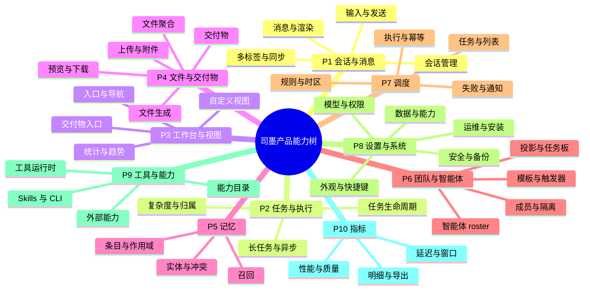

# 司墨产品功能树（TREE）

> 状态：**active**（2026-11-20，P1–P10 产品域底座）
> L0 产品 → L1 能力域 P1–P10 → L2 场景/模块 → L3 功能点（PRD）。
> ID 规则见 [`ID-SPEC.md`](ID-SPEC.md)；三列追溯见 [`TRACEABILITY.md`](TRACEABILITY.md)；缺口见 [`SPEC-GAP.md`](SPEC-GAP.md)。
> **诚实口径**：本树区分 `implemented`（有验收/可运行）、`partial`（有能力但不完整/缺证据）、`unimplemented`（无实现或只有设计）。接口存在不等于产品完成。
> **Backlog**：`unimplemented` 状态列已链接 [`BACKLOG.md`](BACKLOG.md)；backlog 是待办清单，不代表排期、实现或验收。

## 1. 能力树

## 2. 域总览

| 域 | 名称 | 技术域码 | L2 | L3 | implemented | partial | unimplemented | 产品 spec | TEST |
|---|---|---|---:|---:|---:|---:|---:|---|---|
| [`P1`](#p1) | 会话与消息 | `CONV`/`SYNC` | 5 | 13 | 12 | 0 | 1 | [spec](../../specs/product/P1-CONV/spec.md) | [test](../../specs/test/P1-CONV/test-plan.md) |
| [`P2`](#p2) | 任务与执行 | `TASK` | 3 | 6 | 0 | 3 | 3 | [spec](../../specs/product/P2-TASK/spec.md) | [test](../../specs/test/P2-TASK/test-plan.md) |
| [`P3`](#p3) | 工作台与视图 | `WORK` | 4 | 5 | 3 | 1 | 1 | [spec](../../specs/product/P3-WORK/spec.md) | [test](../../specs/test/P3-WORK/test-plan.md) |
| [`P4`](#p4) | 文件与交付物 | `FILE` | 5 | 6 | 1 | 5 | 0 | [spec](../../specs/product/P4-FILE/spec.md) | [test](../../specs/test/P4-FILE/test-plan.md) |
| [`P5`](#p5) | 记忆 | `MEM` | 3 | 6 | 0 | 5 | 1 | [spec](../../specs/product/P5-MEM/spec.md) | [test](../../specs/test/P5-MEM/test-plan.md) |
| [`P6`](#p6) | 团队与智能体 | `TEAM` | 4 | 6 | 0 | 4 | 2 | [spec](../../specs/product/P6-TEAM/spec.md) | [test](../../specs/test/P6-TEAM/test-plan.md) |
| [`P7`](#p7) | 调度 | `SCHED` | 4 | 5 | 0 | 4 | 1 | [spec](../../specs/product/P7-SCHED/spec.md) | [test](../../specs/test/P7-SCHED/test-plan.md) |
| [`P8`](#p8) | 设置与系统 | `SET`/`SYS` | 5 | 12 | 1 | 8 | 3 | [spec](../../specs/product/P8-SET/spec.md) | [test](../../specs/test/P8-SET/test-plan.md) |
| [`P9`](#p9) | 工具与能力 | `TOOL` | 4 | 7 | 0 | 4 | 3 | [spec](../../specs/product/P9-TOOL/spec.md) | [test](../../specs/test/P9-TOOL/test-plan.md) |
| [`P10`](#p10) | 指标 | `METRIC` | 3 | 6 | 3 | 2 | 1 | [spec](../../specs/product/P10-METRIC/spec.md) | [test](../../specs/test/P10-METRIC/test-plan.md) |
| **合计** | — | 12 个技术域码 | **40** | **72** | **20** | **36** | **16** | **10/10** | **10/10** |

> 覆盖口径（2026-11-22 P1 收口后）：全仓 72 个 PRD = **11 covered / 38 partial / 23 gap**；P1 = **11 / 1 / 1**（conditional 计入 partial，`SYNC-005` 保持 gap）。上表 implemented / partial / unimplemented 三列统计实现状态，与覆盖状态分轴，故 P1 仍为 12 / 0 / 1；覆盖状态以各 PRD 行的“覆盖”列为准。

## 3. L2 / L3 功能点

### P1 · 会话与消息

范围：会话树、消息流、发送/流式、输入、时间轴、未读；并含 `SYNC` 的跨域边界。

证据（2026-11-22 收口）：33 条生效 AC = **32 通过 / 1 部分**（`AC-CONV-006-02` 中文输入法待人工）；`SYNC-005` 2 条 `blocked` 仅登记、不计入生效面。P1 覆盖 **11 covered / 1 conditional / 0 not covered / 1 gap**（验收面 12 = `CONV-001..008` + `SYNC-001..004`：`CONV-006` conditional（IME 待人工）；`CONV-005` 已闭环，停止按消息定向、双流只停目标（`stop_interrupt_test.go:402`）；`CONV-008` 已闭环，真机 304 已补；`SYNC-005` 排除、保持 gap）。逐项见 [STOP-EVIDENCE-2](../testing/STOP-EVIDENCE-2-20261122.md)、[第八轮验收](../testing/ACCEPT-CONV-8-20261122.md)、[test-plan](../../specs/test/P1-CONV/test-plan.md) 与 [CONV-CLOSURE](CONV-CLOSURE.md)。

#### L2 · 会话管理

场景 A / B：会话导航与生命周期（树加载、选中/新建、重命名、归档/恢复、归档只读）；搜索与未读。

| PRD | L3 功能点 | P | 实现状态 | 覆盖 | 产品 spec | CHANGE | 开发 | COMP | TEST |
|---|---|---|---|---|---|---|---|---|---|
| `PRD-CONV-001` | 会话树与主会话 | P0 | `implemented` | `covered` | [spec](../../specs/product/P1-CONV/spec.md#prd-conv-001) | [CHG-CONV-001](../../specs/changes/CHG-CONV-001/spec.md) | [FE-001](../../specs/FE-001-frontend-rebuild/spec.md) / [FE-003](../../specs/FE-003-chat-capabilities/spec.md) / [M1](../m1-contract.md) | — | [TC-P1-001](../../specs/test/P1-CONV/test-plan.md#tc-p1-001) |
| `PRD-CONV-002` | 会话生命周期 | P0 | `implemented` | `covered` | [spec](../../specs/product/P1-CONV/spec.md#prd-conv-002) | [CHG-CONV-001](../../specs/changes/CHG-CONV-001/spec.md) | [FE-001](../../specs/FE-001-frontend-rebuild/spec.md) / [FE-003](../../specs/FE-003-chat-capabilities/spec.md) / [FE-004](../../specs/FE-004-first-run-empty/spec.md) / [M1](../m1-contract.md) | — | [TC-P1-002](../../specs/test/P1-CONV/test-plan.md#tc-p1-002) |
| `PRD-CONV-003` | 会话搜索与未读 | P1 | `implemented` | `covered` | [spec](../../specs/product/P1-CONV/spec.md#prd-conv-003) | [CHG-CONV-001](../../specs/changes/CHG-CONV-001/spec.md) | [FE-003](../../specs/FE-003-chat-capabilities/spec.md) / [M1](../m1-contract.md) | — | [TC-P1-003](../../specs/test/P1-CONV/test-plan.md#tc-p1-003) |

#### L2 · 消息与渲染

场景 C：消息渲染与祖先（角色/分类/Markdown/复制/流式/失败/卡片只读/祖先逐级/时间轴）。

| PRD | L3 功能点 | P | 实现状态 | 覆盖 | 产品 spec | CHANGE | 开发 | COMP | TEST |
|---|---|---|---|---|---|---|---|---|---|
| `PRD-CONV-004` | 消息流与渲染 | P0 | `implemented` | `covered` | [spec](../../specs/product/P1-CONV/spec.md#prd-conv-004) | [CHG-CONV-002](../../specs/changes/CHG-CONV-002/spec.md) | [FE-001](../../specs/FE-001-frontend-rebuild/spec.md) / [FE-003](../../specs/FE-003-chat-capabilities/spec.md) / [M1](../m1-contract.md) / [M14](../m14-contract.md) | [COMP-message-colors](../../specs/COMP-message-colors/spec.md) | [TC-P1-004](../../specs/test/P1-CONV/test-plan.md#tc-p1-004) |
| `PRD-CONV-007` | 祖先消息整级加载 | P1 | `implemented` | `covered` | [spec](../../specs/product/P1-CONV/spec.md#prd-conv-007) | [CHG-CONV-002](../../specs/changes/CHG-CONV-002/spec.md) | [FE-007](../../specs/FE-007-ancestor-messages/spec.md) / [M1](../m1-contract.md) / [M14](../m14-contract.md) | [COMP-timeline-groups](../../specs/COMP-timeline-groups/spec.md) / [COMP-timeline-tip](../../specs/COMP-timeline-tip/spec.md) | [TC-P1-005](../../specs/test/P1-CONV/test-plan.md#tc-p1-005) |

#### L2 · 输入与发送

场景 D：输入与发送（快捷键/IME/失败重试/防重复/停止/归档禁用）。

| PRD | L3 功能点 | P | 实现状态 | 覆盖 | 产品 spec | CHANGE | 开发 | COMP | TEST |
|---|---|---|---|---|---|---|---|---|---|
| `PRD-CONV-005` | 发送·流式·断线重连 | P0 | `implemented` | `covered`（停止按消息定向：`correct` 帧带 `messageId`，双流只停目标，见 `stop_interrupt_test.go:402`） | [spec](../../specs/product/P1-CONV/spec.md#prd-conv-005) | [CHG-CONV-003](../../specs/changes/CHG-CONV-003/spec.md) | [FE-002](../../specs/FE-002-chat-robustness/spec.md) / [M1](../m1-contract.md) | — | [TC-P1-006](../../specs/test/P1-CONV/test-plan.md#tc-p1-006) |
| `PRD-CONV-006` | Composer 输入与快捷键 | P0 | `implemented` | `partial`（conditional：仅差 `AC-CONV-006-02` 中文输入法人工验证） | [spec](../../specs/product/P1-CONV/spec.md#prd-conv-006) | [CHG-CONV-003](../../specs/changes/CHG-CONV-003/spec.md) | [FE-006](../../specs/FE-006-chat-experience/spec.md) / [M1](../m1-contract.md) | [COMP-composer-send-mode](../../specs/COMP-composer-send-mode/spec.md) | [TC-P1-007](../../specs/test/P1-CONV/test-plan.md#tc-p1-007) |

#### L2 · 多标签与同步

场景 E：实时同步与多标签（WS 三态、`since` 回放、active/ancestor/read 广播、设置同步）。

| PRD | L3 功能点 | P | 实现状态 | 覆盖 | 产品 spec | CHANGE | 开发 | COMP | TEST |
|---|---|---|---|---|---|---|---|---|---|
| `PRD-SYNC-001` | WS 连接与重连 | P0 | `implemented` | `covered` | [spec](../../specs/product/P1-CONV/spec.md#prd-sync-001) | [CHG-CONV-004](../../specs/changes/CHG-CONV-004/spec.md) | [FE-002](../../specs/FE-002-chat-robustness/spec.md) / [M1](../m1-contract.md) | — | [TC-P1-008](../../specs/test/P1-CONV/test-plan.md#tc-p1-008) |
| `PRD-SYNC-002` | 多标签 active/ancestor/read cursor | P0 | `implemented` | `covered` | [spec](../../specs/product/P1-CONV/spec.md#prd-sync-002) | [CHG-CONV-004](../../specs/changes/CHG-CONV-004/spec.md) | [FE-009](../../specs/FE-009-web-multitab/spec.md) / [M1](../m1-contract.md) | — | [TC-P1-009](../../specs/test/P1-CONV/test-plan.md#tc-p1-009) |
| `PRD-SYNC-003` | 发送模式/设置跨标签同步 | P1 | `implemented` | `covered` | [spec](../../specs/product/P1-CONV/spec.md#prd-sync-003) | [CHG-CONV-004](../../specs/changes/CHG-CONV-004/spec.md) | [FE-006](../../specs/FE-006-chat-experience/spec.md) / [M1](../m1-contract.md) | [COMP-composer-send-mode](../../specs/COMP-composer-send-mode/spec.md) | [TC-P1-010](../../specs/test/P1-CONV/test-plan.md#tc-p1-010) |
| `PRD-SYNC-004` | 未读与已读游标 | P1 | `implemented` | `covered` | [spec](../../specs/product/P1-CONV/spec.md#prd-sync-004) | [CHG-CONV-005](../../specs/changes/CHG-CONV-005/spec.md) | [FE-003](../../specs/FE-003-chat-capabilities/spec.md) / [M1](../m1-contract.md) | — | [TC-P1-011](../../specs/test/P1-CONV/test-plan.md#tc-p1-011) |
| `PRD-SYNC-005` | 远程访问与通知中心 | P2 | `unimplemented` · [backlog](BACKLOG.md) | `gap` | [spec](../../specs/product/P1-CONV/spec.md#prd-sync-005) | [CHG-CONV-005](../../specs/changes/CHG-CONV-005/spec.md) | — | — | [TC-P1-012](../../specs/test/P1-CONV/test-plan.md#tc-p1-012) |

#### L2 · 右栏会话投影

场景 F：右栏会话投影（目标/输入/状态、任务组、交付物只读、加载/错误/重试/空态、展开折叠、`messageId` 定位）。

| PRD | L3 功能点 | P | 实现状态 | 覆盖 | 产品 spec | CHANGE | 开发 | COMP | TEST |
|---|---|---|---|---|---|---|---|---|---|
| `PRD-CONV-008` | 右栏会话投影（新增） | P1 | `implemented` | `covered`（375 四态截图与真机 304 已补，见 [ACCEPT-CONV-8](../testing/ACCEPT-CONV-8-20261122.md)） | [spec](../../specs/product/P1-CONV/spec.md#prd-conv-008) | [CHG-CONV-006](../../specs/changes/CHG-CONV-006/proposal.md) | [FE-001](../../specs/FE-001-frontend-rebuild/spec.md) / [M1](../m1-contract.md) | — | [TC-P1-CONV-008](../../specs/test/P1-CONV/test-plan.md#tc-p1-conv-008) |

### P2 · 任务与执行

范围：任务生命周期、执行组、复杂度/确认、子会话、取消/重试、预算

#### L2 · 任务生命周期

| PRD | L3 功能点 | P | 状态 | 产品 spec | CHANGE | 开发 | COMP | TEST |
|---|---|---|---|---|---|---|---|---|
| `PRD-TASK-001` | 任务生命周期与执行组 | P0 | `partial` | [spec](../../specs/product/P2-TASK/spec.md#prd-task-001) | — | [M1](../m1-contract.md) / [M10](../m10-contract.md) | — | [TC-P2-001](../../specs/test/P2-TASK/test-plan.md#tc-p2-001) |
| `PRD-TASK-002` | 任务概览与进度 | P0 | `partial` | [spec](../../specs/product/P2-TASK/spec.md#prd-task-002) | — | [M14](../m14-contract.md) / [M18](../m18-contract.md) | — | [TC-P2-002](../../specs/test/P2-TASK/test-plan.md#tc-p2-002) |

#### L2 · 长任务与异步

| PRD | L3 功能点 | P | 状态 | 产品 spec | CHANGE | 开发 | COMP | TEST |
|---|---|---|---|---|---|---|---|---|
| `PRD-TASK-003` | 长任务异步与开始/结束消息 | P0 | `unimplemented` · [backlog](BACKLOG.md) | [spec](../../specs/product/P2-TASK/spec.md#prd-task-003) | — | [M19](../m19-contract.md) | — | [TC-P2-003](../../specs/test/P2-TASK/test-plan.md#tc-p2-003) |
| `PRD-TASK-006` | 取消·重试·预算·恢复 | P1 | `partial` | [spec](../../specs/product/P2-TASK/spec.md#prd-task-006) | — | [M19](../m19-contract.md) | — | [TC-P2-004](../../specs/test/P2-TASK/test-plan.md#tc-p2-004) |

#### L2 · 复杂度与归属

| PRD | L3 功能点 | P | 状态 | 产品 spec | CHANGE | 开发 | COMP | TEST |
|---|---|---|---|---|---|---|---|---|
| `PRD-TASK-004` | 复杂度分级与确认门禁 | P0 | `unimplemented` · [backlog](BACKLOG.md) | [spec](../../specs/product/P2-TASK/spec.md#prd-task-004) | — | [M10](../m10-contract.md) | — | [TC-P2-005](../../specs/test/P2-TASK/test-plan.md#tc-p2-005) |
| `PRD-TASK-005` | 子会话与任务归属 | P0 | `unimplemented` · [backlog](BACKLOG.md) | [spec](../../specs/product/P2-TASK/spec.md#prd-task-005) | — | [M1](../m1-contract.md) / [M10](../m10-contract.md) | — | [TC-P2-006](../../specs/test/P2-TASK/test-plan.md#tc-p2-006) |

### P3 · 工作台与视图

范围：工作台、统计卡、趋势、交付物入口、自定义视图

#### L2 · 入口与导航

| PRD | L3 功能点 | P | 状态 | 产品 spec | CHANGE | 开发 | COMP | TEST |
|---|---|---|---|---|---|---|---|---|
| `PRD-WORK-001` | 双页导航与工作台入口 | P0 | `implemented` | [spec](../../specs/product/P3-WORK/spec.md#prd-work-001) | [FE-001](../../specs/FE-001-frontend-rebuild/spec.md) / [FE-005](../../specs/FE-005-workbench/spec.md) | [FE-001](../../specs/FE-001-frontend-rebuild/spec.md) / [FE-005](../../specs/FE-005-workbench/spec.md) / [M1](../m1-contract.md) | — | [TC-P3-001](../../specs/test/P3-WORK/test-plan.md#tc-p3-001) |

#### L2 · 统计与趋势

| PRD | L3 功能点 | P | 状态 | 产品 spec | CHANGE | 开发 | COMP | TEST |
|---|---|---|---|---|---|---|---|---|
| `PRD-WORK-002` | 用量与统计卡 | P0 | `implemented` | [spec](../../specs/product/P3-WORK/spec.md#prd-work-002) | [FE-005](../../specs/FE-005-workbench/spec.md) | [FE-005](../../specs/FE-005-workbench/spec.md) / [M1](../m1-contract.md) | — | [TC-P3-002](../../specs/test/P3-WORK/test-plan.md#tc-p3-002) |
| `PRD-WORK-003` | 每日趋势与最近活动 | P1 | `implemented` | [spec](../../specs/product/P3-WORK/spec.md#prd-work-003) | [FE-005](../../specs/FE-005-workbench/spec.md) | [FE-005](../../specs/FE-005-workbench/spec.md) / [M1](../m1-contract.md) | — | [TC-P3-003](../../specs/test/P3-WORK/test-plan.md#tc-p3-003) |

#### L2 · 交付物入口

| PRD | L3 功能点 | P | 状态 | 产品 spec | CHANGE | 开发 | COMP | TEST |
|---|---|---|---|---|---|---|---|---|
| `PRD-WORK-004` | 工作台交付物与三态 | P0 | `partial` | [spec](../../specs/product/P3-WORK/spec.md#prd-work-004) | [FE-004](../../specs/FE-004-first-run-empty/spec.md) / [FE-005](../../specs/FE-005-workbench/spec.md) | [FE-004](../../specs/FE-004-first-run-empty/spec.md) / [FE-005](../../specs/FE-005-workbench/spec.md) / [M11](../m11-contract.md) | — | [TC-P3-004](../../specs/test/P3-WORK/test-plan.md#tc-p3-004) |

#### L2 · 自定义视图

| PRD | L3 功能点 | P | 状态 | 产品 spec | CHANGE | 开发 | COMP | TEST |
|---|---|---|---|---|---|---|---|---|
| `PRD-WORK-005` | 自定义视图 13 类块 | P1 | `unimplemented` · [backlog](BACKLOG.md) | [spec](../../specs/product/P3-WORK/spec.md#prd-work-005) | — | [M24](../m24-view-contract.md) | — | [TC-P3-005](../../specs/test/P3-WORK/test-plan.md#tc-p3-005) |

### P4 · 文件与交付物

范围：会话文件、上传/附件、交付物、预览/下载、工作区输出、文件生成

#### L2 · 文件聚合

| PRD | L3 功能点 | P | 状态 | 产品 spec | CHANGE | 开发 | COMP | TEST |
|---|---|---|---|---|---|---|---|---|
| `PRD-FILE-001` | 会话文件聚合与列表 | P0 | `partial` | [spec](../../specs/product/P4-FILE/spec.md#prd-file-001) | — | [M11](../m11-contract.md) | — | [TC-P4-001](../../specs/test/P4-FILE/test-plan.md#tc-p4-001) |
| `PRD-FILE-005` | 工作区目录与输出隔离 | P1 | `partial` | [spec](../../specs/product/P4-FILE/spec.md#prd-file-005) | — | [M11](../m11-contract.md) | — | [TC-P4-002](../../specs/test/P4-FILE/test-plan.md#tc-p4-002) |

#### L2 · 上传与附件

| PRD | L3 功能点 | P | 状态 | 产品 spec | CHANGE | 开发 | COMP | TEST |
|---|---|---|---|---|---|---|---|---|
| `PRD-FILE-002` | 上传与附件 | P0 | `partial` | [spec](../../specs/product/P4-FILE/spec.md#prd-file-002) | — | [M8](../m8-contract.md) / [M11](../m11-contract.md) | — | [TC-P4-003](../../specs/test/P4-FILE/test-plan.md#tc-p4-003) |

#### L2 · 交付物

| PRD | L3 功能点 | P | 状态 | 产品 spec | CHANGE | 开发 | COMP | TEST |
|---|---|---|---|---|---|---|---|---|
| `PRD-FILE-003` | 交付物卡片与列表 | P0 | `implemented` | [spec](../../specs/product/P4-FILE/spec.md#prd-file-003) | [FE-003](../../specs/FE-003-chat-capabilities/spec.md) / [FE-005](../../specs/FE-005-workbench/spec.md) | [FE-003](../../specs/FE-003-chat-capabilities/spec.md) / [FE-005](../../specs/FE-005-workbench/spec.md) / [M11](../m11-contract.md) | — | [TC-P4-004](../../specs/test/P4-FILE/test-plan.md#tc-p4-004) |

#### L2 · 预览与下载

| PRD | L3 功能点 | P | 状态 | 产品 spec | CHANGE | 开发 | COMP | TEST |
|---|---|---|---|---|---|---|---|---|
| `PRD-FILE-004` | 预览与下载 | P0 | `partial` | [spec](../../specs/product/P4-FILE/spec.md#prd-file-004) | [FE-005](../../specs/FE-005-workbench/spec.md) | [FE-005](../../specs/FE-005-workbench/spec.md) / [M11](../m11-contract.md) / [M12](../m12-contract.md) | — | [TC-P4-005](../../specs/test/P4-FILE/test-plan.md#tc-p4-005) |

#### L2 · 文件生成

| PRD | L3 功能点 | P | 状态 | 产品 spec | CHANGE | 开发 | COMP | TEST |
|---|---|---|---|---|---|---|---|---|
| `PRD-FILE-006` | 文件生成（PDF/Office/图片） | P1 | `partial` | [spec](../../specs/product/P4-FILE/spec.md#prd-file-006) | — | [M12](../m12-contract.md) | — | [TC-P4-006](../../specs/test/P4-FILE/test-plan.md#tc-p4-006) |

### P5 · 记忆

范围：条目/作用域、实体/关系、冲突、召回、向量/巩固、迁移

#### L2 · 条目与作用域

| PRD | L3 功能点 | P | 状态 | 产品 spec | CHANGE | 开发 | COMP | TEST |
|---|---|---|---|---|---|---|---|---|
| `PRD-MEM-001` | 记忆条目·作用域·搜索 | P1 | `partial` | [spec](../../specs/product/P5-MEM/spec.md#prd-mem-001) | [CHG-LEGACY-P5-MEM](../../specs/changes/CHG-LEGACY-P5-MEM/spec.md) | [M3](../m3-contract.md) / [M21](../m21-memory-contract.md) | — | [TC-P5-001](../../specs/test/P5-MEM/test-plan.md#tc-p5-001) |
| `PRD-MEM-006` | 记忆迁移与索引 | P2 | `unimplemented` · [backlog](BACKLOG.md) | [spec](../../specs/product/P5-MEM/spec.md#prd-mem-006) | [CHG-LEGACY-P5-MEM](../../specs/changes/CHG-LEGACY-P5-MEM/spec.md) | [M21](../m21-memory-contract.md) | — | [TC-P5-002](../../specs/test/P5-MEM/test-plan.md#tc-p5-002) |

#### L2 · 实体与冲突

| PRD | L3 功能点 | P | 状态 | 产品 spec | CHANGE | 开发 | COMP | TEST |
|---|---|---|---|---|---|---|---|---|
| `PRD-MEM-002` | 实体·关系·金字塔 | P1 | `partial` | [spec](../../specs/product/P5-MEM/spec.md#prd-mem-002) | [CHG-LEGACY-P5-MEM](../../specs/changes/CHG-LEGACY-P5-MEM/spec.md) | [M21](../m21-memory-contract.md) | — | [TC-P5-003](../../specs/test/P5-MEM/test-plan.md#tc-p5-003) |
| `PRD-MEM-003` | 冲突与争议保留 | P1 | `partial` | [spec](../../specs/product/P5-MEM/spec.md#prd-mem-003) | [CHG-LEGACY-P5-MEM](../../specs/changes/CHG-LEGACY-P5-MEM/spec.md) | [M21](../m21-memory-contract.md) | — | [TC-P5-004](../../specs/test/P5-MEM/test-plan.md#tc-p5-004) |

#### L2 · 召回

| PRD | L3 功能点 | P | 状态 | 产品 spec | CHANGE | 开发 | COMP | TEST |
|---|---|---|---|---|---|---|---|---|
| `PRD-MEM-004` | 召回 R1/R2 | P1 | `partial` | [spec](../../specs/product/P5-MEM/spec.md#prd-mem-004) | [CHG-LEGACY-P5-MEM](../../specs/changes/CHG-LEGACY-P5-MEM/spec.md) | [M22](../m22-recall-contract.md) | — | [TC-P5-005](../../specs/test/P5-MEM/test-plan.md#tc-p5-005) |
| `PRD-MEM-005` | 向量召回与巩固 | P2 | `partial` | [spec](../../specs/product/P5-MEM/spec.md#prd-mem-005) | [CHG-LEGACY-P5-MEM](../../specs/changes/CHG-LEGACY-P5-MEM/spec.md) | [M22](../m22-recall-contract.md) | — | [TC-P5-006](../../specs/test/P5-MEM/test-plan.md#tc-p5-006) |

### P6 · 团队与智能体

范围：智能体 roster、团队/成员、模板/触发器、投影、内部隔离、任务板

#### L2 · 智能体 roster

| PRD | L3 功能点 | P | 状态 | 产品 spec | CHANGE | 开发 | COMP | TEST |
|---|---|---|---|---|---|---|---|---|
| `PRD-TEAM-001` | 智能体 roster 与模型 | P1 | `partial` | [spec](../../specs/product/P6-TEAM/spec.md#prd-team-001) | [CHG-LEGACY-P6-TEAM](../../specs/changes/CHG-LEGACY-P6-TEAM/spec.md) | [TEAM](../team-contract.md) | — | [TC-P6-001](../../specs/test/P6-TEAM/test-plan.md#tc-p6-001) |

#### L2 · 成员与隔离

| PRD | L3 功能点 | P | 状态 | 产品 spec | CHANGE | 开发 | COMP | TEST |
|---|---|---|---|---|---|---|---|---|
| `PRD-TEAM-002` | 团队成员=子会话+负责人 | P1 | `partial` | [spec](../../specs/product/P6-TEAM/spec.md#prd-team-002) | [CHG-LEGACY-P6-TEAM](../../specs/changes/CHG-LEGACY-P6-TEAM/spec.md) | [TEAM](../team-contract.md) | — | [TC-P6-002](../../specs/test/P6-TEAM/test-plan.md#tc-p6-002) |
| `PRD-TEAM-005` | 团队内部消息隔离 | P0 | `partial` | [spec](../../specs/product/P6-TEAM/spec.md#prd-team-005) | [CHG-LEGACY-P6-TEAM](../../specs/changes/CHG-LEGACY-P6-TEAM/spec.md) | [TEAM](../team-contract.md) | — | [TC-P6-003](../../specs/test/P6-TEAM/test-plan.md#tc-p6-003) |

#### L2 · 模板与触发器

| PRD | L3 功能点 | P | 状态 | 产品 spec | CHANGE | 开发 | COMP | TEST |
|---|---|---|---|---|---|---|---|---|
| `PRD-TEAM-003` | 团队模板·角色·触发器 | P1 | `partial` | [spec](../../specs/product/P6-TEAM/spec.md#prd-team-003) | [CHG-LEGACY-P6-TEAM](../../specs/changes/CHG-LEGACY-P6-TEAM/spec.md) | [M10](../m10-contract.md) / [TEAM](../team-contract.md) | — | [TC-P6-004](../../specs/test/P6-TEAM/test-plan.md#tc-p6-004) |

#### L2 · 投影与任务板

| PRD | L3 功能点 | P | 状态 | 产品 spec | CHANGE | 开发 | COMP | TEST |
|---|---|---|---|---|---|---|---|---|
| `PRD-TEAM-004` | 团队只读投影与对话创建 | P1 | `unimplemented` · [backlog](BACKLOG.md) | [spec](../../specs/product/P6-TEAM/spec.md#prd-team-004) | [CHG-LEGACY-P6-TEAM](../../specs/changes/CHG-LEGACY-P6-TEAM/spec.md) | [TEAM](../team-contract.md) | — | [TC-P6-005](../../specs/test/P6-TEAM/test-plan.md#tc-p6-005) |
| `PRD-TEAM-006` | 子代理并行与团队任务板 | P2 | `unimplemented` · [backlog](BACKLOG.md) | [spec](../../specs/product/P6-TEAM/spec.md#prd-team-006) | [CHG-LEGACY-P6-TEAM](../../specs/changes/CHG-LEGACY-P6-TEAM/spec.md) | [M10](../m10-contract.md) | — | [TC-P6-006](../../specs/test/P6-TEAM/test-plan.md#tc-p6-006) |

### P7 · 调度

范围：定时任务、重跑、重复规则、失败/通知

#### L2 · 任务与列表

| PRD | L3 功能点 | P | 状态 | 产品 spec | CHANGE | 开发 | COMP | TEST |
|---|---|---|---|---|---|---|---|---|
| `PRD-SCHED-001` | 定时任务 CRUD | P1 | `partial` | [spec](../../specs/product/P7-SCHED/spec.md#prd-sched-001) | [CHG-LEGACY-P7-SCHED](../../specs/changes/CHG-LEGACY-P7-SCHED/spec.md) | [M13](../m13-contract.md) | — | [TC-P7-001](../../specs/test/P7-SCHED/test-plan.md#tc-p7-001) |
| `PRD-SCHED-002` | 列表与下次运行时间 | P1 | `partial` | [spec](../../specs/product/P7-SCHED/spec.md#prd-sched-002) | [CHG-LEGACY-P7-SCHED](../../specs/changes/CHG-LEGACY-P7-SCHED/spec.md) | [M13](../m13-contract.md) | — | [TC-P7-002](../../specs/test/P7-SCHED/test-plan.md#tc-p7-002) |

#### L2 · 执行与幂等

| PRD | L3 功能点 | P | 状态 | 产品 spec | CHANGE | 开发 | COMP | TEST |
|---|---|---|---|---|---|---|---|---|
| `PRD-SCHED-003` | 立即运行与幂等 | P1 | `partial` | [spec](../../specs/product/P7-SCHED/spec.md#prd-sched-003) | [CHG-LEGACY-P7-SCHED](../../specs/changes/CHG-LEGACY-P7-SCHED/spec.md) | [M13](../m13-contract.md) | — | [TC-P7-003](../../specs/test/P7-SCHED/test-plan.md#tc-p7-003) |

#### L2 · 规则与时区

| PRD | L3 功能点 | P | 状态 | 产品 spec | CHANGE | 开发 | COMP | TEST |
|---|---|---|---|---|---|---|---|---|
| `PRD-SCHED-004` | 重复规则与时区 | P1 | `partial` | [spec](../../specs/product/P7-SCHED/spec.md#prd-sched-004) | [CHG-LEGACY-P7-SCHED](../../specs/changes/CHG-LEGACY-P7-SCHED/spec.md) | [M13](../m13-contract.md) | — | [TC-P7-004](../../specs/test/P7-SCHED/test-plan.md#tc-p7-004) |

#### L2 · 失败与通知

| PRD | L3 功能点 | P | 状态 | 产品 spec | CHANGE | 开发 | COMP | TEST |
|---|---|---|---|---|---|---|---|---|
| `PRD-SCHED-005` | 失败·重试·通知 | P2 | `unimplemented` · [backlog](BACKLOG.md) | [spec](../../specs/product/P7-SCHED/spec.md#prd-sched-005) | [CHG-LEGACY-P7-SCHED](../../specs/changes/CHG-LEGACY-P7-SCHED/spec.md) | [M13](../m13-contract.md) | — | [TC-P7-005](../../specs/test/P7-SCHED/test-plan.md#tc-p7-005) |

### P8 · 设置与系统

范围：模型/Provider、权限、外观、数据目录/备份、快捷键、能力管理；并含 `SYS` 的跨域边界。

#### L2 · 模型与权限

| PRD | L3 功能点 | P | 状态 | 产品 spec | CHANGE | 开发 | COMP | TEST |
|---|---|---|---|---|---|---|---|---|
| `PRD-SET-001` | 模型与 Provider | P0 | `partial` | [spec](../../specs/product/P8-SET/spec.md#prd-set-001) | [CHG-LEGACY-P8-SET](../../specs/changes/CHG-LEGACY-P8-SET/spec.md) | [M2](../m2-contract.md) | — | [TC-P8-001](../../specs/test/P8-SET/test-plan.md#tc-p8-001) |
| `PRD-SET-002` | 权限·沙盒·审批 | P0 | `partial` | [spec](../../specs/product/P8-SET/spec.md#prd-set-002) | [CHG-LEGACY-P8-SET](../../specs/changes/CHG-LEGACY-P8-SET/spec.md) | [M9](../m9-contract.md) | — | [TC-P8-002](../../specs/test/P8-SET/test-plan.md#tc-p8-002) |

#### L2 · 外观与快捷键

| PRD | L3 功能点 | P | 状态 | 产品 spec | CHANGE | 开发 | COMP | TEST |
|---|---|---|---|---|---|---|---|---|
| `PRD-SET-003` | 外观·主题·语言 | P2 | `unimplemented` · [backlog](BACKLOG.md) | [spec](../../specs/product/P8-SET/spec.md#prd-set-003) | [CHG-LEGACY-P8-SET](../../specs/changes/CHG-LEGACY-P8-SET/spec.md) | — | — | [TC-P8-003](../../specs/test/P8-SET/test-plan.md#tc-p8-003) |
| `PRD-SET-005` | 快捷键·关于·版本 | P2 | `unimplemented` · [backlog](BACKLOG.md) | [spec](../../specs/product/P8-SET/spec.md#prd-set-005) | [CHG-LEGACY-P8-SET](../../specs/changes/CHG-LEGACY-P8-SET/spec.md) | — | — | [TC-P8-004](../../specs/test/P8-SET/test-plan.md#tc-p8-004) |

#### L2 · 数据与能力

| PRD | L3 功能点 | P | 状态 | 产品 spec | CHANGE | 开发 | COMP | TEST |
|---|---|---|---|---|---|---|---|---|
| `PRD-SET-004` | 数据目录·备份·恢复 | P1 | `partial` | [spec](../../specs/product/P8-SET/spec.md#prd-set-004) | [CHG-LEGACY-P8-SET](../../specs/changes/CHG-LEGACY-P8-SET/spec.md) | [M1](../m1-contract.md) | — | [TC-P8-005](../../specs/test/P8-SET/test-plan.md#tc-p8-005) |
| `PRD-SET-006` | 能力管理（MCP/CLI/Skills/目录） | P2 | `unimplemented` · [backlog](BACKLOG.md) | [spec](../../specs/product/P8-SET/spec.md#prd-set-006) | [CHG-LEGACY-P8-SET](../../specs/changes/CHG-LEGACY-P8-SET/spec.md) | [M9](../m9-contract.md) | — | [TC-P8-006](../../specs/test/P8-SET/test-plan.md#tc-p8-006) |

#### L2 · 安全与备份

| PRD | L3 功能点 | P | 状态 | 产品 spec | CHANGE | 开发 | COMP | TEST |
|---|---|---|---|---|---|---|---|---|
| `PRD-SYS-001` | 本地单用户与鉴权边界 | P0 | `partial` | [spec](../../specs/product/P8-SET/spec.md#prd-sys-001) | [CHG-LEGACY-P8-SET](../../specs/changes/CHG-LEGACY-P8-SET/spec.md) | [M1](../m1-contract.md) | — | [TC-P8-007](../../specs/test/P8-SET/test-plan.md#tc-p8-007) |
| `PRD-SYS-002` | 权限 fail-closed | P1 | `partial` | [spec](../../specs/product/P8-SET/spec.md#prd-sys-002) | [CHG-LEGACY-P8-SET](../../specs/changes/CHG-LEGACY-P8-SET/spec.md) | [M9](../m9-contract.md) | — | [TC-P8-008](../../specs/test/P8-SET/test-plan.md#tc-p8-008) |
| `PRD-SYS-004` | 数据备份·迁移·回滚 | P0 | `partial` | [spec](../../specs/product/P8-SET/spec.md#prd-sys-004) | [CHG-LEGACY-P8-SET](../../specs/changes/CHG-LEGACY-P8-SET/spec.md) | [M1](../m1-contract.md) | — | [TC-P8-009](../../specs/test/P8-SET/test-plan.md#tc-p8-009) |

#### L2 · 运维与安装

| PRD | L3 功能点 | P | 状态 | 产品 spec | CHANGE | 开发 | COMP | TEST |
|---|---|---|---|---|---|---|---|---|
| `PRD-SYS-003` | 健康检查与运行时状态 | P1 | `implemented` | [spec](../../specs/product/P8-SET/spec.md#prd-sys-003) | [CHG-LEGACY-P8-SET](../../specs/changes/CHG-LEGACY-P8-SET/spec.md) | [M1](../m1-contract.md) | — | [TC-P8-010](../../specs/test/P8-SET/test-plan.md#tc-p8-010) |
| `PRD-SYS-005` | 日志与审计 | P1 | `partial` | [spec](../../specs/product/P8-SET/spec.md#prd-sys-005) | [CHG-LEGACY-P8-SET](../../specs/changes/CHG-LEGACY-P8-SET/spec.md) | [M9](../m9-contract.md) | — | [TC-P8-011](../../specs/test/P8-SET/test-plan.md#tc-p8-011) |
| `PRD-SYS-006` | 安装·升级·便携包 | P1 | `partial` | [spec](../../specs/product/P8-SET/spec.md#prd-sys-006) | [CHG-LEGACY-P8-SET](../../specs/changes/CHG-LEGACY-P8-SET/spec.md) | [M1](../m1-contract.md) | — | [TC-P8-012](../../specs/test/P8-SET/test-plan.md#tc-p8-012) |

### P9 · 工具与能力

范围：工具注册/执行/审计、权限沙箱、Skills、MCP、CLI、联网、能力目录

#### L2 · 工具运行时

| PRD | L3 功能点 | P | 状态 | 产品 spec | CHANGE | 开发 | COMP | TEST |
|---|---|---|---|---|---|---|---|---|
| `PRD-TOOL-001` | 工具注册·执行·审计 | P0 | `partial` | [spec](../../specs/product/P9-TOOL/spec.md#prd-tool-001) | [CHG-LEGACY-P9-TOOL](../../specs/changes/CHG-LEGACY-P9-TOOL/spec.md) | [M9](../m9-contract.md) / [M20](../m20-contract.md) | — | [TC-P9-001](../../specs/test/P9-TOOL/test-plan.md#tc-p9-001) |
| `PRD-TOOL-002` | 权限·审批·沙盒 | P0 | `partial` | [spec](../../specs/product/P9-TOOL/spec.md#prd-tool-002) | [CHG-LEGACY-P9-TOOL](../../specs/changes/CHG-LEGACY-P9-TOOL/spec.md) | [M9](../m9-contract.md) | — | [TC-P9-002](../../specs/test/P9-TOOL/test-plan.md#tc-p9-002) |

#### L2 · Skills 与 CLI

| PRD | L3 功能点 | P | 状态 | 产品 spec | CHANGE | 开发 | COMP | TEST |
|---|---|---|---|---|---|---|---|---|
| `PRD-TOOL-003` | Skills 发现与加载 | P1 | `unimplemented` · [backlog](BACKLOG.md) | [spec](../../specs/product/P9-TOOL/spec.md#prd-tool-003) | [CHG-LEGACY-P9-TOOL](../../specs/changes/CHG-LEGACY-P9-TOOL/spec.md) | [M20](../m20-contract.md) | — | [TC-P9-003](../../specs/test/P9-TOOL/test-plan.md#tc-p9-003) |
| `PRD-TOOL-005` | CLI 工具白名单 | P1 | `partial` | [spec](../../specs/product/P9-TOOL/spec.md#prd-tool-005) | [CHG-LEGACY-P9-TOOL](../../specs/changes/CHG-LEGACY-P9-TOOL/spec.md) | [M20](../m20-contract.md) | — | [TC-P9-004](../../specs/test/P9-TOOL/test-plan.md#tc-p9-004) |

#### L2 · 外部能力

| PRD | L3 功能点 | P | 状态 | 产品 spec | CHANGE | 开发 | COMP | TEST |
|---|---|---|---|---|---|---|---|---|
| `PRD-TOOL-004` | MCP 接入 | P2 | `unimplemented` · [backlog](BACKLOG.md) | [spec](../../specs/product/P9-TOOL/spec.md#prd-tool-004) | [CHG-LEGACY-P9-TOOL](../../specs/changes/CHG-LEGACY-P9-TOOL/spec.md) | — | — | [TC-P9-005](../../specs/test/P9-TOOL/test-plan.md#tc-p9-005) |
| `PRD-TOOL-006` | 联网搜索与抓取 | P1 | `partial` | [spec](../../specs/product/P9-TOOL/spec.md#prd-tool-006) | [CHG-LEGACY-P9-TOOL](../../specs/changes/CHG-LEGACY-P9-TOOL/spec.md) | [M12](../m12-contract.md) | — | [TC-P9-006](../../specs/test/P9-TOOL/test-plan.md#tc-p9-006) |

#### L2 · 能力目录

| PRD | L3 功能点 | P | 状态 | 产品 spec | CHANGE | 开发 | COMP | TEST |
|---|---|---|---|---|---|---|---|---|
| `PRD-TOOL-007` | 能力目录 L0–L3 | P2 | `unimplemented` · [backlog](BACKLOG.md) | [spec](../../specs/product/P9-TOOL/spec.md#prd-tool-007) | [CHG-LEGACY-P9-TOOL](../../specs/changes/CHG-LEGACY-P9-TOOL/spec.md) | — | — | [TC-P9-007](../../specs/test/P9-TOOL/test-plan.md#tc-p9-007) |

### P10 · 指标

范围：系统/任务/延迟指标、时间窗、明细、导出

#### L2 · 性能与质量

| PRD | L3 功能点 | P | 状态 | 产品 spec | CHANGE | 开发 | COMP | TEST |
|---|---|---|---|---|---|---|---|---|
| `PRD-METRIC-001` | 系统性能指标 | P1 | `implemented` | [spec](../../specs/product/P10-METRIC/spec.md#prd-metric-001) | [FE-008](../../specs/FE-008-metrics-dashboard/spec.md) | [FE-008](../../specs/FE-008-metrics-dashboard/spec.md) / [M1](../m1-contract.md) | — | [TC-P10-001](../../specs/test/P10-METRIC/test-plan.md#tc-p10-001) |
| `PRD-METRIC-002` | 任务质量指标 | P1 | `partial` | [spec](../../specs/product/P10-METRIC/spec.md#prd-metric-002) | [FE-008](../../specs/FE-008-metrics-dashboard/spec.md) | [FE-008](../../specs/FE-008-metrics-dashboard/spec.md) / [M18](../m18-contract.md) | — | [TC-P10-002](../../specs/test/P10-METRIC/test-plan.md#tc-p10-002) |

#### L2 · 延迟与窗口

| PRD | L3 功能点 | P | 状态 | 产品 spec | CHANGE | 开发 | COMP | TEST |
|---|---|---|---|---|---|---|---|---|
| `PRD-METRIC-003` | 延迟 p50/p90 | P1 | `partial` | [spec](../../specs/product/P10-METRIC/spec.md#prd-metric-003) | [FE-008](../../specs/FE-008-metrics-dashboard/spec.md) | [FE-008](../../specs/FE-008-metrics-dashboard/spec.md) / [M1](../m1-contract.md) | — | [TC-P10-003](../../specs/test/P10-METRIC/test-plan.md#tc-p10-003) |
| `PRD-METRIC-004` | 7/30 天窗口与 partial | P1 | `implemented` | [spec](../../specs/product/P10-METRIC/spec.md#prd-metric-004) | [FE-008](../../specs/FE-008-metrics-dashboard/spec.md) | [FE-008](../../specs/FE-008-metrics-dashboard/spec.md) / [M1](../m1-contract.md) | — | [TC-P10-004](../../specs/test/P10-METRIC/test-plan.md#tc-p10-004) |

#### L2 · 明细与导出

| PRD | L3 功能点 | P | 状态 | 产品 spec | CHANGE | 开发 | COMP | TEST |
|---|---|---|---|---|---|---|---|---|
| `PRD-METRIC-005` | 明细表与口径说明 | P1 | `implemented` | [spec](../../specs/product/P10-METRIC/spec.md#prd-metric-005) | [FE-008](../../specs/FE-008-metrics-dashboard/spec.md) | [FE-008](../../specs/FE-008-metrics-dashboard/spec.md) / [M1](../m1-contract.md) | — | [TC-P10-005](../../specs/test/P10-METRIC/test-plan.md#tc-p10-005) |
| `PRD-METRIC-006` | 导出·对比·告警 | P2 | `unimplemented` · [backlog](BACKLOG.md) | [spec](../../specs/product/P10-METRIC/spec.md#prd-metric-006) | — | — | — | [TC-P10-006](../../specs/test/P10-METRIC/test-plan.md#tc-p10-006) |

## 4. 域边界

- **P1 会话与消息**：会话容器 + 消息 + 同步；子会话不是 Task，父会话只维护 `childSessionIds`。
- **P2 任务与执行**：Task 是会话内最小执行单元；复杂度/确认/子会话规则以 `docs/task-complexity.md` 为项目事实。
- **P3 工作台与视图**：工作台只做入口/汇总，不自造指标口径；自定义视图是渲染契约，不是新数据源。
- **P4 文件与交付物**：文件生命周期归本域；预览/下载/工作区隔离必须可验证，不能只靠“后端有路由”。
- **P5 记忆**：召回/实体/冲突/巩固；实验能力必须标注，不得默认开启并宣称稳定。
- **P6 团队与智能体**：成员=子会话+负责人；内部消息隔离是安全边界，不是 UI 折叠。
- **P7 调度**：定时/重跑/时区/失败通知；失败路径必须有产品规则。
- **P8 设置与系统**：配置入口与安全边界；权限判定在服务端，前端隐藏按钮不等于授权。
- **P9 工具与能力**：工具执行/审计/沙箱/外部能力；能力目录是发现层，不是执行层。
- **P10 指标**：口径、窗口、明细、导出；不展示假 0，未完整数据标 partial。

## 5. 维护规则

1. 新功能先加 PRD 到本树与对应产品域 spec，再开 `specs/changes/<CHG>/`；无产品 spec 不开工。
2. 功能点改名不改 ID；废弃标 `deprecated`，不删除行。
3. 状态只降不升：发现覆盖不实，立即降级并在 `SPEC-GAP.md` 记原因。
4. 本树不写实现细节；组件/接口细节放 COMP、变更开发 spec 与契约文档。
5. 产品 spec 已存在，链接必须是 `../../specs/product/<域>/spec.md#prd-...` 稳定锚点。
