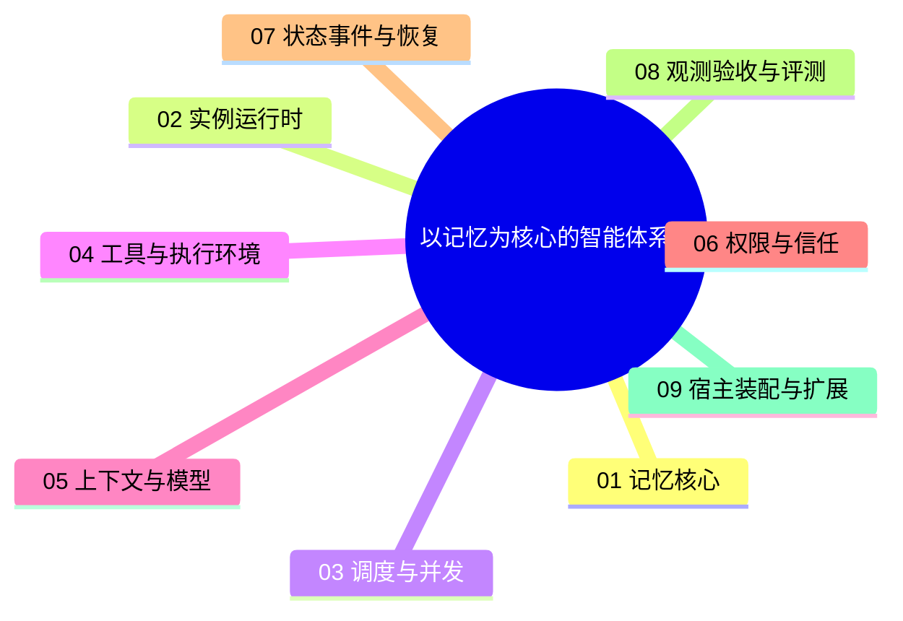
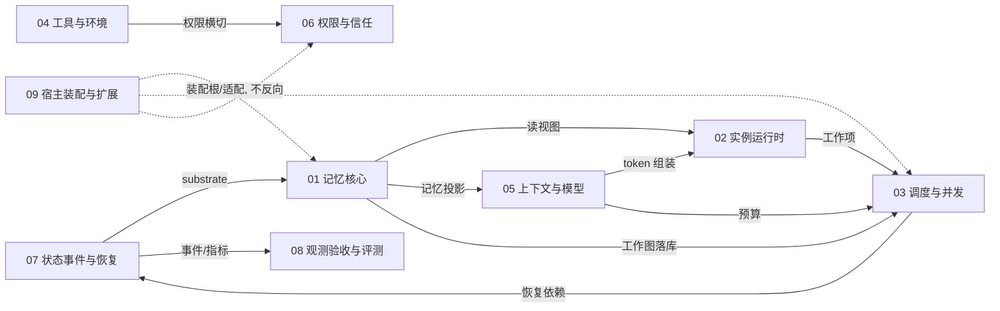

# 系统设计方案 v1 —— 以记忆为核心的智能体系统

> **状态**：方案稿（v1）。本文是"系统要实现什么、怎么组织、怎么验收"的总体方案，供你慢慢看、逐条批注。
> **一句话**：这个系统的核心不是"把大模型包一层"，而是**把记忆做成系统的主体**——记忆是唯一真相，agent 实例是记忆的一次性视图，调度与并发是让多个视图安全地同时工作。**记忆是数据库，实例是 worker，调度是事务管理**。
> **与既有文档的关系**：本文是**总纲**；[26-Harness 设计](26-记忆中心并发Harness-v0.md) 是运行时机制细节；[28-能力树](archive/28-系统能力树-v0.md) 是本文 §2 的讨论稿前身；记忆语义以 [12](../design/12-记忆模型-候选稿.md)/[24](../design/24-记忆模型-v0.3.md) 为准，循环以 [19](../design/19-AgentLoop设计-v0.md) 为准，上下文/提示词以 [20](../design/20-上下文工程-v0.md)/[21](../design/21-提示词工程-v0.md) 为准，评测以 [17](../design/17-评测设计-v0.md) 为准。本文不重写它们。

---

## 0. 一页摘要

**产品无关，这是一套技术系统**。它要解决的根本问题是：

> 大模型只能做"一次推理"，而真实工作要跨天、跨任务、可恢复、可并发、可验收。**记忆**承担"连续性"，**实例**承担"这一次推理"，**调度**承担"何时、多少、谁先"，**验收**承担"做完没有"。

**九个能力域**（§2 完整展开）：

| # | 能力域 | 一句话职责 | 没有它会怎样 |
|---|---|---|---|
| 01 | 记忆核心 | 存什么、怎么读、怎么写、怎么冲突 | 系统没有连续性与真相 |
| 02 | 实例运行时 | 把记忆变成一次可执行的视图 | 记忆不会推进 |
| 03 | 调度与并发 | 何时、多少、谁先；过载降速 | 多实例互相踩 |
| 04 | 工具与执行环境 | 能动手，且动手可约束、可隔离 | 只能空想 |
| 05 | 上下文与模型 | 有限窗口放最该知道的；模型可换 | 模型看不到记忆 |
| 06 | 权限与信任 | 程序判定权限；不可信内容不越权 | 不可控、易被注入 |
| 07 | 状态·事件与恢复 | 崩溃后能解释、能续跑 | 崩溃即失忆 |
| 08 | 观测·验收与评测 | 好坏可测、完成可验、回归可阻 | "完成"不可信 |
| 09 | 宿主·装配与扩展 | 内核可换宿主、可长场景 | 被一种形态绑死 |

**三条系统级不变量**（违反即作废）：

1. **记忆是唯一真相**：实例可随时杀；杀完重建不丢连续性。
2. **实例可丢弃**：任何状态跨崩溃必须已落日志/记忆；实例只是视图 + 草稿 + 租约。
3. **写入必经单写者**：任何写路径都过所属 scope 的写者；分片只改变"哪个写者"，不改变"单写"。

**规模定位**（用户已澄清"1 万只是例子"）：**1 万逻辑工作项**是架构设计假设，用来推演并发系统的边界与瓶颈，**不是验收目标**；**1 万物理并发**明确不是目标。**MVP 边界**：单机、单代码库、1 种 agent、100 工作项、8–16 物理并发；先证明"记忆中心 + 并发 + 候选合并 + 恢复 + 验收"的语义闭环。

**本文的读法**：§1 是"功能诉求"（先对目标）；§2 是能力树（系统要有什么）；§3 是六个关键机制（怎么串起来）；§4 是运行模型（一次执行长什么样）；§5–§7 是 MVP、验收、风险；§8 是与既有设计的关系。

---

## 1. 功能诉求（目标定位）

> 这一章先对齐"系统要满足什么诉求"，再谈能力。每条诉求给：**诉求 / 为什么 / 落在哪个能力域 / 验收判据**。如果某条不成立，后面的设计就要改。

### 1.1 一句话目标

建一个**可长期运行、可并发执行、可恢复、可验收**的智能体系统：它的连续性来自记忆，它的执行力来自一次性实例，它的安全来自程序边界，它的可信来自证据。

### 1.2 九条功能诉求

#### R1 记忆为体：连续性在记忆里，不在进程里

- **诉求**：系统的身份、知识、进展、决策、看法都存在记忆里；实例被杀、换模型、换宿主，不改变"这个系统知道什么、做到哪"。
- **为什么**：这是本设计与"普通 LLM 应用"的根本分歧——普通应用把状态放在会话/进程里，一崩就丢；本设计把记忆当数据库，实例当 worker。
- **落点**：01 记忆核心 + 02 实例运行时。
- **验收判据**：杀光全部实例后重建，系统仍能回答"这个任务做到哪、为什么这么做"。

#### R2 派生廉价：spawn/fork 不复制记忆

- **诉求**：需要更多执行时，派生实例的代价应接近"申请一个租约 + 组装一次视图"，而不是"复制一套上下文/记忆"。
- **为什么**：如果派生要复制记忆，实例数一多就会指数级膨胀；只有"共享记忆 + 私有草稿"才能横向扩展。
- **落点**：02 实例运行时（spawn/fork、视图装配）。
- **验收判据**：单机 8–16 并发下，spawn 到首个 token 的 p95 在可接受范围（MVP 目标 < 1s，〔估算〕待压测）；fork 只复制私有工作集与视图起点，不复制记忆本体。

#### R3 并发受控：不是越多越好，而是可预测

- **诉求**：同时跑多少实例、谁先跑、过载怎么办，必须由系统决定并可解释；不能"来一个起一个"。
- **为什么**：并发度由模型配额、写域、合并吞吐、人审带宽共同决定；无控制的并发只会制造冲突和账单。
- **落点**：03 调度与并发。
- **验收判据**：过载时租约发放速率下降且不崩溃；同一工作项同一时刻只有一个活跃租约。

#### R4 崩溃可恢复：崩溃是常态，不是异常

- **诉求**：进程被杀、机器重启、外部调用超时之后，系统能续跑、不丢已提交的、不重复外部副作用。
- **为什么**：长任务必然遇到崩溃；"重启后从头再来"在成本与信任上都不可接受。
- **落点**：03（租约/幂等）+ 07（事件/检查点/恢复）。
- **验收判据**：kill -9 后 ≤2×TTL 续跑；已提交候选不丢不重；旧 epoch 的迟到写入被拒。

#### R5 完成可验收：完成 = 证据，不是自报

- **诉求**：一个工作项"完成"必须由验收门判定（证据齐全 + 自动检查通过），不能由 agent 说 done。
- **为什么**：规模化后，"假完成"会让整个系统失去可信度；人也不可能逐条看。
- **落点**：08 观测·验收与评测（验收门为主，评测为横切）。
- **验收判据**：缺验收条件/证据的提交不许进 review；无"agent 自报完成即 closed"的路径。

#### R6 行为可解释：每条结论可追溯

- **诉求**：任何一条记忆、一次写入、一个决策，都能回答"谁、基于什么、何时、为什么"。
- **为什么**：没有溯源的记忆无法回滚、无法追责、无法迭代；污染会静默扩散。
- **落点**：01（溯源/版本）+ 06（审计）+ 07（事件日志）。
- **验收判据**：任一高影响操作可定位到 episode + 模型 + 工具调用；无来源的写入只能标 `agent_inferred`。

#### R7 边界可约束：模型不是权限边界

- **诉求**：能读什么、能写什么、能调什么工具、能访问什么网络，由程序判定；不可信内容（检索、子代理输出、外部页面）不能直接触发高影响动作。
- **为什么**：提示词注入是当前最现实的攻击面；把权限交给模型自觉，等于没有权限。
- **落点**：06 权限与信任 + 04 工具与执行环境。
- **验收判据**：越权工具拒绝；注入内容不直接触发写记忆/写文件；无 answerer 时 fail-closed。

#### R8 系统可演进：内核不绑定宿主/模型/场景

- **诉求**：换宿主（CLI/Web/未来 DSH 桥）、换模型、换场景（研发/客服/调研），内核不改。
- **为什么**：绑定一种形态的系统，半年后就会被形态变化拖死。
- **落点**：09 宿主·装配与扩展。
- **验收判据**：换宿主只改适配层；换模型只改 ModelPort；换场景只换场景包。

#### R9 规模可定位：逻辑规模与物理规模分开

- **诉求**：系统能承载"很多工作项同时在系统里"（逻辑规模），但物理并发有界、可预测。
- **为什么**：逻辑规模决定存储/调度/合并的设计；物理规模决定资源与成本。混为一谈会导致"为万级物理并发过早分布式"。
- **落点**：03 调度 + [26 §8.5](26-记忆中心并发Harness-v0.md) 的迁移阈值。
- **验收判据**：容量设计按逻辑规模推演；MVP 验收按物理规模（100 项 / 8–16 并发）。

### 1.3 非目标（明确不做，防止摊子铺太大）

| 非目标 | 理由 |
|---|---|
| 通用的多 agent 协作协议（对话/分工/汇报链） | 本设计的协调靠记忆 + 合并规则，不做实例间对话 |
| 模型训练/微调 | 系统把模型当可替换算力，不做能力上限 |
| 多租户/计费/账号体系（MVP） | 单机单用户优先；阈值见 26 §8.5 |
| 产品前端/交互设计 | 本文只定系统边界；界面另议 |
| 1 万级实测 | 1 万是压力推演假设，非验收目标；MVP 按 100 项设计（见 §1.2 R9） |
| 分布式/跨机（MVP） | 单机档先跑通语义；迁移阈值见 26 §8.5 |

### 1.4 "系统成功"的定义

MVP 成功的判据不是"能跑"，而是同时满足：

1. **语义闭环**：一次执行能走完"读记忆 → 执行 → 候选 → 合并 → 验收 → 归档"，且每一步可查。
2. **并发安全**：8–16 并发下无静默覆盖、无重复记忆、无双跑。
3. **崩溃可恢复**：kill -9 后可续跑。
4. **完成可信**：缺证据的完成被挡住。
5. **可解释**：任一失败能定位到"哪一步、哪个工具、哪次模型调用"。

---

## 2. 能力树（系统要实现什么）

> 本章是 §1 诉求的展开：L0 系统目标 → L1 能力域 → L2 功能模块 → L3 机制/契约 → L4 验收/不变量。
> 规范：叶子必须是"机制 + 不变量"；L1 按能力域分，不按进程/技术栈分；跨域依赖单列（§2.4）。

### 2.1 树的规范

| 层 | 名称 | 回答 | 粒度判据 | 命名 |
|---|---|---|---|---|
| L0 | 系统目标 | 这个系统是什么 | 一句话 | 名词短语 |
| L1 | 能力域 | 有哪几块不可替代的能力 | 去掉它系统不成立 | 名词域 |
| L2 | 功能模块 | 每域下面有哪组职责 | 一组相关机制 | 动词短语 |
| L3 | 机制/契约 | 具体怎么实现 | 可实现、可接口化 | 机制名 |
| L4 | 验收/不变量 | 做完怎么证明 | 可断言/可测试 | 断言句 |

**ID**：`CAP-<域>-<模块>`（模块级，域号 01–09）；机制用 `CAP-<域>-<模块>.<机制>`（如 `CAP-01-03.02`）。本文 §2.3 的表格不逐行写 ID（避免表格过宽），§6.3 的回归清单按此编号引用；改名不改 ID，插入不重排。

### 2.2 总览



九域是"能力"划分，不是"进程"划分：单机一个进程可以实现全部九域；分布式只是拆到不同进程/机器。

### 2.3 九域逐域展开

> 每域：**目标 / 域级不变量 / L2 模块与 L3 机制 / L4 验收断言 / 归属文档**。
> L3 只给"机制名 + 一句话关键点"，细节引用归属文档；本文不重写。

#### 01 记忆核心（Memory Core）

**目标**：让"知道什么、做到哪、为什么"成为长期、可溯源、可并发写的事实源。
**域级不变量**：记忆是唯一真相（I1）；只追加不物理删除（I3）；全量溯源（I4）。

| L2 | L3 机制 | 关键点 |
|---|---|---|
| 01 存储模型 | 三层单元（raw / canonical / MemoryItem） | raw 不可变；canonical 是唯一入口；MemoryItem=可检索事实（24 v0.3.1） |
| | 实体图 + legacy scope 投影 | 实体（智能体/会话/任务/域）+ 关系；scope 只作 legacy 投影，**不再作组织主轴** |
| | 5 类型 + 双时态/失效 | 失效优于删除；`validUntil` 闭合 |
| 02 读路径 | 快照视图 | spawn 时钉版本向量，执行期不受写入影响 |
| | 检索打分（rel+imp+rec+str） | 过滤先于打分；参数可调、可回放 |
| | 预算裁剪 | 超预算按序降级；红线块不裁 |
| | 冲突横幅 / 过期提示 | 冲突不静默选边；变更追加提示不改历史 |
| 03 写路径 | 私有工作集 | 实例只写私有；物理隔离 |
| | 候选提交（handoff） | 结束/检查点提交；带 baseVersion + 来源 |
| | 单写者合并 | 纯规则、不调模型；每 scope 一个写者 |
| | 版本/回滚 | 每次合并产生新版本；回滚=写新版本 |
| | 冲突检测（结构/语义） | fact 冲突一律 disputed（**24 Q3 为准；12 §5.4 待回写**）；语义冲突 LLM/人判 |
| | 来源分级/敏感检查 | 无来源只能 inferred；PII 不外溢 |
| 04 巩固与演化 | 后台整理 | 去重/失效/提升候选，仍走单写者 |
| | 污染防线 | 七道防线（来源/候选/证据/回滚…） |
| | 金字塔/多视角 | 抽象层级；存储与视图分离 |
| | 跨智能体只读 | 默认只读；sensitive 例外 |

**L4 验收断言**：

- V01-1 任一条目可回答"谁/基于什么/何时写的"。
- V01-2 同 snapshot + 同私有草稿 → 视图可重放（哈希一致）。
- V01-3 同一候选重复提交只产生一个版本。
- V01-4 fact 冲突一律 `disputed`，不静默覆盖。
- V01-5 公共层写入必经所属 scope 单写者。

**归属**：12 §2–§5、24 §2–§7、22。

#### 02 实例运行时（Instance Runtime）

**目标**：把记忆变成"一次可执行、可丢弃的视图"。
**域级不变量**：实例可丢弃（见 26 §7 的 C3）；实例不拥有记忆。

| L2 | L3 机制 | 关键点 |
|---|---|---|
| 01 派生 | spawn / fork | spawn 空私有；fork 复制私有+视图起点；都不复制记忆 |
| 02 视图装配 | snapshot → assemble → refresh | 确定性、可重放、有预算报告 |
| 03 执行循环 | 六阶段（接 19） | 组装→决策→执行→观察→更新→判断 |
| 04 主体与预算 | agentRef（身份/人格/读集/写域） | 没有主体就无法执行人格防混乱/敏感例外 |
| | 预算（软上限+可配硬熔断） | 到限留中间结果，不静默失败 |
| 05 生命周期 | 心跳/TTL/回收/崩溃重派 | 私有工作集冻结保留；换模型=新实例 |

**L4 验收断言**：

- V02-1 fork 不复制记忆本体；spawn 不读兄弟实例私有区。
- V02-2 视图装配可重放；`budgetReport` 可查。
- V02-3 实例读写不越出 `agentRef` 读集/写域。
- V02-4 kill -9 后 ≤2×TTL 续跑，已提交候选不丢不重。

**归属**：12 §4、19 §4、26 §4.2/§4.5/§5.6。

#### 03 调度与并发（Scheduling & Concurrency）

**目标**：决定何时、多少、谁先；过载降速而不是崩溃。
**域级不变量**：同一 WorkItem 同刻最多一个活跃租约（见 26 §7 的 C1）；提交幂等（C2）。

| L2 | L3 机制 | 关键点 |
|---|---|---|
| 01 工作图 | WorkItem（18 Task 的调度视图） | 不存第二份 Task 状态；只存调度态投影 |
| | 依赖 DAG / 状态机 | 状态唯一、迁移单入口；`submitted≠完成` |
| 02 准入与配额 | 四类约束（依赖/写域/令牌/人审） | 任一不满足不发放 |
| 03 租约 | CAS 发放、心跳、epoch fencing、回收 | 旧 epoch 写入必拒 |
| 04 优先级与公平 | 优先级/截止/防饥饿/同类合并 | 低优先级超时可提权 |
| 05 反压 | 积压/冲突/人审/429 → 降速 | 阈值可测，不是"感觉慢" |
| 06 幂等与恢复 | at-least-once + candidateId、缺 ack 视为未知、DLQ | 终态失败进异常队列 |
| 07 合并分片 | 按 scope 分片、每片单写者、跨片拆批 | 分片不改"单写者"性质 |

**L4 验收断言**：

- V03-1 同一工作项同刻最多一个活跃租约（并发 spawn 压测）。
- V03-2 同候选重复提交只落一次；progress/final 各自生效。
- V03-3 旧 epoch 的迟到提交被拒。
- V03-4 过载时发放速率 ≤ 注入前 X%（可测）。
- V03-5 任何写路径必经所属 scope 单写者。

**归属**：26 §4/§5、12 §6。

#### 04 工具与执行环境（Tooling & Sandbox）

**目标**：能动手，且动手可约束、可隔离、可重放。
**域级不变量**：写工具绑定写域；副作用先落日志再执行。

| L2 | L3 机制 | 关键点 |
|---|---|---|
| 01 工具注册表 | 元数据（风险/并行安全/超时/写域） | 未注册不可调；写工具必须绑写域 |
| 02 工具管线 | 五段管线、权限求值、参数冻结、三态取消 | 写串行、读可并行；取消不留半成品 |
| 03 沙箱与工作区 | worktree/目录隔离、资源槽位 | 同写域串行、不同写域并行；重工具限流 |
| 04 外部副作用 | 先落日志、幂等收据、outcome_unknown | 崩溃重放不重复外部动作 |
| 05 凭据与网络 | 环境不继承 Key、最小作用域、网络边界 | 实例拿不到未授权凭据 |

**L4 验收断言**：

- V04-1 未注册工具不可调用；写工具越界被拒。
- V04-2 取消后无半成品；超时/重试有上限。
- V04-3 副作用重放不重复；未知结果不自动重试。
- V04-4 同写域串行、不同写域并行可观测。

**归属**：19 §6、docs/dsh-alignment §2.5、26 §5.4/§5.7。

#### 05 上下文与模型（Context & Model）

**目标**：有限窗口放"最该知道的"；模型是可替换算力。
**域级不变量**：模型可见 ⟺ 已记录；token 单一计量。

| L2 | L3 机制 | 关键点 |
|---|---|---|
| 01 上下文组装 | 前缀+尾部、配额分桶、压缩三段式、引用记账 | 压缩只改模型可见，不改用户可见 |
| 02 提示词编译 | 注册表、规则预算、持久规则重注入 | 超预算拒绝编译；Iron Law 不承担门禁 |
| 03 模型路由 | `llm.ask` 端口、按角色、降级/熔断 | 内核不 import 厂商 SDK |
| 04 计量 | token/成本单一计量、分账 | 每项成本可归因，不重复计费 |

**L4 验收断言**：

- V05-1 压缩前后用户可见内容不变；模型可见内容有日志。
- V05-2 超预算规则不编译；持久规则被重注入。
- V05-3 换模型只改 ModelPort，不改内核。
- V05-4 每个工作项成本可归因（实例/任务/项目）。

**归属**：20、21、19 §9。

#### 06 权限与信任（Policy & Trust）

**目标**：程序判定权限；不可信内容不越权。
**域级不变量**：模型不是权限边界；无 answerer 时 fail-closed。

| L2 | L3 机制 | 关键点 |
|---|---|---|
| 01 身份与主体 | 秘书/专家/实例、主体绑定 | 实例只能用自己工具集 |
| 02 权限求值 | 六步顺序 | hooks→deny→ask→mode→allow→fallback |
| 03 审批服务 | 人审队列、一次性 grant | 无 answerer 拒绝，不放行 |
| 04 不可信内容 | 信任分级、控制标签中和、来源打标 | 子代理/检索内容不直接触发写 |
| 05 审计 | 谁/基于什么/做了什么 | 高影响操作可回查 |

**L4 验收断言**：

- V06-1 越权工具拒绝；plan 模式不自动批准写。
- V06-2 无 answerer 时 fail-closed。
- V06-3 注入内容不直接触发写记忆/写文件。
- V06-4 每条高影响操作可追溯到 episode。

**归属**：19 §6.2、24 §6、22 §6、16 D21。

#### 07 状态·事件与恢复（State, Events & Recovery）

**目标**：崩溃、断线、重启后能解释"发生了什么、做到哪"。
**域级不变量**：事件先落库再推送；每流恰好一个终止。

| L2 | L3 机制 | 关键点 |
|---|---|---|
| 01 事件日志 | append-only、命名/字段/id、可见性三分 | 模型可见 ⟺ 已记录 |
| 02 检查点 | 三屏障 fail-closed、写下顺序固定 | 未知副作用不自动重试 |
| 03 单写者存储 | 单写者入口、DB 是投影、文件锁 | 重启后状态与日志一致 |
| 04 对外事件流 | SSE/WS、单终止、断线续接 | 重连不丢不重 |
| 05 恢复协议 | 固定顺序恢复、幂等重放、恢复注记 | 不丢已提交、不重放副作用 |

**L4 验收断言**：

- V07-1 任一模型可见内容可在日志找到。
- V07-2 三屏障 fail-closed；未知副作用不自动重试。
- V07-3 每个流恰好一个终止事件。
- V07-4 崩溃恢复不丢话、不重复。

**归属**：19 §7/§10、18、14 §7.2。

#### 08 观测·验收与评测（Observability, Acceptance & Eval）

**目标**：好坏可测、完成可验、回归可阻。
**域级不变量**：缺证据不许进 review；指标可按项归因。

| L2 | L3 机制 | 关键点 |
|---|---|---|
| 01 指标 | 吞吐/时延/冲突/租约/成本/人审 | 定义+采集点+分账维度 |
| 02 trace 与审计 | 事件串联、采样、脱敏 | 失败可定位到步/工具/模型调用 |
| 03 验收门 | 证据契约（测试/命令/范围/回滚） | 缺证据退回，不进 review |
| 04 评测 | golden set、WITH/W/OUT/Δ、六 grader、回归门禁 | 回归可阻断，可复现 |

**L4 验收断言**：

- V08-1 缺验收条件/证据的提交被挡。
- V08-2 指标可按工作项/项目归因。
- V08-3 任一失败可定位到步/工具/模型调用。
- V08-4 回归可阻断；评测可复现。

**归属**：17、18、26 §5.5。

#### 09 宿主·装配与扩展（Host, Assembly & Extension）

**目标**：内核不绑定宿主/模型/场景。
**域级不变量**：内核不反向依赖宿主；端口有版本。

| L2 | L3 机制 | 关键点 |
|---|---|---|
| 01 端口契约 | 14 个端口 | 破坏性变更走新端口 |
| 02 装配根 | 唯一装配点、启停顺序 | 依赖注入，不反向依赖 |
| 03 宿主适配 | CLI/Web/API/未来桥 | 只做 ingest + 渲染 |
| 04 配置与环境 | 分层配置、敏感项不落库 | 密钥不进代码/文档/日志 |
| 05 扩展点 | 场景包/预设/技能/工具扩展 | 换场景只换包 |
| 06 演进分级 | L1 参数 / L2 场景 / L3 内核 | 自变更留 diff+回滚+指标 |

**L4 验收断言**：

- V09-1 换宿主只改适配层，内核不改。
- V09-2 端口版本化；破坏性变更走新端口。
- V09-3 换场景只换场景包，内核零改动。
- V09-4 自变更可回滚、有指标对比。

**归属**：26 §3.3、harness-map（参考）、00 D-11（问题框架）。

### 2.4 横向依赖（树表达不了，单列）



**依赖含义（决定实现顺序）**：

1. **01 + 07 是地基**：07（事件/存储/检查点）先作为 substrate，01 建在其上。
2. 02 依赖 01（视图）与 05（token 级组装）。
3. 03 依赖 01（工作图落库）、07（恢复）、05（预算）。
4. 06 是 04 的横切约束，不是独立执行路径。
5. 08 横切全部域。
6. 09 在最外层：它装配/适配**端口**，不被任何域反向依赖（图中虚线）。

---

## 3. 六个关键机制（跨域，把能力串起来）

> 能力树回答"有什么"，机制回答"怎么串"。每个机制：目标 / 流程 / 关键决策 / 失败模式 / 验收。

### M1 记忆读写闭环

**目标**：实例读到的永远是"某一版记忆"，写回的永远是"候选"，公共层永远由单写者合并。

**流程**：

```
spawn：snapshot(scope → rev) 钉版本
  → assemble：块 + 检索 + 私有草稿（fork 时）
  → 执行：读基于快照；写只写私有 + 事件日志
  → 结束/检查点：提交 Candidate（baseVersion + sources + evidence）
  → 单写者：幂等校验 → 结构/语义冲突检测 → 合并/拒绝/disputed
  → 发版本 + 回执 → 实例更新基准（或已结束）
```

**关键决策**：

- 实例**不挂记忆编辑工具**（12 §5.7）：写公共层只能走候选；
- 合并器**纯规则、不调模型**（12 §5.1，推断待压测）；
- **fact 冲突一律 disputed**（24 Q3），不按权威自动裁决；
- `baseVersion` 过期是常态：快进 / 三方合并 / 降级 disputed / 拒绝（12 §5.9）。

**失败模式**：候选丢失（最糟，必须回执说明原因）；静默覆盖（禁止）；冲突被藏起（禁止）。

**验收**：§2.3 01 域 V01-1..5；端到端见 §6.2。

### M2 实例生命周期与租约

**目标**：实例可杀、可重建；同一工作项不双跑。

**流程**：

```
ready → CAS 发租约（epoch+1）→ spawn → running（心跳续约）
  → submitting → 提交候选 → 合并回执 → ended
  崩溃：心跳停 → TTL 过期 → lease expired → 工作项回 ready
       → 新 epoch → 重新 spawn（attempt 语义见下）→ 旧 epoch 写入被拒
```

**关键决策**：

- **at-least-once + 幂等**，不追 exactly-once；
- `attempt` 只在"重新开始一次完整执行"时 +1；崩溃重试复用同一 attempt；
- 所有提交/写工具校验 `epoch == current`；
- 缺 ack 视为未知：先查外部状态再补偿。

**验收**：§2.3 02/03 域 V02-4、V03-1..3。

### M3 并发控制

**目标**：并发度可预测；过载降速；冲突率可控。

**流程**：

```
准入检查（deps/写域/令牌/人审）
  → 令牌桶（模型 RPM/TPM、沙箱槽位、人审容量）
  → 优先级/公平/同类合并
  → 反压信号（积压/冲突率/429/人审）→ 降发放
```

**关键决策**：

- 有效并发 ≈ min(模型配额, 沙箱容量, 合并吞吐, 可并行写域, 人审带宽)；
- 分片单写者（对 12 I2 的修订）：每 scope 一个写者，跨片拆批；
- 冲突率是调度信号，不是纯故障：高冲突 → 拆写域/降并发，不是加重试。

**验收**：§2.3 03 域 V03-4..5；§6.2 反压场景。

### M4 验收门

**目标**：完成可验证；人只看"自动通过 + 证据齐全"的。

**流程**：

```
submitted → candidate_merged → integrated
  → 验收门：验收条件存在？证据齐全？自动检查通过？
      ├─ 否 → 退回 running，列出缺什么
      └─ 是 → accepted → closed（归档）
```

**关键决策**：

- 验收门是一等原语（缺证据不许进 review）；
- 验收条件结构化（测试/命令/范围/回滚），不是自由文本；
- 1 万规模下必须自动化，人只看边界与例外。

**验收**：§2.3 08 域 V08-1；§6.2 验收场景。

### M5 权限与信任

**目标**：程序判定权限；注入不越权。

**流程**：

```
工具调用 → 六步求值（hooks→deny→ask→mode→allow→fallback）
  → 需要审批 → 人审队列（fail-closed）
  → 不可信内容 → 信任分级 + 指令形态中和 + 来源打标
  → 高影响操作 → 审计条目
```

**关键决策**：

- 模型不是权限边界；无 answerer 拒绝；
- 子代理/检索内容不直接触发写；
- 凭据不进实例环境（引用 dsh-alignment §2.5）。

**验收**：§2.3 06 域 V06-1..4。

### M6 观测与评测

**目标**：好坏可测、失败可定位、回归可阻。

**指标最小集**：吞吐（closed/小时）、时延（p50/p95）、并发（活跃/队列）、租约健康（过期率）、合并（p95/积压）、质量（冲突率/revert/验收通过率）、成本（tokens/项、cost/closed）、人（队列深度/打扰）。

**评测**：golden set + WITH/W/OUT/Δ + 六 grader + 回归门禁（17）。

**验收**：§2.3 08 域 V08-2..4；§6.3。

---

## 4. 运行模型（一次执行长什么样）

### 4.1 端到端时序

```
[1] 入口：用户/需求源 → 归一化成 WorkItem（幂等键 + 去重）
[2] 工作图：落库、依赖、优先级、验收条件、写域
[3] 调度：准入检查 → 令牌 → 发租约（epoch+1）
[4] 实例：spawn → snapshot → assemble（块+检索+私有）
[5] 循环：组装 → 模型 → 决策 → 工具（写域内）→ 观察 → 更新
      每步：先记录（事件）后行动；副作用先落日志
[6] 结束：提交 Candidate（baseVersion + sources + evidence）
[7] 合并：幂等校验 → 冲突检测 → 合并/拒绝/disputed → 版本 + 回执
[8] 集成：补丁/产物合并进主干（worktree/merge 语义）
[9] 验收：证据检查 → accepted → closed
[10] 归档：episode 保留；私有工作集冻结 7 天；指标入账
```

> **编号说明**：本节步骤是 1–10，**不是** [26](26-记忆中心并发Harness-v0.md) 的 H0–H7 层号（两者语义不同，混用会指错）。映射：26 H0 入口→[1]；H1 工作图→[2]；H2 调度→[3]；H3 实例管理→[4]；H4 循环→[5]；H5 记忆核心→[6][7]；H6 能力面（工具/沙箱）→[8]；H7 观测/验收/成本→[9][10]。

### 4.2 三个变体

**变体 A：并发实例**——同一 domain 多个实例并行；各自快照隔离；结束各交候选；合并器分片串行处理；冲突按 M1 规则。

**变体 B：冲突**——两个实例改同一事实 → **两条候选均标 `disputed` 并存 + `open_question`**；先写者**不因时间获得权威**（24 v0.3.1 Q3：事实冲突一律 disputed，不允许按权威自动裁决）；人/裁决者处理；不自动覆盖、不得只标后者。

**变体 C：崩溃恢复**——实例崩溃 → 租约过期 → 工作项回 ready → 新实例（新 epoch）→ 旧实例迟到写入被拒；已提交候选幂等重放不重复。

### 4.3 人机边界

- **唯一出口是秘书投影**（H0）：实例不直接对人说话；
- **人只处理三类**：需决策（disputed/open_question）、需验收（证据齐全的）、异常（失败超限/成本超限）；
- **其他全部静默**：聚合视图 + 指标，不逐条通知（对齐 14 §5.7 的通知纪律与 26 §5.5 的人类注意力）。

---

## 5. MVP 与实现顺序

### 5.1 MVP 范围（P0 叶子）

| 域 | P0 实现 | 暂不做（P1/P2） |
|---|---|---|
| 01 记忆核心 | 三层单元 + 4 层作用域；快照+FTS 检索+预算；候选+单写者+冲突+版本 | 后台巩固、金字塔、向量检索、语义冲突 LLM 判定 |
| 02 实例运行时 | spawn、视图装配、简化循环、心跳/回收 | fork 的 worktree 复制优化、长驻实例 |
| 03 调度与并发 | 工作图、准入、租约（CAS+epoch）、恢复、分片合并 | 复杂优先级、抢占、分布式调度 |
| 04 工具与执行环境 | 注册表、五段管线、worktree 隔离、副作用日志 | 重工具池化、网络代理、MCP |
| 05 上下文与模型 | 简化组装、ModelPort、token 计量 | 压缩三段式全量、多模型路由 |
| 06 权限与信任 | 六步求值、最小审批、不可信内容中和 | 完整 answerer 体系、凭据代理 |
| 07 状态事件与恢复 | 事件日志、三屏障检查点 | 断线续接优化、跨机恢复 |
| 08 观测验收与评测 | 指标最小集、验收门 | 完整评测体系、回归门禁自动化 |
| 09 宿主装配与扩展 | 端口、装配根、CLI 宿主 | Web 宿主、DSH 桥、场景包市场 |

### 5.2 实现顺序（依赖驱动）

| 阶段 | 目标 | 交付 | 验收 |
|---|---|---|---|
| **S0 地基** | 事件日志 + 单写者存储 + 检查点 | 存储层 + 恢复协议 | 崩溃不丢、日志可查 |
| **S1 记忆闭环** | 三层单元 + 候选 + 合并 + 版本 | 记忆核心 MVP | V01-1..5（01 域） |
| **S2 实例与调度** | spawn/视图/循环/租约/工作图 + 简化上下文/ModelPort 最小实现 | 单实例跑通 + 并发 8 | V02-1..4、V03-1..3 |
| **S3 工具与权限** | 工具管线 + worktree + 六步 | 能改代码、能审批 | V04-1..4、V06-1..4 |
| **S4 验收与观测** | 验收门 + 指标 + 完整压缩/多模型路由 | 完成可信、可度量 | V08-1..4、V05-1..4 |
| **S5 装配与宿主** | 端口 + 装配根 + CLI | 可交付形态 | V09-1..4 |

### 5.3 MVP 验收标准（端到端）

1. 100 个工作项、8 并发、2 小时 `closed` ≥ 90%，每项有验收证据；
2. 同候选重复提交 3 次 → 版本只 +1；progress/final 各自生效；
3. kill -9 一次 → ≤2×TTL 续跑，已提交候选不丢不重；旧 epoch 写入被拒；
4. 两实例改同一事实 → **两条均 `disputed`** + `open_question`，无静默覆盖；先写者不因时间获得权威；
5. 超预算 → 软上限留中间结果；硬熔断开时停在限；
6. 高冲突负载 → 发放速率 ≤ 注入前 X%，不崩溃；
7. 视图可重放（同 snapshot+同草稿 → 同哈希）；
8. 越权写域被拒；越权工具被拒；
9. 缺证据的完成被挡在 review 外；
10. 每项 token/成本可归因。

### 5.4 明确不做（MVP 期）

分布式/多机、多租户、多 agent 协作、自演进、MCP、向量检索、长驻实例、Web 宿主、DSH 运行时。

---

## 6. 验收方案

### 6.1 分域指标（每域至少一个"可判好坏"的指标）

| 域 | 指标 | 目标（MVP，估算待基线） |
|---|---|---|
| 01 记忆核心 | 合并成功率、冲突率、溯源完整率 | 冲突率 < 10%；溯源 100% |
| 02 实例运行时 | spawn p95、视图装配耗时 | spawn < 1s；装配 < 500ms |
| 03 调度 | 租约过期率、队列深度、双跑次数 | 过期 < 1%；双跑 = 0 |
| 04 工具 | 工具失败率、越界拒绝次数 | 越界必须 100% 拒绝 |
| 05 上下文 | token/项、压缩比、成本/项 | 记录基线，不设上限 |
| 06 权限 | 审批延迟、fail-closed 次数 | 无 answerer 必须拒绝 |
| 07 恢复 | 恢复耗时、丢失/重复次数 | 丢失 = 0，重复 = 0 |
| 08 验收 | 验收通过率、退回率 | 退回率可解释 |
| 09 宿主 | 换宿主改动量 | 只改适配层 |

### 6.2 端到端场景（10 条，可执行）

> 每条给：注入 / 断言（对应 §5.3 与 §2.3 的 V 编号）/ 证据在哪 / 门禁方式。`X` 为可配置阈值（如 50%），MVP 先取保守值再按实测校准。

| # | 场景 | 注入 | 断言 | 证据 | 门禁 |
|---|---|---|---|---|---|
| 1 | 功能闭环 | 100 个工作项、8 并发 | `closed` ≥ 90%，每项有验收证据（§5.3#1） | 状态表 + 验收报告 | CI |
| 2 | 幂等 | 同一 `candidateId` 提交 3 次 | 版本只 +1；progress/final 各自生效（V01-3） | 版本表 | CI |
| 3 | 恢复 | kill -9 一次（记录时点） | ≤2×TTL 续跑；不丢不重；旧 epoch 写入被拒（V02-4、V03-3） | 恢复日志 + 租约表 | CI |
| 4 | 冲突 | 两实例改同一事实 | **两条均 `disputed` + `open_question`**；无静默覆盖（V01-4） | 记忆查询 + 冲突队列 | CI |
| 5 | 预算 | 构造超 token 预算任务 | 软上限留中间结果并标 `budget_exceeded`；硬熔断开启时停在限（§5.3#5） | 预算报告 | CI |
| 6 | 反压 | 注入高冲突负载 | 租约发放速率 ≤ 注入前 X%；不崩溃（V03-4） | 调度指标 | 人工 + CI |
| 7 | 视图重放 | 同 snapshot + 同私有草稿 | 装配结果哈希一致（V02-2） | 装配日志 | CI |
| 8 | 越界 | 写非 `writeDomains` 路径、调未注册工具 | 工具层拒绝（V04-1、V02-3） | 拒绝日志 | CI |
| 9 | 验收门 | 缺证据的提交 | 被挡在 review 外（V08-1） | 验收队列 | CI |
| 10 | 成本归因 | 一次完整执行 | 每项 token/成本可归因（V05-4） | Meter 报表 | 人工 |

### 6.3 回归与门禁

**追溯到叶子**：每个 P0 叶子（CAP 模块）至少一条回归用例；下表先给"域级最小集"，实现时按 CAP ID 展开：

| CAP 模块 | L4 断言 | 回归用例（对应 §6.2） |
|---|---|---|
| CAP-01-03 写路径 | V01-3、V01-4、V01-5 | #2 幂等、#4 冲突 |
| CAP-02-01 派生 / CAP-02-02 视图 | V02-1、V02-2 | #7 视图重放 |
| CAP-02-05 生命周期 | V02-4 | #3 恢复 |
| CAP-03-03 租约 / CAP-03-06 幂等 | V03-1、V03-2、V03-3 | #2、#3 |
| CAP-03-05 反压 | V03-4 | #6 反压 |
| CAP-04-01 工具注册 / CAP-04-04 副作用 | V04-1、V04-3 | #8 越界 |
| CAP-05-04 计量 | V05-4 | #10 成本 |
| CAP-06-02 权限求值 | V06-1、V06-2 | #8 越界 |
| CAP-07-02 检查点 / CAP-07-05 恢复 | V07-2、V07-4 | #3 恢复 |
| CAP-08-03 验收门 | V08-1 | #9 验收门 |

- 评测用 golden set + WITH/W/OUT/Δ（17）；
- 回归不过不许发版（门禁）；
- 新增 P0 叶子必须同时加"断言 + 回归用例"，否则不进 MVP。

---

## 7. 风险与取舍

### 7.1 关键取舍（为什么这样、代价、何时反过来）

| 取舍 | 选择 | 代价 | 何时反过来 |
|---|---|---|---|
| 记忆为体 vs 会话为体 | 记忆 | 要写状态机/合并/冲突，比"对话数组"复杂 | 单次问答、无需恢复 → 会话即可 |
| 实例一次性 vs 长驻 | 一次性（默认） | 每次要装配视图；无"经验积累"的实例 | 需要实例级经验沉淀 → 长驻 + 失效重载 |
| at-least-once vs exactly-once | at-least-once + 幂等 | 极端重复执行 | 外部副作用不可幂等（付款）→ 补偿事务 |
| 分片单写者 vs 全局单写者 | 分片（对 I2 的修订） | 跨片批次要拆；分片倾斜 | 单 scope 为主 → 不分片 |
| 软上限 vs 硬停 | 软上限默认 + 可配硬熔断 | 可能超支 | 成本不可控 → 开硬熔断 |
| fact 冲突一律 disputed vs 权威自动裁决 | disputed（24 Q3） | 人审队列 | 冲突率极低 → 低风险 kind 放宽 |
| worktree 隔离 vs 直接改主干 | worktree | 磁盘/合并成本；monorepo 边界 | 单仓库小项目 → 目录隔离 |
| 1 万逻辑工作项 vs 100 MVP 验收 | 容量设计按逻辑规模推演；MVP 验收按 100 项 | 不能提前验证万级 | 业务真实到万级 → 按 26 §8.5 迁移 |

### 7.2 风险

1. **单写者瓶颈**：12 自陈"10 并发还行，100 客服会紧"；分片 + 批处理是缓解不是消除。信号：合并 p95、分片倾斜。
2. **冲突率随并发非线性上升**：写域划分是并发度的分母；不拆写域只加实例 = 制造冲突。
3. **成本**：agent ≈ 4× chat token、多 agent ≈ 15×（Anthropic）；先撞预算，不是先撞并发。
4. **并行反证**（Cognition）：隐式决策冲突；缓解是"假设落成记忆条目"，但仍需评审兜底。
5. **monorepo worktree 边界**：git 官方不推荐对 superproject 多 checkout；MVP 选单仓库可绕开。
6. **验收门缺失 = 假吞吐**：没有验收门，规模化后"完成"不可信。
7. **记忆污染**：候选制 + 来源分级 + 可回滚是底线；沉淀链路见 12 §7。
8. **"1 万"被误读**：用户已澄清是例子；真正的风险是把"逻辑规模"与"物理规模"混用（见 §1.2 R9）。

### 7.3 未验证项（诚实清单）

- TPM/时延/成本数字均为假设，需实测校准；
- 合并器"纯规则毫秒级"未压测；
- 分片单写者的跨片一致性未设计（MVP 默认拆批）；
- worktree 在 monorepo 的替代方案未验证；
- 长驻实例变体未设计；
- 1 万级从未实测；也不需要（用户已澄清是例子——容量按逻辑规模推演，MVP 按 100 项验收）。

---

## 8. 与既有文档的关系

| 文档 | 关系 | 本文引用什么 |
|---|---|---|
| [26-Harness 设计](26-记忆中心并发Harness-v0.md) | 运行时机制细节 | H0–H7、端口、对象、租约/分片/验收 |
| [28-能力树](archive/28-系统能力树-v0.md) | 本文 §2 的讨论稿前身 | 九域划分（已被本文吸收） |
| [12-记忆模型](../design/12-记忆模型-候选稿.md) | 语义权威（**除 §5.4 事实冲突裁决，已被 24 Q3 取代，待 12 回写**） | 候选/单写者/冲突/来源分级 |
| [24-记忆模型 v0.3](../design/24-记忆模型-v0.3.md) | 实体/字段权威；**冲突语义以 24 Q3 为准** | 实体/关系/条目/金字塔/写域/读集/人格 |
| [22-记忆与RAG](../design/22-记忆与RAG-v0.md) | 读路径细节 | 检索/预算/信任分级 |
| [19-AgentLoop](../design/19-AgentLoop设计-v0.md) | 单实例循环 | 六阶段/工具管线/检查点/事件流 |
| [20-上下文工程](../design/20-上下文工程-v0.md) / [21-提示词工程](../design/21-提示词工程-v0.md) | 上下文/提示词细节 | 配额/压缩/注册表 |
| [23-Planner](../design/23-Planner与长程任务-v0.md) | 规划 | 工作图生成 |
| [18-SDD流程](../design/18-SDD流程-v0.md) | 字段权威 | Task/验收证据/`boundary` |
| [17-评测设计](../design/17-评测设计-v0.md) | 评测 | golden set/grader/门禁 |
| [00-决策台账](../design/00-决策台账.md) | 参考问题框架（全部待定） | 不引用为结论 |

---

## 附录 A：术语

| 术语 | 定义 |
|---|---|
| 记忆 | 长期、可溯源、只追加的事实源（raw / canonical / MemoryItem；实体图 + 关系） |
| 实例 | 记忆的一次性视图 + 私有草稿 + 租约；可丢弃 |
| 工作项 | 可调度单元；18 Task 的调度视图 |
| 租约 | "谁在执行"的有时限凭证；带 epoch fencing |
| 候选 | 实例的提交包；经单写者合并后进公共记忆 |
| 写域 | 代码可写域（文件/模块/服务）；记忆侧另有"记忆写域" |
| 反压 | 下游吃不下时降低上游发放速率 |
| 验收门 | 进 review 前的证据契约 |
| 装配根 | 唯一实例化端口并注入的位置 |

## 附录 B：能力树缩进全文（可复制）

```text
L0 以记忆为核心的智能体系统
├─ L1 01 记忆核心
│  ├─ L2 存储模型：raw/canonical/MemoryItem / 实体图 / legacy scope 投影 / 双时态
│  ├─ L2 读路径：快照 / 检索打分 / 预算裁剪 / 冲突横幅
│  ├─ L2 写路径：私有 / 候选 / 单写者合并 / 版本 / 冲突 / 来源敏感
│  └─ L2 巩固演化：后台整理 / 污染防线 / 金字塔 / 跨智能体只读
├─ L1 02 实例运行时
│  ├─ L2 派生：spawn / fork
│  ├─ L2 视图装配：snapshot / assemble / refresh
│  ├─ L2 执行循环：六阶段
│  ├─ L2 主体与预算：agentRef / 软上限+硬熔断
│  └─ L2 生命周期：心跳 / TTL / 回收 / 崩溃重派
├─ L1 03 调度与并发
│  ├─ L2 工作图：WorkItem / DAG / 状态机
│  ├─ L2 准入配额：四类约束
│  ├─ L2 租约：CAS / 心跳 / epoch / 回收
│  ├─ L2 优先级公平：优先级 / 截止 / 防饥饿 / 同类合并
│  ├─ L2 反压：积压 / 冲突 / 人审 / 429
│  └─ L2 幂等恢复：candidateId / 缺 ack / DLQ / 分片合并
├─ L1 04 工具与执行环境
│  ├─ L2 注册表：元数据 / 注册发现
│  ├─ L2 管线：五段 / 权限 / 冻结 / 取消
│  ├─ L2 沙箱工作区：worktree / 槽位
│  ├─ L2 外部副作用：先日志 / 收据 / unknown
│  └─ L2 凭据网络：最小作用域 / 边界
├─ L1 05 上下文与模型
│  ├─ L2 上下文组装：前缀尾部 / 配额 / 压缩 / 记账
│  ├─ L2 提示词编译：注册表 / 预算 / 重注入
│  ├─ L2 模型路由：端口 / 角色 / 降级熔断
│  └─ L2 计量：token / 成本 / 分账
├─ L1 06 权限与信任
│  ├─ L2 身份主体：秘书 / 专家 / 实例
│  ├─ L2 权限求值：六步
│  ├─ L2 审批：人审 / grant / fail-closed
│  ├─ L2 不可信内容：分级 / 中和 / 打标
│  └─ L2 审计：谁 / 基于什么 / 做了什么
├─ L1 07 状态事件与恢复
│  ├─ L2 事件日志：append-only / 命名 / 可见性
│  ├─ L2 检查点：三屏障
│  ├─ L2 单写者存储：入口 / 投影 / 锁
│  ├─ L2 对外事件流：SSE/WS / 单终止 / 续接
│  └─ L2 恢复协议：固定顺序 / 幂等 / 注记
├─ L1 08 观测验收与评测
│  ├─ L2 指标：吞吐 / 时延 / 冲突 / 成本 / 人审
│  ├─ L2 trace 审计：串联 / 采样 / 脱敏
│  ├─ L2 验收门：证据契约
│  └─ L2 评测：golden set / Δ / grader / 门禁
└─ L1 09 宿主装配与扩展
   ├─ L2 端口契约：14 端口 / 版本
   ├─ L2 装配根：唯一 / 顺序
   ├─ L2 宿主适配：CLI / Web / API / 桥
   ├─ L2 配置环境：分层 / 敏感项
   ├─ L2 扩展点：场景包 / 预设 / 技能
   └─ L2 演进分级：参数 / 场景 / 内核
```

## 附录 C：能力域 → 端口映射（避免"能力无落点"）

| 能力域 | 主要端口 |
|---|---|
| 01 记忆核心 | `MemoryCore`、`ContextAssembler`（读侧） |
| 02 实例运行时 | `InstanceManager`、`ContextAssembler`、`LoopRunner` |
| 03 调度与并发 | `Scheduler`、`WorkGraphStore` |
| 04 工具与执行环境 | `ToolRegistry`、`PermissionEvaluator` |
| 05 上下文与模型 | `ContextAssembler`、`ModelPort`、`Meter` |
| 06 权限与信任 | `PermissionEvaluator`、`ApprovalService` |
| 07 状态事件与恢复 | `EventLog`、`CheckpointSink`、`HostAdapter`（事件出） |
| 08 观测验收与评测 | `Meter`、`AcceptanceGate` |
| 09 宿主装配与扩展 | `HostAdapter` + 装配根（全端口） |
