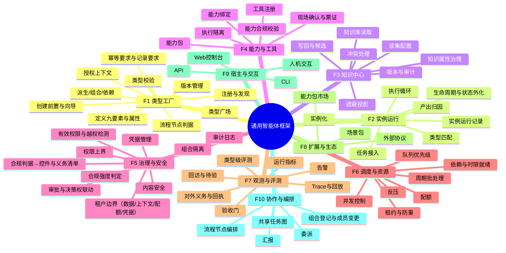

# 通用智能体框架 · 产品功能树与设计方案 v1.7

> **v1.7（2026-11-22）**：依据 [59-类型库-多租户重判-v0](59-类型库-多租户重判-v0.md) §4.2 的五条反馈、[60-类型库-高合规逐型应用-v0](60-类型库-高合规逐型应用-v0.md) §3.2 与 §3.3 的义务清单装载结论、[61-组合依赖图样本验证-v0](61-组合依赖图样本验证-v0.md) 的 §5 结论与 §6 反馈，**只做六组修订**：A 补 F5.3 外部主体登记口径（外包供应商、外部翻译服务、素材库、生成服务）；B 补 F10.5 组合条目字段 7 与 DP-1 的关系、组合依赖图全图检测；C 给 F1.5 的 C20 加场景清单子项；D 给 F5.3 验收判据加 DP-1 前置条件；E 改写 §9.8 第 2 项为纸面重判已完成 57 型、真实租户样本未取；F 改写 §9.5 第 4 项样本描述为两个组合的成员经成员行 22a 互指。v1.6 未产生，本版以 v1.5 为底本，v1.5 及更早版本原样保留，未改一字；未改 31、34 与 59 至 61。
> **v1.5（2026-11-21）**：依据 [46-P0闭环-演练记录-v0](46-P0闭环-演练记录-v0.md) 的 P0 阻断 P0-1 至 P0-4、[47-类型库-T25I13回填-v0](47-类型库-T25I13回填-v0.md) 与 [48-类型库-T25I13回填-v0](48-类型库-T25I13回填-v0.md) 的回填发现、[45-框架边界裁定-v0](45-框架边界裁定-v0.md) 的 J1–J5 裁定，**只补字段与口径，不加域、不加要素、不改九要素**：①**I 表新增第 14 行运行事件流与第 15 行义务清单引用**（D19/D20）；②**T 表行 22 拆 22a 依赖与 22b 上交、行 25 拆 25a 类型级语义与 25b 部署取值、行 20 补六个留存治理子项**（D21/D22/D25）；③**H4 命中口径补执行方，执行方列为 H4 必填控件**（D23）；④**F10.5 组合登记加租户字段，成员继承组合声明**（D24）；⑤**F1.5 接续 C19/C20，专项 20 条、合计 35 条**；⑥**A8 改为禁依赖、允许上交，F5.10 换 P0 验证口径**（D26 同时把部署形态一致性交回 34 拆 R19）。v1.4 及更早版本原样保留，未改一字。
> **v1.4（2026-11-21）**：依据 [43-F5治理与安全补强-v0](43-F5治理与安全补强-v0.md) 的缺口 N1–N4 / 越权 P1–P3 / 判据 C1–C2 与 [45-框架边界裁定-v0](45-框架边界裁定-v0.md) 的裁定，**只做三件事**：①**F5.3 由一行"租户隔离"升格为四件的租户边界（P1）**；②**新增 F5.9 有效权限计算与越权检测（P0）、F5.10 合规判据→控件映射与义务清单（P0）**；③**F1.5 接续 C17/C18 两条校验（专项 18 条、合计 33 条）**。v1.3 及更早版本原样保留，未改一字。
> **定位**：从**产品功能视角**回答"这个智能体框架向使用者提供哪些能力"。不含实现、不含技术选型。
> **输入（术语基准）**：[31-核心设计原则 v1.3](archive/31-核心设计原则-智能体类型-v1.3.md)（九要素与子属性）与 [32-通用 Agent 框架](archive/32-通用Agent框架-v0.md)（九组件）。**v1.4 未改 31**：九要素不动；读集六项、写域三项、能力五维、权限模型三值、合规强度六判据（H1–H6 原名）、记录三性、依据留痕、幂等要求三值一律逐字沿用；**v1.5 同样未改 31**，新增的运行事件流与义务清单引用都是记录层字段，不构成第十要素。
> **v1.5 输入**：[46](46-P0闭环-演练记录-v0.md) 的 P0 阻断四条与 §8 三层判断、[47](47-类型库-T25I13回填-v0.md) 与 [48](48-类型库-T25I13回填-v0.md) 的回填发现（部署配置登记缺位、组合件租户归属无字段）、[45](45-框架边界裁定-v0.md) 的 J1–J5 边界。**34 v1.5 侧同步**：I 表 15 行、T 表行 20/22/25 的三处拆分、R17 只查 25a、部署形态一致性拆为 R19（P1，未验证，依赖 DP-1 部署配置登记表）。v1.4 的增量依据 [43](43-F5治理与安全补强-v0.md) 仍是 F5.3/F5.9/F5.10 的来源，F10 仍不展开、不加 F11 域。
> **与前序文档**：[29-系统设计方案](29-系统设计方案-v1.md) 是"记忆中心"总体方案，其能力已并入本文 F3；[27-功能树](archive/27-功能树-v0.md) 是早期产品向草稿，已作废。
> **本版交付**：功能树 + 功能域详解 + 优先级 + 用户旅程 + v1.3 的 G16–G20 落点（保留）+ v1.4 的 F5 补强落点（§8.9）+ **v1.5 的字段补位与口径裁定（§8.10）** + **v1.7 的六组反馈落点（§8.11）**。v1.7 **不新增要素、不加 F11 域、不展开 F10、不改校验编号**，只补外部主体登记口径、组合检测要求、场景清单与验收前置条件，**未改 31、34、59 至 61 与 v1.5 文件**。
> 本文是类型化框架的规范，不是元框架的规范，元框架的八件原语与五个扩展点见 [51-元框架分层-v0](51-元框架分层-v0.md)；本设计线的 T 表、I 表、A1 至 A8、R1 至 R25 属于类型化框架的内核部件，换掉它们类型化框架不再成立，但它们不是元框架的内核。

---

## 0. 摘要（先结论）

**一句话**：把"每次任务都重新拼提示词 + 挑工具 + 抄上下文"变成——**定义一次智能体类型，之后按需实例化无数次**；v1.3 再补一句：**类型只装"永远不变的约束"（T 表），每次运行的数据另存一层（I 表）**；v1.4 再补一句：**每个动作先用"能力上界 ∩ 读集 ∩ 写域 ∩ 工具白名单"算出有效权限，高合规类型先冻结义务清单**；v1.5 再补一句：**同一次运行要能按事件回放（拒绝/重放/接管都落运行事件流），命中的义务要能按清单 id@版本追到条目**。

**框架的十条功能主线**（v1.3 在 F2、F5、F10 三条上各加一项；v1.4 只在 F5 补两项、升格一项；v1.5 在 F2、F5、F10 三条上各补字段与口径）：

1. **类型工厂**：定义、注册、派生、版本化 agent 类型（"造 agent 的模具"）
2. **实例运行**：把任务变成实例、跑起来、管生命周期、**逐轮留运行记录**（"用模具压出 agent，并记下每一炉的炉次"）
3. **知识中心**：类型声明读什么、写回什么，知识有版本、可审计（"agent 的记忆"）
4. **能力与工具**：工具注册、能力包、执行隔离、**现场确认与票证**（"agent 的手"）
5. **治理与安全**：权限上界、审批、租户边界、凭据、审计、**有效权限与越权检测**、**合规强度判定→义务清单**（"agent 的缰绳"）
6. **调度与资源**：并发、配额、租约、**幂等键生成与去重**、反压（"agent 的体力"）
7. **观测与评测**：指标、trace、类型级评测、验收门（"agent 的成绩单"）
8. **扩展与生态**：能力包、场景包、外部系统接入（"框架的生长"）
9. **宿主与交互**：CLI / Web / API / 人机交互（"人和 agent 的界面"）
10. **协作与编排**：多 agent 委派与协作、**组合登记与成员变更复核**（预留，另一会话主题）

**MVP 最小闭环（P0，v1.5）**：F1（类型定义/注册/校验/创建前置与向导，含幂等要求与记录要求）+ F2（实例化/执行/生命周期/归因 + **F2.7 实例运行记录**，I 表 15 行含运行事件流与义务清单引用）+ F3（读集/写域/快照/准入/记录三性）+ F4（工具注册/越界拒绝/环境阶段）+ F5（权限上界/分级审批/审计 + **F5.8 合规强度判定** + **F5.9 有效权限计算与越权检测** + **F5.10 合规义务清单**）+ F6（并发/租约/幂等去重/周期批处理）+ F7（指标/验收门/双段状态机）+ F9（一种宿主）。

**闭环三步（v1.3 新增口径）**：P0 闭环不是"能跑通"，而是同时满足以下三步——

1. **幂等键去重**：同一请求重复提交两次，只产生一条实例运行记录、只执行一次；第二次返回首次结果引用，而不是再跑一遍；
2. **实例运行记录**：每一次运行都有一条 **I 表**记录，写明租约、单次起止、上轮结果引用、本轮执行证据、本次幂等键值；
3. **审计可查**：F5.5 能从任一产出回到 I 表记录与去重判定，且记录不可篡改（改任一字段即校验失败）、只追加、可按留存期限监管直读。

> **押后声明（42 §10）**：**P0 闭环押后到 T/I 分层落地之后。** 在 T 表/I 表拆开之前跑端到端闭环，会把"类型定义装运行时字段"的结构缺陷固化进运行时，代价高于先改结构。所以 v1.3 的 P0 是"分层落地后的闭环"，不是"v1.3 发版即跑通"。

**v1.3 相对 v1.2 的变化（G16–G20）**：

- **G16**：新增 **F2.7 实例运行记录管理**（P0）——幂等键生成与去重、租约快照、单次运行记录、上轮结果引用、执行证据归档。它承接 P13"类型定义 vs 实例运行记录分层"（31 v1.3 新增）：**类型定义（T 表）只写"幂等要求"三值（必须/不需要/条件）+ 幂等键来源**；**实例运行记录（I 表）写本次幂等键值、租约、单次起止、上轮结果、执行证据**。F2.7 是运行时侧的承载，F1.1 是类型侧的声明位，两者以 I 表为单一事实源。
- **G17**：新增 **F10.5 组合登记与成员变更复核**（P1）——组合声明登记（进类型注册表，**单独一类条目，不是类型条目**）、成员类型 **id@版本**、状态机（含回退边显式枚举）、依赖声明、**移交契约五要素**、内部禁止协作（**按席位对**）、成员变更复核人（默认类型所有者，高合规则加合规负责人）；另承接 42 §9.4 的"轻量节点条目"，使组合成员可以是流程节点而不必塞进类型库。
- **G18**：新增 **F5.8 合规强度判定**（P0）——6 项判据（人身安全 / 法定对外义务 / 许可证依赖 / 监管报送 / 记录留存义务 / 第三方审计权）；命中 H1（人身安全）或 H2（法定对外义务）任一，或在 H3–H6 中同时满足 ≥3 条，即判**高合规**；高合规触发三条后果：**强制新建、不得派生、审批强度上调一档**。它替掉 v1.2 §9.4 第 6 条"什么算高合规"的工作定义。
- **G19**：**现场确认与票证**（P1 执行，声明 P0）——隔离物（编号 + 上锁状态）、许可票面五要素（票种/编号/有效期/签发人/作业范围）、监护在场确认方式（现场/远程 + 见证 + 签字）；证据等级三级（一级物证/二级影像/三级自述）。落 F1.1 边界与能力组（声明）、F4.3（执行）、F4.5（校验）、F5.2（审批凭证）、F5.5（证据等级入审计）。**编号校正**：42 §7 写作 F5.3，而 33 的 F5.3 是租户边界，按语义落 F4.3/F4.5/F5.2；留痕见 §8.6 与 §9.2。
- **G20**：**记录三性 + 留存期限**（不可篡改/只追加/监管直读）——声明落 F1.1 接口与验收组，执行落 F2.7（运行记录）与 F5.5（审计取证），知识侧落 F3.4、知识冲突裁决落 F3.5；**F7.4 加"误拦率上界 + 人工补偿通道"**，并同步到 F1.1 代理指标。
- **术语对齐（R36–R45）**：全面改用 31 v1.3 口径——**读集六项**、能力**五维** + 环境**三段**、验收=**主验收时点 + 附加回访**（代理指标/真实指标分栏、归因设计、证据强度）、决策权=**默认档 + 条件→档位**、生命周期**四档**；新增术语 **P13 / T 表 / I 表 / 幂等要求三值 / 移交契约五要素 / 权限模型三值 / 否决权四值**（见 §8.4）。

**v1.4 相对 v1.3 的变化（只三件，依据 43/45）**：

- **F5.3 升格（P1）**：v1.3 的一行"租户隔离"→ **F5.3 租户边界**，含**数据分区 / 运行上下文 / 配额 / 凭据**四件；明确**单机/本地部署阶段=逻辑隔离，不是物理隔离；物理隔离 P2**。承接 43 的 N1–N4（租户在边界单元、类型归属、实例上下文、知识分区四处无字段）。
- **F5.9 新增（P0）**：**有效权限 = 能力上界 ∩ 读集 ∩ 写域 ∩ 工具白名单**（交集，不是并集；四者任一不含即无权）；三步 **算（冻结当次有效权限）→ 比（动作前比对）→ 记（越权即拒并留审计记录）**；**默认拒绝**，越权判定可执行（拒绝 + 审计，不是"提示一下"）。承接 43 的 P1–P3（无合并公式、越权无可执行定义、最小权限无落点）。
- **F5.10 新增（P0）**：合规强度六判据（H1–H6，沿用 31 原名）**每条指向必填控件**；命中即**生成义务清单并冻结**（清单随实例走，不可事后改）；**义务未满足则高合规不成立**。承接 43 的 C1–C2（判据不驱动控件、无义务清单中间产物）。
- **F1.5 加两条（校验位）**：**C17 有效权限可算性**、**C18 合规义务清单完整性** → 专项 16→**18 条**、合计 31→**33 条**。**不占 34 的 R1–R16 编号**（34 侧拟增的 T25/I13/R17/R18 属 34 v1.4，本轮不动）。
- **§9 加两条 P2 占位（不展开）**：打扰预算（落 F9.4）、团队级视图与协作质量归因（F4.9/F4.10 为预留编号）；来自 44 协作树对齐暴露的真实缺口，按 45 裁定不展开、不进 P0。

**v1.5 相对 v1.4 的变化（六件，依据 46/47/48 与 45）**：

- **I 表补两行（记录层）**：新增**第 14 行运行事件流**（拒绝/重放/接管/审批/失败/异常六类事件，只追加，允许运行中分次追加）与**第 15 行义务清单引用**（`obligation_list@版本`；高合规必填），I 表由 13 行增至 **15 行**。承接 46 的 P0-1（拒绝/重放/接管在 13 行里无槽位）与 P0-3（义务清单无引用字段）。
- **T 表三处拆分（类型层）**：**行 22 拆 22a 依赖与 22b 上交**；**行 25 拆 25a 类型级跨租户语义与 25b 部署取值**；**行 20 的交付物归档补六个子项**（对外公开范围/留存期限/脱敏责任人/撤回方式/销毁或归档/读取审批）。承接 46 的 P0-2、47 §4 的 T25 与部署形态耦合、48 §4 的 P0-1。
- **H4 命中口径（D23）**：**报送动作由本类型执行才计命中**，执行方列为 H4 必填控件；承接 46 的 P0-4（原口径下门禁结论在通过与拦截之间翻转）。
- **组合登记加租户字段（D24）**：F10.5 的组合条目声明租户归属，成员类型继承组合声明；承接 48 的 P0-2（T075/T078 的租户随组合或流程走）。
- **F1.5 加两条**：**C19 运行事件流完整性**、**C20 类型级租户语义与部署取值分离** → 专项 18→**20 条**、合计 33→**35 条**。
- **门禁与验证口径（D26）**：**A8 禁依赖、允许上交**（依赖=阻塞调用，上交=上报式转交）；**F5.10 的 P0 验证改为"样例题加人工评审"**，原因是 A3 会把命中 H2/H4 的类型全部挡在 P0 之外，按"直接拦截命中类型"的原口径跑不出合法输入。

**数量（v1.3）**：新增 3 个子功能（F2.7、F5.8、F10.5）与 1 个非子功能的登记载体（F2.7-a 轻量节点条目，P2）；F1.5 专项校验由 12 条增至 16 条（合计 **31 条**）；改动 **28 行**既有功能（F1.1/F1.2/F1.3/F1.4/F1.5/F1.6/F1.7/F2.1/F2.3/F2.4/F2.5/F2.6/F3.1/F3.4/F3.5/F3.6/F4.1/F4.3/F4.4/F4.5/F5.1/F5.2/F5.5/F5.7/F6.3/F6.6/F7.1/F7.4）另加 6 行联动小改（F7.3/F7.5/F7.6/F9.2/F9.4/F8.2）。逐条对照见 §8，术语对齐见 §8.4，未验证与依赖见 §9。

**数量（v1.4）**：F5 子功能 **8→10**（新增 F5.9/F5.10），F5.3 由 1 行升格为 1 个子功能 + 四件明细表；F1.5 专项 **18 条**（合计 **33 条**）；较 v1.3 增加 **111 行**，新增内容全部是功能点、验收判据、一张六判据映射表与两条 P2 占位，未注水；**未改 31/34，未新增要素/组件/域**。

**数量（v1.5）**：I 表 **13→15 行**（新增运行事件流与义务清单引用），T 表行 22 与行 25 各拆两义、行 20 补六个留存治理子项（T 表仍 25 行）；F1.5 专项 **18→20 条**、合计 **33→35 条**；F10.5 加租户字段一处；§9 新增 §9.8 登记本轮四项待办。**未改 31/34，未新增要素/组件/域。**

**MVP 判断（v1.4 补一句）**：v1.3 **不把"组合协作、物理域现场执行"塞进 P0**，而是把 **T/I 分层本身**当成 P0 的结构前提：P0 = T 表字段可录入可校验 + I 表记录可写可查可审计 + 合规强度可判 + **有效权限可算且越权可拒（F5.9）** + **命中判据的义务清单已冻结（F5.10）**。组合登记（F10.5）P1、组合运行时协作 F10.1–F10.3 仍 P2、现场确认执行 P1。理由三条：

1. 42 §5 证明第三轮卡点集中在"**填了也无处校验**"，继续加属性只会加深错配；先拆层，P0 闭环才有可校验的落点。
2. 幂等键、租约、单次运行记录、上轮结果这些字段**只在运行时产生**；放进 T 表会把"类型定义"变成"运行日志模板"，校验规则永远写不完整。
3. 42 §10 已拍板"P0 闭环押后到 T/I 分层落地之后"：先跑闭环会把结构缺陷固化进运行时，代价高于先改结构。

v1.5 把 I 表补到 15 行、T 表三处拆分补齐、H4 口径写明执行方，P0 的范围不变：仍由 A1–A8 与 S1–S3 双重挡住未验证类型，仍然不把组合运行时、物理域现场执行、投影引擎、物理隔离、事件回放引擎放进 P0。补的两行只让"同一次运行里发生的事"与"命中的义务"有字段可落，不改变 P0 的能力边界。

**诚实声明**：v1.3 中**已由 122 型次验证**的是"要素层够用（0 处需要第十要素）"与"第三轮 22 型的卡点分布（T/I 错配、移交契约无字段、现场证据只能取二级、组合成员可指向不存在的类型）"；**未验证**的是 T/I 分层在产品侧的字段边界、幂等键去重的实现口径、组合登记状态机、合规强度六判据的阈值、现场证据等级的升级路径。逐项列在 §9.3。**v1.4 新增的三块同样是设计而非实证**：租户边界四件只有逻辑形态（物理隔离 P2）、有效权限四交集尚无一条真实拦截记录、义务清单与控件的映射只做了逐条对齐而未做覆盖率验证；逐项列在 §9.7 末段。**v1.4 的 F5.9 与 F5.10 在 46 的 P0 闭环里验证结果为"部分成立"**：F5.9 的四交集能冻结、能拒一次越界，但同一次运行里的拒绝/重放/接管事件没有槽位可落（结构缺运行事件流槽位），所以"越权可回放"只到冻结那一刻；F5.10 的判据能逐条映射到控件，但义务清单没有引用字段（缺义务清单引用）随实例流转，且 H4 的命中口径未定（报送动作由谁执行），门禁结论会在通过与拦截之间翻转。这三处缺口分别由 v1.5 的 I 表第 14/15 行、D23 与 C19/C20 补位，补位后仍未经真实闭环重跑。

---

## 1. 产品定位

### 1.1 它是什么

一个**智能体工厂与运行平台**：团队用"类型"描述 agent（它是谁、干什么、能碰什么），平台负责把任务实例化成 agent、跑完、管住、留痕。v1.3 把"留痕"从一句承诺变成两层的结构：**类型定义（T 表）**描述什么永远不变，**实例运行记录（I 表）**记录每一次运行实际发生了什么。

### 1.2 它不是什么（划清边界）

| 不是 | 为什么 | 是什么 |
|---|---|---|
| 提示词模板库 | 提示词只是"行为"的一部分 | 类型 = 九要素的完整定义 |
| 工作流编排器 | 编排是"任务之间怎么连"，框架管"任务内 agent 怎么活" | 协作留给 F10 与另一会话；流程节点只做识别与编排，不塞进类型库 |
| RPA / 脚本平台 | 脚本是确定性的；agent 是决策性的 | 行为规则 + 边界 + 验收 |
| 单一聊天产品 | 聊天是宿主形态之一 | F9 的一种 |
| 模型供应商 | 模型可替换 | 能力/工具/知识层与模型解耦 |
| 合规认证机构 | 框架校验"有没有声明资质与义务"，不替代发证机关 | 责任主体与资质的**登记与校验位**，不是资质本身 |
| **运行日志系统**（v1.3 新增） | 日志是"事后翻得动"，I 表是"事前可校验、事中可去重、事后可审计" | 实例运行记录 = 幂等键 + 租约 + 单次起止 + 上轮结果 + 执行证据的结构化记录 |
| **类型定义模板**（v1.3 澄清） | 模板装不下"本次"的数据；硬装会让校验规则永远写不完 | T 表（永远不变的约束）+ I 表（本次的数据）两层 |

### 1.3 使用者与角色

| 角色 | 关心什么 | 主要用哪些功能域 |
|---|---|---|
| **类型设计者**（专家/架构师） | 类型定义是否清楚、可复用 | F1 类型工厂 |
| **任务发起者**（业务方） | 任务能不能被正确理解、结果能不能验收、会不会重复跑 | F2 实例运行、F9 宿主 |
| **治理者**（安全/合规/负责人） | 有没有越权、能不能审计、成本可控吗、是不是高合规 | F5 治理、F6 调度、F7 观测 |
| **合规/法务**（强合规域） | 法定对外义务、资质、读集准入、证据强度、记录留存是否可审 | F1 类型定义、F3 知识中心、F5 治理、F7 观测 |
| **平台运维** | 跑得稳不稳、资源够不够、故障能不能定位、重复提交多不多 | F2.7、F6、F7、F9 |
| **扩展开发者** | 能不能加工具/接系统/做场景包 | F4、F8 |
| **组合所有者**（v1.3 明列） | 组合成员是否都在、变更谁复核、移交契约是否齐全 | F10.5、F1.3、F1.4 |

> 角色不是第十要素，也不是新类型；它只是"谁在用哪些功能"的视图。九要素仍是身份/职责/能力/知识/行为/边界/接口/生命周期/协作。

### 1.4 核心价值主张

1. **复用**：定义一次类型，实例化无数次；类型可评、可版本、可派生。
2. **治理**：每个实例的权限、写域、行为都有上界；**有效权限 = 能力上界 ∩ 读集 ∩ 写域 ∩ 工具白名单，动作前比对、越权即拒**；越界可判、可审批、可审计。
3. **可验收**：验收不是一句"以 Z 验收"，而是**主验收时点 + 附加回访 + 验收参数与给定方 + 代理/真实指标 + 归因设计 + 证据强度**；缺证据位不算完成。
4. **可观测**：任何产出可归因到"类型版本 + 实例 + 证据链 + 证据强度"；缺证据不算完成。
5. **可校验**（v1.3 新增）：类型的每个字段要么落 T 表（可校验"声明是否齐全"），要么落 I 表（可校验"本次是否真的发生"）；**没有"填了也无处校验"的第三态**。

---

## 2. 功能树总览

### 2.1 思维导图



### 2.2 功能树（缩进版，便于检索与勾选）

```
通用智能体框架
├─ F1 类型工厂
│  ├─ F1.1 类型定义（九要素模板、八个字段组、幂等要求、记录要求、权限模型、否决权、校验）
│  ├─ F1.2 类型注册与发现（枚举/搜索/详情/证据与依赖展示/合规强度与幂等要求）
│  ├─ F1.3 派生、组合与依赖（判定辅助/高合规不派生/依赖声明/席位对禁止协作）
│  ├─ F1.4 版本管理（历史/差异/回滚/关系与组合登记冻结）
│  ├─ F1.5 类型校验（35 条：基础 15 + 专项 20/反模式/按生命周期分型）
│  ├─ F1.6 类型广场（模板/示例库）
│  ├─ F1.7 创建前置与创建向导（前置/步序/1.5↔7/流程节点判据/合规强度判定）
│  └─ F1.8 授权上下文管理（签发/校验/过期）
├─ F2 实例运行
│  ├─ F2.1 任务接入（消息/事件/工作项/幂等键入口）
│  ├─ F2.2 类型匹配与路由（适用域/依赖前置）
│  ├─ F2.3 实例化（快照/租约/预算/参数/前置复核/建 I 表记录）
│  ├─ F2.4 执行循环（多步/工具调用/停止条件/硬时限/证据采集）
│  ├─ F2.5 生命周期管理（四档/多段硬时限/触发节奏/单次边界/幂等要求/状态外化/归档/交接）
│  ├─ F2.6 产出归因（版本+实例+证据强度+归因+记录引用）
│  └─ F2.7 实例运行记录（幂等键值/租约/单次起止/上轮结果/证据归档/运行事件流/义务清单引用）  ← v1.3 新增
├─ F3 知识中心
│  ├─ F3.1 知识库读取（检索/范围/版本/时效/准入/投影）
│  ├─ F3.2 读集配置（六项：范围含可见粒度/版本/时效/权威级别/驻留范围/准入）
│  ├─ F3.3 写回与候选（私有草稿/候选/合并/可见性不提升）
│  ├─ F3.4 版本与审计（谁改了什么/记录三性/依据版本引用）
│  ├─ F3.5 冲突处理（显式分歧/人工裁决/强度冲突/裁决记录三性）
│  ├─ F3.6 知识属性与时效治理（过期/复核/驻留/准入/证据强度）
│  └─ F3.7 遮蔽投影与可见粒度执行（脱敏/仅标志/仅分数）
├─ F4 能力与工具
│  ├─ F4.1 工具注册（声明/描述/参数/五维/资质/权限模型）
│  ├─ F4.2 能力包（按职责打包）
│  ├─ F4.3 执行隔离（超时/取消/重放/环境阶段/现场确认与票证）
│  ├─ F4.4 能力绑定（类型-工具-写域-资质-权限模型）
│  └─ F4.5 能力合规校验（责任主体/资质/环境三段/现场证据等级）
├─ F5 治理与安全
│  ├─ F5.1 权限上界（实例权限⊆类型上界/否决权对称）
│  ├─ F5.2 审批流与分级授权（限额/风险/决策权联动/高合规上调一档）
│  ├─ F5.3 租户边界（数据分区/运行上下文/配额/凭据四件；类型级语义 25a 与部署取值 25b 分离；外部主体登记口径；逻辑隔离，物理隔离 P2）
│  ├─ F5.4 凭据管理（不落明文）
│  ├─ F5.5 审计日志（越权/审批/放行/义务/投影/资质/幂等去重/记录三性）
│  ├─ F5.6 内容安全（不可信输入/外溢）
│  ├─ F5.7 组合隔离与禁止协作（不共享上下文/模型分/自评/席位对）
│  ├─ F5.8 合规强度判定（六判据/高合规三后果）  ← v1.3 新增
│  ├─ F5.9 有效权限计算与越权检测（四交集/算-比-记/默认拒绝）  ← v1.4 新增
│  └─ F5.10 合规判据→控件映射与义务清单（六判据逐条控件/义务冻结/未满足即高合规不成立）  ← v1.4 新增
├─ F6 调度与资源
│  ├─ F6.1 并发控制（全局/类型/租户上限）
│  ├─ F6.2 配额（token/时间/费用）
│  ├─ F6.3 租约与防重（同任务不双跑/幂等键生成与去重）
│  ├─ F6.4 队列与优先级（公平/优先）
│  ├─ F6.5 反压（过载降速不崩溃）
│  ├─ F6.6 周期批处理（每日/每周/补跑/节拍/幂等要求）
│  └─ F6.7 依赖与时限就绪（缺失降级/硬时限/逾期）
├─ F7 观测与评测
│  ├─ F7.1 运行指标（数量/耗时/成本/失败率/逾期/义务/去重命中/误拦补偿）
│  ├─ F7.2 Trace 与回放（每步可查/可重放/I 表记录回放）
│  ├─ F7.3 类型级评测（按类型横向比较）
│  ├─ F7.4 验收门（主验收时点+附加回访/双段/误拦率上界）
│  ├─ F7.5 告警（异常/越权/成本/时限/资质/记录完整性）
│  ├─ F7.6 回访与待验（回访时点/判定人/超期升级）
│  └─ F7.7 对外义务与回执（对象/时限/格式/回执）
├─ F8 扩展与生态
│  ├─ F8.1 能力包市场（安装/组合）
│  ├─ F8.2 场景包（一套策略+类型清单+T/I 双模板）
│  └─ F8.3 外部协议（与其他系统互联）
├─ F9 宿主与交互
│  ├─ F9.1 CLI（脚本/批处理）
│  ├─ F9.2 Web 控制台（看板/操作/向导/运行记录/组合登记）
│  ├─ F9.3 API（外部系统接入）
│  └─ F9.4 人机交互（审批/确认/汇报/双签/现场见证）
└─ F10 协作与编排（预留）
   ├─ F10.1 委派（向子 agent 派任务）
   ├─ F10.2 汇报（向父 agent 交结果）
   ├─ F10.3 共享任务图（多 agent 协同）
   ├─ F10.4 流程节点编排（非类型节点，P2）
   └─ F10.5 组合登记与成员变更复核（注册表单独一类条目，含租户归属与 DP-1 绑定；依赖图全图检测，P1）  ← v1.3 新增
```

### 2.3 阅读方式

- **按角色读**：§1.3 表 → 对应功能域；
- **按优先级读**：§5 的 P0/P1/P2；
- **按实现顺序读**：§4 功能→组件映射；
- **按修订读**：§8 的 G16–G20 落点表（v1.3）与 G8–G15 落点表（v1.2 沿用）；**v1.4 的 F5 补强见 §8.9**（F5.3/F5.9/F5.10 + C17/C18）；**v1.5 的字段补位见 §8.10**（I 表 15 行、T 表行 20/22/25 三处拆分、C19/C20、A8 口径）；**v1.7 的六组反馈见 §8.11**（F5.3 外部主体与 DP-1 前置、F10.5 全图检测、C20 场景清单、§9.5 与 §9.8 状态改写）；
- **按分层读**：§8.2.2 的 T 表/I 表字段分工——判断一个字段该写在哪一层，先看这张表。

---

## 3. 功能域详解

> 每个功能域统一格式：**一句话 / 使用者 / 功能表 / 关系 / 不做**。功能表中的"验收判据"是**可判定的一句话**，用于评审与 MVP 验收。
> **格式说明**：功能表保持四列（功能/子功能/优先级/验收判据）。v1.3 新增的字段不另起功能表，仍在 F1 下用"F1.1 字段组明细"展开；新增子功能（F2.7/F5.8/F10.5）仍进四列表；改动行在 §8.3 逐行对照。

### F1 类型工厂（造 agent 的模具）

**一句话**：让设计者用九要素定义一个 agent 类型，创建前先过前置与向导校验，注册后能被任务匹配与实例化；**类型只装"永远不变的约束"（T 表），不给它装本次运行的数据**。

**使用者**：类型设计者（主）、合规/法务、平台运维。

| 功能 | 子功能 | 优先级 | 验收判据 |
|---|---|---|---|
| F1.1 类型定义 | 九要素表单/模板、必填校验、设计说明；**八个字段组**（见下方明细）；决策权=默认档+条件→档位；适用域；能力五维（含读写性质、环境三段、可逆性档）；**权限模型三值（并集/独占/签发等级）**；边界判定方式（四值×粒度×误判方向+取向+阈值审批人+**现场确认三件**）；接口与验收组（主验收时点+附加回访、验收参数+给定方、代理/真实指标、归因设计、证据强度+置信度、成熟度、法定对外义务、**记录要求三项+留存期限、依据留痕**）；知识组（读集六项：范围含可见粒度/版本/时效/权威级别/驻留范围/准入）；生命周期组（四档/多段硬时限/触发节奏/单次边界/**幂等要求三值+幂等键来源**/档位覆盖/归档vs外化）；协作组（依赖/人/禁止协作/**否决权四值**） | P0 | 缺任一必填要素无法注册；条件字段在条件成立时缺项不能保存；能力项缺五维或责任主体不能保存；效果后类型缺回访三件套或归因设计不能保存；读集项缺准入或可见粒度不能保存；周期批处理缺触发节奏、单次边界或幂等要求不能保存；一次性类型缺交付物归档不能保存；**类型表单里出现幂等键值/租约/单次起止/上轮结果等 I 表字段时校验拒绝** |
| F1.2 注册与发现 | 注册表、枚举、搜索、类型详情；详情展示主验收时点、证据强度、成熟度、依赖、资质要求、流程节点判定结果；**幂等要求与幂等键来源、记录要求、合规强度判定结果、组合登记引用** | P0 | 能回答"当前有哪些类型"；详情能回答"这个类型怎么验、依赖谁、需要什么资质、是不是高合规、幂等要求是什么"；**详情不展示 I 表字段** |
| F1.3 派生、组合与依赖 | 派生判定辅助（按优先级顺序：职责不共享→新建；边界换维→新建；同型只收紧→派生；**高合规→强制新建**）；组合（has-a）；依赖声明（**22a 依赖：阻塞调用**，类型 id+方向+缺失降级+是否阻塞启动）与**上交声明（22b：上报式转交，不阻塞不调用）**；组合内部禁止协作声明（**按席位对**）；组合登记引用（F10.5） | P1 | 派生关系可查；派生必须共享职责（换向=新建）；能力可扩但须带五维与新增边界；既有边界不放宽；依赖关系与降级策略可查；**上交关系可查，且上交不参与阻塞判定（上交不等于依赖）**；组合内部禁止协作已按席位对声明；**F5.8 判为高合规的类型不出现在派生候选中**；组合声明只能引用已登记的组合 id@版本 |
| F1.4 版本管理 | 版本历史、差异对比、回滚、实例绑版本；关系随版本冻结；派生/依赖关系在版本升级时复核；验收参数快照随版本保存；**组合登记的成员 id@版本随组合版本冻结；成员变更走 F10.5 复核**；**合规强度判定结果随版本冻结** | P0 | 改类型=新版本，旧版本仍可实例化；旧实例的验收参数不因新版本漂移；关系失效时新版本不能置为"可用"；**成员 id@版本 变更后未复核的新版本不能置"可用"；合规强度结论变更必须发新版本，不就地改写** |
| F1.5 类型校验 | 基础 15 条检查清单、反模式检测、独立评审记录；**专项校验 20 条**（C1–C12 沿用；C13–C16 为 v1.3 新增；C17–C18 为 v1.4 新增；**C19–C20 为 v1.5 新增**，见 §8.2.1、§8.9.2 与 §8.10）；按生命周期分型校验（长驻查状态外化与交接；周期查节奏、单次边界与幂等要求）；适用域一致性校验（以职责为准、接口引用）；**T/I 分层校验（类型定义与实例运行记录分层，P13；类型定义不得含 I 表字段）**；**有效权限可算性校验（四交集四项齐全且每项可解析）**；**合规义务清单完整性校验（命中判据都有控件与义务条目）**；**运行事件流完整性校验（拒绝/重放/接管三类事件都能定位到当次 I 表记录）**；**类型级租户语义与部署取值分离校验（25a 可解析、25b 不由类型表单填写；25a 取值为是或仅特定场景时场景清单必填，清单最小结构见 34 v1.7 的 §4.2.25 与 R17）** | P0 | 校验不过不能进"可用"状态；判定方式为近似/环境化但未写误判方向与取向的不得通过；长驻未写状态外化与交接的不得通过；周期未写触发节奏、单次边界或幂等要求的不得通过；效果后未写归因设计的不得通过；**幂等要求=不需要 但未写理由的不得通过；合规强度六判据缺项不得通过；组合移交契约缺要素或成员不存在的不得通过；C17 四交集（能力上界/读集/写域/工具白名单）任一项缺失或不可解析的不得通过；C18 任一命中判据缺必填控件或缺义务条目的不得通过；C19 拒绝/重放/接管三类事件中任一类无法定位到当次 I 表记录的不得通过；C20 25a 的依据三要素或审批角色缺失、25a 取值为是或仅特定场景而场景清单缺失、或 25b 的部署取值被写进类型表单的不得通过** |
| F1.6 类型广场 | 官方/团队模板、示例类型；模板包含 v1.3 八个字段组与 T/I 双模板标注 | P2 | 从模板一键创建，创建后缺项校验与新建一致 |
| F1.7 创建前置与创建向导 | 前置清单按风险等级声明（预算通用；授权上下文/隔离环境/资质预检对红队/越狱测试/高合规/物理域强制）；八步向导（0 前提→1 职责→1.5 证据形态→2 身份→3 能力→4 知识→5 行为→6 边界→7 接口→8 生命周期与协作）；**1.5↔7 回退提示**；**验收参数给定方选择**；**流程节点识别判据面板**（独立交付物/独立边界/可单独委派）；**合规强度判定面板（六判据）**；**步 8 录幂等要求与幂等键来源、步 7 录记录要求**；派生/新建/组合判定树 | P0 | 高风险类型缺授权上下文、隔离环境或资质预检时创建被拒并列出缺项；普通类型缺预算时创建被拒；1.5 与 7 的证据形态不一致时向导阻断并给出回退到 1.5 的提示；验收参数给定方未选不能完成 1.5；流程节点三问任一为"否"时不注册为类型，转入 F10.4 编排区并留判定记录；**合规强度六判据任一未落值时不能完成步 0；判为高合规时向导把创建路径锁定为"新建"并提示审批上调一档** |
| F1.8 授权上下文管理 | 签发登记（签发人/范围/有效期）、校验、过期/撤销；与隔离环境绑定；创建与实例化时复核 | P1 | 过期或撤销的授权上下文不能用于创建或实例化；签发人、范围、有效期可查；复核留审计 |

**F1.1 字段组明细（v1.3）**

| 字段组 | 包含字段 | 必填性 | 优先级 | 说明 |
|---|---|---|---|---|
| G1 身份与职责 | 角色名、人格/语气、立场、价值取舍顺序；任务类、交付物、验收口径、决策权（默认档+条件→档位）、适用域 | 必填（价值排序可选） | P0 | 决策权三值（建议/共决/执行）不变；v1.3 只补"条件→档位"结构 |
| G2 能力 | 每项能力：读写性质、影响面、可逆性、成本、作用域、环境（部署环境三段+可回放性+人身风险）、**权限模型三值（并集/独占/签发等级）**、责任主体与资质（证照四件：证照/等级/有效期/责任险；agent 上限含"仅辅助不担责"）、agent 角色 | 必填 | P0 | 责任主体与资质与五维**并列**，不是第六维；**权限模型是能力的取值结构（U27），不是第六维**；环境仍是五维之一，内部拆三段 |
| G3 知识 | 读集每项：范围（含**可见粒度**）、版本、时效、权威级别、驻留范围、**准入**；写域每项：层级、驻留范围、是否禁止写 | 必填 | P0 | **读集六项**（31 v1.3 口径）：范围含可见粒度、版本、时效、权威级别、驻留范围、准入；写域三项 |
| G4 边界 | 每条边界：判定方式、粒度（动作级/环境级）、误判方向、取向、阈值审批人、触发条件；**物理域环境级展开：隔离物（编号+上锁状态）/ 许可票面五要素（票种/编号/有效期/签发人/作业范围）/ 监护在场确认方式（现场/远程+见证+签字）** | 必填 | P0 | 判定方式四值不变；现场确认三件由 F4.3 执行、F4.5 校验，证据等级落 G5 |
| G5 接口与验收 | 输入形态、输出形态、证据、证据强度+置信度、交付物成熟度、主验收时点、附加回访、验收参数+给定方、代理指标（**含误拦率上界+人工补偿通道**）、真实指标、归因设计、法定对外义务、**记录要求三项（不可篡改/只追加/监管直读）+ 留存期限**、**依据留痕（判断时点/依据版本=记忆条目 id@版本）** | 条件必填 | P0 | 效果后必填回访三件套+归因设计；有法定义务必填义务四件套；物理域记录三性全真；高合规类型依据留痕强制 |
| G6 生命周期 | 档位（默认+实例可覆盖）、有效期、**多段硬时限（起算点+期限+逾期后果+是否可延）**、触发节奏（基础节奏+复合事件）、单次运行边界、**幂等要求三值（必须/不需要/条件）+ 幂等键来源（事件 id/周期 id/调用方传入）**、**租约期限**、**业务有效期**、实例私有状态外化、**交付物归档六子项（对外公开范围/留存期限/脱敏责任人/撤回方式/销毁或归档/读取审批）**、交接条件、续期/退休 | 条件必填 | P0 | 长驻/周期必填状态外化；一次性也必须写交付物归档；**"实例寿命"一格拆三义：租约期限/单次运行边界/业务有效期**；幂等键值不在此填（属 I 表） |
| G7 协作 | 可委派、被委派、汇报、人、禁止协作（**按席位对声明**）、依赖（**22a 依赖，阻塞调用**：类型 id+方向+缺失降级+是否阻塞启动；依赖对象可含外部主体：名称+证照+有效期）、**上交（22b，上报式转交：交给谁、交什么、什么时点交、不阻塞也不调用）**、**否决权四值（无/单方否决/双方否决/需一致）** | 条件必填 | P0（委派/汇报/人的声明、禁止协作声明、否决权声明）/P1（依赖、席位对执行） | 不声明=不协作；"人"档必填；依赖是 v1.2 新增档位，P1 落地；P0 类型依赖=无 |
| G8 关系 | 派生自、组合关系、**组合登记引用（组合 id@版本）**、派生判定依据、**合规强度判定结果（六判据取值）**、流程节点判定结果 | 条件必填 | P1（关系）/P0（合规强度判定结果） | 由 F1.3/F1.7/F5.8/F10.5 维护；流程节点与组合都不入类型库，用注册表的单独条目承载 |

**关系**：F1 的输出是 F2 的输入；F1.3 的派生/组合/依赖关系由 F1 自己维护（用户已拍板"子类型能扩展能力和数据集，由类型本身决定"）；F1.7 的前置与向导由授权方/治理者/合规方提供输入、由 F1 校验，不改变类型本体；F1.7 的流程节点判定结果转 F10.4，组合判定结果转 F10.5，都不进类型库；F1.5 的"不得含 I 表字段"由 F2.7 的字段清单反查。

**不做**：不负责执行、不存知识本体、不判定具体权限（只声明上界）；创建前置只做录入与校验，不代替授权方签发，也不代替 F5 做运行时权限判定；资质校验只核验"有没有登记与凭证"，不代替发证机关；**不装实例运行记录（I 表归 F2.7）；不把组合登记与轻量节点条目混进类型条目**。

### F2 实例运行（用模具压出 agent）

**一句话**：把外部任务变成实例，按类型跑起来，管生命周期，产出可归因，**每次运行留一条可去重、可审计的运行记录**。

**使用者**：任务发起者、平台运维。

| 功能 | 子功能 | 优先级 | 验收判据 |
|---|---|---|---|
| F2.1 任务接入 | 消息/事件/工作项、幂等键入口（来源按 T 表声明：事件 id/周期 id/调用方传入）、去重 | P0 | 同一请求重复提交不重复执行；重复提交返回首次实例与记录引用 |
| F2.2 类型匹配 | 显式指定 + 语义兜底路由；匹配前校验适用域与依赖前置 | P1 | 能回答"为什么这个任务给了这个类型"；任务超出适用域或依赖缺失时匹配被拒并说明原因 |
| F2.3 实例化 | 绑输入、钉知识快照、发租约、定预算；**生成幂等键并建 I 表记录（实例 id/类型 id/输入绑定/租约/幂等键值）**；复核创建前置有效性（F1.7/F1.8）；**验收参数给定方=实例委托人时强制录入参数**；依赖就绪检查；档位实例覆盖（若启用）；多段硬时限起算；资质预检结果复核；**记录要求与留存期限随实例快照** | P0 | 实例化不复制类型/知识，秒级完成；前置过期/撤销或依赖阻塞时实例化被拒；给定方=实例委托人而参数缺失时被拒；档位覆盖未审批时被拒；**幂等键相同且已有在跑/已完成的记录时不再新建实例，直接返回首次记录引用** |
| F2.4 执行循环 | 多步、工具调用、停止条件、失败重试；到硬时限强制停止并转交；单次运行边界到界即停；对外义务回执登记；**逐步采集执行证据（含证据等级：一级物证/二级影像/三级自述）并追加到 I 表记录** | P0 | 每步可查、可中断、可恢复；到硬时限不静默继续；单次运行边界不被突破；义务回执有记录；**每条 I 表记录有证据引用或"无证据"声明；证据等级不高于类型声明下限时不能签收** |
| F2.5 生命周期 | 四档：一次性/短驻/长驻/周期批处理；**默认档+实例可覆盖**；**多段硬时限（起算点+期限+逾期后果+是否可延）**；**触发节奏（基础节奏+复合事件）**；**单次运行边界**；**幂等要求三值（T 表侧声明）**；**租约期限/单次边界/业务有效期三分**；**实例私有状态外化 vs 交付物归档**（位置/保留期/公开范围/脱敏责任人/撤回方式/读权限）；续期/退休；交接条件；回收 | P0 | 四档都可选且行为不同；长驻退出后状态可按外化位置与保留期恢复或交接；长驻有交接条件；周期批处理有触发节奏、单次边界与幂等要求；一次性也有交付物归档；硬时限到期触发停止或逾期处置；档位覆盖有审批与审计；**租约期限与业务有效期不是一个值，分别可查** |
| F2.6 产出归因 | 类型版本+实例+证据链+证据强度+归因设计引用+交付物成熟度+**I 表记录 id** | P0 | 任一产出能追到"谁、按什么定义、干了什么、证据多强、哪一轮"；效果后产出能追到归因设计；**从产出能一步跳到对应 I 表记录** |
| **F2.7 实例运行记录管理**（v1.3 新增） | **I 表逐次记录**（15 字段，逐字口径见 §8.2.2，与 34 v1.5 §4.3 同词）：实例 id / 类型 id@版本 / 输入绑定 / 租约（holder+epoch+到期）/ 幂等键值 / 单次运行起止 / 上轮结果引用 / 执行证据（含等级）/ 审批记录 / 状态外化引用 / 产出引用 / 生命周期状态（运行中/成功/失败/超时/取消/已交接/已退休）/ 租户上下文（租户 id@配置版本 + 跨租户声明引用）/ **运行事件流**（拒绝/重放/接管/审批/失败/异常六类事件，只追加）/ **义务清单引用**（`obligation_list@版本`，高合规必填）；**幂等键生成与去重**（按 T 表"幂等键来源"生成；与 F6.3 共用同一次去重判定）；**上轮结果引用**（上轮产出 id@版本 + 结论摘要）；**执行证据归档**（不可篡改/只追加/留存期限/监管直读，按 T 表记录要求）；**运行事件流的追加与回放**（六类事件按当次记录归位；只追加，允许运行中分次追加；封链之后追加时生成新版本封链证明并引用前一版本，旧版本不覆盖）；**义务清单引用随实例冻结**（高合规必填，与 F5.10 的清单 id@版本同源）；按实例/类型/幂等键/事件类型查询与导出 | P0 | 同一幂等键只产生一条 I 表记录且只执行一次；任一实例可回答"这一轮何时起止、租约归谁、上轮结果是什么、证据在哪、键值是什么"；**I 表字段不出现在类型定义表单与 F1.5 校验项里**；记录被改动即校验失败（不可篡改）；超出留存期限的记录按策略归档且仍可监管直读；周期批处理可凭上轮结果引用跳过已完成轮次；**拒绝/重放/接管三类事件都能定位到当次 I 表记录；事件只追加，运行中可分次追加且追加顺序可还原；追加须产生新版本封链证明并引用前一版本，旧版本不得覆盖；高合规实例的记录必含 obligation_list@版本** |
| **F2.7-a 轻量节点条目**（组合成员用，v1.3 承接 42 §9.4） | 承载"不入类型库但需要登记"的流程节点（如 T220 的关账确认）：节点 id@版本、职责一句话、所属组合、签署/排序/转发类型、责任人；只作组合与编排的引用目标 | P2（随 F10.5 交付） | 轻量节点条目不出现在类型枚举里；被组合引用时可解析到 id@版本；变更留痕 |

**关系**：依赖 F1（类型与 T 表字段）、F3（知识快照/准入）、F4（工具/资质）、F5（权限/审批）、F6（租约/周期节拍/依赖就绪）；**F2.7 与 F6.3 共用同一次幂等去重判定**（F6.3 管"同一工作项不双跑"的调度侧，F2.7 管"这一次运行的记录"）；F2.5 的档位与单次边界决定 I 表记录何时开、何时闭；F2.6 的归因引用 I 表记录 id。

**不做**：不定义类型、不实现调度策略（调用 F6）、不存公共知识（写回走 F3）；不代替合规方判断资质真伪（只校验登记与凭证有效性）；**F2.7 只写与查记录，不改写既有记录（只追加），也不替代 F5.5 的审计取证视角**。

### F3 知识中心（agent 的记忆）

**一句话**：类型声明读集/写域，实例只读快照、只写私有，公共知识经候选写回并留版本；读集项带**六项**（范围含可见粒度、版本、时效、权威级别、驻留范围、准入）；**记录类知识按记录三性留存**。

**使用者**：类型设计者（声明）、任务发起者（受益）、治理者/合规（审计）。

| 功能 | 子功能 | 优先级 | 验收判据 |
|---|---|---|---|
| F3.1 知识库读取 | 按范围检索、按相关度/时间过滤；按声明版本取用；过期与权威级别标注；**执行准入**（可读/需授权/禁读/仅命中标志）；**按可见粒度投影**（全量/脱敏/仅标志/仅分数）；证据强度标注；**依据留痕（读取时记录判断时点+条目 id@版本）** | P0 | 实例只能读到读集内且准入允许的内容；命中"禁读"直接拒绝并解释；"需授权"无授权时拒绝；读到过期项时带"过期"标记，不能作为"现行"依据；投影后不返回超出可见粒度的字段；**高合规类型的每次读取留下依据版本，可从产出反查到当次读的哪一版** |
| F3.2 读集配置 | 类型→读集声明、项目/领域/全局范围；每项声明**六项**（范围含可见粒度/版本/时效/权威级别/驻留范围/准入）；证据强度 | P0 | 越界读取被拒绝并可解释；读集项能回答"读的哪一版、何时过期、多权威、允许驻留在哪、能不能读、能读到多细"；缺准入或可见粒度的读集项不能保存；**读集项缺任一项即不能保存（六项齐全才算配置完成）** |
| F3.3 写回与候选 | 私有草稿、候选提交、审批合并；写域项声明版本/时效/权威级别/驻留范围（含"禁止写"）；**写回不得提升可见性**（受限读集内容不得写入更高可见层级）；准入复核 | P0 | 实例不能直写公共知识；写域项缺驻留范围的写入被拒；受限内容写入更高可见层级被拒；候选合并后版本与权威级别可追 |
| F3.4 版本与审计 | 知识版本、变更历史、回滚；版本/时效/权威级别/驻留范围/准入/可见粒度/证据强度的属性变更也入历史；**记录类条目按"只追加"维护，历史不可篡改，留存期限到期归档** | P1 | 能回答"这条知识谁改的、什么时候、改前改后"；属性变更可追；**记录类条目无删除与就地改写入口；归档后仍可按留存期限检索** |
| F3.5 冲突处理 | 矛盾标记、显式分歧、人工裁决；证据强度冲突（一级 vs 二级）显式暴露；**裁决记录按记录三性留存**（不可篡改/只追加/留存期限；有监管要求时监管直读）；**记录类知识被冲突改写时以追加新版本解决，不覆盖旧值** | P1 | 冲突不会被静默合并；强度冲突不会被"取平均"掩盖；**每条裁决有编号、裁决人、裁决时点与依据版本；裁决链只追加，可被第三方按编号直读复现** |
| F3.6 知识属性与时效治理 | 六项属性的登记、过期扫描与提醒、权威级别复核、驻留范围校验、准入复核、证据强度标注；**留存期限扫描与归档** | P1 | 过期知识被标注且不能作为"现行"依据；驻留范围外的写入被拒；准入变更需复核并留审计；证据强度缺失的知识项不能被标为"一级"；**超出留存期限的记录类条目被归档且仍可读，不静默删除** |
| F3.7 遮蔽投影与可见粒度执行 | 字段级脱敏、聚合、仅返回命中标志、仅返回模型分；投影规则配置与审计；与 F5.1/F5.5 联动 | P1 | 同一读集项对不同角色可按规则返回不同粒度；"仅标志/仅分数"不返回原文/权重；每次投影决策可审计 |

**关系**：29 的"记忆中心"实现可落在这里；F2 的实例化从这里取快照；F3.6 为 F3.1/F3.2 提供时效、权威、准入判定；F3.7 为 F3.1 提供投影执行；F3.3 的写回受 F3.2 的准入与可见性约束；**F3.4/F3.5 的记录三性与 F1.1 G5 的记录要求同一套口径**（G5 声明，F3 与 F2.7 执行）。

**不做**：不存 agent 定义（F1）、不做执行（F2）；F3.6 只治理属性与时效，不判定知识内容的对错；F3.7 只做投影，不决定"该不该给"（准入在 F3.2，权限在 F5.1）；**不做审计取证系统本身（在 F5.5），只保证记录条目满足三性**。

### F4 能力与工具（agent 的手）

**一句话**：工具注册、能力包、执行隔离；能力与类型、写域、资质、环境绑定；**物理域动作的隔离物/许可/监护在隔离层执行**。

**使用者**：扩展开发者（注册）、类型设计者（绑定）、治理者/合规（审计）。

| 功能 | 子功能 | 优先级 | 验收判据 |
|---|---|---|---|
| F4.1 工具注册 | 声明名/描述/参数/副作用；**五维元数据**（影响面/可逆性/成本/作用域/环境）；**责任主体与资质要求**（证照四件）；可回放性/人身风险标注；**权限模型三值标注（并集/独占/签发等级）** | P0 | 未注册工具不可调用；工具详情能回答"这个工具能造成多大影响、能不能撤销、需要什么资质、在哪个环境可执行"；**独占型工具的并发调用被拒；签发等级型工具无对应等级签发时被拒** |
| F4.2 能力包 | 按职责打包工具；包级五维与资质清单；**包级权限模型与记录要求继承声明** | P1 | 能力包可被类型引用；包内工具的五维与资质不冲突；**包级声明不得宽于成员工具的声明** |
| F4.3 执行隔离 | 超时/取消/重放/收据；**环境阶段门禁**（沙箱→灰度→生产）；不可回放动作的审批与监护；人身风险动作的**现场确认三件**：隔离物（编号+上锁状态）/ 许可（票面五要素：票种/编号/有效期/签发人/作业范围）/ 监护（在场确认方式=现场/远程+见证+签字）；**现场确认结果与证据等级（一级物证/二级影像/三级自述）入执行证据** | P0 | 写操作有收据、可重放；未到环境阶段拒绝执行；不可回放/人身风险动作无审批或监护时拒绝；**隔离物编号缺失或未上锁、许可票面缺要素、监护签字缺失任一成立即拒绝执行；远程监护未附见证人时按二级证据记，不得声称一级** |
| F4.4 能力绑定 | 类型↔工具↔写域；**资质绑定**；**环境绑定**；**权限模型绑定（并集/独占/签发等级 与工具一致）**；绑定校验 | P0 | 越界调用被拒；类型声明了资质要求而绑定工具不满足时绑定被拒；环境不匹配时绑定被拒；**权限模型不一致（如类型声明独占、工具声明并集）时绑定被拒** |
| F4.5 能力合规校验 | 责任主体与资质校验（创建前置）、环境三段校验、审批强度与决策权分级联动校验；资质到期提醒；外部资质库/人工核验接口；**现场确认三件的声明完整性校验与证据等级下限校验** | P1 | 缺责任主体或资质的类型不能进"可用"；环境序列不合法（跳段/越段）不能绑定；资质过期时相关能力被降级为"仅起草"并告警；**声明人身风险=有 但现场确认三件缺项的类型不能进"可用"；证据等级上限低于类型要求时告警并拒绝签收该类证据** |

**关系**：F5 判定权限、F3 管数据范围、F1 声明能力；F4.5 读取 F1.1 的能力组、边界组与 F1.7 的前置清单；F4.5 的结果供 F5.2 计算审批强度、供 F5.8 判定合规强度；**F4.3 的现场确认证据供 F5.5 审计取证与 F2.7 归档**。

**不做**：不判定权限（F5）、不定义类型（F1）；资质校验只核验登记与凭证，不替代发证机关；环境三段校验只校验声明与绑定，不负责创建环境；**不发明隔离物编号与许可票号（由现场系统给），只要求填写与核验一致性**。

### F5 治理与安全（agent 的缰绳）

**一句话**：权限上界、审批（含分级授权与决策权联动）、**租户边界（四件）**、凭据、审计、内容安全、组合隔离、**合规强度判定**、**有效权限与越权检测**、**合规判据→控件与义务清单**——横切所有域。

**使用者**：治理者（主）、合规/法务、平台运维。

| 功能 | 子功能 | 优先级 | 验收判据 |
|---|---|---|---|
| F5.1 权限上界 | 类型上界→实例权限（只收窄）；决策权条件分支的权限上界；组合内部隔离约束；**权限模型三值在运行时的执行**（并集可多人同时有效；独占同一时刻只一个持有者；签发等级要求签发人等级≥动作要求） | P0 | 实例权限超类型上界被拒；决策权=建议却有写权限被判矛盾；组合内实例越隔离边界被拒；**独占型动作被第二个持有者并发发起时被拒；签发人等级不足时放行被拒** |
| F5.2 审批流 | 高风险动作挂起待人批准；分级授权（限额/风险分级内自动放行、超限转人工）；审批规则引用能力五维+边界判定方式；**审批强度与决策权分级联动**；阈值审批人；无审批者时 fail-closed；**高合规类型审批强度上调一档（F5.8 结果驱动）**；**现场确认票证作为审批前置附件** | P0 | 无审批者时 fail-closed；限额内自动放行不生成人工待办但留审计记录；超限单转人工；决策权=共决时至少人机双签；决策权=执行且影响面=广泛/不可逆/人身风险=有时至少人工审批；审批单展示五维、判定方式、阈值审批人；同一输入的自动/人工判定可复现；**判为高合规的类型，同一动作的审批档位比非高合规上一档，档位按 34 v1.7 R25 的定档映射取值，且审批单必须能看到合规强度判定依据** |
| F5.3 租户边界 | **四件**：数据分区（知识/记忆/运行记录/审计日志/凭据池带 tenant_id，跨分区读须显式声明）、运行上下文（实例注入 tenant_id+配置版本，读写前校验一致）、配额（按租户计并发/预算/存储，超限排队不挪用）、凭据（租户级凭据池不共享，注入带 tenant_id）；**T 表行 25 拆 25a 类型级语义与 25b 部署取值**（25a 写"是/否/仅特定场景"+依据三要素+审批角色；25b 由部署配置生成，不入 T 表）；组合隔离不替代租户边界 | P1 | 跨租户不可见/不可调；**未声明的跨分区读被拒；上下文缺失或版本不一致时拒绝并留审计；单租户配额超限只排队、不借用他租户额度；跨租户引用凭据被拒；25a 与 25b 分开判定：25b 未登记时按"未登记"处理，不冒充"否"；同一实例的 25b 取值与 25a 冲突时拒绝执行并留审计**；外部主体未按登记口径登记时，引用它的运行请求被拒并留审计；DP-1 未建成时外部主体 id 写"待分配"、缺登记项记警告不阻断类型登记；**DP-1 未登记时 F5.3 验收只能标"未开始"，不能标"通过"** |
| F5.4 凭据管理 | 凭据池、不落明文、按需注入；资质凭证与凭据分离；**许可票号/隔离物编号等现场凭证按凭据管理，不落明文** | P1 | 凭据不出现在产出/日志；资质凭证不当作运行凭据使用；**票号与编号在日志中脱敏但仍可核对** |
| F5.5 审计日志 | 越权/审批/工具调用/分级授权自动放行全记录；**义务回执/时限逾期/投影访问/资质校验/档位覆盖/依赖降级/现场确认/合规强度判定**入审计；**审计记录本身满足记录三性（不可篡改/只追加/监管直读）并受留存期限约束** | P0 | 任一越权或自动放行可回放取证；义务回执与逾期可追；投影决策可追；资质过期可追；**现场确认（隔离物/许可/监护）可追到证据等级；高合规判定依据可追；审计记录不可就地改写，监管方可按编号直读** |
| F5.6 内容安全 | 不可信输入、外溢控制 | P1 | 不可信内容不能直接触发高影响动作 |
| F5.7 组合隔离与禁止协作 | 组合内实例不得共享上下文/模型分/中间结论；写者不得自评；审核实例不得与评分实例共享模型分；**按席位对的禁止协作执行**（席位 A 不得调用席位 B）；隔离边界可审计 | P1 | 组合内禁止协作的双方同时活跃时，共享上下文/模型分被拒；写者自评被拒；隔离边界可回放；**席位对声明之外的调用不受限、声明之内的调用被拒，均可举证** |
| **F5.8 合规强度判定**（v1.3 新增） | **合规强度六判据**：H1 人身安全 / H2 法定对外义务 / H3 许可证依赖 / H4 监管报送 / H5 记录留存义务 / H6 第三方审计权；每项三值（命中/不命中/不适用+理由）；**判定规则：H1（人身安全）或 H2（法定对外义务）任一命中，或 H3–H6 中命中 ≥3 条，即判高合规**；判定结果写回 F1.1 G8 并随版本冻结；**高合规三项后果**：强制新建（不得派生）、审批强度上调一档（联动 F5.2）、成员变更加合规负责人（联动 F10.5）；判定依据可复核、可申诉 | P0（判定面板+结果落库+三处联动）；外部审计权的举证材料格式 P1 | 合规强度六判据任一未落值（含"不适用"未写理由）时不能出判定结果；同一类型输入相同则判定结果可复现；**判为高合规的类型在 F1.3 派生候选中被排除，在 F5.2 审批时档位上一档，在 F10.5 成员变更时必须由合规负责人复核**；判定依据与命中项可逐条举证；申诉可改判并留痕 |
| **F5.9 有效权限计算与越权检测**（v1.4 新增） | **有效权限 = 能力上界 ∩ 读集 ∩ 写域 ∩ 工具白名单**（交集，不是并集；四者任一不含即无权）；三步：**算**（冻结当次有效权限）→ **比**（动作前比对）→ **记**（越权即拒并留审计记录）；**默认拒绝**；越权判定可执行（拒绝 + 审计，不是"提示一下"） | P0 | 四交集任一维度缺失或不可解析时实例不能启动；任一越权动作在动作前被拒，且审计含越权类型/动作/请求方/缺的维度；同一冻结版本下判定可复现 |
| **F5.10 合规判据→控件映射与义务清单**（v1.4 新增） | 合规强度六判据（H1–H6，31 原名）**逐条指向必填控件**；命中即**生成义务清单并冻结**（清单 id@版本随实例走，不可事后改，改=重新判定）；**义务未满足则高合规不成立**（类型层不能注册、运行层拒绝执行并告警） | P0 | 任一命中判据都有必填控件与义务条目；义务清单带 id@版本且不可就地改；存在未满足义务时高合规判定不成立；**H4 未声明执行方的不得计命中；P0 验证以样例题加人工评审完成，样例题不注册为 P0 可用类型** |

**F5.3 租户边界四件（v1.4 升格）**

| 件 | 内容 | 接哪里 | 验收判据 |
|---|---|---|---|
| 数据分区 | 知识/记忆/运行记录（I 表）/审计日志/凭据池五类数据都带 tenant_id、按租户分区；跨分区读必须显式声明用途与范围 | F1.1 知识组、F2.7 记录、F5.5 审计、F5.4 凭据 | 任一记录缺 tenant_id 不得写入；未声明的跨租户读被拒并留痕 |
| 运行上下文 | 实例启动即注入 tenant_id + 配置版本；每次工具调用与读写前校验上下文一致 | F1.8 实例、F4.1 工具调用 | 上下文缺失或与数据分区不一致时拒绝执行并记审计 |
| 配额 | 并发（接 F6.1）、预算（接 F6.2）、存储按租户计量；超限按 F6.5 排队，不挪用其他租户额度 | F6.1/F6.2/F6.5 | 单租户超限只影响本租户；额度不可跨租户借调 |
| 凭据 | 租户级凭据池，密钥不共享；注入时带 tenant_id，凭据只在所属租户上下文内可用 | F5.4 | 跨租户引用凭据被拒；凭据不出现在产出/日志 |

**外部主体登记口径（v1.7 新增，接 59 §4.2 第 1 条，按 34 v1.7 §4.9 与 R24 落口径）**

外部主体指不注册为类型、但会承接数据或执行动作的外部组织或服务，本版列明四类：外包供应商、外部翻译服务、素材库、生成服务。它们不是租户，不能占用租户 id，也不能写进 25b 的租户清单；25a 的接收方角色要引用它们时，必须先登记为外部主体条目。登记位置与租户清单同处，放在 DP-1 部署配置登记表的 external_subject 子表，不另建第二份清单。这个口径补在 F5.3，不改 T 表字段与 I 表行。

登记载体与 id 来源。外部主体 id 由 DP-1 分配，形如 `EXT-{主体slug}-{两位序号}`，全局唯一且不复用；类型文件只引用 id，不自造 id，也不拿系统名或团队名当主体 id。DP-1 未建成时，类型文件一律写"外部主体 id 待 DP-1 分配"，不得先写临时 id；此时只做纸面核对，缺 DP-1 登记项记警告不阻断，类型可以继续登记。

谁登记。部署管理员在 DP-1 分配 id 与租户映射，类型所有者确认承接动作与接收方角色，高合规类型或组合另由合规负责人复核；租户映射写委托方租户 id，或明确写"不属于任何租户"，映射到租户时必须命中 DP-1 租户清单。25a 的接收方角色写角色名加外部主体 id，不得只写"外部角色"。id、租户映射、承接动作与回执四项在登记记录里同时可查。

登记失败处置。DP-1 建成后，引用未登记、已过期或已撤销的外部主体时，F1.5 C20 判不通过，类型或组合登记被拒并给出原因与位置，不得把未登记写成否或不适用。运行期每次跨租户读写前复核外部主体登记状态，主体失效时拒绝执行并写审计事件，接 F5.5。

边界。外部主体不是类型，不参与 F1 的类型校验；组合引用外部主体时按 34 v1.7 §4.8 字段 1 的外部主体成员写法登记，成员引用写外部主体 id 加回执。外部主体的租户映射与配置版本随部署走，换部署只改映射，不触发类型升版；主体 id 与承接动作属类型级声明，随类型版本冻结。

**部署形态口径（v1.4 明确，v1.5 补 25a/25b 分工）**：**单机/本地部署阶段 = 逻辑隔离，不是物理隔离**；物理隔离（独立库/独立进程/独立网络）为 **P2**，不在本轮。

**T 表行 25 的两义（v1.5 拆分，D22）**

| 项 | 写什么 | 谁写 | 是否随类型版本冻结 |
|---|---|---|---|
| **25a 类型级跨租户语义** | 是 / 否 / 仅特定场景；取值为"是"或"仅特定场景"时写场景清单（逐场景写场景名、触发条件、参与方、审批角色与档位，最小结构见 34 v1.7 的 §4.2.25 与 R17）；**依据三要素（数据流向 / 接收方 / 依据）**；审批角色；接收方角色写角色名，外部主体另加主体 id（34 v1.7 R24）；否型三要素写空值且有理由即可，不要求审批角色，空值标记按 34 v1.7 R17 的写法；L 域六型不实例化时 25a 写空值加豁免理由，跳过三要素与审批角色校验，豁免按 34 v1.7 R17 判定，33 侧只做校验入口 | 类型设计者（F1.1），由 F1.5 C20 校验 | 是，随类型版本冻结 |
| **25b 部署取值** | 本部署实际启用哪些租户、哪些数据域可互访、配置版本号 | 由部署配置生成，实例化时写入 I 表第 13 行（租户上下文） | 否，**不入 T 表**；换部署即换取值，不算类型版本变更 |

**分工规则**：类型层只回答"这个类型允不允许跨租户、允许到什么范围"，部署层回答"这套部署里实际开了哪些"。**25b 由部署配置生成，同一类型版本在不同部署下取不同值，不触发类型升版**；25a 改口径必须发新版本。**DP-1 部署配置登记表（租户清单 + 配置版本）是待建件，优先级 P1**：未建成之前，25b 只能标"未登记"，F1.5 C20 只校验 25a；34 侧的部署形态一致性由 **R19（P1，未验证，依赖 DP-1）** 承接，**R17 只查 25a**，两者不合并，避免把"类型声明"与"部署取值"绑死在同一格。DP-1 未建成时，F5.3 的验收状态只能标"未开始"，不能标"通过"。

**F5.9 有效权限：公式、三步与越权判定（v1.4 新增）**

**有效权限 = 能力上界 ∩ 读集 ∩ 写域 ∩ 工具白名单（交集，不是并集；四者任一不含即无权）。**

| 维度 | 来源（谁定义） | 冻结时点 | 缺失/不可解析时 |
|---|---|---|---|
| 能力上界 | F5.1 类型上界（能力五维、决策权条件分支、权限模型三值） | 实例化 + 类型版本变更 | 不能实例化 |
| 读集 | F1.1 读集六项（知识组）：范围（含可见粒度）/版本/时效/权威级别/驻留范围/准入 | 同上 | 按"无权读"处理 |
| 写域 | F1.1 写域三项：层级（任务/领域/全局）/驻留范围/是否禁止写 | 同上 | 按"无权写"处理 |
| 工具白名单 | F4.1 工具清单与五维、F4.4 组合席位对约束 | 同上 | 白名单为空 = 不能调用任何工具 |

| 步 | 做什么 | 失败时 |
|---|---|---|
| 算 | 冻结当次有效权限：四交集逐项展开，记 `effective_permission@版本`，I 表引用 | 任一项不可解析 → 不启动 |
| 比 | 每次工具调用/知识读写/副作用动作前，把动作所需维度与冻结值比对 | 不匹配 → 拒绝，不进入执行 |
| 记 | 越权即拒，按越权类型/动作/请求方/缺的维度写 F5.5 | 审计写失败 → fail-closed，动作不执行 |

| 越权类型 | 判定 | 处置 |
|---|---|---|
| 超上界 | 动作要求超出类型上界 | 拒绝；需更大权限 → 改类型或走 F5.2 显式授权，不得就地放行 |
| 读集外 | 范围/粒度/版本/时效/权威级别/驻留范围/准入任一不满足 | 拒绝；需扩读集 → 改类型并重判合规（F5.8） |
| 写域外 | 写层级/驻留范围越界，或该层级禁止写 | 拒绝；需跨层写 → 新建类型或走 F10 组合 |
| 工具白名单外 | 工具未列入白名单，或组合席位对禁止 | 拒绝；组合禁止协作的席位对同时活跃时直接拒绝 |

**默认拒绝**：四交集任一未声明、解析失败、租户上下文缺失、策略版本对不上，一律拒绝；"没有规则所以放行"在本框架不成立。

**与 F5.1/F5.2/F5.5 的关系**：**F5.1 是原料**——上界由类型定义给出，F5.9 只做交集与执行，不定义上界；**F5.2 是旁路**——审批只在有效权限内对单次动作临时放行，不得扩读集/写域/工具白名单，且放行带有效期、到期复检；**F5.5 是结果**——每次拒绝与每次放行都留审计，越权审计四字段（类型/动作/请求方/缺的维度）缺一不可。

**F5.10 合规判据→必填控件→义务条目→验收证据（v1.4 新增）**

- **每条判据都有控件**：判据命中→该行"必填控件"进 T 表必填组，缺控件即 C18 不通过（见 §8.9.2）。
- **义务清单冻结**：清单 = 判据行 × 义务条目，带 `obligation_list@版本`，随实例走；事后只能新增版本，不能改旧版本。
- **未满足即高合规不成立**：类型层不能注册为"可用"，运行层拒绝执行并告警；不是"打个标记"。

| 判据（31 原名） | 必填控件 | 义务条目（冻结进清单） | 验收证据 |
|---|---|---|---|
| H1 人身安全 | 环境三段（部署/可回放/人身风险）+ 现场确认三件（隔离物/许可/监护）+ 证据等级下限 | 每次现场动作前完成现场确认并留证；人身风险段未闭合不得执行 | 现场确认记录（一级物证或二级影像）+ 证据等级标注；缺一项即阻断 |
| H2 法定对外义务 | 对外义务四件套（对象/时限/格式/回执）+ 义务台账（F7.7）+ fail-closed | 按期报送并登记回执；逾期升级；无回执不得结项 | 回执编号与时限对照；逾期升级记录 |
| H3 许可证依赖 | 资质四件（许可证/等级/有效期/责任主体）+ 签发等级 + 到期降级（F4.5） | 证照在有效期内且等级匹配；到期前降级或停用 | 证照编号与有效期；等级匹配校验记录 |
| H4 监管报送 | **执行方（报送动作由谁执行：本类型 / 外部主体 / 联合）**、报送计划（对象/周期/字段/格式）+ F7.7 + 硬时限 + 记录三性 | **仅当报送动作由本类型执行时计入 H4 命中**；命中即按周期与字段报送，回执归档，逾期升级 | 执行方声明；报送回执；字段完整性校验；逾期记录 |
| H5 记录留存义务 | 记录要求三项 + 记录三性（不可篡改/只追加/监管直读）+ 留存期限 + F2.7 + F5.5 | 留存期内可按编号直读；到期归档不得删除 | 按编号直读的取证记录；到期处置记录 |
| H6 第三方审计权 | 只读审计账号 + 按编号直读 + 依据留痕（判断时点+依据版本） | 限时响应审计请求；只给最小字段集；不得改记录 | 审计报告/访问记录；字段集清单；响应时限 |

**与 F5.8 的分工**：F5.8 判"是不是高合规"（H1/H2 命中或 H3–H6 ≥3），F5.10 把判定变成可执行控件与不可改义务；F5.8 的三后果（强制新建、审批上调一档、成员变更加合规负责人）不变，义务清单是第四项产物，供 F7.7 跟踪回执、F1.5 C18 校验。

**P0 验证口径（v1.5 改，D23/D26）**：F5.10 的 P0 验证从"直接拦截命中类型"改为"**样例题加人工评审**"。原口径是在 P0 门禁处直接拦截命中判据的类型，用它对 F5.10 做验证会拿不到合法输入：**A3 不允许"有法定对外义务或带法律后果的硬时限"的类型进 P0，而命中 H2（法定对外义务）与 H4（监管报送）的类型都落在 A3 的拦截范围内**，于是 F5.10 要么没有样本可映射，要么只能拿不命中的类型跑出"空清单通过"，两种结果都证明不了映射有效。新口径的做法是：**准备一组样例类型（H1–H6 各至少一型，含 H2/H4），在 P0 之外走完"判据→控件→义务条目→证据"四步，由人工评审逐条核对映射是否成立**；样例题只作为 F5.10 的验收材料，不注册为 P0 可用类型。这样验证的是映射本身，不依赖把高合规类型放进 P0。

**H4 的命中口径（v1.5 补，D23）**：**报送动作由本类型执行才计 H4 命中**，报送由外部主体执行、本类型只起草或转交的，不计命中。执行方是 H4 的必填控件，缺执行方时该行不能落值，F5.8 的六判据校验随之不通过。46 的 P0-4 记的正是原口径下门禁结论会在通过与拦截之间翻转：同一个类型，按"有报送要求"计命中会判高合规并被 A3 拦下，按"报送不由本类型执行"计不命中则可以通过，两种读法都能自圆其说。把执行方写进必填控件后，口径只有一种。

**关系**：横切 F1–F10；F1 声明边界，F5 判定执行；F5.2 的自动放行规则读取 F1.1 的能力五维、判定方式、决策权与阈值审批人；F5.7 读取 F1.3 的组合禁止协作席位对；**F5.8 读取 F1.1 的能力、知识、接口组（人身风险、法定义务、资质、记录要求、审计权），输出供 F1.3/F5.2/F10.5 三处消费**；F5.5 承接全链证据；**F5.9 读取 F5.1 的上界、F1.1 的读集与写域、F4.1/F4.4 的工具白名单，四者交集为当次有效权限；F5.2 只在有效权限内临时放行、不扩维度；每次拒绝与放行都落 F5.5**；**F5.10 读取 F1.1 的合规判据与 F5.8 的判定结果，产出冻结的义务清单，供 F7.7 跟踪回执、F1.5 C18 校验、F10.5 成员变更复核**。

**不做**：不做业务逻辑；不替代 F10 定义组合协议（F5.7 只执行"禁止协作"的隔离，不定义组合的移交契约）；**F5.8 只做判定与后果联动，不做合规认证、不出具法律意见；合规强度六判据不设权重，避免"算分"式黑箱**；**F5.9 不定义上界（F5.1 定义）、不替代审批（F5.2）、不做日志系统（F5.5 承载）**；**F5.10 不做合规认证、不出法律意见、不设权重，只把命中判据映射成控件与义务**。

### F6 调度与资源（agent 的体力）

**一句话**：并发、配额、租约、队列、反压、周期批处理、依赖与时限就绪——让 agent"跑得多但不失控"，**并把幂等去重落在调度侧而不是类型侧**。

**使用者**：平台运维（主）、治理者（成本/时限）。

| 功能 | 子功能 | 优先级 | 验收判据 |
|---|---|---|---|
| F6.1 并发控制 | 全局/类型/租户并发上限；**独占型能力的并发上限=1** | P0 | 超限排队而不是压垮；**独占型动作不会被并发执行** |
| F6.2 配额 | token/时间/费用预算；**成本度量三元组（token 数+工具调用次数+墙钟秒），比例由框架配置** | P1 | 超预算停止并可解释；**三元组都有值，不以单一 token 数充当成本** |
| F6.3 租约与防重 | 同任务同刻单活跃租约；**幂等键去重（与 F2.7 共用判定：键已存在且有活跃/已完成记录时不再起跑）；租约期限与续租、租约持有者写入 I 表** | P0 | 同一工作项不会双跑；**同一幂等键第二次提交返回首次实例 id 与记录引用，不新建实例；租约过期后可被接管且接管留痕** |
| F6.4 队列与优先级 | 公平/优先/插队规则 | P1 | 优先级可验证 |
| F6.5 反压 | 过载降速、熔断 | P1 | 过载时可用性不崩 |
| F6.6 周期批处理 | 每日/每周节拍、批内并发与配额、错过节拍补跑、同批防重；与 F2.5 的触发节奏/单次运行边界/**幂等要求三值与幂等键来源**对接；**凭上轮结果引用跳过已完成轮次** | P0 | 按业务周期自动起批；同一批不重复执行；错过节拍可补跑并留痕；单次运行边界到界即停；**幂等要求=必须 而幂等键来源未声明时拒绝起批；重跑时能凭上轮结果跳过已完成的轮次并说明跳过依据** |
| F6.7 依赖与时限就绪 | 启动前检查依赖类型/实例/交付物是否就绪；缺失时按声明阻塞/降级/跳过；多段硬时限窗口校验（含各段到期时刻、时钟源与起算事件迟到顺延，判据见 34 R22）；逾期转交或升级；**依赖对象为外部主体时校验证照有效期** | P1 | 依赖缺失时按声明降级并留痕；声明"阻塞启动"时实例不启动；硬时限到期前未完成则转交或升级；逾期可追；**各段到期时刻可解析，起算事件迟到时按 R22 顺延并留痕**；**外部主体证照过期时依赖视为缺失并降级** |

**关系**：F2 调用 F6；F7 观测 F6；F6.6 与 F2.5 的周期批处理档配对；F6.7 读取 F1.3 的依赖声明与 F2.5 的多段硬时限；**F6.3 与 F2.7 是同一次去重判定的两侧（调度侧拦截、记录侧留证）**。

**不做**：不做执行（F2）、不做类型定义；周期批处理只负责节拍与起批，实例内部状态由 F2.5 状态外化承载；依赖就绪只做检查与降级，不替代 F10 的组合状态机；**不自建幂等键语义（键来源由 T 表声明）；不把租约与幂等键值写进类型定义**。

### F7 观测与评测（agent 的成绩单）

**一句话**：指标、trace、类型级评测、验收门（主验收时点+附加回访的双段）、告警、回访待验、对外义务回执；**验收要能区分"漏放"和"误拦"，误拦有上界、有补偿通道**。

**使用者**：治理者、平台运维、类型设计者、合规/法务。

| 功能 | 子功能 | 优先级 | 验收判据 |
|---|---|---|---|
| F7.1 运行指标 | 数量/耗时/成本/失败率/越权数；**逾期数/义务回执率/证据强度分布/归因完成率/资质过期数/幂等去重命中数/高合规类型数** | P0 | 看板能回答"今天跑了多少、花多少、有多少待验/逾期/义务未回执"；**能回答"有多少重复提交被幂等拦截"** |
| F7.2 Trace 与回放 | 每步输入输出、可重放；验收参数快照、投影决策、资质校验、档位覆盖、**现场确认证据等级、合规强度判定**入 trace；**trace 与 I 表记录 id 双向可跳** | P1 | 任一失败可定位到步骤；验收参数与投影决策可回放；**从 trace 能跳到当次 I 表记录，反之亦然** |
| F7.3 类型级评测 | 按类型比较成功率/成本/质量；**证据强度与验收结构质量**纳入比较；**误拦率与补偿完成率**纳入比较 | P1 | 能回答"哪个类型更划算、哪个类型的证据更可靠、哪个类型误拦多" |
| F7.4 验收门 | 完成需证据，缺证据不通过；**主验收时点（交付时/效果后/过程型）+ 附加回访（可空）双段编排**；交付门与效果后回访门分别记录；读取验收参数与给定方、代理/真实指标（**含误拦率上界+人工补偿通道**）、归因设计、证据强度、成熟度、**记录要求与留存期限**；状态机：待验/通过/不通过/超期；**误拦处置独立记账（拦错→补偿→复核），不与"漏放"混计** | P0 | 无证据的产出不被签收；主验收时点=效果后时，交付门通过后状态为"待验"，不得计为"通过"；附加回访未到点前为"待验"；证据强度不达类型声明的最低强度时不通过；交付物成熟度与声明不符时不通过；过程型缺三项判据之一即不通过；**代理指标的误拦率超过类型声明的上界时该类动作暂停自动放行并转人工；被误拦的动作有可发起的人工补偿通道，补偿结论回写验收记录；留存期限已过的记录不能作为验收证据引用** |
| F7.5 告警 | 异常/越权/成本超限；**多段硬时限临近、回访超期、义务逾期、资质到期、依赖降级、误拦率越界、留存期限到期** | P1 | 异常有通知；时限/义务/资质告警可追；**误拦率越界与留存到期各有独立告警，可回到判据** |
| F7.6 回访与待验 | 回访时点登记与到期提醒、判定人待办、待验状态、超期未判升级；**效果后回访任务生成**；**归因设计回填**；回访结论回写 F7.4；**回访时可引用上轮结果（I 表）判定趋势** | P1 | 到回访时点自动生成待验任务并通知判定人；未判定前验收状态为"待验"；超期未判触发升级/告警；回访结论与归因设计可追；**多轮回访能引用上轮结果，说明"比上轮好/差"的依据** |
| F7.7 对外义务与回执 | 义务台账：对象/时限/格式/回执要求；到期提醒；回执登记；逾期升级；与 F5.5 审计联动；**由 F5.8 判为高合规的类型，义务项必填且不可空置** | P1 | 每条法定义务有对象、时限、格式、回执状态；到期前提醒；逾期升级；回执可审计；**高合规类型存在空义务项时不能进"可用"** |

**关系**：观测 F2/F3/F4/F5/F6；F1 的设计依据来自 F7；F7.4 读取 F1.1 声明的验收结构，F7.6 承接效果后回访与归因回填，F7.7 承接法定对外义务；F5.2 的审批强度读取 F7.3 的类型评测结果；**F7.4 的误拦率上界来自 F1.1 G5 的代理指标声明，误拦处置证据落 F5.5 与 F2.7**。

**不做**：不干预执行（门禁除外）；回访队列只跟踪待验，不代替判定人下结论；义务台账只跟踪与提醒，不代替合规方履行义务；**不做"漏放"的自动豁免（漏放只能通过提高证据等级或加严判据来修），误拦的补偿也不得反过来放宽判据**。

### F8 扩展与生态（框架的生长）

**一句话**：能力包、场景包、外部协议——让框架能长、能接。

**使用者**：扩展开发者（主）。

| 功能 | 子功能 | 优先级 | 验收判据 |
|---|---|---|---|
| F8.1 能力包市场 | 安装/组合/版本；包内工具带五维、资质与权限模型 | P2 | 装上即用、可组合；资质不满足时安装被拒或标记；**包级声明宽于成员时安装被拒** |
| F8.2 场景包 | 策略选择+类型清单打包；包内类型含 v1.3 字段组与 T/I 双模板标注 | P2 | 导入场景=得到一套配置；缺项校验与新建一致 |
| F8.3 外部协议 | 与其他 agent 系统互联 | P2 | 互通不改变骨架语义 |

**关系**：F8 扩展 F1（类型模板）、F4（工具包）；不改骨架。

**不做**：不引入新的核心语义（类型/实例/共享层不变）；不把外部系统的"流程节点"自动注册为类型；**不把外部系统的运行记录直接当作 I 表记录（需映射并标注来源）**。

### F9 宿主与交互（人和 agent 的界面）

**一句话**：CLI / Web / API / 人机交互——把功能暴露给人或系统。

**使用者**：全部角色。

| 功能 | 子功能 | 优先级 | 验收判据 |
|---|---|---|---|
| F9.1 CLI | 建类型/发任务/查状态/审批；**查运行记录（按实例/幂等键）** | P0 | 无 Web 也能完成闭环；**能按幂等键查到当次记录** |
| F9.2 Web 控制台 | 看板/类型管理/实例追踪/创建向导/流程节点判据面板/验收双段状态/**运行记录详情页/组合登记页/合规强度判定面板/误拦补偿入口** | P1 | 非技术用户能看懂；向导能提示 1.5↔7 回退；**运行记录详情页能回答"这一轮谁跑的、键值是什么、证据在哪"** |
| F9.3 API | 外部系统对接 | P1 | 可被程序调用 |
| F9.4 人机交互 | 审批/澄清/汇报/双签；资质与义务的人工确认；**现场确认的监护签字与票证上传；误拦补偿的受理** | P0 | 高风险动作必须经人；资质/义务的人工确认留审计；**监护签字与票证可上传并绑定到当次 I 表记录；补偿受理有回执** |

**关系**：宿主不反向依赖内核；换宿主不改内核。

**不做**：不做业务逻辑、不直接读写知识/类型（走接口）。

### F10 协作与编排（预留）

**一句话**：多 agent 的委派、汇报、共享任务图，"不是类型"的流程节点编排，以及**组合形态的登记与成员变更复核**——另一会话的主题，本框架留接口位并补上登记载体。

**使用者**：后续（组合所有者、平台运维）。

| 功能 | 子功能 | 优先级 | 验收判据 |
|---|---|---|---|
| F10.1 委派 | 向子 agent 派任务 | P2（预留） | 委派关系可追溯 |
| F10.2 汇报 | 子 agent 向父交结果 | P2（预留） | 结果可合并 |
| F10.3 共享任务图 | 多 agent 协同 | P2（预留） | 任务图一致 |
| F10.4 流程节点编排 | 承接 F1.7 判定为"流程节点"的对象（只签署/排序/转发，无独立交付物/独立边界/不可单独委派）；节点不入类型库，**以 F2.7-a 轻量节点条目登记**；编排图与类型实例的边界可追 | P2（预留） | 流程节点不出现在类型注册表；编排图能回答"这个节点为什么不是类型"；节点与类型实例的交接可追；**被组合引用的流程节点能解析到轻量节点条目 id@版本** |
| **F10.5 组合登记与成员变更复核**（v1.3 新增） | 组合条目以 **34 §4.8** 为准：组合声明进类型注册表，作为单独一类条目（不是类型条目）登记，条目字段、成员对象域与解析规则不在本行重复。本行只规定产品动作与两条登记判据。登记动作沿用四步：登记组合 id@版本与组合所有者，登记成员变更，成员变更登记后提交复核，F5.8 判为高合规时追加合规负责人复核，登记不通过时给出原因与位置并留痕。状态机判据按 34 §4.8 字段 2 重述：阶段序列为草稿到已登记到生效到暂停到退役，前驱指阶段序列里位置更早的阶段，回退边单独枚举且不进依赖图，回退目标必须在前驱集合内，回退目标不在前驱集合时登记被拒。依赖声明判据按 34 §4.8 字段 3 重述：每条依赖成对写上游成员引用与下游成员引用，并挂降级枚举与是否阻塞；字段 3 的边集必须等于成员行 22a 指向本组合成员的边集；依赖图按 34 R21 做环检测，检出环时登记被拒并回写环路径。组合条目字段 7 的租户归属以 DP-1 部署配置登记表为来源，DP-1 未建时写"待 DP-1 登记"。组合依赖图必须全图检测：字段 3 的边与全部成员行 22a 的边合成一张图，单读本条目不能证明无环 | P1（登记与校验 P1；成员变更复核 P1） | 组合声明不出现在类型枚举与类型匹配中；成员变更经复核人签字后才能置**可用**，高合规组合缺合规负责人签字时不能置**可用**；成员引用按 34 §5.1 R16 解析不通过时登记被拒；成员租户声明与组合条目字段 7 冲突时登记被拒；回退目标不在前驱集合时登记被拒；字段 3 与 22a 不一致时登记被拒；依赖图全图检测检出环时登记被拒并回写环路径；DP-1 未登记时字段 7 只写"待 DP-1 登记"且组合不得置生效或可用；变更留痕可回放 |

**F10.5 的两项补项（v1.7 新增，接 59 §4.2 第 2 条与 61 §5 结论）**

字段 7 的租户归属与 DP-1 绑定。组合条目的字段 7 写 租户id@配置版本，取值来自 DP-1 部署配置登记表的租户清单；成员行 25a 写继承时按字段 7 解析，成员写具体租户时必须等于字段 7。DP-1 未建成时字段 7 只写"待 DP-1 登记"，此时继承解析不出具体租户，组合只能停在草稿或已登记阶段，不得置生效或可用。DP-1 建成后回填真实租户 id 与配置版本并重新复核，回填前已生效的组合转暂停。字段 7 为空、写不在清单内的租户、或与成员声明冲突时，登记被拒并给出原因与位置。34 v1.7 §4.8 把字段 7 记为 DP-1 建成前的临时写法，本项不改变该口径，只给 33 的产品动作与状态门禁。

组合依赖图必须全图检测。字段 3 只写本组合成员之间的边，跨组合依赖只能写在成员行 22a，所以单读一个组合条目不能证明无环；检测时把字段 3 的边与全部成员行 22a 的边合成一张有向图，节点是全部成员引用与所有已登记类型的 id@版本，状态机回退边不进这张图。检出环即登记被拒并回写环路径，不区分组合内环、跨组合环与二元环、三元环。类型注册时 22a 边变化与组合登记时字段 3 边变化两个执行点各跑一次同一算法，先后按 34 v1.7 R23，先类型注册、后组合登记；只在本组合内检测会漏掉跨组合环，61 的样本三已按纸面样本证明这一点。组合条目仍不作为组合成员，跨组合依赖只写成员行 22a。

**不做**：本框架不定义协作协议（留给专门设计）；F10.4 只承载流程节点的编排位；**F10.5 只登记与校验组合，不实现组合运行时的调度（留给另一会话），不替代 F5.7 的隔离执行；组合条目不是类型，不参与派生；组合条目仍不作为组合成员，跨组合依赖只写成员行 22a。**

---

## 4. 功能地图（功能域 → 组件 → 九要素）

| 功能域 | 对应组件（32） | 承载的九要素 | MVP 必须有 |
|---|---|---|---|
| F1 类型工厂 | C1 类型系统（含**组合登记条目**与**轻量节点条目**两类非类型条目） | 身份/职责/能力/知识/行为/边界/接口/生命周期/协作 | 是 |
| F2 实例运行 | C2 实例运行时 + **C6 调度侧的幂等去重** | 行为/生命周期/接口；**I 表运行记录（记录层，不是要素）** | 是 |
| F3 知识中心 | C3 共享知识层 | 知识（读集/写域/准入/可见粒度）；**记录类知识的记录三性** | 是 |
| F4 能力与工具 | C4 工具与能力层 | 能力（五维/资质/环境/权限模型/现场确认） | 是 |
| F5 治理与安全 | C5 边界与安全层 | 边界/身份（权限）/协作（禁止协作）；**合规强度（规则层判定）**；**有效权限（规则层执行）**；**合规义务（接口·记录要求）** | 是 |
| F6 调度与资源 | C6 调度与资源层 | 生命周期（资源/时限/节奏/幂等） | 是 |
| F7 观测与评测 | C7 观测与评测层 | 接口（验收证据/回访/义务/记录要求） | 是 |
| F8 扩展与生态 | C8 扩展与集成层 | — | 否 |
| F9 宿主与交互 | C9 宿主与接口层 | 接口/身份 | 是（一种宿主） |
| F10 协作与编排 | C1（组合登记）+ C8 预留 | 协作 | 否（F10.5 登记 P1） |

**自检**：十域覆盖九要素、九组件；每个组件至少有一个功能域承载；每个要素至少有一个功能域落实。**v1.3 新增的两类条目（组合登记、轻量节点条目）都挂在 C1 注册表，但不占用"要素"——它们是注册对象，不是定义维度。**

**v1.3 要素归属补注（关键：不新增第十要素，也不新增第十个组件）**：

| v1.3 新增字段/能力 | 归属要素 | 说明 |
|---|---|---|
| 幂等要求三值 + 幂等键来源 | 生命周期·周期档 | R43；T 表侧声明，**不是新要素** |
| I 表（幂等键值/租约/单次起止/上轮结果/执行证据/审批记录/状态外化引用/产出引用/生命周期状态） | **运行时记录层（不是要素）** | R36/P13；I 表不进九要素，是"实例的一次运行"这一对象 |
| 租约期限 / 单次运行边界 / 业务有效期三分 | 生命周期·寿命 | R42；v1.2 的"实例寿命"一格拆三义 |
| 权限模型三值（并集/独占/签发等级） | 能力·取值结构 | R37；与五维并列的取值结构，不进五维 |
| 现场确认三件（隔离物/许可票面/监护在场） | 能力·环境（物理域展开） | R38；仍是"环境"这一维的内部结构 |
| 资质四件 + agent 上限"仅辅助不担责" | 能力·责任主体 | R39；责任主体与五维并列 |
| 记录三性 + 留存期限 | 接口·记录要求 | R40；接口约束，不是新要素 |
| 依据留痕（判断时点/依据版本） | 接口·证据 | R40；证据的元信息 |
| 否决权四值 + 席位对 | 协作·否决权 | R41；协作的子属性 |
| 移交契约五要素 | 协作·组合移交（规则层 §4.3） | R44；组合件字段，不是要素 |
| 组合登记（组合 id@版本/状态机/成员/复核人） | **注册表条目（不是要素）** | R44/U31；组合不是类型 |
| 轻量节点条目 | **注册表条目（不是要素）** | 42 §9.4；流程节点不入类型库但有登记载体 |
| 合规强度六判据 | 规则层（31 D11 / 34 §4 规则 13） | U25；判定结果回写 F1.1 G8 |
| 误拦率上界 + 人工补偿通道 | 接口·代理指标 | 42 §4（物理 S26）；代理指标的度量约束 |
| 派生是防误判闸门、不是主路径 | 规则层（31 §4 开头） | R45；122 型 0 派生正样本 |
| 租户 id + 租户上下文（tenant_id/配置版本） | 规则层 + 注册表字段 | v1.4 的 F5.3；边界执行的前置字段，**不是新要素** |
| 有效权限四交集（上界∩读集∩写域∩工具白名单） | 规则层（边界执行） | v1.4 的 F5.9；四者的合成值，**不是新要素** |
| 义务清单（判据→控件→义务，id@版本） | 接口·记录要求 / 规则层 | v1.4 的 F5.10；判定产物，**不是新要素** |

**结论**：v1.3 的全部新增都能落到九要素的子属性、规则层、或**注册表条目/运行记录**这两类"非要素对象"上；**没有新增第十要素，也没有新增第十个组件**。这也是 42 §10 第 1 条最硬的结论（122 型 0 处需要第十要素）。**P13 的实质不是"多一个要素"，而是"把不属于要素的数据从要素表里请出去"**——这正是本文 v1.3 与 v1.2 的结构差别。**v1.4 补的三行同理：租户上下文、四交集、义务清单都落在规则层/注册表字段/接口要求上，仍无第十要素、无第十个组件。**

---

## 5. 优先级与 MVP

### 5.1 P0 最小闭环（先跑通"定义→实例化→跑完→可验收→可审计→**可去重**"）

- F1.1 类型定义（八个字段组）、F1.2 注册发现、F1.4 版本、F1.5 类型校验（含 **35 条**（C1–C20）与 T/I 分层校验）、F1.7 创建前置与向导（含合规强度判定面板、步 7 记录要求、步 8 幂等要求）
- F2.1 任务接入、F2.3 实例化（含幂等键生成与 I 表建档）、F2.4 执行循环（含证据采集）、F2.5 生命周期、F2.6 归因、**F2.7 实例运行记录管理（v1.3 新增）**
- F3.1 知识读取（含准入/依据留痕）、F3.2 读集（六项）、F3.3 写回候选（可见性不提升）
- F4.1 工具注册（含权限模型标注）、F4.3 执行隔离（含环境阶段）、F4.4 能力绑定
- F5.1 权限上界（含权限模型执行）、F5.2 审批（含决策权联动与高合规上调）、F5.5 审计（含记录三性）、**F5.8 合规强度判定（v1.3 新增）**、**F5.9 有效权限计算与越权检测（v1.4 新增）**、**F5.10 合规判据→控件与义务清单（v1.4 新增）**
- F6.1 并发、F6.3 租约与防重（含**幂等键去重**）、F6.6 周期批处理（含幂等要求校验）
- F7.1 指标、F7.4 验收门（双段状态机 + **误拦率上界与人工补偿通道**；回访自动化不在 P0）
- F9.1 CLI、F9.4 人机交互

**闭环验收（v1.3 口径：三步缺一不可）**：

1. **幂等键去重**：用 F1 定义一个"客服 agent"类型 → F2.1 用**同一条消息提交两次** → 只产生一条 I 表记录、只执行一次；第二次返回首次实例 id 与记录引用，**不新建实例**（F6.3 与 F2.7 共用同一次判定）。
2. **实例运行记录**：再跑两条真实任务（其中一次前置过期被拒、一次验收参数缺失被拒）→ 每次成功运行都有一条 I 表记录，写明租约持有者与期限、单次起止、本次幂等键值、上轮结果引用（无条件时为"无上轮"）、执行证据与证据等级；F4 调工具、F5 拦一次越权、放行一次限额内动作、F3 读快照（含一次准入拒绝）写候选。
3. **审计可查**：F7 查指标与证据、看一次双段验收的"待验"状态 → F5.5 从任一产出回到 I 表记录与去重判定 → **拒绝/重放/接管三类事件都能在运行事件流里定位到当次记录（D19）** → 尝试改动 I 表任一字段，**校验失败（不可篡改）**；删除一条记录，**无入口（只追加）**；按留存期限查询归档记录，**监管可直读**。

另用一个周期批处理类型验证 F6.6 节拍、F2.5 触发节奏与单次运行边界、**幂等要求=必须 时的键来源强制**，以及**凭上轮结果引用跳过已完成轮次**。

> **押后声明（42 §10，硬约束）**：**P0 闭环押后到 T/I 分层落地之后。** 顺序是：31 v1.3 落 P13（T 表/I 表定义）→ 34 v1.3 拆双模板（T 表 24 行 / I 表 12 行）→ 33 v1.3 落 F2.7 与 T/I 分层校验 → 才允许跑端到端闭环。**在分层落地之前跑闭环，会把"类型定义装运行时字段"的结构缺陷固化进运行时**，届时要改的是运行时数据模型，代价远高于先改结构。因此 v1.3 的 P0 是"分层落地后的闭环"，不是"v1.3 发版即可宣称闭环"。

### 5.1.1 P0 类型准入条件（A1–A8 保留，v1.3 补注）

> v1.2 的八条硬门禁**原样保留**：P0 允许注册与实例化的类型必须同时满足 A1–A8；任一不满足，F1.7 拒绝创建或标记"需 P1 能力"，F1.2 不展示为可选类型。v1.3 不新增门禁条目（避免门禁随版本膨胀），只补三处注记。

| # | 条件 | 不满足时的处置 | 依据 | v1.3 补注 |
|---|---|---|---|---|
| A1 | 主验收时点 ∈ {交付时, 过程型}；附加回访不作门禁 | 效果后类型需 F7.6 上线并验证后才能注册 | U1/U3、U38 | 修正：原写"附加回访为空"与 R7"效果后必须有回访"冲突，导致主时点为交付时但声明了附加回访的类型无法注册；现改为只约束主验收时点，附加回访若已声明则须满足 R7 的回访四要素，但不阻断注册 |
| A2 | 环境=生产时，可回放性=可回放，人身风险=无；部署环境序列只允许沙箱/预发/生产顺序，不允许生产不可回放动作 | 物理域/不可回放类型需 F4.5/F4.3 环境阶段验证 | U16 | **G19 只落"声明+校验+执行位"，不等于 P0 允许物理域动作**；人身风险=有 仍被 A2 挡在 P0 之外 |
| A3 | 无法定对外义务，且无带法律后果的硬时限 | 有法定义务或法律时限的类型需 F7.7 上线并验证 | U9/U10 | 不变；F7.7 仍 P1。**F5.8 会把这类类型判为高合规，但高合规 ≠ 可进 P0** |
| A4 | 无"责任主体=外部持证主体且 agent 执行"的能力；外部持证能力只能"仅起草" | 需 F4.5 资质核验后才能注册 | U8 | 不变；资质四件（证照/等级/有效期/责任险）是登记位扩充，不放开 P0 |
| A5 | 决策权=建议/共决，或决策权=执行但所有执行分支的影响面≤局部且可逆性∈{可回滚,可补偿} | 执行×广泛/不可逆/人身风险的组合需 F5.2 联动规则验证 | U7 | **高合规类型审批强度上调一档后，A5 的判定基准也随之上移**（即同一动作在高合规类型里更难落进"自动放行"） |
| A6 | 读集准入不含"仅命中标志"；可见粒度∈{全量,脱敏} | 需 F3.7 投影执行后才能注册 | U5/U6 | 不变；F3.7 仍 P1 |
| A7 | 生命周期档位∈{一次性,短驻,周期批处理}；不启用档位实例覆盖 | 长驻/覆盖需 F2.5 状态外化与覆盖审批验证 | U11/U18 | **周期批处理进 P0 的前提加一条**：幂等要求三值与幂等键来源必须已声明（G16 新增的可校验点） |
| A8 | 不参与组合（F10 预留）；**不声明 22a 依赖（阻塞调用）**；**允许声明 22b 上交（上报式转交）** | 组合与 22a 依赖需 F5.7/F6.7 验证；22b 上交不阻塞、不调用，不构成门禁障碍 | U15；D21 | **F10.5 只提供"登记与复核"能力（P1），不构成"P0 可以参与组合"**；**v1.5 改口径：A8 只拦 22a 依赖，放行 22b 上交；46 的 P0-2 是行 22 把两者写在一格，结果 A8 把合法的上交也一起禁掉** |

**编号区分**：审批档 A0 至 A3 与门禁 A1 至 A8 是两套编号，引用时写审批档 A2 与门禁 A3；本节 A 表是门禁，34 v1.7 的 A0 至 A3 是审批档。

**A8 的两个动作（v1.5 区分，D21）**

| 动作 | 是什么 | 是否阻塞本类型启动 | 是否调用对方 | P0 类型能否声明 |
|---|---|---|---|---|
| **22a 依赖** | 启动前要等对方就绪，缺失时按声明阻塞或降级 | 阻塞 | 会调用（F6.7 校验就绪） | 不能（A8 禁止） |
| **22b 上交** | 把结果或问题上报式转交给另一主体，交完即结束 | 不阻塞 | 不调用 | 可以（留痕、可追） |

**为什么区分**：依赖意味着本类型的启动条件受制于另一类型，A8 在 P0 禁止它，是为了不让未验证的组合协作从依赖这个口子漏进来；上交只是把结果交给另一主体，本类型的运行不因对方状态而变，也不产生跨类型调用链。行 22 原来把两者写在同一格，A8 按"不声明跨类型依赖"一刀切，结果连合法的上交也一起禁掉，46 的 P0-2 记录的就是这处互斥。**v1.5 起行 22 拆成 22a 与 22b，A8 只禁 22a。**

**v1.3 的三条结构前提（S1–S3，与 A1–A8 并列，属于"分层是否已落地"而非"类型是否够格"）**：

| # | 结构前提 | 不满足时的处置 |
|---|---|---|
| S1 | 31 v1.3 的 P13 与 34 v1.3 的 T 表/I 表模板已落盘，且字段清单与本文 §8.2.2 一致 | 不开始端到端闭环；先对齐三份文件，再跑 |
| S2 | F1.5 的 T/I 分层校验（C13–C16）已可用，能拒绝"类型定义里填 I 表字段" | 类型注册闸门不打开；已注册类型回查并标记 |
| S3 | F2.7 的 I 表记录可写、可查、不可篡改、只追加、可按留存期限直读 | 闭环验收的第 2、3 步不通过；不得用"日志系统"顶替 |

**门禁的诚实边界**：A1–A8 是 v1.2 的新设计、未经第三轮之外的验证；S1–S3 是 v1.3 新增的**结构性前置**，它们不是"能力"，而是"顺序约束"。**这十一条不保证"满足它们的类型一定安全"，只保证"不满足时不会假装支持"。**

### 5.2 P1（治理与体验）

F1.3 派生/组合/依赖（含席位对禁止协作的声明与校验）、F1.8 授权上下文管理、F2.2 匹配、F3.4 版本审计（含记录类条目归档）、F3.5 冲突裁决（含裁决记录留置）、F3.6 知识属性与时效治理（含留存期限扫描）、F3.7 遮蔽投影、F4.2 能力包、F4.5 能力合规校验（含现场确认三件完整性校验）、**F5.3 租户边界（四件：数据分区/运行上下文/配额/凭据）**、F5.4 凭据（含票号/编号脱敏）、F5.6 内容安全、F5.7 组合隔离与禁止协作执行、F6.2 配额、F6.4 队列、F6.5 反压、F6.7 依赖与时限就绪、F7.2 trace、F7.3 类型级评测、F7.5 告警、F7.6 回访与待验、F7.7 对外义务与回执、F9.2 Web、F9.3 API、**F10.5 组合登记与成员变更复核（v1.3 新增）**。

> F1.6 类型广场仍为 P2（v1.1 口径），不因为模板要更新而升级；模板更新是 F1.6 的内容变更，不是优先级变更。

### 5.3 P2（生态与扩展）

F1.6 类型广场、F8.1 市场、F8.2 场景包、F8.3 外部协议、F10.1–F10.4 协作与编排（预留）、**F2.7-a 轻量节点条目（v1.3 新增，随 F10.5 使用）**、**多租户物理隔离（F5.3 的物理形态，v1.4 标 P2）**。

### 5.4 新增字段/能力的优先级判定（逐项，显式）

> 口径：**P0** = 不做就无法定义/验收/审计最小闭环；**P1** = 治理增强或依赖外部条件；**P2** = 生态/预留。**字段的"录入"与"执行能力"分开判断**，避免把"能填"当成"已支持"。第 1–29 条为 v1.2 沿用（措辞微调），第 30–45 条为 v1.3 新增，**第 46–49 条为 v1.4 新增，第 50–54 条为 v1.5 新增**。

| # | 新增字段/能力 | 落点 | 优先级 | 判断理由 | P0 条件/门禁 |
|---|---|---|---|---|---|
| 1 | 验收参数+给定方 | F1.1/F2.3 | P0 | 阈值/权重/容忍度是验收合同的一部分；没有给定方，同一类型在不同实例上不可复现 | 给定方=实例委托人时 F2.3 必须录入，否则拒绝实例化 |
| 2 | 代理指标/真实指标 | F1.1 | P0 | 防止代理指标冒充真实目标；真实指标可空但必须声明"不可归因/仅过程型" | 主验收时点=效果后或交付物含主观质量时必填 |
| 3 | 归因设计 | F1.1/F7.4 | P0（字段） | 没有归因设计的"效果后"是不可证伪的声明 | 效果后类型必填；P0 门禁 A1 排除效果后 |
| 4 | 证据强度+置信度 | F1.1/F7.4 | P0 | 没有强度的"证据"只是字符串；人工/近似判定必须有 | 人工/近似判定或证据项必须标注 |
| 5 | 责任主体与资质 | F1.1/F4.5 | P1（校验）；字段 P0 | 物理域/法定持证是硬约束，但核验依赖外部资质库 | 人身风险=有或法定持证时必填；此类类型 P0 不注册（A4） |
| 6 | 法定对外义务 | F1.1/F7.7 | P1（台账）；字段 P0 | 义务的对象/时限/格式/回执需要独立台账，塞进停止条件不可审计 | 有法定义务的类型 P0 不注册（A3） |
| 7 | 交付物成熟度 | F1.1 | P0 | 成本极低，直接决定读者把交付物当"事实"还是"假设" | 无 |
| 8 | 读集准入 | F1.1/F3.1/F3.2 | P0 | "禁读/需授权"是硬合规边界，不能靠行为规则兜 | 读集项必填；P0 门禁 A6 |
| 9 | 可见粒度/遮蔽投影 | F1.1/F3.2/F3.7 | P1（执行）；字段 P0 | 字段可先声明；脱敏/仅标志/仅分数依赖数据层 | P0 类型限全量/脱敏（A6） |
| 10 | 硬时限+逾期 | F2.5/F7.7 | P0（字段）；P1（台账/告警） | 法定/合同时限不能只写"有效期"；台账与告警可后置 | 有法律后果的硬时限 P0 不注册（A3） |
| 11 | 触发节奏 | F2.5/F6.6 | P0 | 周期档没有节拍就无法调度 | 周期批处理必填 |
| 12 | 单次运行边界 | F2.5/F6.6 | P0 | 防止单次运行无限扩张或重复副作用 | 周期批处理必填 |
| 13 | 档位实例可覆盖 | F2.5/F2.3 | P1 | MVP 类型档位稳定；覆盖是项目级优化，先关闭 | 默认关闭；开启需类型所有者审批（A7） |
| 14 | 归档 vs 状态外化 | F2.5/F1.5 | P0 | 一次性类型的交付物也必须归档 | 一次性也须写交付物归档 |
| 15 | 读集准入治理 | F3.2/F3.6 | P0（声明）；P1（治理） | 声明必须在 P0；复核/审计可后置 | P0 门禁 A6 |
| 16 | 遮蔽投影配置 | F3.2/F3.7 | P1 | 依赖数据层与字段级权限；P0 不做 | P0 类型门禁 A6 |
| 17 | 证据强度标注（知识项） | F3.6 | P1 | 知识项强度是治理增强，不阻塞读取；接口证据强度已在 P0 | P0 只要求接口证据强度 |
| 18 | 双段验收编排 | F7.4 | P0（状态机）；P1（回访自动化） | 状态机是验收门的一部分；回访自动化是 F7.6 | P0 类型限 A1 |
| 19 | 归因设计登记 | F7.4/F7.6 | P0（登记）；P1（回填） | 登记在类型层；回填在回访 | 效果后类型 |
| 20 | 效果后回访任务 | F7.6 | P1 | 不塞进 P0，避免"定义了永远待验"的假闭环 | P0 门禁 A1 排除效果后 |
| 21 | 责任主体/资质校验 | F4.5 | P1 | 需要外部资质库/人工核验；P0 不做 | P0 门禁 A4 |
| 22 | 环境三段校验 | F4.5/F4.3 | P1 | 阶段化部署依赖环境管理；P0 只做环境值与顺序校验 | P0 门禁 A2 |
| 23 | 审批强度与决策权联动 | F5.2 | P0 | 决策权分级若不带审批联动，等于没分级 | F5.2 P0；A5 |
| 24 | 派生判定辅助 | F1.3/F1.7 | P1（F1.3）；P0（向导判定树） | 判定树在向导里就必须有，否则派生滥用复发 | F1.7 P0 |
| 25 | 依赖声明与降级 | F1.3/F2.3/F6.7 | P1（字段 P0，P0 类型填"无"） | MVP 类型不组合、不依赖；字段保留是为了显式写"无" | P0 类型依赖=无（A8） |
| 26 | 组合内部禁止协作 | F1.3/F5.7 | P1 | 组合本身 P1/P2；但禁止协作必须先声明 | P0 类型不参与组合（A8） |
| 27 | 流程节点识别判据 | F1.7/F10.4 | P0（面板）；P2（编排） | 面板防止把流程节点塞进类型库；编排是后话 | F1.7 P0 |
| 28 | 1.5↔7 回退提示 | F1.7 | P0 | 证据不可得时必须能回退改验收定义，否则只能造"假验收" | F1.7 P0 |
| 29 | 验收参数给定方选择 | F1.7/F2.3 | P0 | 与第 1 条配套；给定方决定参数在创建时还是实例化时给 | F1.7 P0 |
| **30** | **幂等要求三值 + 幂等键来源** | F1.1 G6、F6.6、F6.3 | **P0** | 周期档没有幂等要求就无法判定"该不该去重"；键来源决定键能不能生成（G16/R43） | 周期批处理必填；=不需要 须写理由；**类型表单只写要求与来源，不填键值**（S2） |
| **31** | **I 表实例运行记录** | F2.7、F2.3、F2.4 | **P0** | 没有 I 表，"去重"和"审计"都无处落；它是 P0 闭环的第 2 步（G16） | I 表 12 个字段可写可查；记录不可篡改、只追加；**记录不在 T 表校验范围** |
| **32** | **租约期限 / 单次边界 / 业务有效期三分** | F2.5、F2.7、F6.3 | **P0** | "实例寿命"一格三义会让长驻与周期档都判不清（R42） | 三值分别可查；租约期限进 I 表（本次），另两者进 T 表（约束） |
| **33** | **幂等键去重** | F6.3、F2.1、F2.7 | **P0** | 重复提交在生产里是常态，不去重等于重复副作用（G16） | 同键第二次提交返回首次实例 id 与记录引用；去重判定留痕 |
| **34** | **上轮结果引用** | F2.7、F6.6、F7.6 | **P0** | 周期档与多轮回访都要能说"比上轮如何"，否则每轮都是从零开始（G16） | 记录含上轮产出 id@版本与结论摘要；无上轮时显式写"无上轮" |
| **35** | **执行证据归档 + 三级证据等级** | F2.7、F2.4、F4.3、F5.5 | **P0**（记录）/P1（现场采集） | 证据不归档，验收就只能靠自述（G16/G19） | 每条记录有证据引用或"无证据"声明；证据等级可回查（一级物证/二级影像/三级自述） |
| **36** | **记录三性 + 留存期限** | F1.1 G5、F2.7、F5.5、F3.4 | **P0**（声明+运行记录）/P1（知识侧归档） | 法定记录"可改等于没有"（G20/R40） | 三性三布尔+留存期限必填；改动即校验失败；无删除入口 |
| **37** | **依据留痕（判断时点/依据版本）** | F1.1 G5、F3.1、F7.2 | **P0**（高合规强制）/P1（其余） | 事后无法回答"当时依据的是哪一版"就无法问责（R40/U29） | 高合规类型每次判断留时点+条目 id@版本；可从产出反查 |
| **38** | **权限模型三值（并集/独占/签发等级）** | F1.1 G2、F4.1、F4.4、F5.1、F6.1 | **P0** | "任何人可急停"与"唯一指挥"必须能共存且可判（R37/U27） | 能力项必填；独占型并发上限=1；签发等级不足拒绝放行 |
| **39** | **现场确认三件（隔离物/许可票面/监护）** | F1.1 G4、F4.3、F4.5、F5.2、F5.5 | **P1**（声明 P0，执行 P1） | 判据落现场物证，agent 只能取二级证据；P0 类型被 A2 挡住（G19/U26） | 人身风险=有 时三件必填；缺编号/未上锁/票面缺要素/无监护签字任一成立即拒绝执行 |
| **40** | **移交契约五要素** | F10.5、F1.3 | **P1** | 组合里唯一"完全没有字段"的一件（R44/U24） | 五要素缺项时组合登记被拒；引用验收判据须可解析 |
| **41** | **组合登记与成员变更复核** | F10.5 | **P1** | 组合声明此前没有登记载体，成员可指向不存在的类型（U31/T219） | 成员不存在即拒；变更需复核人签字；高合规加合规负责人 |
| **42** | **轻量节点条目** | F2.7-a、F10.4 | **P2** | 流程节点"不入库"却没有登记载体，组合里无处挂（42 §9.4） | 不进类型枚举；被组合引用时可解析 id@版本 |
| **43** | **合规强度六判据** | F5.8、F1.1 G8、F1.3、F5.2 | **P0** | 没有判据，"高合规"只能是工作定义，派生与审批都无锚（G18/U25） | 六项须全部落值（含"不适用+理由"）；判定结果随版本冻结 |
| **44** | **误拦率上界 + 人工补偿通道** | F1.1 G5、F7.4、F7.3 | **P0**（误拦记账与补偿入口）/P1（自动调参） | 只压漏放会逼出大量误拦，误拦没有出口就会绕过门禁（G20/物理 S26） | 代理指标须声明误拦率上界；越界转人工；补偿有回执 |
| **45** | **否决权四值（无/单方否决/双方否决/需一致）** | F1.1 G7、F5.2 | **P0**（声明）/P1（席位对执行） | 共决否决不对称会让"双签"变成摆设（R41/U30） | 协作组必填；否决权与决策权的组合不得矛盾 |
| **46** | **有效权限计算与越权检测** | F5.9、F5.1、F1.1 G2/G3、F4.1 | **P0** | 上界/读集/写域/白名单分散在四处，没有交集公式就没有"当次能做什么"（43 P1–P3） | 四交集逐项可解析；越权在动作前被拒且审计四字段齐全 |
| **47** | **合规判据→控件映射与义务清单** | F5.10、F5.8、F7.7、F1.5 C18 | **P0** | 判据只出结论不出控件，高合规就只是标签（43 C1–C2） | 命中判据都有控件与义务条目；清单 id@版本冻结不可改 |
| **48** | **租户边界四件（数据/上下文/配额/凭据）** | F5.3、F1.8、F5.4、F6.1/F6.2/F6.5 | **P1** | 单机阶段逻辑隔离够用，物理隔离才是 P2（43 N1–N4） | 跨租户不可见/不可调；未声明跨分区读被拒；上下文不一致拒绝并审计 |
| **49** | **多租户物理隔离** | F5.3（物理形态）、部署层 | **P2** | 独立库/进程/网络是部署形态问题，框架层只留接口（43 部署形态） | 仅在 P2 设计评审时给判据；v1.4 不展开 |
| **50** | **运行事件流（I 表第 14 行）** | F2.7、F5.5、F7.2 | **P0**（字段+只追加+分次追加）；P1（按事件类型聚合看板） | 同一次运行里的拒绝/重放/接管没有槽位可落，越权回放只能到冻结那一刻（46 P0-1） | 第 14 行可写可查；六类事件都能归到当次记录；只追加且可分次追加 |
| **51** | **义务清单引用（I 表第 15 行）** | F2.7、F5.10、F7.7 | **P0**（字段）；P1（按清单聚合回执率） | 清单 id@版本 不随实例走，义务只在判定当时成立（46 P0-3） | 高合规实例的记录必含 `obligation_list@版本`；清单改版只能新增版本 |
| **52** | **T 表行 22 拆 22a 依赖与 22b 上交** | F1.1 G7、F1.3、F6.7、§5.1.1 A8 | **P0**（字段与门禁口径） | 一格写两义会让 A8 与合法上交互斥（46 P0-2） | 22a 与 22b 分别可填；A8 只拦 22a；上交不进阻塞判定 |
| **53** | **T 表行 25 拆 25a 类型级语义与 25b 部署取值** | F5.3、F1.5 C20、34 的 R17/R19 | **P1**（拆分口径 P0；25b 依赖 DP-1） | 单机部署下 5 个"是"行直接违反 R17（48 P0-1）；部署形态不能由类型声明（47 P0） | 25a 的三项可解析，取值为是或仅特定场景时场景清单齐全且符合 34 v1.7 §4.2.25 的最小结构；25b 不入 T 表；R17 只查 25a；否型与 L 域六型的例外按 34 v1.7 R17 判定（否型三要素写空值且有理由即可、不要求审批角色；L 域六型不实例化时写空值加豁免理由、跳过三要素与审批角色校验） |
| **54** | **组合登记加租户归属字段** | F10.5 | **P1** | 组合件的租户随组合或流程走，单个租户 id 装不下（48 P0-2） | 组合条目必有租户归属，DP-1 未建时写"待 DP-1 登记"且组合不得置生效；成员继承组合声明；冲突即拒登记 |

**一句话**：**v1.3 的 P0 加的是"分层（T/I）+ 去重 + 记录三性 + 判据（六项）"，不是"组合运行时、物理域现场执行、投影引擎"**。后三样仍留 P1/P2，并由 §5.1.1 的 A1–A8 与 S1–S3 双重挡住。**v1.4 的 P0 只加"有效权限可算且越权可拒"（第 46 条）与"义务清单可冻结"（第 47 条）两件，都不引入运行时协作、物理隔离或 CLI 之外的新宿主。v1.5 只补记录层两行（第 50–51 条）与三处字段拆分（第 52–54 条），不加能力、不加域、不加要素。**

---

## 6. 用户旅程（功能串起来的样子）

> v1.2 的三条主线旅程（设计者 / 业务方 / 治理者）保留，另加 6.4/6.5 两条边界旅程；v1.3 再补 6.6/6.7 两条**新增能力的旅程**，用来演示 G16–G20 落地后的实际样子。

### 6.1 设计者：建一个"客服 agent"类型（走八步向导，v1.3 版）

1. **F1.7 步 0 前提**：预算=单会话 ≤ 2 万 token；授权上下文=客服系统账号（有效期=季度）；隔离环境=生产（可回放，人身风险=无）；组合=否；资质预检=无外部持证能力；**F5.8 六判据面板**：H1 人身安全=不命中、H2 法定对外义务=不命中、H3 许可证依赖=不命中、H4 监管报送=不命中、H5 记录留存义务=**命中**（工单按平台政策留 180 天）、H6 第三方审计权=不命中 → 命中 1 条，未命中 H1/H4 → **判非高合规**；F1.7 流程节点三问：有独立交付物 ✓、有独立边界 ✓、可单独委派 ✓ → **是类型**，进入向导。
2. **步 1 职责**：负责"售后咨询与工单处理"，交付"回复+工单结论"，以"政策命中+客户确认+首次解决率"验收；决策权=**默认执行，条件→档位**（退款 <500 执行；≥500 共决；涉及隐私/投诉升级=建议）；适用域=售后咨询，不含售前与境外。
3. **步 1.5 证据形态**：主验收时点=**交付时**；附加回访=**空**（P0 门禁 A1）；验收参数=首次解决率 ≥80%、响应时长 ≤2h、容忍度=1 次改派；**给定方=实例委托人**；代理指标=平均响应时长/一次解决率（**误拦率上界 ≤3%，超界转人工，被误拦可走人工补偿通道**）；真实指标=**空，声明"仅交付时，不做效果归因"**；证据强度=一级（工单原始记录）/二级（客户口头确认）；成熟度=决定（政策内回复）/建议（超限升级）。
4. **步 2 身份**：售后顾问；稳妥、先共情后给方案；价值顺序=合规 > 客户满意 > 速度。
5. **步 3 能力**：读订单（只读/局部/可回滚/低/项目内/生产/可回放/人身风险无；责任主体=客服主管，agent=执行；**权限模型=并集**）；发回复（副作用/局部/可补偿/低/项目内/生产；权限模型=并集）；退款（副作用/局部/可补偿/中/项目内/生产；**权限模型=签发等级（<500 由客服主管等级即可，≥500 要求财务等级）**；agent=执行<500、仅起草≥500）；无外部持证资质；**现场确认三件=不适用（无人身风险动作）**。
6. **步 4 知识**：读集=订单（最新/本任务周期/权威/本实例/**可读/脱敏**）、支付信息（最新/30 天/参考/本实例/**需授权/脱敏**）、风控名单（最新/永久/权威/本实例/**禁读/仅标志**——但 P0 门禁 A6 不允许"仅命中标志"，故改为"禁读"且不取标志）；写域=工单结论（任务层/本实例/可写）、政策例外（领域层/全局/候选制，需评审）。
7. **步 5 行为**：先查政策→再回复；歧义影响退款先问；失败先看工单再重试（≤2 次）；满足验收即停，不追"更好"。
8. **步 6 边界**：不承诺政策外赔付（程序高可信：政策引擎）；不泄露支付信息（程序高可信：字段脱敏）；不绕过风控名单（程序高可信：禁读）；退款 ≥500 必须人审（人工：财务）；**误判方向=漏放（该拦未拦）代价高，取向=偏误拦，阈值审批人=客服主管**；不可逆动作=无。**边界若涉及"作业范围/上锁"这类物理语义，才需要现场确认三件；本类型不涉及。**
9. **步 7 接口**：输入=消息/工单；输出=回复+工单结论；证据=政策命中记录、客户确认、退款流水；**主验收时点=交付时；附加回访=空**；交付物成熟度=决定/建议分列；**法定对外义务=无**；**记录要求=不可篡改✓/只追加✓/监管直读✗（无监管要求）+ 留存期限 180 天**；**依据留痕=高合规才强制，本类型不强制但开启（便于回查政策版本）**；适用域=售后咨询（引用职责，不双写）。
10. **步 8 生命周期与协作**：档位=**一次性**（一消息一实例）；**租约期限=30 分钟**（防重复持有）、**单次运行边界=单会话单工单**、**业务有效期=180 天（工单归档期）**——三者分开填；**幂等要求=条件**（同一消息 id 重复投递必须去重；同一客户换消息可重新起跑），**幂等键来源=事件 id**；**交付物归档=工单库，保留 180 天，同类型可读**；硬时限=2h 响应，逾期升级主管，不可延；触发节奏=每消息；交接=升级时交主管；协作=声明向客服主管汇报（F10 预留，不启用委派），人=退款≥500/隐私/投诉升级需人确认，禁止协作=无，**否决权=无**，依赖=无（P0 类型不声明依赖，见 A8）。
11. **F1.5 校验（35 条）**：基础 15 条 + 专项 20 条（§8.2.1、§8.9.2 与 §8.10）。重点查——效果后条件不成立（主验收=交付时）✓；读集六项齐（范围含可见粒度/版本/时效/权威级别/驻留范围/准入）✓；一次性交付物归档已写 ✓；决策权条件分支与能力一致 ✓；适用域只在职责写、接口引用 ✓；流程节点判定记录 ✓；**C14 幂等要求=条件 且键来源=事件 id ✓；C15 I 表字段未混入类型表单（表单里没有"幂等键值/租约/单次起止"）✓；C16 六判据全部落值（H5 命中但未凑够 3 条，非高合规）✓；C13 记录三性+留存期限已填 ✓；C17 四交集（能力上界/读集/写域/工具白名单）四项齐全且可解析 ✓；C18 H5 命中→义务清单含留存控件与条目 ✓；C19 拒绝/重放/接管各写一条事件并归到本次记录 ✓；C20 25a 写"否"、依据三要素与审批角色齐全、25b 由部署配置生成（类型表单里没有租户清单）✓**。
12. **F1.7 的 1.5↔7 回退演示**：步 7 想写"7 天满意度"作为附加回访，但 F1.7 检测到 F7.6 未上线、P0 门禁 A1 不允许附加回访 → **提示回退到 1.5**，改为"附加回访=空，真实指标=不适用"；设计者接受，类型可注册。
13. **F1.2 注册 → F1.4 版本 v1 → F1.6 模板留档**（P2）。**注册表里这一条是"类型条目"；若日后把它拉进一个组合，组合本身会另起一条"组合条目"（F10.5），不会长在它身上。**

### 6.2 业务方：把 100 条消息变成 100 个实例（v1.3 三步闭环版）

F2.1 接入 100 条消息（带幂等键=消息 id）→ **F6.3 + F2.7 去重判定：其中 3 条是重复投递，被拦下并返回首次实例 id 与记录引用，不新建实例** → F2.2 匹配"客服 agent"（校验任务落在适用域内；F2.2 属 P1，P0 用显式指定类型）→ F2.3 每条实例化（复核前置有效、钉知识快照、发租约、定预算；**建 I 表记录：实例 id/类型 id/输入绑定/租约/幂等键值**；**因为验收参数给定方=实例委托人，实例化时必须录入首次解决率/响应时长/容忍度**；缺参数的那条被拒并提示）→ F2.4 执行（读政策→分类→回复；读支付信息时走"需授权"，读风控名单时被"禁读"拒绝并转人工；**逐步追加执行证据，证据等级随证据类型落一级/二级**）→ F5.2 分级授权：退款 <500 在限额内自动放行并留审计，≥500 转人工；决策权=共决的分支触发人机双签 → F2.6 归因（类型版本+实例+证据强度+**I 表记录 id**）→ F2.7 关闭本次记录（写单次运行止点、产出引用、生命周期状态）→ F7.1 看板：处理量/耗时/自动放行数/人工审批数/逾期数/**幂等去重命中数 3**。

**三步闭环在这一次批量里同时成立**：①去重（3 条重复被拦，只留一条记录）；②记录（97 条成功实例各有 I 表记录，含租约/起止/证据）；③审计（F5.5 从任一条工单产出回到对应记录，并可核对"当时租约归谁"）。

**双段验收的样子**：F7.4 交付门通过后，主验收状态=通过；因为附加回访=空，不生成 F7.6 任务。若设计者强行要"7 天满意度"，P0 门禁会在 F1.7 拦下。

**误拦补偿的样子**：某条本该放行的退款（<500、政策内）被"漏放优先"的取向误拦 → F7.4 记一次误拦（不计入漏放），F9.2 的补偿入口由客服主管发起 → 复核通过后放行，并把结论回写验收记录；**同日误拦率 4% > 上界 3% → F7.5 告警，该类动作当天下调为全人工，次日复核后再恢复**。

### 6.3 治理者：审计一次越权（并核对记录三性）

F7.5 告警"某实例尝试调用未授权工具"→ **F2.7 定位到当次 I 表记录（幂等键值、租约持有者、单次起止）** → F5.5 审计日志（谁、哪个类型版本、尝试了什么、当时的能力五维与判定方式、资质预检结果、投影决策、**依据版本**）→ F5.1 判定（越权，拒绝）→ F7.2 回放 → 结论：类型上界写宽了 → F1.4 新版本收紧 → 旧实例按旧版本归档。若该动作本可落在分级授权限额内，F5.2 的自动放行记录同样进审计、可回放；若涉及"公开但可更正"的言论，按硬规则默认不可逆、必须审批。

**记录三性的现场核对**（v1.3 新增）：治理者让运维**直接改一条审计记录的"审批人"字段** → 写入被拒，返回"记录不可篡改"（三性之一）；**再找删除入口** → 不存在（只追加）；**然后把记录挪到归档区** → 按留存期限仍可按编号检索（监管直读）。若这三步任何一步不成立，闭环第 3 步即判不通过（§5.1）。

### 6.4 合规官：注册一个物理域类型（从"被门禁拦下"到"判定为高合规"）

合规官要为"现场电气巡检"建类型：能力含"带电检测"（人身风险=有、不可回放、责任主体=持证电工）、读集含"仅命中标志"、有"24h 事故上报"法定义务、生命周期=长驻。

**F5.8 判定**：H1 人身安全=**命中**、H2 法定对外义务=**命中**、H3 许可证依赖=**命中**（电工证）、H4 监管报送=**命中**（事故上报）、H5 记录留存义务=**命中**、H6 第三方审计权=命中 → **命中 H1 与 H4，判高合规**（且命中数远超 3 条）。后果三条同时生效：**①强制新建（不得从既有"巡检 agent"派生）；②审批强度上调一档（原本"人工"的审批变"人机双签"，原本"自动放行"的变"人工"）；③成员变更加合规负责人（若它日后进组合，F10.5 的复核人由类型所有者+合规负责人双签）**。

**同时被 P0 门禁挡住**：F1.7 向导走到步 3 就命中 A2（人身风险=有）/A4（外部持证）；走到步 4 命中 A6（仅命中标志）；走到步 8 命中 A3（法定义务+长驻）。系统**不注册**，列出缺项与对应 P1 能力：F4.3/F4.5（现场确认三件与资质校验）、F3.7（投影）、F7.7（义务台账）、F2.5 长驻状态外化验证；并建议先以"仅起草"类型注册（agent 角色=起草，执行由持证主体完成）。

**现场确认的声明长什么样**（P1 执行，声明 P0）：边界项"带电作业必须停电挂牌"→ 隔离物=编号 + 上锁状态；许可=票种（第一种工作票）/编号/有效期/签发人/作业范围；监护=现场监护（在场确认）+ 见证人签字；证据等级=一级（工作票原件）/二级（现场照片）/三级（自述）——**agent 能取到的最高级别通常是二级，所以"一级物证"只能由现场系统回传**（这正是 42 说的"现场证据只能取二级"）。

**这不是失败，是 P0 与高合规的诚实边界**：判为高合规不会让它进入 P0，只会让它**更难派生、更难自动放行、更需要双签**。

### 6.5 类型设计者：判断"发布门"是类型还是流程节点（并给它一个登记载体）

设计者要建"发布门"：它只做"签署/排序/转发"，没有独立交付物、没有独立边界、不能被单独委派。F1.7 判据面板三问全部为"否"→ **判定为流程节点**，不注册为类型，转入 F10.4 编排图；F1.2 类型注册表不出现它。

**v1.3 补的一步**：它虽然不进类型库，但要能**被组合引用**——于是登记为 **F2.7-a 轻量节点条目**（节点 id@版本、职责一句话、所属组合、签署/排序/转发类型、责任人，P2）。组合的成员清单里可以写这个条目，而不是硬塞一个"假类型"。若"发布门"其实产出"发布风险评估报告"（独立交付物）并能被单独委派，则三问有"是"→ 可以注册为类型，但仍需独立边界与验收。**判据的价值在于把"像流程节点的类型"和"真流程节点"分开；轻量节点条目的价值在于承认"真流程节点也需要一个能被引用的身份"。**

### 6.6 组合所有者：登记一个"财务关账组合"并处理成员变更（v1.3 新增旅程）

1. **F10.5 登记**：组合 id=`C-FIN-CLOSE@v1`，组合所有者=财务平台负责人；成员=对账类型 id@v3、差异调查类型 id@v2、**关账确认（F2.7-a 轻量节点条目 id@v1）**、凭证归档类型 id@v1。
2. **成员校验**：系统逐个解析成员 id@版本——**若"差异调查"写成了已下线的 id@v1，登记被直接拒绝**（42 的 T219 反例：成员可指向不存在的类型），并列出"存在的版本有 v2/v3"。
3. **移交契约五要素**：对账→差异调查这一段必须写全——交付物 id@版本（差异清单 v2）、验收判据引用（"差异率 <0.5%"的判据 id）、拒收退回规则（不合格退回对账，附原因码）、责任方签字（对账 owner + 调查 owner）、跨阶段追溯 id（组合运行 id）。**缺任一要素，登记被拒。**
4. **状态机与依赖声明**：草稿→已登记→生效→暂停→退役；**回退边必须显式枚举**（生效→草稿仅允许在"无在跑实例"时；暂停→生效需复核人签字）。前驱指阶段序列里位置更早的阶段，回退边不进依赖图，回退目标必须落在前驱集合内，未枚举或不在前驱集合内的回退目标被拒。依赖声明按字段 3 的"上游成员引用、下游成员引用"成对写，依赖图按 34 R21 做环检测，检出环时登记被拒并回写环路径（42 §9.3：组合循环依赖要用显式回退边表达，不能靠隐式跳转；隐式跳转与环由本句与 R21 一起判）。全图检测把字段 3 的边与全部成员行 22a 的边合成一张图，跨组合的环也在这张图里判。组合条目字段 7 的租户归属来自 DP-1，DP-1 未建成时写"待 DP-1 登记"，组合不得置生效。
5. **内部禁止协作（按席位对）**：席位"编制"不得调用席位"复核"；席位对入库后由 F5.7 直接执行隔离。
6. **成员变更**：三个月后"差异调查"升到 v3 → 提交成员变更 → **复核人=类型所有者（默认）签字**；若该组合被 F5.8 判为高合规（例如涉及监管报送），**追加合规负责人签字，双签不全不能置"可用"**。变更留痕可回放：谁改的、改前改后、依据哪版契约。

### 6.7 周期批处理：每日对账如何"重跑不重复、并能引用上轮"（v1.3 新增旅程）

1. **T 表侧声明**：档位=周期批处理；触发节奏=每日 02:00（基础节奏）+ "上游账务文件到位"（复合事件）；单次运行边界=一个账务日；**幂等要求=必须，幂等键来源=周期 id（账务日 + 组合 id）**；租约期限=2h；业务有效期=对账结果保留 90 天。
2. **F6.6 起批**：02:00 到点 + 文件到位 → 按"账务日 + 组合 id"生成幂等键 → **F6.3/F2.7 查键：该账务日已有完成记录则不重复起跑**；若上次是失败终态，允许重跑但**新建一条 I 表记录并把上一条记为"上轮结果引用"**（不是覆盖）。
3. **表内跳过**：批内 4 个科目，其中 2 个上一轮已完成（上游文件未变）→ **凭上轮结果引用直接跳过**，只对另外 2 个起子实例，并在本次记录里写明"跳过 2 项，依据=上轮产出 id@版本"。
4. **F7.6 回访**：次日回访引用上轮结果，"差异率比上轮下降 0.12pp"这句话有据可查（上轮记录 id + 产出 id@版本），而不是重新算一遍再声称"改善了"。
5. **逾期与租约**：02:00 起批、2h 租约；若 04:00 未完成 → 租约到期可被接管，**接管写新记录并标注"接管自上一条记录 id"**；硬时限=06:00 前必须出结果，逾期按"逾期后果=升级财务值班 + 记逾期一次"处理。起算事件迟到时按 34 R22 处理，到期时刻按实际起算事件时间顺延，并在事件流追加一条异常事件记顺延前后的两个到期时刻。

---

## 7. 与 31/32 的关系与版本依赖

**与 31 v1.3**：P13 是 v1.3 的结构性变化——**类型定义（T 表）与实例运行记录（I 表）分两层**。本文的功能映射随之调整：F1 是 T 表的录入与校验入口，**F2.7 是 I 表的写入与查询入口**，F6.3 与 F2.7 共用同一次去重判定（调度侧拦、记录侧留证），F5.5 是两层共同的取证出口。

**依赖表（R36–R45）**：

| 33 v1.3 功能/字段 | 依赖 31 v1.3 的修订 | 若 31 v1.3 未落地或用词不同 | 落点 |
|---|---|---|---|
| F1.1 类型定义不含 I 表字段；F2.7 的 I 表 15 字段（v1.5 含运行事件流与义务清单引用） | R36（P13 分层，31 §1） | 以 42 §6 R36 与 34 v1.5 的 T 表 25 行 / I 表 15 行为准；本文 §8.2.2 记录分工 | F1.1、F1.5、F2.7 |
| 能力·权限模型三值（并集/独占/签发等级） | R37（31 §2.3） | 以 42 §4 U27 为准；本文作为能力取值结构，不进五维 | F1.1 G2、F4.1、F5.1、F6.1 |
| 环境三段内的现场三项（隔离物/许可/监护） | R38（31 §2.3） | 以 42 §4 U26 与 34 的"物理域环境级展开"为准 | F1.1 G4、F4.3、F4.5 |
| 资质四件 + agent 上限"仅辅助不担责" | R39（31 §2.3） | 以 42 §4 U28 为准；本文只做登记与校验 | F1.1 G2、F4.1、F4.5 |
| 记录要求三项 + 留存期限 + 依据留痕 | R40（31 §2.7） | 以 42 §4 U29 为准；三性为布尔要求，不是"日志级别" | F1.1 G5、F2.7、F3.4、F5.5 |
| 否决权四值 + 席位对 | R41（31 §2.9） | 以 42 §4 U30 为准；否决权与决策权须组合校验 | F1.1 G7、F5.7 |
| 多段硬时限 + 寿命三拆（租约/单次/业务有效期） | R42（31 §2.8） | 以 42 §4 U11 为准；三值分属 T 表与 I 表 | F1.1 G6、F2.5、F2.7、F6.3 |
| 幂等要求三值 + 幂等键来源 | R43（31 §2.8） | 以 42 §4 U23 为准；键值不进 T 表 | F1.1 G6、F2.1、F2.7、F6.3、F6.6 |
| 移交契约五要素 + 组合登记 | R44（31 §4.3） | 以 42 §4 U24/U31 为准；组合单独一类条目 | F10.5、F1.3 |
| 派生是防误判闸门、不是主路径 | R45（31 §4） | 以 42 §4 U15 与 122 型 0 派生正样本为准 | F1.3、F1.7 |

**与 32**：§4 的功能→组件映射确保"组件都有功能承载"；v1.3 新增 F2.7 由 **C2 实例运行时**承载、其去重判定复用 **C6 调度侧**；F5.8 由 **C5 边界与安全层**承载（判据属规则层，不是新组件）；F10.5 由 **C1 类型系统的注册表**承载（单独一类条目）；F2.7-a 同挂 C1。**组件骨架不变（仍是九组件）**。

**与 43/45（v1.4）**：43 是 v1.4 的唯一增量依据（多租户边界四件、有效权限与越权检测、合规判据→控件与义务清单）；45 裁定"只落 43，两条 P2 只登记不展开"。本文把这三块落在**规则层 / 注册表字段 / 接口·记录要求**上，**未改 31 的九要素、读集六项、写域三项、能力五维、权限模型三值、六判据 H1–H6、记录三性、依据留痕、幂等要求三值**。43 建议 34 v1.4 增的 T 第 25 行、I 第 13 行、R17/R18 **已在 34 v1.4 落地**；v1.5 在此基础上由 34 增 I 第 14/15 行、拆 R17 与 R19，33 侧只补对应字段与 C19/C20；F4.9/F4.10 只是 §9.7 的预留编号，不是已建子功能。

**v1.1/v1.2 的旧悬点（已收口，只留痕）**：

1. ~~派生规则口径~~ → 已决：31 §4.2"必须共享职责 + 能力可扩但须配套五维与新边界 + 既有边界不得放宽"；v1.2 加优先级顺序；**v1.3 按 R45 补一句"派生是防误判闸门、不是主路径"（122 型 0 派生正样本）**。
2. ~~授权上下文归谁维护~~ → 已决 D5：类型所有者签发、创建时校验、到期失效；F1.8 按此设计。
3. ~~过程型验收由谁判定~~ → 已决 D6：验收门判，设计者不得自签；F7.4 按此设计。
4. ~~长驻状态外化的读权限粒度~~ → 已决 D7：本实例/同类型/全局三档；F2.5 按此设计；**v1.3 再与 I 表的"状态外化引用"字段对齐（记录里存引用，不存状态本体）**。
5. ~~"什么算高合规"无判据~~ → 已决（v1.3）：**F5.8 六判据**（G18）。
6. ~~T 表的运行字段无处去~~ → 已决（v1.3）：**P13 + F2.7**（G16）。
7. ~~组合的移交契约没有字段~~ → 已决（v1.3）：**F10.5 移交契约五要素**（G17）。
8. ~~流程节点"不入库"却无处挂~~ → 已决（v1.3）：**F2.7-a 轻量节点条目**（42 §9.4）。

**版本依赖风险（v1.3）**：F2.7 的 I 表字段名、F1.1 G6 的"幂等要求三值"、F5.8 的六判据取值、F10.5 的移交契约五要素**全部逐字引用 31 v1.3**。31 v1.3 与 34 v1.3 在并行撰写，**任何一方改词，另两份必须同步改名**（§9.6 给裁决规则）。

**下一步（顺序不可换）**：

1. **31 v1.3** 落 P13 与 R36–R45（T 表/I 表定义、幂等要求三值、权限模型三值、否决权四值、移交契约五要素）。
2. **34 v1.3** 按 T 表 24 行 / I 表 12 行拆**双模板**，并从 12 条校验扩到 16 条。
3. **33 v1.3**（当时版本）落 F2.7、F5.8、F10.5 与 31 条校验 —— **三份对齐后才允许跑 P0 闭环**（§5.1 押后声明）。
4. **第四轮验证**：专压"分层后的端到端闭环（含并发重复提交）"、"组合登记与成员变更"、"物理域现场确认"三类，再决定 P1 是否升 P0。
5. **v1.4 增量（已落）**：33 只补 F5.3 四件、F5.9、F5.10 与 C17/C18；34 v1.4 的 T25/I13/R17/R18 由 34 自行落。两条 P2（打扰预算、团队级归因）只登记在 §9.7，不展开。
6. **v1.5 增量（本轮）**：33 补 I 表第 14/15 行、T 表行 20/22/25 三处拆分口径、C19/C20 与 A8 口径；34 v1.5 同步 I 表 15 行、T 表拆分、R17 只查 25a 与 R19 分工；**DP-1 部署配置登记表是待建件（P1）**，未建成前 25b 只能标"未登记"。

---

## 8. 修订说明（v1.2 → v1.3 → v1.4 → v1.5）

> 本节是评审对照表：G16–G20 逐条对应到功能表的行/子功能，并给出 42 的 R/U 码证据；先看 §8.1 总表，再看 §8.2 新增、§8.2.1 校验、§8.2.2 分层分工、§8.3 改动、§8.4 术语、§8.5 对齐项、§8.6 编号校正、§8.7 自检。**§8.1–§8.8 是 v1.3 的历史记录，其中"31 条"为 v1.3 口径；v1.4 的三件事与 C17/C18 另立 §8.9，v1.5 的字段补位与口径裁定另立 §8.10，均不改写上述历史。**

### 8.1 G16–G20 落点总表

| 编号 | 42 §7 的要求 | 落点（功能/行/子功能） | 变更 | 42 的 R/U 码 | 优先级 |
|---|---|---|---|---|---|
| G16 | 实例运行记录管理：幂等键生成与去重、租约、单次运行记录、上轮结果引用、执行证据归档（承接 P13 分层） | **F2.7**（新增：I 表 12 字段/幂等键生成与去重/上轮结果引用/证据归档/查询导出）；**F1.1 G6**（幂等要求三值与键来源，T 侧声明）；**F2.1**（幂等键入口）；**F2.3**（建 I 表记录）；**F2.4**（证据追加与等级）；**F2.5**（寿命三拆）；**F2.6**（记录 id 入归因）；**F6.3**（与 F2.7 共用去重判定）；**F6.6**（周期凭上轮跳过）；**F7.1/F7.2**（去重命中数与 trace 互跳）；**F1.5 C13/C14/C15** | 新增 F2.7（+F2.7-a）；改 F1.1/F2.1/F2.3/F2.4/F2.5/F2.6/F6.3/F6.6/F7.1/F7.2 | R36、R42、R43；U23；42 §8（T 24 行 / I 12 行） | P0 |
| G17 | 组合登记与成员变更复核：组合声明登记（注册表单独一类条目）、成员类型 id@版本、状态机、依赖声明、移交契约、内部禁止协作（按席位对）、成员变更复核人 | **F10.5**（新增）；**F1.3**（组合登记引用，不混入类型条目）；**F1.4**（成员 id@版本随组合版本冻结）；**F1.1 G7**（席位对声明）；**F1.1 G8**（组合登记引用）；**F5.7**（按席位对执行隔离）；**F10.4 + F2.7-a**（流程节点作为成员的登记载体）；**F2.2**（组合不参与类型匹配） | 新增 F10.5、F2.7-a；改 F1.1/F1.3/F1.4/F5.7/F10.4 | R44、R41；U24、U31；42 §9.3（回退边）、§9.4（轻量节点） | 登记与复核 P1；F2.7-a P2 |
| G18 | 合规强度判定：6 项判据，命中 H1（人身安全）或 H2（法定对外义务）任一、或 H3–H6 中 ≥3 条判高合规；高合规触发强制新建/不得派生/审批强度上调一档 | **F5.8**（新增：判据面板、判定规则、结果落库、三处后果联动、可申诉）；**F1.1 G8**（判定结果随版本冻结）；**F1.3**（高合规排除出派生候选）；**F1.7**（步 0 判据面板锁定新建路径）；**F5.2**（审批档位上移）；**F10.5**（成员变更加合规负责人）；**F7.7**（高合规义务项不可空置）；**F1.5 C16** | 新增 F5.8；改 F1.1/F1.3/F1.7/F5.2/F7.7 | U25；42 §5（模板分层错配主判定） | P0（判定+联动） |
| G19 | 现场确认与票证：隔离物（编号+上锁）、许可票面五要素、监护在场确认方式；证据等级三级 | **F1.1 G4**（边界声明三件）；**F1.1 G5**（证据等级）；**F4.3**（执行：缺项即拒绝执行）；**F4.5**（声明完整性+证据下限校验）；**F5.2**（票证为审批前置附件）；**F5.4**（票号/编号按凭据管理）；**F5.5**（证据等级入审计）；**F2.7**（证据归档）；**F2.4**（采集）；**F9.4**（监护签字与票证上传）；**F1.5**（人身风险三件必填） | 改 F1.1/F2.4/F4.3/F4.5/F5.2/F5.4/F5.5/F9.4；不新增子功能（42 §7 写的 F5.3 是串号，见 §8.6） | R38；U26 | 声明 P0；执行 P1 |
| G20 | 记录三性（不可篡改/只追加/监管直读）+ 留存期限；F7.4 加误拦率上界 + 人工补偿通道 | **F1.1 G5**（记录三性+留存期限+依据留痕）；**F2.7**（I 表按三性写）；**F5.5**（审计记录三性+监管直读）；**F3.4**（知识侧只追加与归档）；**F3.5**（裁决记录按三性留存）；**F3.6**（留存期限扫描）；**F3.1**（依据留痕）；**F7.4**（误拦率上界+补偿通道+误拦独立记账）；**F7.3**（误拦率与补偿完成率入评测）；**F7.5**（误拦率越界告警）；**F9.2**（补偿入口）；**F1.5 C13** | 改 F1.1/F3.1/F3.4/F3.5/F3.6/F5.5/F7.3/F7.4/F7.5/F9.2 | R40；U29；42 §4（物理 S26） | 三性+留存 P0；知识侧归档 P1；误拦 P0 |

**覆盖自检**：G16→F2.7/F1.1 G6/F2.1/F2.3/F2.4/F2.5/F2.6/F6.3/F6.6/F7.1/F7.2/F1.5；G17→F10.5/F1.3/F1.4/F1.1 G7/F1.1 G8/F5.7/F10.4/F2.7-a；G18→F5.8/F1.1 G8/F1.3/F1.7/F5.2/F10.5/F7.7/F1.5；G19→F1.1 G4/F1.1 G5/F4.3/F4.5/F5.2/F5.4/F5.5/F2.7/F2.4/F9.4；G20→F1.1 G5/F2.7/F5.5/F3.4/F3.5/F3.6/F3.1/F7.4/F7.3/F7.5/F9.2/F1.5。**五条均有落点，无悬空；G19 与 G20 的 42 原文编号经语义校正后落位（§8.6）。**

### 8.2 新增子功能（3 条 + 1 个登记载体，均带优先级与验收判据）

| 子功能 | 归属 | 优先级 | 功能摘要 | 验收判据 | 依据 |
|---|---|---|---|---|---|
| **F2.7 实例运行记录管理** | F2 | **P0** | I 表逐次记录（12 字段；**v1.5 已增至 15 行，见 §8.10**）；幂等键生成与去重（与 F6.3 共用判定）；上轮结果引用；执行证据归档（三性+留存期限）；按实例/类型/幂等键查询导出 | 同键只一条记录且只执行一次；任一实例可回答"何时起止/租约归谁/上轮是什么/证据在哪/键值是什么"；I 表字段不进类型表单；改字段即校验失败；按留存期限归档后仍可直读；周期可凭上轮跳过 | G16；R36/R42/R43；U23 |
| **F5.8 合规强度判定** | F5 | **P0**（判定+联动） | 6 项判据（H1 人身安全/H2 法定对外义务/H3 许可证依赖/H4 监管报送/H5 记录留存义务/H6 第三方审计权），每项三值+理由；规则：H1 或 H2 命中、或 H3–H6 命中数≥3 → 高合规；三处后果联动；可申诉改判 | 六项任一未落值不能出结论；同输入可复现；高合规类型被排除出派生候选、审批上一档、成员变更加合规负责人双签；判据可逐条举证；申诉改判留痕 | G18；U25；42 §5 |
| **F10.5 组合登记与成员变更复核** | F10 | **P1** | 组合声明登记为注册表单独一类条目，字段以 **34 §4.8** 的组合条目为准；本行只保留登记动作与审批动作：登记组合 id@版本与所有者、登记成员变更、提交复核、高合规双签、拒绝登记并留痕 | 组合不出现在类型枚举/类型匹配；成员变更未复核不能置**可用**，高合规缺合规负责人签字不能置**可用**；成员解析或租户声明与组合条目冲突时拒登记 | G17；R44/R41；U24/U31 |
| **F2.7-a 轻量节点条目**（登记载体，非子功能表行） | C1 注册表 | **P2** | 流程节点的登记载体：节点 id@版本、职责一句话、所属组合、签署/排序/转发类型、责任人 | 不进类型枚举；被组合引用时可解析 id@版本；变更留痕 | 42 §9.4；U22 |

#### 8.2.1 F1.5 二十条专项校验（C1–C20，合计 35 条）

| # | 校验项 | 不过时的处置 | 依据 |
|---|---|---|---|
| C1 | 主验收时点与附加回访一致（1.5 与 7 不冲突；效果后必填回访三件套） | 阻断并提示回退到 1.5 | G11/G15；U1 |
| C2 | 验收参数（权重/阈值/容忍度）与给定方齐全；给定方=实例委托人时 F2.3 必录 | 不能保存；实例化缺参数被拒 | G8/G15；U13 |
| C3 | 代理指标/真实指标分栏；真实指标为空时必须声明"不可归因/仅交付时" | 阻断 | G8；U2 |
| C4 | 归因设计为五值之一；主验收=效果后时必填 | 阻断 | G8/G11；U3 |
| C5 | 证据强度+置信度；人工/近似判定必须标注 | 阻断 | G8；U4 |
| C6 | 交付物成熟度（事实/假设/建议/决定）与输出形态一致 | 阻断 | G8；U14 |
| C7 | 法定对外义务四件套（对象/时限/格式/回执）齐全 | 阻断；P0 门禁 A3 | G8；U9 |
| C8 | 责任主体与资质与五维并列；法定持证/人身风险项须标 agent 角色上限 | 阻断；P0 门禁 A4 | G12；U8 |
| C9 | 环境三段（部署/可回放/人身风险）与阶段序列一致；生产不可回放须审批/监护 | 阻断；P0 门禁 A2 | G12；U16 |
| C10 | 读集六项齐全（范围含可见粒度/版本/时效/权威级别/驻留范围/准入）；禁读有检测点；仅标志/仅分数受 P0 门禁 A6 限制 | 阻断 | G10；U5/U6 |
| C11 | 生命周期分型：长驻查状态外化/交接；周期查触发节奏/单次边界；硬时限写逾期与可延；一次性也写交付物归档 | 阻断 | G9；U10/U11/U18/U19 |
| C12 | 适用域以职责为准、接口只引用；流程节点判定记录存在；关系随版本冻结 | 阻断 | G13/G14；U20/U21/U22 |
| **C13** | **记录三性（不可篡改/只追加/监管直读）+ 留存期限已填；依据留痕口径已选（高合规强制开）** | 阻断；三性缺项不能注册 | G20/R40；U29 |
| **C14** | **幂等要求三值已填；=必须 或 =条件 时幂等键来源已声明；=不需要 须写理由；"条件"须写清条件** | 阻断（周期批处理额外由 F6.6 再校验一次） | G16/R43；U23 |
| **C15** | **T/I 分层：类型定义中不得出现 I 表字段（幂等键值/租约持有者/单次运行起止/上轮结果/执行证据/审批记录/产出引用/生命周期状态）** | 阻断并提示"该字段属实例运行记录，请到 F2.7 录入" | G16/R36；42 §5 |
| **C16** | **合规强度六判据全部落值（含"不适用"+理由）；判定结果写回 G8 并随版本冻结；判为高合规时校验创建路径=新建（不得派生）** | 阻断；高合规且为派生时强制改为新建 | G18；U25 |

> 计数（v1.3 口径）：基础 15 条（v1.2 已有，未逐条列出）+ 专项 16 条 = **31 条**。v1.4 在 C16 后接 C17/C18，专项 **18 条**、合计 **33 条**（见 §8.9.2）。**v1.5 再接 C19/C20，专项 20 条、合计 35 条**（见 §8.9.2 与 §8.10）；§6.1 已按 v1.5 改为"35 条"。

#### 8.2.2 T 表 25 行 / I 表 15 行：字段分工（P13 的产品侧落法，v1.5 对齐 34 v1.5）

**原则**：**T 表装"永远不变的约束"，I 表装"这一次运行实际发生的事实"。** 判断一个字段归哪张表，只问一句：**换一次运行，这个值会不会变？** 会变 → I 表；不变 → T 表。**同一语义若在两侧都要，T 表存"要求"，I 表存"取值"**（例如幂等：T 表存"幂等要求三值 + 键来源"，I 表存"本次键值"）。

| 表 | 行数 | 内容 | 谁写 | 可改 |
|---|---|---|---|---|
| **T 表（类型定义）** | **25 行**（20 行既有 + 4 行 v1.3 新增 + 1 行 v1.4 新增） | 九要素的全部子属性；20 行既有行覆盖身份/职责/能力/知识（读集与写域）/行为/边界/接口（输入输出与证据）/验收结构/生命周期（档位/硬时限/寿命/节奏/单次边界/状态外化与归档）/协作（委派/汇报/人/禁止协作/依赖/否决权） | 类型设计者（F1.1）、F1.7 向导 | 只能发新版本（F1.4），不可就地改 |
| **I 表（实例运行记录）** | **15 行** | 见下表逐行 | 运行时自动写（F2.3/F2.4/F2.7），人只填审批与签收 | **只追加**，不可改不可删（G20） |

**T 表 v1.3 新增的 4 行**（其余 20 行的明细以 34 v1.5 的 T 表模板为准，本文只声明新增行与分工规则）：**行号以 34 模板为准**——下表"逻辑编号"T21–T24 只是本文件的讨论编号，**在 34 的物理行号见第三列**，禁止拿逻辑编号当物理行号引用（否则会落到 T 表第 21 行"交接与续期退休"）。

| 逻辑编号 | T 表新增行 | 34 模板物理行号 | 取值结构 | 对应 G |
|---|---|---|---|---|
| T21 | 幂等要求 | **第 17 行** | 必须 / 不需要 / 条件（条件须写条件） | G16/R43 |
| T22 | 幂等键来源 | **第 18 行** | 事件 id / 周期 id / 调用方传入 | G16/R43 |
| T23 | 记录要求 + 留存期限 | **第 12 行** | 三性三布尔（不可篡改/只追加/监管直读）+ 留存期限 | G20/R40 |
| T24 | 依据留痕 | **第 13 行** | 关闭 / 开启（高合规强制开启；记录判断时点+依据版本） | G20/R40 |

**T 表 v1.5 拆分的三行**（拆分不增行数，只把一格两义拆成两义；行号以 34 v1.5 模板为准）

| 行 | 拆法 | 取值结构 | 由谁校验 |
|---|---|---|---|
| 第 20 行 生命周期·状态外化 | 交付物归档补六个子项 | 对外公开范围 / 留存期限 / 脱敏责任人 / 撤回方式 / 销毁或归档 / 读取审批 | C13 与 F1.5 按档位分型校验 |
| 第 22 行 协作 | **22a 依赖**（阻塞调用）与 **22b 上交**（上报式转交，不阻塞不调用） | 22a：类型 id@版本+方向+缺失降级+是否阻塞启动；22b：交给谁+交什么+什么时点交 | C12；§5.1.1 的 A8 只拦 22a |
| 第 25 行 租户归属 | **25a 类型级跨租户语义**与 **25b 部署取值** | 25a：是/否/仅特定场景+依据三要素（流向/接收方/依据）+审批角色；25b：由部署配置生成，写入 I13，**不入 T 表** | C20；34 的 R17 查 25a、R19 查部署形态一致性 |

**I 表 15 行逐行分工**（与 §3 F2.7 的字段清单同一套，逐字一致）：

| # | I 表字段 | 说明 | 从哪来 | 关联 T 表的哪一行 |
|---|---|---|---|---|
| I1 | 实例 id | 本次实例的唯一标识 | F2.3 发号 | — |
| I2 | 类型 id@版本 | 本次实例钉住的类型与版本（派生件标"派生自 T0xx（第 n 层）"） | F2.3 | 全表（类型身份） |
| I3 | 输入绑定 | 本次输入的消息/事件/工作项 id（内容 id + 版本 + 摘要） | F2.1 接入 | 接口·输入 |
| I4 | 租约 | holder + epoch + 到期时刻 + 续租次数（与 34 §4.3 行 4 逐字一致） | F2.3 发放、F6.3 续租/fencing 接管 | 生命周期·租约期限 |
| I5 | 幂等键值 | 本次生成/接收的键**值** | F2.1/F6.3 | T21 + T22（要求与来源） |
| I6 | 单次运行起止 | 起 / 止时间点 | F2.4 开始与结束 | 生命周期·单次运行边界 |
| I7 | 上轮结果引用 | 上轮产出 id@版本 + 结论摘要；无则"无上轮" | F2.7 自动关联 | — |
| I8 | 执行证据 | 证据引用 + 等级（一级物证/二级影像/三级自述） | F2.4/F4.3 | 接口·证据 + 证据强度 |
| I9 | 审批记录 | 审批人/档位/时点/双签 | F5.2 | 边界·阈值审批人 |
| I10 | 状态外化引用 | 指向外部状态存储的位置（不存状态本体） | F2.5 | 生命周期·状态外化 |
| I11 | 产出引用 | 交付物 id@版本 + 成熟度 | F2.4/F2.6 | 接口·输出/成熟度 |
| I12 | 生命周期状态 | 运行中/成功/失败/超时/取消/已交接/已退休（7 值，与 34 §4.3 行 12 逐字一致） | F2.5 | 生命周期·档位 |
| **I13** | 租户上下文 | 租户 id@配置版本 + 跨租户声明引用；多租户必填，单机可空 | F2.3 实例化 | 第 25 行（25a） |
| **I14** | 运行事件流 | 拒绝/重放/接管/审批/失败/异常六类事件的追加序列；只追加，运行中可分次追加 | F2.4/F2.5/F5.2/F5.5 在事件发生时追加 | 无对应 T 行（记录层，D19） |
| **I15** | 义务清单引用 | `obligation_list@版本` + 命中的判据编号；高合规必填 | F5.8/F5.10 判定时写入并冻结 | 接口·记录要求（F5.10，D20） |

**反向清单（C15 的校验依据）**：以上 I1–I15 **不得出现在 T 表 25 行里**。若设计者想"记下本次用了哪个幂等键"，正确做法是填 T21/T22 的要求，键值由运行时写入 I5；想"记下这次有没有跨租户"，类型层只写 25a 的语义，实际取值由部署配置与 I13 承载。

**读写规则（v1.5 与 34 v1.5 §4.3 对齐）**：I 表只追加不可改，状态变更以追加状态事件实现；**幂等命中不新建记录**，返回首次记录的实例 id 与记录引用；**运行事件流在同一条记录内追加**，允许运行中分次追加，追加顺序即事实顺序，后写的事件不得改写前一条；审计侧只读 I 表，不靠改记录"修正"审计。

### 8.3 既有功能行改动（逐行对照，28 行 + 6 行联动）

| 行 | v1.2（摘要） | v1.3（摘要） | 依据 |
|---|---|---|---|
| F1.1 | 八个字段组；验收组/能力组/边界组/知识组 | G5 加记录三性+留存期限+依据留痕；G6 加幂等要求三值与键来源、租约期限、业务有效期；G7 加席位对+否决权四值+外部主体依赖；G4 加现场确认三件；G2 加权限模型三值；**明确表单不含 I 表字段** | G16/G19/G20；R37/R38/R40/R41/R42/R43 |
| F1.2 | 详情展示主验收时点、证据强度、成熟度、依赖、资质、流程节点判定 | 详情增**幂等要求与键来源、记录要求、合规强度判定结果、组合登记引用**；**不展示 I 表字段** | G16/G18 |
| F1.3 | 派生优先级/依赖声明/组合禁止协作声明（按类型对） | 组合禁止协作改**按席位对**；加**组合登记引用**；**高合规不出现在派生候选** | G17/G18 |
| F1.4 | 关系随版本冻结；验收参数快照 | 加**成员 id@版本随组合版本冻结、成员变更走 F10.5 复核**；**合规强度结论变更必须发新版本** | G17/G18 |
| F1.5 | 15 条+12 条专项=27 条；按档位分型 | **16 条专项=31 条**；加 C13 记录三性、C14 幂等要求、C15 T/I 分层、C16 六判据 | G16/G18/G20 |
| F1.6 | 模板含 v1.2 八字段组 | 模板含 v1.3 八字段组 + **T 表/I 表双模板标注** | G16 |
| F1.7 | 八步向导/1.5↔7/给定方/流程节点判据/派生判定树 | 步 0 加**合规强度判定面板（六判据）**；**步 7 录记录要求、步 8 录幂等要求与键来源**；高合规锁定新建路径 | G16/G18/G20 |
| F2.1 | 消息/事件/工作项接入 | 加**幂等键入口（来源按 T 表声明）**；重复提交返回首次实例与记录引用 | G16 |
| F2.3 | 绑输入/快照/租约/预算/前置复核/参数录入 | 加**幂等键生成与 I 表建档**；**记录要求与留存期限随实例快照**；同键已有记录时返回首次引用不新建 | G16/G20 |
| F2.4 | 多步/工具/停止/重试/硬时限/义务回执 | 加**逐步采集执行证据与证据等级并追加 I 表**；证据等级低于类型下限不能签收 | G16/G19 |
| F2.5 | 四档/硬时限/节奏/单次边界/状态外化 | **寿命拆三值（租约期限/单次边界/业务有效期）**；**幂等要求三值（T 侧）** | G16/R42 |
| F2.6 | 类型版本+实例+证据链+强度+归因+成熟度 | 加**I 表记录 id**，产出可一步跳到当次记录 | G16 |
| F3.1 | 检索/版本/过期/权威/准入/投影/强度 | 加**依据留痕（判断时点+条目 id@版本）**，高合规强制 | G20/R40 |
| F3.4 | 版本/历史/回滚/属性变更入历史 | 加**记录类条目只追加、历史不可篡改、留存到期归档且仍可读** | G20 |
| F3.5 | 矛盾标记/显式分歧/人工裁决/强度冲突 | 加**裁决记录按三性留存**（编号/裁决人/时点/依据版本；可第三方直读）；冲突以追加新版本解决 | G20 |
| F3.6 | 属性登记/过期/权威复核/驻留/准入/强度 | 加**留存期限扫描与归档**（不静默删除） | G20 |
| F4.1 | 声明/描述/参数/副作用/五维/资质/可回放 | 加**权限模型三值标注**；资质按**四件**登记 | R37/R39 |
| F4.3 | 超时/取消/重放/收据/环境阶段门禁/审批与监护 | 加**现场确认三件执行**（隔离物编号+上锁、许可票面五要素、监护方式+见证+签字）；**证据等级入执行证据**；缺项即拒 | G19/R38 |
| F4.4 | 类型↔工具↔写域/资质/环境绑定 | 加**权限模型绑定一致性校验**（类型与工具不一致即拒） | R37 |
| F4.5 | 资质/环境三段/审批联动校验/到期提醒 | 加**现场确认三件声明完整性校验**与**证据等级下限校验** | G19 |
| F5.1 | 类型上界→实例权限；组合隔离约束 | 加**权限模型三值运行时执行**（并集/独占同一时刻单持有者/签发等级不足拒） | R37 |
| F5.2 | 分级授权/五维/判定方式/决策权联动/阈值审批人/fail-closed | 加**高合规审批强度上调一档**；**现场确认票证作为审批前置附件** | G18/G19 |
| F5.5 | 越权/审批/工具/放行/义务/逾期/投影/资质/覆盖/降级 | 加**现场确认与证据等级、合规强度判定依据入审计**；**审计记录三性+留存期限+监管可直读** | G18/G19/G20 |
| F5.7 | 组合内不共享上下文/模型分/中间结论；写者不自评；边界可审计 | 加**按席位对的禁止协作执行**（声明之外的调用不受限、之内的被拒，均可举证） | G17/R41 |
| F6.3 | 单活跃租约/防重 | **幂等键去重与 F2.7 共用判定**；租约期限与持有者写 I 表；过期可接管且留痕 | G16 |
| F6.6 | 节拍/补跑/防重/单次边界 | 加**幂等要求与键来源强制校验**（=必须 但来源未声明则拒起批）；**凭上轮结果引用跳过已完成轮次** | G16 |
| F7.1 | 数量/耗时/成本/失败/越权/逾期/义务/强度/归因/资质 | 加**幂等去重命中数、高合规类型数** | G16/G18 |
| F7.4 | 主验收时点+附加回访双段/证据/参数/归因/强度/成熟度 | 加**误拦率上界与人工补偿通道、误拦独立记账**；留存期限已过的记录不能作为验收证据 | G20/物理 S26 |

**联动小改（6 行，随上表同批落地，不单列理由）**：F7.3（误拦率与补偿完成率入类型级评测）、F7.5（误拦率越界告警）、F7.6（多轮回访可引用上轮结果）、F9.2（运行记录详情页/组合登记页/合规强度面板/误拦补偿入口）、F9.4（监护签字与票证上传绑定 I 表记录、补偿受理）、F8.2（场景包标注 T/I 双模板）。

> 未列的行（F1.8、F2.2、F3.2/F3.3/F3.7、F4.2、F5.3、F5.4、F5.6、F6.1/F6.2/F6.4/F6.5/F6.7、F7.7、F8.1/F8.3、F9.1/F9.3、F10.1–F10.4）中，F5.4/F6.1/F6.2/F6.7/F7.7/F10.4 有"G19/G20 落地后的间接补注"（票号脱敏、独占并发上限、成本三元组、外部主体证照、高合规义务不可空置、轻量节点登记），措辞见 §3 对应行，不重复计数。

### 8.4 术语对齐表（31 v1.3 / 42 / 33 v1.3）

> 表中 **T21–T24 是本文件对 T 表新增行的逻辑编号**，物理行号见 §8.2.2（T21=17、T22=18、T23=12、T24=13）；引用 34 模板时一律用物理行号，不用逻辑编号。

| 术语 | 31 v1.3 口径（R 码） | 42 依据 | 33 v1.3 用法 |
|---|---|---|---|
| 九要素 | 身份/职责/能力/知识/行为/边界/接口/生命周期/协作，**不新增第十要素** | 122 型 0 需第十要素 | 逐字使用；新增全部落子属性/规则层/注册条目 |
| **P13 类型定义与实例运行记录分层** | R36：类型定义（T 表）与实例运行记录（I 表）分开 | §5 主判定、§10 | §1.1/§3 F2.7/§8.2.2 全篇按此 |
| **T 表 / I 表** | T 表 24 行、I 表 12 行 | §8 | §8.2.2 逐行分工；C15 用它做校验 |
| **幂等要求三值** | R43：必须/不需要/条件 | §7 G16、U23 | T21；F1.1 G6；F1.5 C14；F6.6 |
| **幂等键来源** | R43：事件 id/周期 id/调用方传入 | U23 | T22；F2.1；F6.3/F2.7 生成键值 |
| 能力五维 | 影响面/可逆性/成本/作用域/环境（+读写性质） | — | 仍称"五维"；环境内部拆三段 |
| 环境三段 | 部署环境/可回放性/人身风险 | R38 | 五维之一，内部三段；物理域再展开现场三件 |
| **权限模型三值** | R37：并集/独占/签发等级 | U27 | F1.1 G2、F4.1、F4.4、F5.1、F6.1 |
| 读集六项 | 范围（含可见粒度）/版本/时效/权威级别/驻留范围/准入 | — | 统一"读集六项"；C10 校验 |
| 验收 | **主验收时点 + 附加回访（可空）** | — | F1.1 G5、F7.4、F7.6 |
| 代理指标 / 真实指标 | 分栏；真实指标可空须声明 | U2 | F1.1 G5、F7.3/F7.4 |
| 归因设计 | 五值之一 | U3 | F1.1 G5、F7.4、F7.6 |
| 证据强度 | 一级/二级/无法证实 + 置信度 | U4 | F1.1、F7.4、F3.6 |
| **证据等级（现场）** | 一级物证/二级影像/三级自述 | G19/U26 | F4.3 采集、F5.5 审计、F2.7 归档 |
| 决策权 | **默认档 + 条件→档位**（建议/共决/执行） | — | F1.1 G1、F5.2 |
| 生命周期四档 | 一次性/短驻/长驻/周期批处理 | — | F2.5；不设第五档 |
| **寿命三拆** | R42：租约期限 / 单次运行边界 / 业务有效期 | U11 | F1.1 G6（T）、F2.7 I4/I6（I） |
| **记录三性** | R40：不可篡改/只追加/监管直读 | U29 | T23、F2.7、F5.5、F3.4/F3.5 |
| **留存期限** | R40 | U29 | T23；F3.6 扫描；F7.4 引用限制 |
| **依据留痕** | R40：判断时点 + 依据版本 | U29 | T24、F3.1、F7.2 |
| **否决权四值** | R41：无/单方否决/双方否决/需一致 | U30 | F1.1 G7、F5.2 |
| **席位对** | R41：按席位声明"谁不得调用谁" | U30 | F1.1 G7、F5.7、F10.5 |
| **移交契约五要素** | R44：交付物 id@版本/验收判据引用/拒收退回规则/责任方签字/跨阶段追溯 id | U24 | F10.5；F1.3 引用 |
| **组合登记** | R44：注册表单独一类条目（不是类型条目） | U31 | F10.5；F1.2 详情展示引用 |
| **轻量节点条目** | 流程节点不进类型库但有登记载体 | 42 §9.4 | F2.7-a；F10.4 |
| **合规强度六判据** | H1 人身安全/H2 法定对外义务/H3 许可证依赖/H4 监管报送/H5 记录留存义务/H6 第三方审计权 | G18/U25 | F5.8；F1.1 G8；F1.5 C16 |
| **误拦率上界 / 人工补偿通道** | 代理指标的度量约束 | 42 §4 物理 S26 | F1.1 G5、F7.4、F7.3、F7.5 |
| 派生三规则 | 共享职责/能力可扩+五维/既有边界不放宽；**派生是防误判闸门、不是主路径** | R45/U15 | F1.3/F1.7；高合规排除派生 |

### 8.5 31 v1.3 对齐项（非 G 码，一并落地）

| 项 | 31 v1.3 来源 | 33 v1.3 落点 | 说明 |
|---|---|---|---|
| U23 幂等键自动消解 | R43 | F1.1 G6（要求+来源）、F2.7 I5（键值） | 42 §5 判"自动消解"：不是字段缺失，而是层级放错；拆层后无需新要素 |
| U24 移交契约留 T 表 | R44 | F10.5（组合条目）、F1.3（引用） | 组合不是类型，故契约挂组合条目而非类型条目 |
| U26 现场三件 | R38 | F1.1 G4、F4.3、F4.5、F5.5 | 声明 P0、执行 P1；证据上限二级是已知限制（§9.3） |
| U27 权限模型三值 | R37 | F1.1 G2、F4.1/F4.4、F5.1、F6.1 | 与五维并列的取值结构，不进五维 |
| U28 资质四件 | R39 | F1.1 G2、F4.1、F4.5 | 证照/等级/有效期/责任险；agent 上限含"仅辅助不担责" |
| U29 记录三性+依据留痕 | R40 | F1.1 G5、F2.7、F3.1、F3.4/F3.5、F5.5 | 记录不可改是"能力"而非"日志配置" |
| U30 否决权四值+席位对 | R41 | F1.1 G7、F5.7、F10.5 | 否决权与决策权组合校验，防止"双签"变摆设 |
| U31 组合登记独立成条目 | R44 | F10.5、F1.2 | 注册表多一类条目，类型枚举不受影响 |
| 成本度量三元组 | 42 §9.1 | F6.2（token+工具调用次数+墙钟秒，比例框架配置） | 不追求绝对金额可比，先保证三维都有值 |
| 组合循环依赖 | 42 §9.3 | F10.5 状态机（回退边显式枚举且不进依赖图）与 34 R21 的依赖图环检测 | 隐式跳转一律拒绝登记；检出环时拒绝登记并回写环路径；回退目标必须在前驱集合内 |
| L 域流程节点落位 | 42 §9.4 | F2.7-a、F10.4 | 承认"真流程节点也需要被引用" |
| 代理/真实指标相关性 | 42 §9.2 | §9.5 列为真未决 | 属评测设计，不在功能树内解决；F1.1 只要求声明不对证明 |

### 8.6 编号校正（42 §7 与 33 既有编号的差异，已按语义落位并留痕）

| 42 §7 的写法 | 33 的实际编号 | 差异 | v1.3 的落法 |
|---|---|---|---|
| G19 → **"F5.3 加现场确认与票证"** | F5.3 = **租户隔离**（33 v1/v1.1/v1.2 三版一致） | 42 串号：现场确认与租户隔离无任何语义关联 | 声明落 **F1.1 G4**、执行落 **F4.3**、校验落 **F4.5**、审批凭证落 **F5.2**、证据等级落 **F5.5**；**F5.3 保持"租户隔离"不变**，不新增子功能 |
| G20 → **"F3.5 加记录三性"** | F3.5 = **冲突处理** | 42 串号：记录三性是接口/记录层约束，不是知识冲突处理 | 接口级落 **F1.1 G5**（记录三性+留存期限）；运行记录落 **F2.7**；审计落 **F5.5**；知识侧落 **F3.4**；同时**正向落 F3.5"裁决记录按三性留存"**（冲突裁决本身也是一种记录） |
| G16 → F2.7（新） | F2 已有 F2.1–F2.6 | 无冲突 | 新增 **F2.7**，并新增非子功能载体 **F2.7-a** |
| G17 → F10.5（新） | F10.1–F10.4 为预留 | 无冲突 | 新增 **F10.5** |
| G18 → F5.8（新） | F5.1–F5.7 已占用 | 无冲突 | 新增 **F5.8** |
| G18 的判据编号 **H1–H6** | 42 §2.4 的 H1–H6 是 **42 自身编号**（42 里 H4=法定对外义务） | 跨文档复用编号会串号：若照抄 42 的"H1 或 H4"，在 33 的本地表里 H4=监管报送 | 33 本地编号固定为 **H1 人身安全 / H2 法定对外义务 / H3 许可证依赖 / H4 监管报送 / H5 记录留存 / H6 审计权**；判定规则按本地编号写 **H1 或 H2 任一、或 H3–H6 中 ≥3 条**；F5.8、§0、§8.1、§8.2 四处已统一（禁止跨文档复用编号） |

> 这些差异不是"改 42"，而是把 42 的**意图**落到 33 的真实编号上。**凡与 42 §7 字面不一致处，本表逐条留痕**；42 仍是 G16–G20 的语义来源。**F5.3 与 F3.5 的原语义一字未改**，避免读者按 42 字面去 F5.3 找"现场确认"却看到"租户隔离"。

### 8.7 自检（交付前核对）

- **G16–G20 可检索**：G16→F2.7/F1.1 G6/F2.1/F2.3/F2.4/F2.5/F2.6/F6.3/F6.6/F7.1/F7.2/C13–C15；G17→F10.5/F1.3/F1.4/F1.1 G7/F1.1 G8/F5.7/F10.4/F2.7-a；G18→F5.8/F1.1 G8/F1.3/F1.7/F5.2/F10.5/F7.7/C16；G19→F1.1 G4/F1.1 G5/F4.3/F4.5/F5.2/F5.4/F5.5/F2.4/F2.7/F9.4；G20→F1.1 G5/F2.7/F5.5/F3.1/F3.4/F3.5/F3.6/F7.3/F7.4/F7.5/F9.2/C13。**五条均有落点。**
- **三处一致**：§2.1 mindmap、§2.2 缩进树、§3 功能表对新增节点（F2.7、F2.7-a、F5.8、F10.5）的表述一致；F1.5 在 v1.3 时三处均为"31 条"，v1.5 增至"35 条"且三处已同步；优先级在 §0/§5/§8.2 三处一致（F2.7 P0、F5.8 P0、F10.5 P1、F2.7-a P2）。
- **每行可验收**：§3 十张功能表的每行都有优先级与一句可判定的验收判据；3 条新子功能见 §8.2，C13–C16 见 §8.2.1，28 行改动见 §8.3。
- **术语一致**：九要素/能力五维+环境三段/读集六项/主验收时点+附加回访/代理指标与真实指标/归因设计/证据强度/决策权默认档+条件→档位/生命周期四档/P13/T 表/I 表/幂等要求三值/移交契约五要素/权限模型三值/否决权四值/记录三性/合规强度六判据/运行事件流/义务清单引用，与 31 v1.4、42 §6、34 v1.5 同词；**未新增第十要素**。
- **优先级同步**：§0 摘要、§5.1（P0 增 F2.7/F5.8）、§5.2（P1 增 F10.5）、§5.3（P2 增 F2.7-a）、§8.2 四处一致；§5.4 第 30–45 条逐项判定。
- **闭环与押后**：§0 与 §5.1 两处都写明三步闭环与"押后到 T/I 分层落地之后（42 §10）"，不是只写一处。
- **无占位**：全文不含未决占位词（凡未落值的项一律写明去向或转为已收口/真未决）；真未决集中在 §9.5，并标明影响面与下一步。
- **只新建一个文件**：`harness-design/33-智能体框架-产品功能树-v1.3.md`；33 v1/v1.1/v1.2、31、34、42 均未改。

### 8.8 文件说明

- 本文件为**新增**：`harness-design/33-智能体框架-产品功能树-v1.3.md`；v1.2 文件 `harness-design/33-智能体框架-产品功能树-v1.2.md` 未做任何修改。
- 修订只做三件事：**在既有十域内落 G16–G20**（新增 F2.7/F5.8/F10.5 与载体 F2.7-a，改 28 行 + 6 行联动）、**把 T/I 分层落成产品侧的字段分工与校验**（§8.2.2 + C15）、**把 v1.2 §9.4 的六项与 42 §9 的四条逐条收口或降级为已知限制**（§9.4/§9.5）。未改标题体系、十域划分、九组件映射、A1–A8 门禁与三条基本旅程的结构（新增 6.6/6.7 两条旅程）。
- 功能表格式与 v1.2 一致（功能/子功能/优先级/验收判据）；行数与字符数见 §10。

### 8.9 v1.4 修订（三件事 + C17/C18，已落，v1.5 不改其结论）

**8.9.1 落点表**

| 要求（43/45） | 落点 | 变更 | 依据 |
|---|---|---|---|
| 租户边界四件（数据分区/运行上下文/配额/凭据） | F5.3、§2.1/§2.2、§4、§5.2、§5.4 第 48 条 | 一行"租户隔离"→ 子功能 + 四件表 + 部署形态口径 | 43 N1–N4 |
| 有效权限与越权检测（四交集/算-比-记/默认拒绝） | F5.9、F1.5 C17、§5.1、§5.4 第 46 条 | 新增子功能 + 公式/三步/越权四类 + 与 F5.1/F5.2/F5.5 关系 | 43 P1–P3 |
| 合规判据→控件与义务清单 | F5.10、F1.5 C18、§5.4 第 47 条 | 新增子功能 + 六判据四列表 + 义务冻结/未满足即不成立 | 43 C1–C2 |
| 两条 P2 只占位 | §9.7 | 新增 §9.7（两行表 + 未验证段） | 44 暴露 / 45 裁定 |

**8.9.2 F1.5 接续四条（C17–C20）**

| 编号 | 校验项 | 阻断 |
|---|---|---|
| C17 | 有效权限可算性：四交集（能力上界/读集/写域/工具白名单）四项齐全且每项可解析 | 任一项缺失/不可解析 → 类型不能进"可用"，实例不能启动 |
| C18 | 合规义务清单完整性：命中判据都有必填控件与义务条目，清单 id@版本可冻结 | 缺控件或缺条目 → 高合规判定不成立、不能注册 |
| **C19** | **运行事件流完整性**：拒绝/重放/接管三类事件在当次 I 表记录里都能定位（有事件、有归位、只追加、允许运行中分次追加）；封链之后的追加须生成新版本封链证明并引用前一版本，旧版本保留（D27） | 任一类事件无法定位 → 记录不完整，审计不通过 |
| **C20** | **类型级租户语义与部署取值分离**：25a 可解析（是/否/仅特定场景 + 依据三要素 + 审批角色）；25a 取值为是或仅特定场景时，场景清单必填，逐场景写场景名、触发条件、参与方、审批角色与档位，最小结构以 34 v1.7 的 §4.2.25 与 R17 为准；例外按 34 v1.7 R17 判定：否型三要素写空值且有理由即可、不要求审批角色；L 域六型不实例化时 25a 写空值加豁免理由、跳过三要素与审批角色校验；25b 不被类型表单填写 | 25a 缺项、场景清单缺失或结构不全、或 25b 进类型表单时不能注册 |

> 计数：基础 15 条 + 专项 18 条（C1–C18）= **33 条**（v1.4 口径）。**v1.5 接 C19/C20 后为专项 20 条、合计 35 条**（见 §8.10）。C17–C20 是 33 的校验编号，**不占 34 的 R1 至 R25**；34 侧的 R17/R19/R20 由 34 v1.5 自行定义。

**8.9.3 数量与自检**（v1.4 当时的记录，v1.5 不复述）：F5 子功能 8→10（改 F5.3、增 F5.9/F5.10）；F1.5 专项 16→18、合计 31→33；较 v1.3 增 111 行（1056→1167）；**未改 31、34 与 v1.3 文件**（§8.7/§8.8 的"只新建 v1.3 文件"为 v1.3 当时口径），未新增要素/组件/域，F10 未动；v1.4 未验证项见 §9.7 末段。v1.5 的数量与自检见 §8.10.3。

---

### 8.10 v1.5 修订（D19–D27：补字段与口径）

**8.10.1 落点表**

| 裁定 | 要求 | 落点 | 变更 |
|---|---|---|---|
| D19 | I 表新增第 14 行运行事件流 | F2.7、§8.2.2、F1.5 C19、§5.4 第 50 条、闭环第 3 步 | 13 行→15 行；六类事件、只追加、允许运行中分次追加 |
| D20 | I 表新增第 15 行义务清单引用 | F2.7、F5.10、F1.5 C18、§5.4 第 51 条 | `obligation_list@版本`；高合规必填 |
| D21 | T 表行 22 拆 22a 依赖 / 22b 上交 | F1.1 G7、F1.3、§5.1.1 A8 与两动作表、§5.4 第 52 条 | 依赖=阻塞调用；上交=上报式转交，不阻塞不调用 |
| D22 | T 表行 25 拆 25a 类型级语义 / 25b 部署取值 | F5.3、F1.5 C20、§5.4 第 53 条 | 25a 是/否/仅特定场景+依据三要素+审批角色；25b 由部署配置生成，不入 T 表 |
| D23 | H4 只计"报送动作由本类型执行" | F5.10 的 H4 行、H4 口径段与判据、§5.4 第 47 条 | 执行方列为 H4 必填控件 |
| D24 | F10.5 组合登记加租户字段 | F10.5、§5.4 第 54 条 | 组合声明租户归属，成员继承；冲突即拒登记 |
| D25 | T 表行 20 补六个留存治理子项 | F1.1 G6、§8.2.2 拆分表、F5.10 留存行 | 对外公开范围/留存期限/脱敏责任人/撤回方式/销毁或归档/读取审批 |
| D26 | R17 只查 25a；部署形态一致性拆 R19 | F5.3 分工规则、§7 下一步第 6 条、§9.8 第 1 项 | 33 侧只给判据；34 侧 R19 为 P1、未验证、依赖 DP-1 |
| D27 | 事件流追加后封链证明按版本追加，新版本引用前一版本，旧版本保留 | F2.7 的判据、F1.5 C19 | 旧版本不得覆盖；审计按版本序列读；重放与接管仍可见 |

**8.10.2 新增校验两条（C19/C20）**

| 编号 | 校验项 | 阻断 |
|---|---|---|
| C19 | 定义见 §8.9.2 的 C19 条目 | 同 §8.9.2 的 C19 条目 |
| C20 | 定义见 §8.9.2 的 C20 条目 | 同 §8.9.2 的 C20 条目 |

**8.10.3 数量与自检**：I 表 13→15 行；T 表行 22 与行 25 各拆两义、行 20 补六个子项（T 表仍 25 行）；F1.5 专项 18→20、合计 33→35；§5.4 判定表 49→54 条；F10.5 加租户字段一处；§9 加 §9.8 一项。**未改 31、34 与 v1.4 文件**，未新增要素/组件/域，F10 除 F10.5 字段外未动。v1.5 的未验证项见 §9.8。

### 8.11 v1.7 修订说明（六组反馈落点）

**8.11.1 落点表**

| 组 | 改了什么 | 来源 | 为什么 |
|---|---|---|---|
| A | F5.3 新增外部主体登记口径：外包供应商、外部翻译服务、素材库、生成服务四类不占租户 id、不进 25b，登记在 DP-1 的 external_subject 子表，id 形如 EXT-{主体slug}-{两位序号} 由部署管理员分配；部署管理员分配 id 与租户映射，类型所有者确认承接动作与接收方角色，高合规由合规负责人复核；DP-1 未建时写"外部主体 id 待 DP-1 分配"并记警告不阻断类型登记，建成后引用未登记、过期或撤销主体时 C20 判不通过，运行期复核失效即拒并留审计 | 59 §4.2 第 1 条；34 v1.7 §4.9 与 R24 | 25a 的接收方角色要写角色名加外部主体 id，34 旧版只给解析规则不给登记口径；T017、T026、T028 的 25a 判定依赖它 |
| B1 | F10.5 补组合条目字段 7 与 DP-1 的关系：DP-1 未建时写"待 DP-1 登记"，组合不得置生效或可用；DP-1 建成后回填并重新复核 | 59 §4.2 第 2 条 | 组合租户字段与 DP-1 都未落地，T075、T078 判不可判，原文没有写两者关系 |
| B2 | F10.5 补组合依赖图全图检测：字段 3 的边与全部成员行 22a 的边合成一张图，类型注册与组合登记两个执行点各跑一次；单读组合条目不能证明无环 | 61 §5 结论与 §6 第 3 条 | 字段 3 只覆盖组合内边，跨组合依赖只在 22a；61 样本三表明条目各自无环、全图仍可能成环 |
| C | F1.5 的 C20 加场景清单子项：25a 取值为是或仅特定场景时清单必填，逐场景写场景名、触发条件、参与方、审批角色与档位，最小结构引用 34 v1.7 的 §4.2.25 与 R17；清单缺失或结构不全判不通过；豁免条款在 34 侧（R17 判定否型与 L 域六型的例外），33 侧只做校验入口 | 59 §4.2 第 3 条 | 57 型里 25 型判是，其中多个是只在代运营或外包场景成立，原 C20 只查三要素，漏掉场景清单 |
| D | F5.3 验收判据与分工规则加前置条件：DP-1 未登记时 F5.3 验收只能标"未开始"，不能标"通过" | 59 §4.2 第 5 条 | 57 型的 25b 全部未登记，部署侧核验无法开始；不设前置会把未做当通过 |
| E | §9.8 第 2 项状态改为纸面重判已完成 57 型、真实租户样本未取，并写分批与判定分布 | 59 §4.2 第 4 条与 §3 | 59 已完成 57 型纸面重判，可作为关闭依据；缺 DP-1 与真实租户数据，不能写成已闭环 |
| F | §9.5 第 4 项样本描述改为两个组合的成员经成员行 22a 互指，不依赖组合嵌套；61 样本三作纸面验算记录 | 61 §6 第 1 条 | 原文要求组合作为成员，与同一行的不接受组合嵌套限制冲突，样本构造不出来 |

**8.11.2 数量与自检**：本版以 v1.5 为底本（v1.6 未产生）。六组改动落在六处正文：F5.3（行内判据与新增外部主体段）、F10.5（行内判据、新增两项段与 §6.6 旅程第 4 步）、F1.5（行内判据与 §8.9.2 的 C20）、§5.4 判定表第 53 与第 54 条、§9.5 第 4 项、§9.8 第 1 与第 2 项。F1.5 仍专项 20 条、合计 35 条；§5.4 仍 54 条；F1 至 F10 十域、九要素、读集六项、能力五维、环境三段、合规强度六判据均未改。新增文字不含破折号、箭头、感叹号、问号；继承的 v1.5 原文保留其原有符号。60 §3.2 与 §3.3 的核对结论是：33 的 F5.10 与 C18 没有规定 T 表行 25 装控件取值，与 60 的清单装载结论不冲突；H1 控件的信息型替代需要改 34 附录 D，超出 33 与本次范围，未落。A 与 C 的 34 引用按 34 v1.7 的 §4.9 与 R24、§4.2.25 与 R17 落，与 34 v1.7 对齐；未改 31、34、59、60、61 与 v1.5 文件。独立验收后又修五处：场景清单四件按 34 v1.7 的四件统一（行 447、C20 与 §8.11 组 C 三处逐字一致）、补 R17 的两条例外（否型与 L 域六型）、F5.2 审批档补 R25 来源、A 编号加审批档与门禁的区分注记、R 编号上界改 R25。自检数字见 §10。

---

## 9. 未验证、依赖与口径差异

### 9.1 依赖 31 v1.3 的字段与接口

| 33 v1.3 的字段/功能 | 依赖 31 v1.3 的哪条 | 若 31 v1.3 未落地/改词 | 本文的处理 |
|---|---|---|---|
| T 表不含 I 表字段；I 表 15 字段 | R36（P13） | 31 v1.2 无此分层 | 本文按 42 §6 R36 与 34 v1.5 的行数先写；31 v1.3 落盘后逐字段核对，**以 31 为准改名** |
| 权限模型三值 | R37 | 31 v1.2 能力无此取值结构 | 先按 U27 写；落盘后核对取值是否仍是三值 |
| 现场三件（隔离物/许可/监护） | R38 | 31 v1.2 只有"环境三段" | 先按 U26 与 34 v1.2 的物理域展开写；31 落盘后核对要素名 |
| 资质四件 + 仅辅助不担责 | R39 | 31 v1.2 只有"责任主体" | 先按 U28 写；落盘后核对是否仍为四件 |
| 记录三性+留存期限+依据留痕 | R40 | 31 v1.2 §2.7 无记录要求 | 先按 U29 写；落盘后核对三性是布尔还是枚举 |
| 否决权四值+席位对 | R41 | 31 v1.2 §2.9 无否决权 | 先按 U30 写；落盘后核对四值命名 |
| 寿命三拆+硬时限多段 | R42 | 31 v1.2 只有"实例寿命"一格 | 先按 U11 写；落盘后核对三值是否同名 |
| 幂等要求三值+键来源 | R43 | 31 v1.2 §2.8 无幂等要求 | 先按 U23 写；落盘后核对"条件"档是否保留 |
| 移交契约五要素+组合登记 | R44 | 31 v1.2 §4.3 无字段 | 先按 U24/U31 写；落盘后核对五要素顺序与命名 |
| 派生是防误判闸门 | R45 | 31 v1.2 §4 未写这句 | 以 42 §4 U15 为准；落盘后按 31 原句引用 |

**结论**：33 v1.3 的 10 组字段全部指向 31 v1.3 的 R36–R45。**31 v1.3 与 34 v1.3 正在并行撰写**，本文按 42 §6 的 R 码与 §8 的行数先行落位；三份对齐后**只需复核字段名，不预期再有术语分歧**。若出现分歧，按 §9.6 裁决。

### 9.2 42 §7 与 33 既有编号/范围差异（已按语义校正，留痕）

| 42 §7 的写法 | 33 的实际编号 | 差异 | v1.3 的落法 |
|---|---|---|---|
| G19 → F5.3 | F5.3 = 租户隔离 | 串号；现场确认与租户隔离无语义关联 | 落 F1.1 G4 / F4.3 / F4.5 / F5.2 / F5.5；F5.3 不动（详见 §8.6） |
| G20 → F3.5 | F3.5 = 冲突处理 | 串号；记录三性属接口/记录层 | 落 F1.1 G5 / F2.7 / F5.5 / F3.4；并正向落 F3.5 裁决记录三性（详见 §8.6） |
| G17 → "组合登记与成员变更复核"（未指编号） | F10 为预留域 | 组合此前无登记载体 | 新增 F10.5；流程节点载体落 F2.7-a |
| G16 → "新增 F2.7" | F2 已有 F2.1–F2.6 | 无冲突 | 新增 F2.7（+F2.7-a） |
| G18 → "新增 F5.8" | F5 已有 F5.1–F5.7 | 无冲突 | 新增 F5.8 |
| 43 §（v1.4）→ 34 增 T 第 25 行 / I 第 13 行 / R17 / R18；46/48 → 34 增 I 第 14/15 行、拆 R17 与 R19 | 34 v1.3 为 T 24 行 / I 12 行 / R1–R16；33 v1.5 为 C1–C20 | 43 与 46/48 的编号是 34 的增量，不是 33 的编号 | 34 v1.4 已落 T25/I13/R17/R18；v1.5 由 34 增 I14/I15 与 R19，33 侧只加 C19/C20（§8.10） |

> 与 v1.2 的 §9.2 相比，v1.3 只新增前三行（G19/G20 的串号、G17 的载体、G16/G18 的新增），v1.2 记录的 G8–G15 编号差异仍然有效，不重复列出。

### 9.3 新设计未验证清单（v1.3 首次提出）

| # | 新设计 | 落点 | 为什么是新的 | 风险 | 第四轮怎么验 |
|---|---|---|---|---|---|
| 1 | T/I 分层在产品侧的字段边界（哪 25 行、哪 15 行） | §8.2.2、F1.5 C15 | 42 给的是"该分层"与行数，没给产品侧字段清单 | 拆错会制造"两边都像、两边都不全"的字段 | 用 6 型（一次性/周期/长驻/物理/组合成员/合规）各跑一遍录入与查询 |
| 2 | 幂等键去重实现口径（键怎么生成、冲突怎么返回） | F2.1/F2.7/F6.3 | 42 只说"键进 I 表" | 键冲突策略错会让"重复提交"变成"互相覆盖" | 并发重复提交压测（同一键 100 次、不同键同工作项） |
| 3 | 组合登记状态机（含回退边） | F10.5 | 42 §9.3 提出"用回退边表达"，没给状态表 | 回退边漏枚举会让组合卡在不可恢复状态 | 3 个组合样本做登记→生效→暂停→退役→回退演练，样本里至少一个必须被拒的环，用于检验 R21 的环检测确实拒绝登记并回写环路径 |
| 4 | 合规强度六判据的阈值（H1/H4 直判 + ≥3 条） | F5.8 | 42 §7 只给判据，没给阈值的依据 | 阈值过松=人人高合规；过紧=该拦不拦 | 用 10 型做判定，人工标定 3 型为真高合规，看误判 |
| 5 | 现场证据等级升级路径（agent 只能取二级） | F4.3/F5.5 | 42 指出"现场只能取二级"，没给升级机制 | 全二级会让物理域验收形同自述 | 用电气/动火/高处 3 型，比对一级物证回传链路 |
| 6 | 误拦率上界的取值与补偿流程 | F7.4/F7.3 | 42 §4 只给"要有上界与补偿"，没给数 | 上界过松=误拦失控；过紧=不敢拦 | 用 4 型跑两周，统计误拦率与补偿完成率 |
| 7 | 记录三性的"监管直读"接口形态 | F2.7/F5.5 | 42 只说"可直读"，没说读什么格式 | 直读做成"导出 CSV"可能不满足第三方审计 | 用一次模拟第三方审计（只给编号，不给后台） |

### 9.4 已收口项（v1.2 §9.4 六项 + 42 §9 四条，逐条给结论）

| # | 原未决项 | 结论 | 落点 | 证据 |
|---|---|---|---|---|
| 1 | 成本度量单位不统一（低/中/高跨批不可比） | **收口**：改度量三元组（token+工具调用次数+墙钟秒），比例由框架配置；不追求绝对金额可比 | F6.2、§8.5 | 42 §9.1 |
| 2 | 代理指标与真实目标的相关性未验证 | **降级为已知限制**：F1.1 只要求"分栏声明"，不要求证明相关性；实证属评测设计，转入 §9.5 第 1 条 | F1.1 G5、F7.3 | 42 §9.2 |
| 3 | 长驻/周期批处理压测不足 | **收口**：第三轮已覆盖（22 型含长驻/周期）；字段按 R42 补三拆；P0 仍排除长驻（A7） | F2.5、F6.6 | 42 §3/§7 |
| 4 | 组合的可组合性声明/移交契约未定义 | **收口**：移交契约五要素 + 组合登记条目 + 状态机回退边 | F10.5、§8.2.2 | 42 §7 G17、§9.3 |
| 5 | L 域是否独立压力测试 | **收口**：L 域流程节点由 F2.7-a 承接（不入类型库但有登记载体）；L 域本身不再单列 | F2.7-a、F10.4 | 42 §9.4 |
| 6 | "什么算高合规"无可判据 | **收口**：F5.8 六判据 + H1/H4 直判 + ≥3 条阈值 | F5.8、F1.5 C16 | 42 §7 G18 |
| 7 | 幂等键"无处安放"（U23） | **收口**：T 表存要求与来源，I 表存键值 | F1.1 G6、F2.7 I5 | 42 §5 U23 |
| 8 | 类型定义装运行字段（P13） | **收口**：T 表 25 行 / I 表 15 行 + C15 分层校验 | §8.2.2、F1.5 C15 | 42 §5/§8 |
| 9 | 现场证据只能取二级 | **部分收口**：证据等级三级 + 等级下限校验落地；**升级路径仍属未验证**（§9.3 第 5 条） | F4.3、F5.5 | 42 §7 G19 |
| 10 | 派生滥用 | **收口**：派生是防误判闸门、不是主路径（122 型 0 派生正样本）；高合规强制新建 | F1.3、F1.7 | 42 §4 U15/R45 |

> **v1.2 §9 的六项不再以"未决"形式存在**：4 项收口、1 项降级为已知限制（第 2 条）、1 项部分收口（现场证据升级路径，转入 §9.3）。**§9 的未决清单已清零，只保留"已收口项"（本节）与"真未决"（§9.5）两栏**。

### 9.5 真未决（4 项，均不阻塞 v1.3 落盘，但会影响 P1 放开）

| # | 真未决 | 影响面 | 为什么现在不能定 | 下一步与责任 |
|---|---|---|---|---|
| 1 | 代理指标与真实目标的相关性无实证 | F1.1 代理/真实分栏、F7.3 类型级评测 | 需要跨类型的效果数据，框架侧只有单类型样本 | 第四轮做相关性实证；在此之前**只允许声明，不允许把代理指标当真实目标验收** |
| 2 | 误拦率上界的具体数值（现用 3% 为示例） | F7.4、F7.5、F5.2 自动放行 | 合理上界依赖动作风险分布，各域不同 | 按域配置，不设全局值；首版给"每个 P0 类型必须声明一个数"的强制项 |
| 3 | "监管直读"的接口形态与最小字段集 | F2.7、F5.5、F3.4 | 取决于外部监管要求，框架不能自定 | 先做"按编号直读 + 只读账号"最小形态；等首个强合规域落地再定字段集 |
| 4 | 跨组合的循环依赖（两个组合的成员经成员行 22a 互指形成跨组合依赖） | F10.5 状态机、34 R21 | 判据已给：字段 3 只写本组合成员之间的边，跨组合依赖只写成员行 22a；回退边不进依赖图，依赖图按 R21 做全图检测，检出环时拒绝登记并回写环路径；缺的是跑过环检测的真实组合件样本 | 用 2 个组合做检测：组合 A 的成员类型 T1 在行 22a 指向组合 B 的成员类型 T2，T2 在行 22a 指向 T1；字段 3 各写本组合内的边；全图检测应检出二元环，两个组合的登记都被拒并回写环路径。61 的样本三已按这一形态做纸面验证，可作判据验算记录，不能替代真实组合件样本。**F10.5 只接受"成员是类型或轻量节点"，不接受组合嵌套**这条保留为临时限制，不再要求组合作为成员 |

> **与 31 v1.3 §7.3 的口径关系**：31 的四条是**原则层未决**（成本度量单位、代理/真实相关性、组合循环依赖、L 域流程节点落位）；本表四条是**产品侧未决**，其中第 1、4 项与 31 同源，第 2、3 项是产品/实现层（误拦率上界、监管直读接口形态）。**成本度量单位不在本文展开**（功能树不定义成本单位，以 31 §7.3 #1 为准）；**L 域流程节点落位本文已收口**（作 F2.7-a 轻量节点条目、不进类型枚举，见 §8.2 与 §9.4），31 的该条因此降级为"形态待 P1 验证"，不阻塞。

### 9.6 术语优先级声明（冲突时按此裁决）

1. **P13/T 表/I 表、R36–R45 的字段名与取值**：以 **31 v1.3** 为准；34 v1.3 的模板行数是其投影，33 只做产品侧落位。
2. **G16–G20 的语义**：以 **42 §7** 为准；**编号以 33 的既有编号为准**（§8.6/§9.2 已校正 G19/G20 的串号）。
3. **九要素归属**：以 **31 v1.3** 为准；33 只做"字段落在哪个要素/规则层/注册条目"的映射，不自行新增要素。
4. **功能 ID/编号**：以 **33 v1.2 的既有编号**为准；新增功能只用未被占用的编号（F2.7/F2.7-a/F5.8/F10.5；**v1.4 再加 F5.9/F5.10，F4.9/F4.10 仅 §9.7 预留、尚未建**），**不重排既有功能**。
5. **冲突处置**：若 42 与 31 v1.3 对同一字段给出不同取值，**停止落库，先开 31/33/34 联合对齐**；不得在 33 里私造第三套词。
6. **不新增第十要素、不新增第十组件**：任何"装不下"的字段，先尝试子属性 → 规则层 → 注册条目/运行记录三层归位；三层都装不下才回到 31 讨论。
7. **43/45（v1.4）**：只作增量依据，字段名与取值仍以 31 为准；45 是范围裁定（J1–J5），不改任何术语。

### 9.7 v1.4 登记的 P2 待办（只占位，不展开）

| # | 待办 | 拟落点 | 框架判据 | 状态 |
|---|---|---|---|---|
| 1 | 打扰预算（人工审批/确认的频次与响应时延上限） | F9.4 | J1 必要性（人被打扰成瓶颈会破坏运行） | P2 占位；来自 44 协作树对齐暴露的真实缺口，按 45 裁定不展开、不进 P0；下一步先量化频次与时延 |
| 2 | 团队级视图与协作质量归因 | F4.9/F4.10（预留编号） | J2 一致性 / J3 可验证性 | P2 占位；同一来源与裁定；F4.9/F4.10 尚未建，不得在别处引用为已存在 |

**v1.4 未验证项**：① 租户物理隔离未设计（仅逻辑隔离）；② 有效权限四交集无一条真实拦截记录；③ 义务清单与控件的映射未做覆盖率验证。三项均不阻塞 v1.4 落盘，但决定 P1 能否放开。**v1.5 补位后状态**：① 仍 P2；② 仍只有封冻那一刻的拒绝，没有来自真实运行的拦截记录；③ 映射口径改为样例题加人工评审（§3 F5.10 末段），评审结果尚未产生。

### 9.8 v1.5 新增待办（三项开放，一项已收口）

| # | 待办 | 落点 | 状态 |
|---|---|---|---|
| 1 | **DP-1 部署配置登记表**（租户清单 + 配置版本）：25b 部署取值的唯一来源，R19 验证部署形态一致性的前提，外部主体条目的登记载体 | F5.3 分工规则与验收判据、F5.3 外部主体登记口径、§5.4 第 53 条、34 的 R19 | **P1 待建件**，来自 47 §4 的 P0 与 46 的 P1-11；建成前 25b 只能标"未登记"，R19 不能验，F5.3 验收只能标"未开始" |
| 2 | **T25 回填后的重判触发条件**：21 型"跨租户=是"在单机部署下与 R17 冲突，需按 25a/25b 拆分后重判；36 型 T25 为空或"仅特定场景"未写场景的，需补场景与依据三要素 | 48 §4、F5.3、F1.5 C20 | **纸面重判已完成 57 型，真实租户样本未取**：第一批 21 型与第二批 36 型连续无缺号，判是 25 型、维持否 25 型、判不可判 7 型；待 DP-1 建成与真实租户数据后，把 25 个是型与 7 个不可判型落到实例层；触发条件=DP-1 建成或该型发生一次实际跨租户 |
| 3a | **档位判读 A7**：长驻与周期批处理的分档口径未定，判读一翻转 A7 的通过/拦截结论就翻转 | §5.1.1 A7、46 的 P1-1 | 开放，未验证 |
| 3b | **覆盖率算法版本**：义务清单与控件映射的覆盖率按哪一版算法计算，未登记 | F5.10、F7.7 | 开放，未验证 |
| 3c | **重放次数语义**：一次运行内同一事件重放多次记几条，事件流内未定计数口径 | F2.7 第 14 行、F7.2 | 开放，未验证 |
| 3d | **事件流追加语义** | F2.7、§8.2.2 读写规则 | **已收口**：由 D19 规定为只追加、允许运行中分次追加、追加顺序即事实顺序；保留在案备查 |

三项开放待办都不阻塞 v1.5 落盘，但 1 与 2 决定 25b 与 R19 能否验证，3a–3c 决定 P0 门禁在边界情形下的判定是否稳定。

---

## 10. 交付汇报（自检摘要）

- **文件**：`harness-design/33-智能体框架-产品功能树-v1.7.md`（**新增**；33 v1.6 未产生，v1.5 及更早、31、34、59、60、61 均未改）。
- **规模**：**1,303 行**；**94,335 字符**（UTF-8；文件 **203,500 字节**）。v1.5 为 1,263 行 / 87,436 字符 / 187,702 字节。
- **v1.5 落点**：I 表第 14 行运行事件流与第 15 行义务清单引用（§3 F2.7、§8.2.2）；T 表行 20 六子项、行 22 拆 22a/22b、行 25 拆 25a/25b（§3 F1.1/F1.3/F5.3）；H4 执行方与命中口径（§3 F5.10）；F10.5 租户字段；F1.5 C19/C20（专项 20 / 合计 35）；A8 只禁 22a；F5.10 的 P0 验证改为样例题加人工评审；§8.10 修订对照；§9.8 待办。
- **v1.7 落点**：F5.3 外部主体登记口径与 DP-1 验收前置（§3 F5.3、§8.11）；F10.5 组合字段 7 与 DP-1 绑定、依赖图全图检测（§3 F10.5、§6.6、§8.11）；F1.5 C20 场景清单子项（§3 F1.5、§8.9.2、§5.4 第 53 条）；§9.5 第 4 项样本改为两个组合经成员行 22a 互指；§9.8 第 1 与第 2 项状态改写；修订对照见 §8.11。
- **数量**：I 表 13→15 行；T 表三处拆格（行数仍 25）；F1.5 专项 18→20、合计 33→35；§5.4 判定表 49→54 条；未新增要素/组件/域，未改 31/34。**v1.7 不改任何计数**（专项仍 20、合计仍 35、§5.4 仍 54 条），只在既有条目内加子项与状态说明。
- **优先级口径**：运行事件流与义务清单引用 = P0 字段；22a/22b 拆分与 A8 口径 = P0；25a/25b 拆分口径 = P0，25b 取值 = P1（依赖 DP-1）；组合租户字段 = P1；R19 = P1、未验证。
- **闭环口径**：P0 闭环仍是"幂等键去重 + 实例运行记录 + 审计可查"，v1.5 在审计可查上加"拒绝/重放/接管三类事件可回放到当次记录"；P0 闭环仍押后到 T/I 分层落地之后（42 §10）。
- **MVP 判断**：P0 不塞组合运行时、物理域现场执行、投影引擎、物理隔离；v1.5 只让同一次运行里的事件与命中的义务有字段可落，A1–A8 与 S1–S3 的门禁不变。
- **诚实声明**：**v1.4 的 F5.9/F5.10 在 46 的 P0 闭环里验证结果为"部分成立"**，原因是结构缺运行事件流槽位、义务清单引用缺字段、H4 口径未定；v1.5 只补字段与口径，**补位后没有重跑闭环**，事件流真实写入、25b 部署取值、R19、样例题评审四项都未验证（§9.8）；C19/C20 是校验项定义，尚无实现；真未决 4 项见 §9.5。**v1.7 的六组改动同样是纸面修订**：外部主体登记、组合全图检测、C20 场景清单校验都没有实现与真实样本，v1.7 没有重跑 P0 闭环；60 的清单装载结论与 33 的 F5.10 不冲突，H1 控件的信息型替代（改 34 附录 D）未落。
- **保留结构**：十域 F1–F10、A1–A8 门禁、S1–S3、三条基本旅程与两条边界旅程、6.6/6.7、§8 历史对照 + §8.9/§8.10/§8.11、§9 依赖/差异/真未决/§9.7/§9.8，均为增量。
