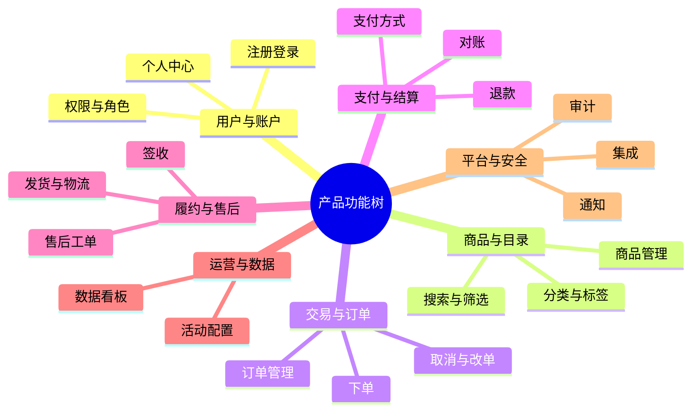

# 功能树设计 v0.1 —— 树状功能分解，兼作记忆骨架

> ⚠️ **方向更正（2026-11-16 用户澄清）**：本文写的是**产品功能树**（面向产品需求）；用户本轮要的是**系统能力树**（技术系统需要实现的功能/目标）。两者结构同源，但对象不同。**本轮主文档见 [28-系统能力树-v0.md](28-系统能力树-v0.md)**；本文保留作"树状分解方法"的参考，不再作为本轮设计对象。
> **状态**：讨论稿（产品功能设计的目标与结构），不是定稿。
> **一句话**：功能树不是"功能清单的画法"，而是**产品记忆的骨架**——每个节点是"一个功能方向/模块/功能点"的稳定挂载点；需求、决策、进展、验收、看法都挂在节点上。**树是静态的"产品是什么"，工作项是动态的"做到哪"**。
> **与 26 的关系**：[26-Harness 设计](26-记忆中心并发Harness-v0.md) 里的 `WorkItem` 是"功能树某个节点的一次执行"；功能树是"要做哪些节点"的全集。两者用同一套 ID 与记忆作用域对应，不另造第二套结构。

---

## 0. 一分钟读法

**你要的形态**：思维导图式的树，按功能方向分类，可逐级细分/拆解到功能点。

**这份初版给的是**：
1. 一棵树的**分层规范**（L0 产品 → L1 方向 → L2 模块 → L3 功能点 → L4 验收项）；
2. 每个节点的**字段**（id / 路径 / 定义 / 价值 / 状态 / 验收 / 记忆作用域 / 依赖）；
3. **拆解硬规则**（MECE、7±2、动词+名词、叶子可验收、不按技术栈分）；
4. **两种同源表达**：Mermaid 思维导图（给人看）+ 缩进列表（给评审/diff/agent 读）；
5. 一个**通用骨架**与一个**团购骨架**（内容域待你确认，结构相同）。

**一条最重要的判断**：功能树的价值不在"图好看"，而在**每个节点都可被引用、可挂记忆、可验收**。否则它只是一张过两周就过期的宣传图。

---

## 1. 设计目标（这棵树要同时干四件事）

| # | 目标 | 具体含义 | 不做会怎样 |
|---|---|---|---|
| **G1** | **可分解** | 从产品愿景一路拆到"可交付、可验收"的功能点；每层有明确的"拆到什么程度算完" | 树停在"大模块"，无法排期、无法验收 |
| **G2** | **可分类** | 同级按**功能方向**互斥（MECE），不按技术栈/团队分工分 | 组织一调整，树就腐烂；"前端/后端"不是功能 |
| **G3** | **可定位** | 每个节点有**稳定 ID 与路径**，是需求/任务/测试/文档/记忆的统一引用点 | 需求只能靠自然语言找功能，重复建树 |
| **G4** | **可生长** | 新需求挂到对应节点，而不是新建一棵树；叶子必须可验收，否则继续拆 | 树越长越乱，最后没人维护 |

**推论**：这棵树首先是**产品与 agent 共用的索引结构**，其次才是给人看的图。图可以重画，ID 与记忆不能重来。

---

## 2. 分层规范

| 层 | 名称 | 回答什么 | 粒度判据 | 典型数量 |
|---|---|---|---|---|
| **L0** | 产品 | 这是什么产品 | 一句话能说清 | 1 |
| **L1** | 功能方向 | 产品有哪几块价值 | 用户能感知的"大块"，彼此互斥 | 5–9 |
| **L2** | 功能模块 | 每块下面有哪组能力 | 一组相关功能的集合 | 每方向 3–7 |
| **L3** | 功能点 | 具体能做什么 | 一个可独立交付/验收的行为 | 每模块 3–9 |
| **L4** | 验收项 / 边界 | 做完是什么样、边界在哪 | 能写成测试/断言/验收证据 | 每功能点 1–5 |

**展开策略**：思维导图默认展开到 **L3**；L4 折叠（太多，展开会糊）。评审时看 L1–L2 是否 MECE，排期时看 L3，验收时看 L4。

**反向规则（同样重要）**：如果一个 L3 功能点写不出 L4 验收项 → 它还没拆完；如果一个 L4 只能靠"人看一眼"判断 → 它不是可验收项，是主观意见。

---

## 3. 节点字段（思维导图背后的数据）

| 字段 | 必填 | 说明 |
|---|---|---|
| `id` | 是 | 稳定 ID：`F-<方向>-<模块>-<序号>`（如 `F-03-02-01`）；**改名不改 id，插入不重排** |
| `path` | 是 | 人类可读路径：`交易 / 订单 / 取消未支付订单` |
| `name` | 是 | **动词 + 名词**（"取消未支付订单"，不是"订单取消"） |
| `type` | 是 | `direction` / `module` / `feature` / `criterion` |
| `definition` | 是 | 一句话：是什么（**不写实现**） |
| `value` | L1–L3 | 用户价值 / 为什么存在 |
| `state` | 是 | `设想 / 设计中 / 已定义 / 开发中 / 已验收 / 暂缓` |
| `acceptance` | L3–L4 | 验收条件（可测）；L3 没有它 = 没拆完 |
| `memoryScope` | L1–L3 | 记忆作用域 id：方向 = `domain:<id>`，功能点 = `task:<模板>`（见 §7） |
| `deps` | 可选 | 依赖的其他节点 id（跨方向依赖只记 id，不复制节点） |
| `owner` / `priority` | 可选 | 负责人 / 优先级 |
| `refs` | 可选 | 需求、设计、测试、文档的链接 |

> 字段纪律：**只保留"能改变决策"的字段**。思维导图工具能显示的字段有限；字段一多，人就只填图不填数据。

---

## 4. 拆解硬规则（违反任何一条，树就不可维护）

1. **MECE**：子节点合起来 = 父节点，且互不重叠；不允许"其他""杂项"这类垃圾桶节点（有就说明分类轴错了）。
2. **7±2**：同级 ≤ 9 个；超过说明该层分类轴不对，应该换轴或上提一层。
3. **动词 + 名词**：功能点描述"能做什么"；名词化（"订单管理"）会导致边界模糊。
4. **不按技术栈分**：`前端 / 后端 / 数据库 / 中间件` 不是功能方向；`下单 / 支付 / 履约 / 售后` 才是。
5. **叶子可验收**：L3 必须有 `acceptance`；L4 必须能被测试/断言/证据检查。
6. **一个功能只出现一次**：跨方向复用的能力放到"平台能力"方向，或只记 `refs`，不复制节点。
7. **编号稳定**：插入新节点用后缀（`F-03-02-01a`）或预留号段，**不重排**——重排会让所有引用（需求、任务、记忆、测试）断链。
8. **纵深有上限**：默认不超过 L4；再深说明"功能点"粒度太粗或混入了实现细节。

---

## 5. 两种同源表达

### 5.1 思维导图（给人看）

用 Mermaid `mindmap`（GitHub / 多数 Markdown 渲染器支持）。**图只展开到 L2–L3**，避免糊成一团：



> 语法注意：节点文本避免 `()` `[]` `{}` 等特殊字符（会被 Mermaid 解析成形状/链接）；中文可直接写。图放不下时**按 L1 方向拆多张图**，根节点保留索引，不要强行塞一张。

### 5.2 缩进树（给评审 / diff / agent 读）

与图同源，先写它、再生成图；它是"可评审的版本"，也是 agent 能直接消费的格式：

```text
L0 产品
├─ L1 用户与账户
│  ├─ L2 注册登录
│  │  ├─ L3 手机号注册        [验收] 验证码 60s 有效；重复号提示
│  │  └─ L3 第三方登录        [验收] 微信授权成功后可绑定手机号
│  └─ L2 个人中心
│     └─ L3 资料管理          [验收] 头像/昵称修改即时生效
├─ L1 交易与订单
│  ├─ L2 下单
│  └─ L2 订单管理
└─ L1 支付与结算
```

**同步规则**：缩进树是源，Mermaid 是视图；改树先改缩进树，再更新图（或由脚本生成）。避免"图和列表各改各的"。

---

## 6. 示例骨架

> **内容域待确认**：你说的"团购"如果是真实产品域（拼团/社区团购），用 B；如果只是"我们共同"的口误，用 A 作通用骨架，或直接告诉我真实产品，我按它重画 L1。**结构与方法不受影响**。

### A. 通用产品骨架（SaaS / 工具类，L1 级）

```text
L0 产品
├─ L1 用户与账户      # 注册登录、个人中心、权限与角色
├─ L1 商品与目录      # 商品管理、分类标签、搜索筛选
├─ L1 交易与订单      # 下单、订单管理、取消改单
├─ L1 支付与结算      # 支付方式、退款、对账
├─ L1 履约与售后      # 发货物流、签收、售后工单
├─ L1 营销与增长      # 优惠券、活动、分享裂变
├─ L1 运营与数据      # 活动配置、数据看板、内容运营
├─ L1 平台与集成      # 通知、审计、开放接口
└─ L1 安全与合规      # 实名、隐私、风控
```

### B. 团购 / 拼团骨架（L1 级，示例）

```text
L0 团购产品
├─ L1 用户与团长      # 用户注册、团长申请、团长后台
├─ L1 商品与团购活动  # 商品池、开团配置、成团规则
├─ L1 拼团交易        # 参团、拼团订单、成团/失败处理
├─ L1 支付与分账      # 支付、退款、团长佣金分账
├─ L1 履约与自提      # 备货、自提点、核销、配送
├─ L1 售后与退款      # 售后工单、部分退款、纠纷
├─ L1 营销与裂变      # 邀请、分享、拉新奖励、优惠券
├─ L1 运营与数据      # 活动配置、团长/用户数据、看板
└─ L1 平台与合规      # 通知、风控、资质与隐私合规
```

> 两套 L1 都符合"按功能方向分"；区别只在内容域。**先定 L1，再往下拆**——L1 定了，产品边界基本就定了。

---

## 7. 与"记忆为核心"的咬合（这是它区别于普通脑图的地方）

功能树不是一张静态图，它是**记忆作用域的骨架**：

| 功能树 | 记忆侧 | 执行侧（26） |
|---|---|---|
| L1 方向 | `domain:<方向>` 记忆作用域（长期：领域知识、约束、决策） | 不直接执行 |
| L2 模块 | 方向的子作用域（可选） | 聚合视图 |
| L3 功能点 | `task:<功能点>` 模板（需求、进展、验收、经验挂这里） | 一个 WorkItem 指向它 |
| L4 验收项 | `acceptance` 条目 + `evidence`（episode 引用） | 验收门检查 |

**三种挂载**（产品经理/agent 都按同一规则写）：

1. **需求**：一条 requirement 条目，挂到 L3 节点（或 L2，若跨功能点）；
2. **进展**：progress 条目，挂到执行中的 WorkItem → 回写 L3 节点；
3. **看法/决策**：belief / decision 条目，挂到 L1–L3（方向性判断挂 L1，具体取舍挂 L3）。

**好处**：产品经理加需求 = 往节点挂条目；agent 干活 = 推进节点状态；人看树 = 看到"哪些节点有未决冲突 / 哪些已验收"。**树即索引，记忆即内容**——不需要另做一套"需求管理"和"记忆管理"。

**一个必须遵守的约束**：功能树节点本身也是记忆实体（有 id、有版本、可失效），不能只存在思维导图文件里；否则"节点被改名/删除"会让挂在上面的记忆失去归属（对齐 24 的"记忆必须有实体引用"原则）。

---

## 8. 评审清单（树定稿前逐条过）

- [ ] 每个 L1 方向能用一句话说清"给用户什么价值"？
- [ ] 同级是否 MECE？有没有"其他/杂项"节点？
- [ ] 每个 L3 是否有 `acceptance`？L4 是否可测？
- [ ] 节点命名是否"动词+名词"？
- [ ] ID 是否稳定、可引用？插入节点是否不重排？
- [ ] 是否按用户价值分类，而不是按技术栈/团队分工？
- [ ] 是否覆盖完整用户旅程（发现 → 购买 → 使用 → 售后 → 复购）？
- [ ] 是否有跨节点重复的功能？
- [ ] 每个节点是否有 `memoryScope` 或明确"不挂记忆"？
- [ ] 树是否能支撑"需求 → 节点 → 任务 → 验收"的双向追溯？

---

## 9. 待确认（需要你拍板）

1. **"团购"是真实产品域，还是"我们共同"的口误？** —— 决定 §6 用 A 还是 B，或换成你真实的产品。
2. **一级分类轴**：按**功能方向**（本文默认，如"交易/支付/履约"）、按**用户旅程**（发现→购买→…）、还是按**角色**（买家/卖家/平台）？三者可以组合，但一级只能选一个。
3. **树的用途**：产品评审 / 研发排期 / agent 执行？—— 决定展开到 L3 还是 L4、字段填多细。
4. **交付形态**：只出文档 + Mermaid，还是要可导入思维导图工具（XMind/MindNode 的 `.md`/`.opml`/`.csv`）？
5. **范围**：先做全产品 L1–L2 骨架，还是先挑一个方向拆到 L3–L4 做样板？

---

## 10. 下一步（建议顺序）

1. 你确认 §9 的 1–2 条（产品域 + 一级分类轴）；
2. 我出 **L1–L2 骨架**（一页思维导图 + 缩进树）给你审；
3. 你挑一个方向（如"交易与订单"），我拆到 **L3–L4** 做样板，验证"叶子可验收"这条规则；
4. 样板通过后，再把节点映射到记忆作用域与 WorkItem（与 26 对接）；
5. 最后定"树的维护规则"：谁改、怎么改、ID 怎么分配、变更怎么留痕。

---

## 附录：本文与既有文档的关系

| 文档 | 关系 |
|---|---|
| [26-记忆中心并发Harness](26-记忆中心并发Harness-v0.md) | WorkItem = 功能树节点的一次执行；本文是其"节点全集" |
| [12-记忆模型](../design/12-记忆模型-候选稿.md) | 节点作为记忆实体（id/版本/失效），记忆作用域挂载 |
| [24-记忆模型 v0.3](../design/24-记忆模型-v0.3.md) | 实体/关系/记忆条目的字段权威；节点引用 `entity_refs` |
| [23-Planner](../design/23-Planner与长程任务-v0.md) | 功能点 → Plan 的拆解输入 |
| [18-SDD流程](../design/18-SDD流程-v0.md) | 验收项 → acceptance_keys/evidence 的字段权威 |
