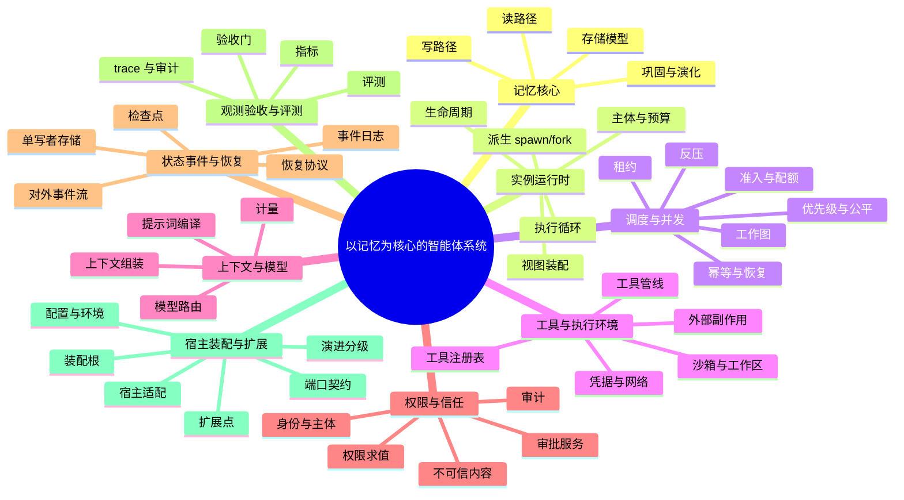
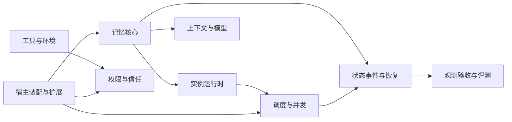

# 系统能力树 v0.1 —— 以记忆为核心的智能体系统目标分解

> ℹ️ **本文已被 [29-系统设计方案 v1](29-系统设计方案-v1.md) 吸收**（29 的 §2 是本文九域划分的完整展开，含 L4 验收与端口映射）。本文保留作"能力树讨论过程"的记录；**以 29 为准**。
> **状态**：讨论稿。本文是"系统要实现什么"的**能力分解**，不是代码模块划分、不是产品功能、不是路线图。
> **一句话**：把"以记忆为核心的智能体系统"拆成一棵**能力树**——根是系统目标，L1 是能力域，L2 是功能模块，L3 是可实现的机制/契约，L4 是可测的验收/不变量。**树回答"需要实现什么"，不回答"代码放哪个目录"。**
> **与既有文档的关系**：[26-Harness 设计](26-记忆中心并发Harness-v0.md) 是"运行时怎么组织"（H0–H7 栈）；本文是"要实现哪些能力"（能力视图）。两者是同一系统的两个视图，节点可互相映射但不一一对应；机制细节引用 [19](../design/19-AgentLoop设计-v0.md)/[20](../design/20-上下文工程-v0.md)/[21](../design/21-提示词工程-v0.md)/[23](../design/23-Planner与长程任务-v0.md)/[12](../design/12-记忆模型-候选稿.md)/[24](../design/24-记忆模型-v0.3.md)/[17](../design/17-评测设计-v0.md)，本文不重写。
> **前情**：27 号《功能树》是产品功能向，方向不符，已标注；本轮对象是本文。

---

## 0. 一分钟读法

- **树形**：L0 系统目标 → L1 能力域（9 个）→ L2 功能模块 → L3 机制/契约 → L4 验收/不变量。
- **九域**：记忆核心 / 实例运行时 / 调度与并发 / 工具与执行环境 / 上下文与模型 / 权限与信任 / 状态·事件与恢复 / 观测·验收与评测 / 宿主·装配与扩展。
- **三条规则**：① 叶子必须是"机制 + 不变量"，不是概念；② L1 按**能力域**分，不按进程/技术栈分；③ 树只表达"整体-部分"，跨域依赖单列（§5）。
- **MVP 切片**：每个域只保留"没有它系统跑不起来"的叶子，见 §6。

---

## 1. 这棵树要解决什么

| # | 目标 | 具体含义 |
|---|---|---|
| **G1** | **定边界** | 哪些是系统职责、哪些不是（例如"模型能力"不是系统职责，"把模型能力接进来并约束它"才是） |
| **G2** | **定优先级** | 每个叶子能标 P0/P1/P2；MVP = P0 叶子集合，不是"先做个 demo" |
| **G3** | **定验收** | 每个叶子至少有一条可测的不变量；没有不可变量的叶子不算"功能" |
| **G4** | **定映射** | 每个叶子能映射到 26 的端口/机制，或既有文档的已拍板项，避免第二套设计 |

---

## 2. 分层与命名规范

| 层 | 名称 | 回答什么 | 粒度判据 | 命名模式 |
|---|---|---|---|---|
| **L0** | 系统目标 | 这个系统是什么 | 一句话 | 名词短语 |
| **L1** | 能力域 | 系统有哪几块不可替代的能力 | 去掉它系统不成立；域之间不重叠 | **名词域**（记忆核心、权限与信任） |
| **L2** | 功能模块 | 每个域下面有哪组职责 | 一组相关机制的集合 | **动词短语**（版本化写入、租约管理） |
| **L3** | 机制/契约 | 具体怎么实现 | 可实现、可接口化 | **机制名**（候选制合并、六步权限求值） |
| **L4** | 验收/不变量 | 做完怎么证明 | 可写成断言/测试 | **断言句**（同一候选重复提交只产生一个版本） |

**ID 方案**：`CAP-<域>-<模块>-<机制>`，如 `CAP-01-03-02`；与功能树的 `F-` 前缀区分。改名不改 ID，插入不重排。

---

## 3. 能力树总览（L1 + L2）

> 九域是"能力"划分，不是"进程"划分：一个单机进程可以同时实现全部九域；分布式部署只是把它们拆到不同进程/机器。

---

## 4. 九个能力域（逐个拆到 L3 + 验收示例）

> 格式：`L2 模块 → L3 机制`；右侧给"至少一条 L4 验收"和"归属文档"（细节不在本文重写）。

### 4.1 记忆核心（Memory Core）

**目标**：让"知道什么、做到哪、为什么"成为长期、可溯源、可并发写的事实源。

| L2 模块 | L3 机制 | L4 验收示例 | 归属 |
|---|---|---|---|
| 存储模型 | 三层单元（块/条目/原始流）、作用域树（global→domain→task→instance）、实体与关系、双时态失效 | 任何条目都能回答"谁/基于什么/何时写的" | 12 §2/§3、24 §2 |
| 读路径 | 快照视图、检索打分（rel+imp+rec+str）、预算裁剪、冲突横幅、过期提示 | 同 snapshot + 同私有草稿 → 视图可重放（哈希一致） | 12 §4.3、22 |
| 写路径 | 私有工作集、候选提交（handoff）、单写者合并、版本/回滚、冲突检测（结构/语义）、来源分级/敏感检查 | 同一候选重复提交只产生一个版本；fact 冲突一律 `disputed` 不静默覆盖 | 12 §5、24 §7 |
| 巩固与演化 | 后台整理（去重/失效/提升）、污染防线、金字塔/多视角、跨智能体只读 | 候选未达标不提升为通用知识；sensitive 不跨域 | 12 §7、24 §5/§6 |

### 4.2 实例运行时（Instance Runtime）

**目标**：把记忆变成"可执行的一次性视图"，实例可随时杀、随时重建。

| L2 模块 | L3 机制 | L4 验收示例 | 归属 |
|---|---|---|---|
| 派生 | spawn（空私有工作集）/ fork（复制私有工作集+视图起点） | fork 不复制记忆本体；spawn 不读兄弟实例私有区 | 12 §4.1、26 §1.3 |
| 视图装配 | snapshot → assemble（块+检索+私有）→ refresh（过期提示） | 装配确定性；预算报告可查 | 12 §4.3、26 §5.6 |
| 执行循环 | 组装→决策→执行→观察→更新→判断（接 19 六阶段） | 每步先记录后行动；失败不丢话 | 19 §4 |
| 主体与预算 | `agentRef`（agentId/persona/读集/写域）、软上限+可配硬熔断 | 实例读写不越出主体读集/写域；超预算留中间结果 | 24 §6、26 §4.2/§4.5 |
| 生命周期 | 心跳、TTL、回收、崩溃重派、私有工作集冻结 | kill -9 后 ≤2×TTL 续跑，已提交候选不丢不重 | 26 §4.3/§5.2 |

### 4.3 调度与并发（Scheduling & Concurrency）

**目标**：决定"什么时候、允许多少实例同时跑、谁先跑"，并在过载时降速而不是崩溃。

| L2 模块 | L3 机制 | L4 验收示例 | 归属 |
|---|---|---|---|
| 工作图 | WorkItem（18 Task 的调度视图）、依赖 DAG、状态机 | 状态唯一、迁移只经一个入口；依赖未完成不占资源 | 26 §4.1 |
| 准入与配额 | 四类约束（依赖/写域/资源令牌/人审容量） | 任一类不满足 → 不发放租约 | 26 §5.1 |
| 租约 | 原子 CAS 发放、心跳续约、epoch fencing、过期回收 | 同一 WorkItem 同刻最多一个活跃租约；旧 epoch 写入被拒 | 26 §4.3/§5.2 |
| 优先级与公平 | 显式优先级、截止时间、防饥饿、同类合并 | 低优先级等待超阈值可提权 | 26 §5.1 |
| 反压 | 候选积压/冲突率/人审/429 → 降发放速率 | 负载注入后发放速率 ≤ 注入前 X%（可测） | 26 §5.1 |
| 幂等与恢复 | at-least-once + `candidateId`、缺 ack 视为未知、DLQ | 重复提交只落一次；终态失败进异常队列 | 26 §4.4/§5.2 |
| 合并分片 | 按 scope 分片、每片单写者、跨片拆批 | 任何写路径必经所属 scope 单写者 | 26 §5.3 |

### 4.4 工具与执行环境（Tooling & Sandbox）

**目标**：让模型"能动手"，同时让动手可约束、可隔离、可重放。

| L2 模块 | L3 机制 | L4 验收示例 | 归属 |
|---|---|---|---|
| 工具注册表 | 元数据（风险级别/parallelSafe/timeout/写域）、注册/发现/禁用 | 未注册工具不可被调用；写工具必须绑定写域 | 19 §6、26 §5.7 |
| 工具管线 | 五段管线、权限求值、参数冻结、超时/重试/三态取消 | 写操作串行、只读可并行；取消不产生半成品 | 19 §6 |
| 沙箱与工作区 | worktree/目录隔离、资源槽位、磁盘配额 | 同写域串行、不同写域并行；重工具限流 | 26 §5.4 |
| 外部副作用 | 先落日志再执行、幂等收据、`outcome_unknown` 处理 | 崩溃重放不重复外部动作 | 12 §5、19 §7 |
| 凭据与网络 | 环境不继承 Key、最小作用域注入、网络边界 | 实例拿不到未授权的密钥/网络 | docs/dsh-alignment §2.5 |

### 4.5 上下文与模型（Context & Model）

**目标**：在有限窗口里放"此刻最该知道的"，并把模型当作可替换算力。

| L2 模块 | L3 机制 | L4 验收示例 | 归属 |
|---|---|---|---|
| 上下文组装 | 钉住前缀 + 动态尾部、配额分桶、压缩三段式、引用记账 | 模型可见 ⟺ 已记录；压缩只改模型可见不改用户可见 | 20 |
| 提示词编译 | prompt 注册表、规则预算、持久规则重注入 | 超预算规则拒绝编译；Iron Law 不承担门禁 | 21 |
| 模型路由 | `llm.ask` 端口、按角色路由、降级/熔断 | 内核不 import 厂商 SDK；失败可回退 | 19 §12、26 §3.3 |
| 计量 | token/成本单一计量、按实例/工作项/项目分账 | 每项成本可归因，不重复计费 | 19 §11.4、26 §5.5 |

### 4.6 权限与信任（Policy & Trust）

**目标**：让"谁能做什么"是程序判定，不是模型自觉；不可信内容不越权。

| L2 模块 | L3 机制 | L4 验收示例 | 归属 |
|---|---|---|---|
| 身份与主体 | 秘书/专家/实例、主体绑定、越权工具拒绝 | 实例只能用自己 `tools[]` 内的工具 | 24 §6、26 §1.2 |
| 权限求值 | 六步顺序（hooks→deny→ask→mode→allow→fallback） | plan 模式不自动批准写操作 | 19 §6.2 |
| 审批服务 | 人审队列、一次性 grant、fail-closed | 无 answerer 时拒绝，不放行 | 19 §6.2、26 §3.3 |
| 不可信内容 | 信任分级、控制标签中和、来源打标 | 子代理/检索内容不直接触发写记忆/写文件 | 16 D21、22 §6 |
| 审计 | 谁基于什么做了什么、可回查 | 每条高影响操作可追溯到 episode | 12 I4、19 §7 |

### 4.7 状态、事件与恢复（State, Events & Recovery）

**目标**：系统在崩溃、断线、重启后仍能解释"发生了什么、做到哪"。

| L2 模块 | L3 机制 | L4 验收示例 | 归属 |
|---|---|---|---|
| 事件日志 | append-only、事件命名/字段/id、可见性三分 | 任何模型可见内容都能在日志找到 | 19 §10 |
| 检查点 | 三屏障 fail-closed、写下顺序固定 | 未知副作用不自动重试 | 19 §7 |
| 单写者存储 | 单写者入口、DB 是投影、文件锁 | 重启后状态与日志一致 | 14 §7.2 |
| 对外事件流 | SSE/WS、每流恰好一个终止、断线续接 | 断线重连不丢事件、不重复终止 | 19 §10.3/§10.4 |
| 恢复协议 | 固定顺序恢复、幂等重放、恢复注记 | 崩溃恢复后不丢已提交、不重放副作用 | 19 §7.4、26 §5.2 |

### 4.8 观测、验收与评测（Observability, Acceptance & Eval）

**目标**：让"系统好不好"可测量、可阻断、可归因。

| L2 模块 | L3 机制 | L4 验收示例 | 归属 |
|---|---|---|---|
| 指标 | 吞吐/时延/冲突率/租约健康/成本/人审，定义+采集点+分账 | 指标可按工作项/项目归因 | 26 §5.5、19 §11.4 |
| trace 与审计 | 事件串联、采样、敏感信息脱敏 | 任一失败可定位到步/工具/模型调用 | 19 §11、17 |
| 验收门 | 证据契约（测试/命令/变更范围/回滚）、缺证据退回 | 缺证据不许进 review | 18、17 |
| 评测 | golden set、WITH/W/OUT/Δ、六 grader、回归门禁 | 回归可阻断；评测可复现 | 17 |

### 4.9 宿主、装配与扩展（Host, Assembly & Extension）

**目标**：内核不绑定宿主、不绑定模型、不绑定场景。

| L2 模块 | L3 机制 | L4 验收示例 | 归属 |
|---|---|---|---|
| 端口契约 | 14 个端口（Host/WorkGraph/Scheduler/InstanceManager/Context/Memory/Tool/Permission/Approval/Model/Event/Meter/Acceptance） | 端口有版本；破坏性变更走新端口 | 26 §3.3 |
| 装配根 | 唯一装配点、依赖注入、启停顺序 | 内核不反向依赖宿主 | 26 §3.3 |
| 宿主适配 | CLI/Web/API/（未来 DSH 桥）；只做 ingest + 渲染 | 换宿主不改内核 | 26 §3.3 |
| 配置与环境 | 配置分层、环境变量、敏感项不落库 | 密钥不写进代码/文档/日志 | docs/admin-guide |
| 扩展点 | 场景包/预设/技能、工具扩展 | 换场景只换包，内核零改动 | 23、harness-map（参考） |
| 演进分级 | L1 参数级 / L2 场景级 / L3 内核级，逐级放权 | 每次自变更留 diff + 可回滚 + 指标对比 | 00 D-11（参考问题框架） |

---

## 5. 横向依赖（树表达不了，必须单列）

树只表达"整体-部分"；下面这些是**跨域依赖**，不进树，单独维护：

**关键依赖方向**（决定实现顺序）：

1. 记忆核心 + 状态事件是**地基**（没有它们，其他域没有可信状态）；
2. 实例运行时依赖记忆（视图）与上下文（token 级组装）；
3. 调度依赖记忆（工作图落库）与状态（恢复）；
4. 权限是工具的横切约束，不是独立执行路径；
5. 观测/验收横切全部域；
6. 宿主在最外层，只依赖端口，不被任何域反向依赖。

---

## 6. MVP 切片（P0 叶子 = 没有它跑不起来）

> 与 [26 §8](26-记忆中心并发Harness-v0.md) 的 MVP 对齐：单机、单代码库、1 种 agent、100 工作项、8–16 并发。

| 域 | P0 必须实现（叶子） | 为什么 |
|---|---|---|
| 记忆核心 | 存储模型（块/条目/原始流 + 4 层作用域）、读路径（快照+FTS+预算）、写路径（候选+单写者+冲突）、版本 | 没有这些，"记忆为核心"不成立 |
| 实例运行时 | spawn、视图装配、执行循环（简化版）、生命周期（心跳/回收） | 没有实例，记忆不会被推进 |
| 调度与并发 | 工作图、准入、租约（CAS+epoch）、恢复、分片合并 | 没有它们，多实例会互相踩 |
| 工具与执行环境 | 工具注册表、五段管线、worktree 隔离、副作用落日志 | 没有工具，实例只能空想 |
| 上下文与模型 | 上下文组装（简化）、模型端口、token 计量 | 没有上下文，模型看不到记忆 |
| 权限与信任 | 六步求值、审批（最小）、不可信内容中和 | 没有权限，写操作不可控 |
| 状态事件与恢复 | 事件日志、三屏障检查点 | 没有日志，崩溃即失忆 |
| 观测验收与评测 | 指标（最小集）、验收门 | 没有验收，完成不可信 |
| 宿主装配与扩展 | 端口、装配根、CLI 宿主 | 没有装配，跑不起来 |

**P1/P2（MVP 不做）**：后台巩固/金字塔、语义冲突 LLM 判定、向量检索、分布式/多机、多租户、多 agent 协作、自演进、DSH 桥。

**切片纪律**：MVP 的每个 P0 叶子必须有 L4 验收，否则不进 MVP；P1/P2 叶子允许只有"目标 + 依赖"。

---

## 7. 树与既有文档的映射（防止第二套设计）

| 能力域 | 主要归属文档 | 说明 |
|---|---|---|
| 记忆核心 | 12、24、22 | 12 是语义权威，24 是实体/字段权威 |
| 实例运行时 | 12 §4、19、26 §4/§5.6 | 视图装配引用 12 §4.3 |
| 调度与并发 | 26（本文配套） | 12 §0.3 明确让出的空白 |
| 工具与执行环境 | 19 §6、dsh-alignment | 工具管线不重写 |
| 上下文与模型 | 20、21、19 §12 | 20/21 是细节权威 |
| 权限与信任 | 19 §6.2、24 §6、22 §6 | 六步求值以 19 为准 |
| 状态事件与恢复 | 19 §7/§10、18 | 三屏障/事件流不重写 |
| 观测验收与评测 | 17、18、26 §5.5 | 验收门字段以 18 为准 |
| 宿主装配与扩展 | 26 §3.3、harness-map（参考） | 不引入 DSH 运行时 |

---

## 8. 这棵树怎么维护

1. **谁改**：每个 L1 能力域有 owner；叶子变更必须带"验收 + 映射文档"两个字段，否则不合并。
2. **ID 稳定**：插入节点用后缀/预留号段，不重排；废弃节点标 `deprecated` 不删（保引用）。
3. **节点即记忆实体**：树节点本身要落成记忆实体（id/版本/失效），否则"节点被改名/删除"会让挂在上面的需求/进展/验收失去归属（对齐 24 的实体引用原则）。
4. **变更留痕**：每次结构调整记一个 decision 条目（为什么拆/为什么并），可回查。
5. **与 26 的同步**：能力树加新域时，26 的端口表要检查是否缺端口；反之亦然。

---

## 9. 待确认（需要你拍板）

1. **九域划分是否认可？** 特别是有争议的边界：
   - 「记忆核心」与「状态·事件与恢复」是否分开？（我主张分开：内容 vs 过程）
   - 「上下文与模型」是否并入「实例运行时」？（我主张独立：它有自己的端口与预算）
   - 「宿主与扩展」是否合并？（我主张合并：都是"让内核可换/可长"）
2. **树的深度**：这版只展开到 L3 + 验收示例；要不要把某个域（建议"记忆核心"或"调度与并发"）拆到完整 L4？
3. **MVP 切片是否太大？** §6 的 P0 叶子有 9 个域，可以再砍（例如先不做 worktree，只做目录隔离）。
4. **交付形态**：一张总图 + 每域一张子图（推荐），还是全部塞一张图？
5. **树的用途**：只作设计索引，还是要直接驱动任务拆解（节点 → WorkItem）？

---

## 10. 下一步

1. 你确认 §9 的 1、3 两条（九域边界 + MVP 切片）；
2. 我把这棵树补成"每域一页"：L2/L3 全展开 + 每叶子的 L4 断言 + 端口映射（先做记忆核心与调度并发两页）；
3. 用两页样板验证"叶子可验收"这条规则是否站得住；
4. 通过后，把树节点映射到 WorkItem（26 §4.1），形成"能力树 → 工作图"的生成规则；
5. 最后补 §8 的维护规则落成模板。

---

## 附录：与 26 的分工（避免两份文档打架）

| | 26-Harness 设计 | 本文（能力树） |
|---|---|---|
| 回答 | 运行时怎么组织（H0–H7 栈、端口、对象、机制） | 要实现哪些能力（九域、L2/L3/L4） |
| 形态 | 分层架构图 + 对象/接口 | 能力树 + 验收断言 |
| 读者 | 实现者 | 设计评审 / 排期 / 验收 |
| 变更 | 机制变化时改 | 能力增减时改 |
| 关系 | 本文的每个叶子应能指向 26 的某个端口/机制；指不上的，要么 26 缺端口，要么叶子不该在树里 | |
