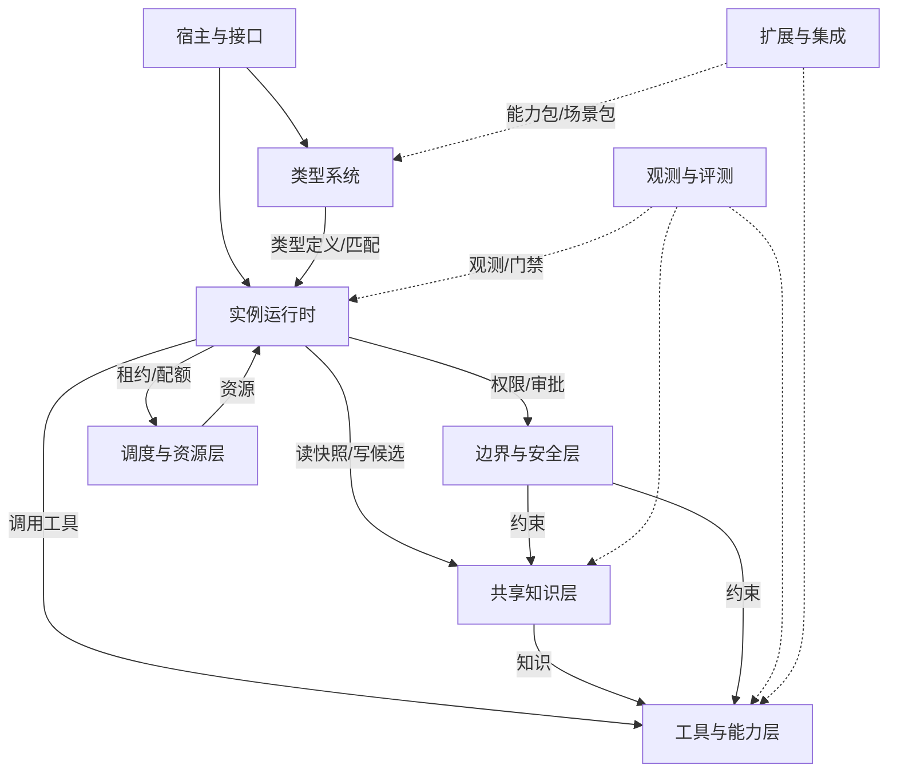

# 通用 Agent 框架方案 v0 —— 基本元素与组件

> **定位**：回答"一个通用的 Agent 框架应该包含哪些基本元素和组件"。概念层：只定**组件、职责、边界、关系**，不做技术选型、不写接口、不写实现。
> **与方案一的关系**：[31-核心设计原则](31-核心设计原则-智能体类型-v1.md) 回答"怎么设计一个智能体类型"（类型视角）；本文回答"框架由哪些组件承载这些类型与实例"（系统视角）。两份互补：**九要素是'内容'，组件是'容器'**。
> **与前序文档**：[29-系统设计方案](29-系统设计方案-v1.md) 的记忆中心降级为"共享知识层的一种实现"；[30](30-Agent框架-类型与实例-v0.md) 是类型/实例的讨论稿。

---

## 0. 一句话与三层骨架

**一句话**：通用的 Agent 框架 = **类型系统**（可枚举的 agent 定义）+ **实例运行时**（这一次的执行体）+ **共享层**（知识/工具/边界/租户）+ **调度与安全**（资源与约束）+ **观测与接口**（可解释、可接入）。

```
┌─────────────────────────────────────────────────────────────┐
│ 宿主与接口层：CLI / Web / API / 事件源 / 人机交互            │
├─────────────────────────────────────────────────────────────┤
│ 类型层（设计期）：类型定义｜注册表｜派生/组合｜版本｜路由匹配 │
├─────────────────────────────────────────────────────────────┤
│ 实例层（运行期）：实例化｜执行循环｜生命周期｜归因            │
├─────────────────────────────────────────────────────────────┤
│ 共享层：知识/记忆｜工具与能力｜边界与策略｜租户与配置         │
├─────────────────────────────────────────────────────────────┤
│ 横切：调度与资源｜访问与安全｜观测与评测｜扩展与集成          │
└─────────────────────────────────────────────────────────────┘
```

**三层骨架的判据**：类型层回答"可能是什么"；实例层回答"这一次是什么"；共享层回答"它们共同依赖什么"。任何组件都能被归到这三层或横切层，否则就是设计不清。

---

## 1. 组件总览

| # | 组件 | 属于 | 一句话职责 | 必须有？ |
|---|---|---|---|---|
| C1 | **类型系统** | 类型层 | 定义/注册/派生/版本化/匹配 agent 类型 | 是 |
| C2 | **实例运行时** | 实例层 | 实例化、执行、生命周期、归因 | 是 |
| C3 | **共享知识层** | 共享层 | 承载知识/记忆：读集、写域、版本、候选写回 | 是 |
| C4 | **工具与能力层** | 共享层 | 工具注册、能力包、执行环境 | 是 |
| C5 | **边界与安全层** | 横切 | 权限上界、审批、租户隔离、审计 | 是 |
| C6 | **调度与资源层** | 横切 | 并发、配额、租约、队列、反压 | 是 |
| C7 | **观测与评测层** | 横切 | 指标、trace、类型级评测、验收 | 是 |
| C8 | **扩展与集成层** | 横切 | 能力包、场景包、外部系统/协议接入 | 可选（MVP 后可加） |
| C9 | **宿主与接口层** | 外层 | 输入归一化、输出渲染、人机交互 | 是 |

---

## 2. 九个组件（职责 / 不变量 / 边界）

### C1 类型系统（Type System）

- **职责**：定义 agent 类型（九要素）；注册与发现；派生/组合；版本化；把输入匹配到类型。
- **不变量**：
  1. 没有"野生 agent"——实例必须来自已注册类型；
  2. 类型不可变，改类型 = 新版本；
  3. 类型是可枚举的（注册表能回答"有哪些 agent"）。
- **不属于它**：实例状态、知识内容、权限判定（只声明上界）。
- **承载**：31 的九要素在这里被"定义、注册、版本化"。

### C2 实例运行时（Instance Runtime）

- **职责**：按类型实例化；驱动执行；管理生命周期（创建/运行/结束/回收）；产出归因。
- **不变量**：
  1. 实例化必须轻（绑输入 + 钉快照 + 发租约，不复制类型/知识）；
  2. 实例只能收窄类型上界；
  3. 实例可丢弃，关键状态外置。
- **不属于它**：类型定义、知识本体、调度策略（它调用调度，不实现调度）。
- **承载**：实例六组成（输入/快照/私有草稿/租约/产出/过程记录）。

### C3 共享知识层（Shared Knowledge）

- **职责**：承载知识/记忆本体；按读集/写域分发；版本与审计；候选写回与合并。
- **不变量**：
  1. 知识是第三层，不属于类型也不属于实例；
  2. 实例只读快照、只写私有；公共知识经候选写回；
  3. 知识有版本，可追溯、可回滚。
- **不属于它**：agent 定义（在类型层）、执行（在实例层）。
- **承载**：29 的知识/记忆/合并策略可作为本组件的一种实现。

### C4 工具与能力层（Tools & Capabilities）

- **职责**：工具注册（能力包）；工具执行；执行环境隔离；能力与写域绑定。
- **不变量**：
  1. 未注册工具不可调用；
  2. 写工具必须绑定写域；
  3. 工具执行可超时、可取消、可重放（副作用有收据）。
- **不属于它**：权限判定（在 C5）、类型定义（在 C1）。

### C5 边界与安全层（Boundaries & Security）

- **职责**：权限上界判定；审批；租户隔离；凭据管理；审计。
- **不变量**：
  1. 实例权限 ⊆ 类型上界；
  2. 无审批者时 fail-closed；
  3. 不可信内容不直接触发高影响动作。
- **不属于它**：能力清单（在 C4）、类型定义（在 C1）。
- **注意**：这一层横切所有层，不是"最后加的一道门"。

### C6 调度与资源层（Scheduling & Resources）

- **职责**：并发控制；配额；租约；队列；反压；资源画像。
- **不变量**：
  1. 同一任务同刻最多一个活跃租约；
  2. 过载时降速而不是崩溃；
  3. 实例化速率受配额约束。
- **不属于它**：执行（在 C2）、类型定义（在 C1）。

### C7 观测与评测层（Observability & Eval）

- **职责**：指标（吞吐/成本/质量）；trace；类型级评测（这个类型的实例成功率/成本）；验收门。
- **不变量**：
  1. 任何产出可归因到类型版本 + 实例；
  2. 缺证据的完成不算完成；
  3. 评测以类型为锚点，可横向比较。
- **不属于它**：执行、调度（只观测，不干预，除非门禁）。

### C8 扩展与集成层（Extension & Integration）

- **职责**：能力包/场景包的注册与组合；外部系统接入（数据源、动作目标）；协议（若与其他 agent 系统互通）。
- **不变量**：
  1. 扩展不改变骨架（类型/实例/共享层的语义不变）；
  2. 场景包 = 一套策略选择 + 类型清单，不是新代码分支。
- **说明**：MVP 可先只做"能力包"，场景包与外部协议放后面。

### C9 宿主与接口层（Host & Interface）

- **职责**：把外部输入归一化成"任务/消息/事件"；把内部产出渲染给人或下游；人机交互（审批、确认、汇报）。
- **不变量**：
  1. 内核不反向依赖宿主；
  2. 宿主不直接读写知识/类型（只经接口）；
  3. 换宿主不改内核。
- **说明**：这一层是"产品形态"的落点，但不是框架的核心。

---

## 3. 组件清单（MVP 必须 vs 可选）

| 组件 | MVP 必须 | 可后置的部分 |
|---|---|---|
| C1 类型系统 | 类型定义 + 注册 + 版本 + 匹配 | 派生/组合的高级形式 |
| C2 实例运行时 | 实例化 + 执行 + 生命周期 + 归因 | 长驻实例、复杂恢复 |
| C3 共享知识层 | 读集/写域 + 版本 + 候选写回 | 复杂合并、语义冲突、金字塔 |
| C4 工具与能力层 | 工具注册 + 执行 + 隔离 | 能力包市场、复杂执行环境 |
| C5 边界与安全层 | 权限上界 + 审批 + 审计 | 多租户、凭据代理、完整网络策略 |
| C6 调度与资源层 | 并发上限 + 租约 + 队列 | 复杂优先级、抢占、分布式调度 |
| C7 观测与评测层 | 指标 + trace + 验收门 | 类型级评测体系、回归门禁自动化 |
| C8 扩展与集成层 | 能力包（可选） | 场景包、外部协议、生态 |
| C9 宿主与接口层 | 一种宿主（CLI 或 Web） | 多宿主、产品级交互 |

**判据**：MVP 的每个"必须"组件都要能独立回答一个**可验证的问题**（例如 C1：能不能枚举类型？C2：能不能用同一类型跑两次不同任务？C3：实例能否只读快照、只写私有？C5：越界能否拒绝？）。

---

## 4. 组件间关系（概念）



**三条依赖方向（决定实现顺序）**：

1. **C1 + C3 + C6 是地基**：没有类型定义、知识层、调度，运行时无从谈起；
2. **C2 依赖 C1/C3/C4/C5/C6**：它是"组装者"，不是"拥有者"；
3. **C7/C8/C9 是外围**：可后置，但 C9（至少一种宿主）MVP 必须有。

---

## 5. 与类型/实例原则的映射（九要素 → 组件承载）

| 九要素 | 承载组件 | 说明 |
|---|---|---|
| 身份 | C1 类型系统 | 类型的元数据；实例继承身份 |
| 职责 | C1 + C9 | 类型声明职责；宿主按职责路由输入 |
| 能力 | C4 工具与能力层 | 类型声明能力包（上界）；实例选子集 |
| 知识 | C3 共享知识层 | 类型声明读集/写域；实例只持快照 |
| 行为 | C2 实例运行时 | 类型声明行为策略；实例执行 |
| 边界 | C5 边界与安全层 | 类型声明上界；实例只能收窄 |
| 接口 | C1 + C9 | 类型声明输入/输出契约；宿主适配 |
| 生命周期 | C2 + C6 | 类型声明策略；调度执行回收 |
| 协作 | C8（预留） | 协作关系留给多智能体会话 |

**自检**：如果某个要素在组件里找不到承载，说明框架缺组件；如果某个组件不承载任何要素，说明组件是多余的。

---

## 6. 最小骨架 vs 完整框架

**最小骨架（POC 要验证的）**：

- C1：能定义 1–2 个类型、注册、按输入匹配；
- C2：能用同一类型跑两次不同任务，产出可归因；
- C3：实例只读快照、只写私有，公共知识经候选写回；
- C4：工具注册 + 越界拒绝；
- C5：权限上界 + 越界拒绝 + 审批（最小）；
- C6：并发上限 + 租约（防双跑）；
- C7：能回答"这个类型的实例成功率/成本"；
- C9：一种宿主（CLI 即可）。

**完整框架再补**：C8 场景包/外部协议、C3 的复杂合并与金字塔、C6 的分布式调度、C5 的多租户/凭据代理、C7 的类型级评测体系。

---

## 7. 待确认

1. **组件粒度**：九个组件是否太细/太粗？（我倾向：C1–C7 必须有，C8/C9 可后置；C5/C6 是否合并成"运行时治理"可讨论。）
2. **C3 与 C2 的边界**：知识层是"独立服务"还是"运行时的内嵌能力"？（概念上独立，实现可合。）
3. **C8 的定位**：扩展层是"框架的一部分"还是"框架外部的生态"？（我倾向：能力包在框架内，场景包/协议在框架外。）
4. **人机交互**：审批/确认/汇报放在 C9 还是 C5？（我倾向：交互入口在 C9，审批判定在 C5。）

**下一步**：用 31 的八步创建 2–3 个真实类型，逐个检查"九要素是否都有组件承载"；再用一个真实任务走一遍 C1→C2→C3→C4→C5→C6→C7，看组件之间是否缺环节。两步都过，框架的"元素与组件"就基本成立。
