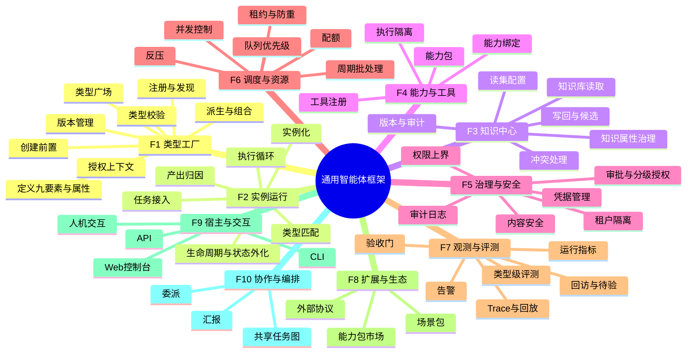

# 通用智能体框架 · 产品功能树与设计方案 v1.1

> **v1.1（2026-11-21）**：依据 [39](39-类型库-验证结论-v1.md) §5 的 G1–G7 修订；v1 保留不动。
> **定位**：从**产品功能视角**回答"这个智能体框架向使用者提供哪些能力"。不含实现、不含技术选型。
> **输入**：[31-核心设计原则](31-核心设计原则-智能体类型-v1.md)（九要素）与 [32-通用 Agent 框架](32-通用Agent框架-v0.md)（九组件）。本文把它们翻译成"用户能看见、能操作、能验收的功能"。
> **v1.1 输入**：[39-类型库-验证结论](39-类型库-验证结论-v1.md)：78 个真实类型的验证结论。v1.1 只把 §5 的 G1–G7 落进功能树，不改十域骨架、不新增第十要素。
> **与前序文档**：[29-系统设计方案](29-系统设计方案-v1.md) 是"记忆中心"总体方案，其能力已并入本文的 F3 知识中心；[27-功能树](27-功能树-v0.md) 是早期产品向草稿，已作废。
> **第一步交付**：功能树 + 功能域详解 + 优先级 + 用户旅程。第二步（模拟验证）已完成，结论见 [39](39-类型库-验证结论-v1.md)；本文是第二步对功能树的修订。

---

## 0. 摘要（先结论）

**一句话**：把"每次任务都重新拼提示词 + 挑工具 + 抄上下文"变成——**定义一次智能体类型，之后按需实例化无数次**。

**框架的十条功能主线**：

1. **类型工厂**：定义、注册、派生、版本化 agent 类型（"造 agent 的模具"）
2. **实例运行**：把任务变成实例、跑起来、管生命周期（"用模具压出 agent"）
3. **知识中心**：类型声明读什么、写回什么，知识有版本、可审计（"agent 的记忆"）
4. **能力与工具**：工具注册、能力包、执行隔离（"agent 的手"）
5. **治理与安全**：权限上界、审批、租户、审计（"agent 的缰绳"）
6. **调度与资源**：并发、配额、租约、反压（"agent 的体力"）
7. **观测与评测**：指标、trace、类型级评测、验收门（"agent 的成绩单"）
8. **扩展与生态**：能力包、场景包、外部系统接入（"框架的生长"）
9. **宿主与交互**：CLI / Web / API / 人机交互（"人和 agent 的界面"）
10. **协作与编排**：多 agent 委派与协作（预留，另一会话主题）

**MVP 最小闭环（P0）**：F1（类型定义/注册/创建前置/匹配）+ F2（实例化/执行/归因）+ F3（读集/写域/快照）+ F4（工具注册/越界拒绝）+ F5（权限上界/分级审批/审计）+ F6（并发/租约/周期批处理）+ F7（指标/验收门）+ F9（一种宿主）。

**v1.1 相对 v1 的变化（G1–G7）**：在既有十域内补七处能力——F1.1 表单补五个属性字段（G1）、F5.2 审批支持分级授权（G2）、F3 知识项补四个属性（G3）、F7.4 验收门分三类（G4）、F6 补周期批处理（G5）、F2.5 生命周期补到四档并支持状态外化与交接（G6）、F1 新增创建前置（G7）。共新增 5 个子功能（F1.7、F1.8、F3.6、F6.6、F7.6），改动 11 行既有功能；逐条对照见 §8。

---

## 1. 产品定位

### 1.1 它是什么

一个**智能体工厂与运行平台**：团队用"类型"描述 agent（它是谁、干什么、能碰什么），平台负责把任务实例化成 agent、跑完、管住、留痕。

### 1.2 它不是什么（划清边界）

| 不是 | 为什么 | 是什么 |
|---|---|---|
| 提示词模板库 | 提示词只是"行为"的一部分 | 类型 = 九要素的完整定义 |
| 工作流编排器 | 编排是"任务之间怎么连"，框架管"任务内 agent 怎么活" | 协作留给 F10 与另一会话 |
| RPA / 脚本平台 | 脚本是确定性的；agent 是决策性的 | 行为规则 + 边界 + 验收 |
| 单一聊天产品 | 聊天是宿主形态之一 | F9 的一种 |
| 模型供应商 | 模型可替换 | 能力/工具/知识层与模型解耦 |

### 1.3 使用者与角色

| 角色 | 关心什么 | 主要用哪些功能域 |
|---|---|---|
| **类型设计者**（专家/架构师） | 类型定义是否清楚、可复用 | F1 类型工厂 |
| **任务发起者**（业务方） | 任务能不能被正确理解、结果能不能验收 | F2 实例运行、F9 宿主 |
| **治理者**（安全/合规/负责人） | 有没有越权、能不能审计、成本可控吗 | F5 治理、F6 调度、F7 观测 |
| **平台运维** | 跑得稳不稳、资源够不够、故障能不能定位 | F6、F7、F9 |
| **扩展开发者** | 能不能加工具/接系统/做场景包 | F4、F8 |

### 1.4 核心价值主张

1. **复用**：定义一次类型，实例化无数次；类型可评、可版本、可派生。
2. **治理**：每个实例的权限、写域、行为都有上界，越界可判、可审批、可审计。
3. **可观测**：任何产出可归因到"类型版本 + 实例 + 证据"，缺证据不算完成。

---

## 2. 功能树总览

### 2.1 思维导图



### 2.2 功能树（缩进版，便于检索与勾选）

```
通用智能体框架
├─ F1 类型工厂
│  ├─ F1.1 类型定义（九要素模板、五个属性字段、校验）
│  ├─ F1.2 类型注册与发现（枚举/搜索/详情）
│  ├─ F1.3 类型派生与组合
│  ├─ F1.4 版本管理（历史/差异/回滚）
│  ├─ F1.5 类型校验（检查清单/反模式检测/新属性校验）
│  ├─ F1.6 类型广场（模板/示例库）
│  ├─ F1.7 创建前置（授权上下文/预算/隔离环境）
│  └─ F1.8 授权上下文管理（签发/校验/过期）
├─ F2 实例运行
│  ├─ F2.1 任务接入（消息/事件/工作项）
│  ├─ F2.2 类型匹配与路由
│  ├─ F2.3 实例化（快照/租约/预算/前置复核）
│  ├─ F2.4 执行循环（多步/工具调用/停止条件）
│  ├─ F2.5 生命周期管理（四档/状态外化/交接）
│  └─ F2.6 产出归因（类型版本+实例+证据）
├─ F3 知识中心
│  ├─ F3.1 知识库读取（检索/范围/版本与时效）
│  ├─ F3.2 读集配置（版本/时效/权威/驻留）
│  ├─ F3.3 写回与候选（私有草稿/候选/合并）
│  ├─ F3.4 版本与审计（谁改了什么）
│  ├─ F3.5 冲突处理（显式分歧/人工裁决）
│  └─ F3.6 知识属性与时效治理（过期/复核/驻留校验）
├─ F4 能力与工具
│  ├─ F4.1 工具注册（声明/描述/参数）
│  ├─ F4.2 能力包（按职责打包）
│  ├─ F4.3 执行隔离（超时/取消/重放）
│  └─ F4.4 能力绑定（类型-工具-写域）
├─ F5 治理与安全
│  ├─ F5.1 权限上界（实例权限⊆类型上界）
│  ├─ F5.2 审批流与分级授权（限额内自动/超限转人工）
│  ├─ F5.3 租户隔离（数据与运行隔离）
│  ├─ F5.4 凭据管理（不落明文）
│  ├─ F5.5 审计日志（越权/审批/自动放行）
│  └─ F5.6 内容安全（不可信输入/外溢）
├─ F6 调度与资源
│  ├─ F6.1 并发控制（全局/类型/租户上限）
│  ├─ F6.2 配额（token/时间/费用）
│  ├─ F6.3 租约与防重（同任务不双跑）
│  ├─ F6.4 队列与优先级（公平/优先）
│  ├─ F6.5 反压（过载降速不崩溃）
│  └─ F6.6 周期批处理（每日/每周/补跑）
├─ F7 观测与评测
│  ├─ F7.1 运行指标（数量/耗时/成本/失败率）
│  ├─ F7.2 Trace 与回放（每步可查/可重放）
│  ├─ F7.3 类型级评测（按类型横向比较）
│  ├─ F7.4 验收门（交付时/效果后/过程型）
│  ├─ F7.5 告警（异常/越权/成本超限）
│  └─ F7.6 回访与待验（回访时点/判定人/超期升级）
├─ F8 扩展与生态
│  ├─ F8.1 能力包市场（安装/组合）
│  ├─ F8.2 场景包（一套策略+类型清单）
│  └─ F8.3 外部协议（与其他系统互联）
├─ F9 宿主与交互
│  ├─ F9.1 CLI（脚本/批处理）
│  ├─ F9.2 Web 控制台（看板/操作）
│  ├─ F9.3 API（外部系统接入）
│  └─ F9.4 人机交互（审批/确认/汇报）
└─ F10 协作与编排（预留）
   ├─ F10.1 委派（向子 agent 派任务）
   ├─ F10.2 汇报（向父 agent 交结果）
   └─ F10.3 共享任务图（多 agent 协同）
```

### 2.3 阅读方式

- **按角色读**：§1.3 表 → 对应功能域；
- **按优先级读**：§5 的 P0/P1/P2；
- **按实现顺序读**：§4 功能→组件映射。

---

## 3. 功能域详解

> 每个功能域统一格式：**一句话 / 使用者 / 功能表 / 关系 / 不做**。功能表中的"验收判据"是**可判定的一句话**，用于评审与 MVP 验收。

### F1 类型工厂（造 agent 的模具）

**一句话**：让设计者用九要素定义一个 agent 类型，创建前先过前置校验，注册后能被任务匹配与实例化。

**使用者**：类型设计者（主）、平台运维。

| 功能 | 子功能 | 优先级 | 验收判据 |
|---|---|---|---|
| F1.1 类型定义 | 九要素表单/模板、必填校验、设计说明；**决策权**（建议/共决/执行）、**适用域**（地区/期间/主体/交易结构等）、**验收类型**（交付时/效果后/过程型）、**能力五维**（逐能力项：影响面×可逆性×成本 + 作用域/环境）、**边界判定方式**（程序高可信/近似判定/人工/环境化；标动作级或环境级、误判方向） | P0 | 缺任一必填要素无法注册；五个属性字段均有独立录入位，缺项不能保存；能力项缺五维不能保存 |
| F1.2 注册与发现 | 注册表、枚举、搜索、类型详情 | P0 | 能回答"当前有哪些类型" |
| F1.3 派生与组合 | 类型派生（**共享职责；能力可扩，但每个新能力带五维与新边界**）、组合（has-a） | P1 | 派生关系可查；派生必须共享职责（换向=新建）；能力可扩但须带五维与新增边界；既有边界不放宽 |
| F1.4 版本管理 | 版本历史、差异对比、回滚、实例绑版本 | P0 | 改类型=新版本，旧版本仍可实例化 |
| F1.5 类型校验 | 15 条检查清单、反模式检测、独立评审记录；五个属性字段的完整性校验；按生命周期分型校验（长驻查状态外化与交接条件） | P1 | 校验不过不能进"可用"状态；判定方式为近似/环境化但未写误判方向的不得通过；长驻类型未写状态外化与交接条件的不得通过 |
| F1.6 类型广场 | 官方/团队模板、示例类型 | P2 | 从模板一键创建 |
| F1.7 创建前置 | 按风险等级声明前置清单：预算（通用）、授权上下文与隔离环境（红队/越狱测试/高合规类型强制）；录入与校验；缺前置拒绝创建 | P0 | 高风险类型缺授权上下文或隔离环境时创建被拒并列出缺项；普通类型缺预算时创建被拒 |
| F1.8 授权上下文管理 | 签发登记（签发人/范围/有效期）、校验、过期/撤销；与隔离环境绑定；创建与实例化时复核 | P1 | 过期或撤销的授权上下文不能用于创建或实例化；签发人、范围、有效期可查；复核留审计 |

**关系**：F1 的输出是 F2 的输入；F1.3 的派生关系由 F1 自己维护（用户已拍板"子类型能扩展能力和数据集，由类型本身决定"）；F1.7/F1.8 的前置由授权方/治理者提供、由 F1 校验，不改变类型本体。

**不做**：不负责执行、不存知识本体、不判定具体权限（只声明上界）；创建前置只做录入与校验，不代替授权方签发，也不代替 F5 做运行时权限判定。

### F2 实例运行（用模具压出 agent）

**一句话**：把外部任务变成实例，按类型跑起来，管生命周期，产出可归因。

**使用者**：任务发起者、平台运维。

| 功能 | 子功能 | 优先级 | 验收判据 |
|---|---|---|---|
| F2.1 任务接入 | 消息/事件/工作项、幂等键、去重 | P0 | 同一请求重复提交不重复执行 |
| F2.2 类型匹配 | 显式指定 + 语义兜底路由 | P1 | 能回答"为什么这个任务给了这个类型" |
| F2.3 实例化 | 绑输入、钉知识快照、发租约、定预算；复核创建前置有效性（F1.7/F1.8） | P0 | 实例化不复制类型/知识，秒级完成；前置过期或撤销时实例化被拒 |
| F2.4 执行循环 | 多步、工具调用、停止条件、失败重试 | P0 | 每步可查、可中断、可恢复 |
| F2.5 生命周期 | 四档：一次性/短驻/长驻/周期批处理；状态外化（位置/保留期/读权限）；续期/退休；交接条件；实例寿命与业务周期分列；回收 | P0 | 四档都可选且行为不同；长驻实例退出后状态可按外化位置与保留期恢复或交接；长驻不要求"停止条件"而要求"交接条件"；周期批处理以业务周期为节拍、实例寿命可短于周期 |
| F2.6 产出归因 | 类型版本+实例+证据链 | P0 | 任一产出能追到"谁、按什么定义、干了什么" |

**关系**：依赖 F1（类型）、F3（知识快照）、F4（工具）、F5（权限）、F6（租约与周期节拍）。

**不做**：不定义类型、不实现调度策略（调用 F6）、不存公共知识（写回走 F3）。

### F3 知识中心（agent 的记忆）

**一句话**：类型声明读集/写域，实例只读快照、只写私有，公共知识经候选写回并留版本；读集项与写域项都带版本、时效、权威级别、驻留范围。

**使用者**：类型设计者（声明）、任务发起者（受益）、治理者（审计）。

| 功能 | 子功能 | 优先级 | 验收判据 |
|---|---|---|---|
| F3.1 知识库读取 | 按范围检索、按相关度/时间过滤；按声明版本取用；过期与权威级别标注 | P0 | 实例只能读到读集内的内容；读到过期项时结果带"过期"标记，不能作为"现行"依据 |
| F3.2 读集配置 | 类型→读集声明、项目/领域/全局范围；每项声明版本/时效/权威级别/驻留范围 | P0 | 越界读取被拒绝并可解释；读集项能回答"读的哪一版、何时过期、多权威、允许驻留在哪" |
| F3.3 写回与候选 | 私有草稿、候选提交、审批合并；写域项声明版本/时效/权威级别/驻留范围（含"禁止写"） | P0 | 实例不能直写公共知识；写域项缺驻留范围的写入被拒；候选合并后版本与权威级别可追 |
| F3.4 版本与审计 | 知识版本、变更历史、回滚；版本/时效/权威级别/驻留范围的属性变更也入历史 | P1 | 能回答"这条知识谁改的、什么时候、改前改后" |
| F3.5 冲突处理 | 矛盾标记、显式分歧、人工裁决 | P1 | 冲突不会被静默合并 |
| F3.6 知识属性与时效治理 | 四属性登记、过期扫描与提醒、权威级别复核、驻留范围校验 | P1 | 过期知识被标注且不能作为"现行"依据；驻留范围外的写入被拒；权威级别变更需复核并留审计 |

**关系**：29 的"记忆中心"实现可落在这里；F2 的实例化从这里取快照；F3.6 为 F3.1/F3.2 提供时效与权威判定。

**不做**：不存 agent 定义（F1）、不做执行（F2）；F3.6 只治理属性与时效，不判定知识内容的对错。

### F4 能力与工具（agent 的手）

**一句话**：工具注册、能力包、执行隔离；能力与类型、写域绑定。

**使用者**：扩展开发者（注册）、类型设计者（绑定）、治理者（审计）。

| 功能 | 子功能 | 优先级 | 验收判据 |
|---|---|---|---|
| F4.1 工具注册 | 声明名/描述/参数/副作用 | P0 | 未注册工具不可调用 |
| F4.2 能力包 | 按职责打包工具 | P1 | 能力包可被类型引用 |
| F4.3 执行隔离 | 超时/取消/重放/收据 | P0 | 写操作有收据、可重放 |
| F4.4 能力绑定 | 类型↔工具↔写域 | P0 | 越界调用被拒 |

**关系**：F5 判定权限、F3 管数据范围、F1 声明能力。

**不做**：不判定权限（F5）、不定义类型（F1）。

### F5 治理与安全（agent 的缰绳）

**一句话**：权限上界、审批（含分级授权）、租户隔离、凭据、审计、内容安全——横切所有域。

**使用者**：治理者（主）、平台运维。

| 功能 | 子功能 | 优先级 | 验收判据 |
|---|---|---|---|
| F5.1 权限上界 | 类型上界→实例权限（只收窄） | P0 | 实例权限超类型上界被拒 |
| F5.2 审批流 | 高风险动作挂起待人批准；分级授权（限额/风险分级内自动放行、超限转人工）；审批规则可引用能力五维 + 边界判定方式；无审批者时 fail-closed | P0 | 无审批者时 fail-closed；限额内自动放行不生成人工待办但留审计记录；超限单转人工，审批单展示能力五维与判定方式依据；同一输入的自动/人工判定可复现 |
| F5.3 租户隔离 | 数据+运行隔离 | P1 | 跨租户不可见/不可调 |
| F5.4 凭据管理 | 凭据池、不落明文、按需注入 | P1 | 凭据不出现在产出/日志 |
| F5.5 审计日志 | 越权/审批/工具调用/分级授权自动放行全记录 | P0 | 任一越权或自动放行可回放取证 |
| F5.6 内容安全 | 不可信输入、外溢控制 | P1 | 不可信内容不能直接触发高影响动作 |

**关系**：横切 F1–F9；F1 声明边界，F5 判定执行；F5.2 的自动放行规则读取 F1.1 的能力五维与判定方式。

**不做**：不做业务逻辑。

### F6 调度与资源（agent 的体力）

**一句话**：并发、配额、租约、队列、反压、周期批处理——让 agent"跑得多但不失控"。

**使用者**：平台运维（主）、治理者（成本）。

| 功能 | 子功能 | 优先级 | 验收判据 |
|---|---|---|---|
| F6.1 并发控制 | 全局/类型/租户并发上限 | P0 | 超限排队而不是压垮 |
| F6.2 配额 | token/时间/费用预算 | P1 | 超预算停止并可解释 |
| F6.3 租约与防重 | 同任务同刻单活跃租约 | P0 | 同一工作项不会双跑 |
| F6.4 队列与优先级 | 公平/优先/插队规则 | P1 | 优先级可验证 |
| F6.5 反压 | 过载降速、熔断 | P1 | 过载时可用性不崩 |
| F6.6 周期批处理 | 每日/每周节拍、批内并发与配额、错过节拍补跑、同批防重、与 F2.5 周期批处理档对接 | P0 | 按业务周期自动起批；同一批不重复执行；错过节拍可补跑并留痕 |

**关系**：F2 调用 F6；F7 观测 F6；F6.6 与 F2.5 的四档之一（周期批处理）配对。

**不做**：不做执行（F2）、不做类型定义；周期批处理只负责节拍与起批，实例内部状态由 F2.5 状态外化承载。

### F7 观测与评测（agent 的成绩单）

**一句话**：指标、trace、类型级评测、验收门（三类验收）、告警、回访待验。

**使用者**：治理者、平台运维、类型设计者。

| 功能 | 子功能 | 优先级 | 验收判据 |
|---|---|---|---|
| F7.1 运行指标 | 数量/耗时/成本/失败率/越权数 | P0 | 看板能回答"今天跑了多少、花多少" |
| F7.2 Trace 与回放 | 每步输入输出、可重放 | P1 | 任一失败可定位到步骤 |
| F7.3 类型级评测 | 按类型比较成功率/成本/质量 | P1 | 能回答"哪个类型更划算" |
| F7.4 验收门 | 完成需证据，缺证据不通过；三类验收：交付时验收 / 效果后验收（设定回访时点与判定人）/ 过程型验收（验过程完整 + 来源可追 + 预算未超）；按类型声明的验收类型选门 | P0 | 无证据的产出不被签收；效果后验收未到回访时点前状态为"待验"，不得计为"通过"；过程型验收缺三项判据之一即不通过 |
| F7.5 告警 | 异常/越权/成本超限 | P1 | 异常有通知 |
| F7.6 回访与待验 | 回访时点登记与到期提醒、判定人待办、待验状态、超期未判升级 | P1 | 到回访时点自动生成待验任务并通知判定人；未判定前验收状态为"待验"；超期未判触发升级/告警 |

**关系**：观测 F2/F3/F4/F5/F6；F1 的设计依据来自 F7；F7.4 读取 F1.1 声明的验收类型，F7.6 承接效果后验收的回访。

**不做**：不干预执行（门禁除外）；回访队列只跟踪待验，不代替判定人下结论。

### F8 扩展与生态（框架的生长）

**一句话**：能力包、场景包、外部协议——让框架能长、能接。

**使用者**：扩展开发者（主）。

| 功能 | 子功能 | 优先级 | 验收判据 |
|---|---|---|---|
| F8.1 能力包市场 | 安装/组合/版本 | P2 | 装上即用、可组合 |
| F8.2 场景包 | 策略选择+类型清单打包 | P2 | 导入场景=得到一套配置 |
| F8.3 外部协议 | 与其他 agent 系统互联 | P2 | 互通不改变骨架语义 |

**关系**：F8 扩展 F1（类型模板）、F4（工具包）；不改骨架。

**不做**：不引入新的核心语义（类型/实例/共享层不变）。

### F9 宿主与交互（人和 agent 的界面）

**一句话**：CLI / Web / API / 人机交互——把功能暴露给人或系统。

**使用者**：全部角色。

| 功能 | 子功能 | 优先级 | 验收判据 |
|---|---|---|---|
| F9.1 CLI | 建类型/发任务/查状态/审批 | P0 | 无 Web 也能完成闭环 |
| F9.2 Web 控制台 | 看板/类型管理/实例追踪 | P1 | 非技术用户能看懂 |
| F9.3 API | 外部系统对接 | P1 | 可被程序调用 |
| F9.4 人机交互 | 审批/澄清/汇报 | P0 | 高风险动作必须经人 |

**关系**：宿主不反向依赖内核；换宿主不改内核。

**不做**：不做业务逻辑、不直接读写知识/类型（走接口）。

### F10 协作与编排（预留）

**一句话**：多 agent 的委派、汇报、共享任务图——另一会话的主题，本框架只留接口位。

**使用者**：后续。

| 功能 | 子功能 | 优先级 | 验收判据 |
|---|---|---|---|
| F10.1 委派 | 向子 agent 派任务 | P2（预留） | 委派关系可追溯 |
| F10.2 汇报 | 子 agent 向父交结果 | P2（预留） | 结果可合并 |
| F10.3 共享任务图 | 多 agent 协同 | P2（预留） | 任务图一致 |

**不做**：本框架不定义协作协议（留给专门设计）。

---

## 4. 功能地图（功能域 → 组件 → 九要素）

| 功能域 | 对应组件（32） | 承载的九要素 | MVP 必须有 |
|---|---|---|---|
| F1 类型工厂 | C1 类型系统 | 身份/职责/能力/知识/行为/边界/接口/生命周期/协作 | 是 |
| F2 实例运行 | C2 实例运行时 | 行为/生命周期/接口 | 是 |
| F3 知识中心 | C3 共享知识层 | 知识（读集/写域） | 是 |
| F4 能力与工具 | C4 工具与能力层 | 能力 | 是 |
| F5 治理与安全 | C5 边界与安全层 | 边界/身份（权限） | 是 |
| F6 调度与资源 | C6 调度与资源层 | 生命周期（资源） | 是 |
| F7 观测与评测 | C7 观测与评测层 | 接口（验收证据） | 是 |
| F8 扩展与生态 | C8 扩展与集成层 | — | 否 |
| F9 宿主与交互 | C9 宿主与接口层 | 接口/身份 | 是（一种宿主） |
| F10 协作与编排 | C8 预留 | 协作 | 否 |

**自检**：十域覆盖九要素、九组件；每个组件至少有一个功能域承载；每个要素至少有一个功能域落实。

**v1.1 补注（要素归属）**：F1.1 新增的五个字段不是新要素，分别是——**决策权/适用域**落在"职责/接口"，**验收类型**落在"接口"，**能力五维**落在"能力"，**边界判定方式**落在"边界"；F3.2/F3.3 的四个属性落在"知识"；F2.5 的四档与状态外化落在"生命周期"；F1.7/F1.8 的创建前置是**类型本体之外的创建输入**（39 §4 明确不采纳"授权上下文做成第十要素"）。新增的 F1.7/F1.8 由 C1 承载，F3.6 由 C3 承载，F6.6 由 C6 承载，F7.6 由 C7 承载。

---

## 5. 优先级与 MVP

### 5.1 P0 最小闭环（先跑通"定义→实例化→跑完→可审计"）

- F1.1 类型定义、F1.2 注册发现、F1.4 版本、F1.7 创建前置（v1.1）
- F2.1 任务接入、F2.3 实例化、F2.4 执行循环、F2.5 生命周期、F2.6 归因
- F3.1 知识读取、F3.2 读集、F3.3 写回候选
- F4.1 工具注册、F4.3 执行隔离、F4.4 能力绑定
- F5.1 权限上界、F5.2 审批、F5.5 审计
- F6.1 并发、F6.3 租约、F6.6 周期批处理（v1.1）
- F7.1 指标、F7.4 验收门
- F9.1 CLI、F9.4 人机交互

**闭环验收**：用 F1 定义一个类型（含 G1 五属性与 G7 前置）→ F2 用两条真实任务实例化（其中一次前置过期被拒）→ F4 调工具 → F5 拦一次越权、放行一次限额内动作 → F3 读快照写候选 → F7 查指标与证据。全程可回放；另用一个周期批处理类型验证 F6.6 节拍与 F2.5 状态外化。

### 5.2 P1（治理与体验）

F1.3 派生、F1.5 校验、F1.8 授权上下文管理（v1.1）、F2.2 匹配、F3.4 版本审计、F3.5 冲突、F3.6 知识属性与时效治理（v1.1）、F4.2 能力包、F5.3 租户、F5.4 凭据、F5.6 内容安全、F6.2 配额、F6.4 队列、F6.5 反压、F7.2 trace、F7.3 类型级评测、F7.5 告警、F7.6 回访与待验（v1.1）、F9.2 Web、F9.3 API。

### 5.3 P2（生态与扩展）

F1.6 类型广场、F8.1 市场、F8.2 场景包、F8.3 外部协议、F10 协作（预留）。

---

## 6. 用户旅程（功能串起来的样子）

### 6.1 设计者：建一个"客服 agent"类型

F1.1 填九要素 + 五个属性（职责·决策权=建议；职责·适用域=售后咨询，不含售前与境外；接口·验收类型=交付时；能力五维=影响面中/可逆/成本低；边界·判定方式=程序高可信）→ F1.7 填预算（客服类型对授权上下文/隔离环境显式标"不适用"）→ F1.5 校验（边界是否可判？能力是否最小？五个属性是否齐？）→ F1.2 注册 → F1.4 版本 v1 → 用 F1.6 模板留档。

### 6.2 业务方：把 100 条消息变成 100 个实例

F2.1 接入 100 条消息（带幂等键）→ F2.2 匹配"客服 agent"（校验任务落在适用域内）→ F2.3 每条实例化（复核前置有效、钉知识快照、发租约、定预算）→ F2.4 执行（读政策→分类→回复）→ F5.2 分级授权：退款 <500 在限额内自动放行并留审计，≥500 转人工审批 → F2.6 归因 → F7.1 看板：处理量/耗时/自动放行数/人工审批数。

### 6.3 治理者：审计一次越权

F7.5 告警"某实例尝试调用未授权工具"→ F5.5 审计日志（谁、哪个类型版本、尝试了什么、当时的能力五维与判定方式）→ F5.1 判定（越权，拒绝）→ F7.2 回放 → 结论：类型上界写宽了 → F1.4 新版本收紧 → 旧实例按旧版本归档。若该动作本可落在分级授权限额内，F5.2 的自动放行记录同样进审计、可回放。

---

## 7. 与 31/32 的关系与待确认

**与 31**：本文每个功能都指向 31 的要素——F1 是九要素的"落地入口"，F2 承载行为/生命周期，F3 承载知识，F4 承载能力，F5 承载边界。v1.1 的对应关系更具体：F1.1 承载职责·决策权/职责·适用域/接口·验收类型/能力五维/边界·判定方式；F3.2/F3.3 承载知识四属性；F2.5 承载生命周期四档与状态外化；F1.7/F1.8 承载创建前置。**这些字段都是既有要素的子属性，不是第十要素**（39 §4 明确不采纳把授权上下文做成要素）。

**与 32**：§4 的功能→组件映射确保"组件都有功能承载"；反过来，若某功能找不到组件，说明 32 缺组件（目前没有）。v1.1 新增的 F1.7/F1.8 由 C1 类型系统承载，F3.6 由 C3 共享知识层承载，F6.6 由 C6 调度与资源层承载，F7.6 由 C7 观测与评测层承载。

**待确认（v1.1 后已全部收口，本节只留痕）**：

1. ~~派生规则口径~~ → **已决**：31 v1.1 §4.2 定"必须共享职责 + 能力可扩但须配套五维与新边界 + 既有边界不得放宽"；T008 改判新建的理由是职责换向（评审对象从代码变架构），不是"不能扩能力"（用户已拍板子类型可扩能力）。本文 F1.3 已按此改。
2. ~~授权上下文归谁维护~~ → **已决 D5**：类型所有者签发、创建时校验、到期失效（31 v1.1 §7.2）；F1.8 按此设计。
3. ~~过程型验收由谁判定~~ → **已决 D6**：验收门判，设计者不得自签（31 v1.1 §7.2）。
4. ~~长驻状态外化的读权限粒度~~ → **已决 D7**：状态外化声明三档（**本实例 / 同类型 / 全局**）（31 v1.1 §7.2）。

v1 的 F2.2 语义兜底、F3 写回候选、F9 宿主范围三项本次未触及，仍按 v1 的倾向执行（语义兜底后置、私有草稿+手动提升、CLI 优先）；如需改判请单独提出。

**下一步**：按修订后的类型定义（31 v1.1）与本文 v1.1 走一遍 P0 闭环（39 §9 选项 C），验证类型与功能树之间没有断点；再决定是否按 39 §9 选项 B 补 22 个类型。

---

## 8. 修订说明（v1 → v1.1）

> 本节是评审对照表：G1–G7 逐条对应到功能表的行/子功能，并给出 39 的证据（§2 的 H 判定 + §3 的 K 卡点 + §5 列的类型编号）。先看 §8.1 总表，再看 §8.2 新增与 §8.3 改动；§8.4 记录 39 自身的口径差异，§8.5 是交付前自检。

### 8.1 G1–G7 落点总表

| 编号 | 39 §5 的要求 | 落点（功能/行/子功能） | 变更 | 证据（39 §2 H / §3 K） |
|---|---|---|---|---|
| G1 | F1.1 表单能填决策权/适用域/验收类型/能力五维/判定方式 | **F1.1**（五个字段进子功能与验收判据）；**F1.5**（新属性完整性校验） | 改 F1.1、F1.5 | H1（31/78 借位补丁：成本/验收方法/适用域/判定方式）；H3（可判定≠判得准）；K1/K2/K5/K6/K8 |
| G2 | F5.2 分级授权：限额/风险分级内自动放行、超限转人工；规则引用能力五维 + 判定方式 | **F5.2**（子功能与验收判据）；**F5.5**（自动放行入审计） | 改 F5.2、F5.5 | H1 补丁表"分级授权"（T037/T073）；K6（能力维度太粗）；39 §5 列 T037/T073 |
| G3 | F3 知识项支持版本/时效/权威级别/驻留范围（读集与写域都要） | **F3.1/F3.2/F3.3**（读写两侧四属性）；**F3.4**（属性变更入历史）；**F3.6**（新增：时效与属性治理） | 改 F3.1–F3.4，新增 F3.6 | H1 补丁表"版本/时效"（T026/T029/T023）与"驻留范围"（T072）；K7（知识读集缺属性） |
| G4 | F7.4 支持交付时/效果后/过程型三类验收 | **F7.4**（三类验收与选门规则）；**F7.6**（新增：回访时点与待验队列） | 改 F7.4，新增 F7.6 | H3（验收只有交付时一种：T062/T077）；K1（验收时态单一） |
| G5 | F6 支持周期批处理（每日/每周重算） | **F6.6**（新增：周期批处理调度） | 新增 F6.6 | H5（T061 库存优化需每日重算）；K4（生命周期档位不足） |
| G6 | F2.5 四档 + 状态外化 + 交接 | **F2.5**（四档/状态外化/续期退休/交接条件/寿命与业务周期分列）；**F1.5**（长驻校验） | 改 F2.5、F1.5 | H5（T009 有界长驻、T064/T065/T076 状态外化、T034/T036 交接条件）；K3/K4 |
| G7 | F1 增加创建前置：授权上下文/预算/隔离环境录入与校验 | **F1.7**（新增：创建前置）；**F1.8**（新增：授权上下文管理）；**F2.3**（实例化复核） | 新增 F1.7/F1.8，改 F2.3 | H2（步 0 确认前提：L 域 6 型、T073/T077）；K10（授权上下文）；H1 补丁表（T073/T074） |

### 8.2 新增子功能（含优先级与验收判据）

| 子功能 | 归属 | 优先级 | 功能摘要 | 验收判据 | 依据 |
|---|---|---|---|---|---|
| F1.7 创建前置 | F1 | P0 | 前置清单按风险等级声明（预算通用；授权上下文/隔离环境对红队/越狱测试/高合规强制）；录入、校验、缺项拒绝创建 | 高风险类型缺授权上下文或隔离环境时创建被拒并列出缺项；普通类型缺预算时创建被拒 | G7 |
| F1.8 授权上下文管理 | F1 | P1 | 签发登记（签发人/范围/有效期）、校验、过期/撤销；与隔离环境绑定；创建与实例化时复核 | 过期或撤销的授权上下文不能用于创建或实例化；签发人/范围/有效期可查；复核留审计 | G7 |
| F3.6 知识属性与时效治理 | F3 | P1 | 版本/时效/权威级别/驻留范围的登记、过期扫描与提醒、权威级别复核、驻留范围校验 | 过期知识被标注且不能作为"现行"依据；驻留范围外的写入被拒；权威级别变更需复核并留审计 | G3 |
| F6.6 周期批处理 | F6 | P0 | 每日/每周节拍、批内并发与配额、错过节拍补跑、同批防重、与 F2.5 周期批处理档对接 | 按业务周期自动起批；同一批不重复执行；错过节拍可补跑并留痕 | G5 |
| F7.6 回访与待验 | F7 | P1 | 回访时点登记与到期提醒、判定人待办、待验状态、超期未判升级 | 到回访时点自动生成待验任务并通知判定人；未判定前状态为"待验"；超期未判触发升级/告警 | G4 |

### 8.3 v1 已有行的改动（逐行对照）

| 行 | v1（摘要） | v1.1（摘要） | 依据 |
|---|---|---|---|
| F1.1 | 九要素表单/模板、必填校验、设计说明 | 增五个属性字段（决策权/适用域/验收类型/能力五维/边界判定方式），并写入验收判据 | G1 |
| F1.5 | 15 条检查清单、反模式检测、独立评审记录 | 增五属性完整性校验、按生命周期分型校验（长驻查状态外化与交接） | G1、G6 |
| F2.3 | 绑输入、钉知识快照、发租约、定预算 | 增"复核创建前置有效性（F1.7/F1.8）"，前置失效拒绝实例化 | G7 |
| F2.5 | 一次性/短驻/长驻三策略、回收 | 四档（增周期批处理）+ 状态外化（位置/保留期/读权限）+ 续期/退休 + 交接条件 + 实例寿命与业务周期分列 | G6 |
| F3.1 | 按范围检索、按相关度/时间过滤 | 增按声明版本取用、过期与权威级别标注 | G3 |
| F3.2 | 类型→读集声明、项目/领域/全局范围 | 每项增版本/时效/权威级别/驻留范围 | G3 |
| F3.3 | 私有草稿、候选提交、审批合并 | 写域项增版本/时效/权威级别/驻留范围（含禁止写） | G3 |
| F3.4 | 知识版本、变更历史、回滚 | 属性变更（时效/权威/驻留）也入历史 | G3 |
| F5.2 | 高风险动作挂起待人批准 | 增分级授权（限额/风险分级内自动放行、超限转人工）、审批规则引用能力五维 + 判定方式 | G2 |
| F5.5 | 越权/审批/工具调用全记录 | 增分级授权自动放行记录 | G2 |
| F7.4 | 完成需证据，缺证据不通过 | 三类验收（交付时/效果后/过程型）、按类型的验收类型选门 | G4 |

> 另：F1/F3/F5/F6/F7 的"一句话"随新增能力同步改写；§4 增加"要素归属"补注；§5.1/§5.2 与 §0 摘要同步优先级。均不改变 v1 的十域骨架与既有功能编号。

### 8.4 39 内部四处口径差异（**已修正，v1.1 对齐**）

落 G1–G7 时发现 39 有 4 处口径不一致；31/33/34 v1.1 制作完成后已统一修正（39 正文对应处已改，并留 §10 勘误）：

1. **派生能否扩能力（H4 vs R7 vs 已拍板）→ 已修正**：用户已拍板"子类型能扩展能力和数据集"；T008 改判新建的真实理由是**职责换向**（评审对象从代码变架构），不是"不能扩能力"。31 v1.1 §4.2 已改为"必须共享职责 + 能力可扩但须配套五维与新边界 + 既有边界不得放宽"；39 §2 H4 与 §4 R7 已同步；本文 F1.3 已按此写。
2. **第四档的地位（§8.6 vs G6）→ 已决**：生命周期定**四档**（一次性/短驻/长驻/周期批处理），有界长驻是长驻的子属性（31 v1.1 D3）；39 §8.6 已标"已决"。本文按四档执行（F2.5/F6.6）。
3. **四属性的适用范围（R4 vs G3）→ 已统一**：按**读集四项**（范围/版本/时效/权威级别）、**写域三项**（层级/驻留范围/是否禁止写）执行；版本与时效对写入不适用（31 v1.1 §2.4；39 §10）。
4. **判定方式的维度（R5 vs G1）→ 已统一**：判定方式 = **方法（四值：程序高可信/近似判定/人工/环境化）× 粒度（动作级/环境级）× 误判方向**三部分，不是单一四值单选（31 v1.1 §2.6；39 §10）。本文 F1.1/F1.5 已按三部分写。

### 8.5 自检（交付前核对）

- **G1–G7 可检索**：G1→F1.1/F1.5；G2→F5.2/F5.5；G3→F3.1/F3.2/F3.3/F3.4/F3.6；G4→F7.4/F7.6；G5→F6.6；G6→F2.5/F1.5；G7→F1.7/F1.8/F2.3。
- **三处一致**：§2.1 mindmap、§2.2 缩进树、§3 功能表对新增/改名节点（F1.7/F1.8/F3.6/F6.6/F7.6；F2.5/F5.2/F7.4）的表述一致。
- **每行可验收**：§3 十张功能表的每一行都有优先级与一句可判定的验收判据；新增 5 行见 §8.2。
- **术语一致**：决策权/适用域/验收类型/能力五维/判定方式/分级授权/状态外化/周期批处理/创建前置，与 31/39 同词；未新增第十要素。
- **优先级同步**：§5.1 P0 已补 F1.7、F6.6；§5.2 P1 已补 F1.8、F3.6、F7.6；§0 摘要同步。
- **待确认**：§7 四条已全部收口（派生口径→31 v1.1 §4.2；其余三条→D5/D6/D7），无遗留待确认；G1–G7 不在其中。

### 8.6 文件说明

- 本文件为**新增**：`design/33-智能体框架-产品功能树-v1.1.md`；v1 文件 `design/33-智能体框架-产品功能树-v1.md` 未做任何修改。
- 修订只做两件事：**在既有十域内增补 G1–G7 对应的功能/字段**，以及在 §8 记录对照与口径差异；未改标题体系、十域划分、组件映射与三条旅程的基本结构。
