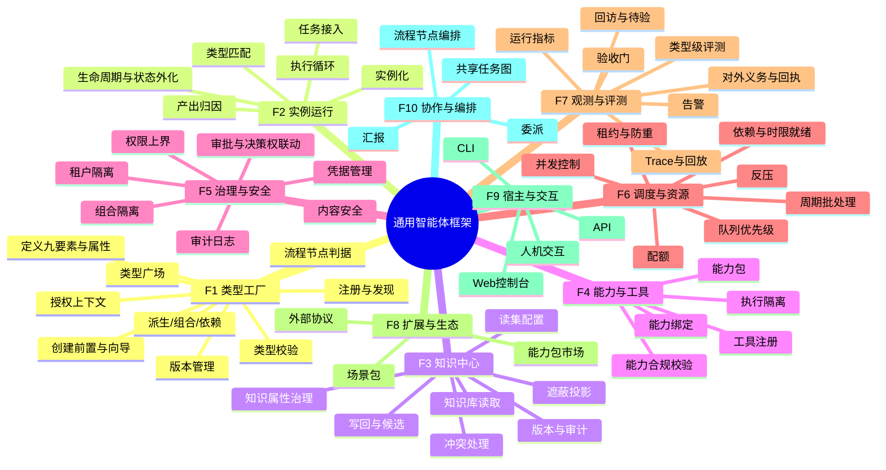

# 通用智能体框架 · 产品功能树与设计方案 v1.2

> **v1.2（2026-11-21）**：依据 [41-类型库-补充验证结论-v1](41-类型库-补充验证结论-v1.md) §7 的 G8–G15 修订；v1.1 保留不动。
> **定位**：从**产品功能视角**回答"这个智能体框架向使用者提供哪些能力"。不含实现、不含技术选型。
> **输入**：[31-核心设计原则 v1.1](31-核心设计原则-智能体类型-v1.1.md)（九要素与子属性）与 [32-通用 Agent 框架](32-通用Agent框架-v0.md)（九组件）。本文把它们翻译成"用户能看见、能操作、能验收的功能"。
> **v1.2 输入**：[41](41-类型库-补充验证结论-v1.md)：三份 40 文件、22 型（T101–T122）的第二轮压力测试结论，重点是 §4 的 U1–U22、§7 的 G8–G15、§10 的三条结论。31 v1.2 已落盘（R13–R35），本文涉及的字段名与取值以 **31 v1.2 与 41 §7** 为准（两者已对齐；**读集统一为六项**），差异记录在 §9.1。
> **与前序文档**：[29-系统设计方案](29-系统设计方案-v1.md) 是"记忆中心"总体方案，其能力已并入本文 F3；[27-功能树](27-功能树-v0.md) 是早期产品向草稿，已作废。
> **本版交付**：功能树 + 功能域详解 + 优先级 + 用户旅程 + G8–G15 落点表 + 未验证声明。v1.2 只做两件事：把 G8–G15 落进既有十域；把新增字段的 MVP 归属与未验证边界说清楚。

---

## 0. 摘要（先结论）

**一句话**：把"每次任务都重新拼提示词 + 挑工具 + 抄上下文"变成——**定义一次智能体类型，之后按需实例化无数次**。

**框架的十条功能主线**：

1. **类型工厂**：定义、注册、派生、版本化 agent 类型（"造 agent 的模具"）
2. **实例运行**：把任务变成实例、跑起来、管生命周期（"用模具压出 agent"）
3. **知识中心**：类型声明读什么、写回什么，知识有版本、可审计（"agent 的记忆"）
4. **能力与工具**：工具注册、能力包、执行隔离（"agent 的手"）
5. **治理与安全**：权限上界、审批、租户、审计（"agent 的缰绳"）
6. **调度与资源**：并发、配额、租约、反压（"agent 的体力"）
7. **观测与评测**：指标、trace、类型级评测、验收门（"agent 的成绩单"）
8. **扩展与生态**：能力包、场景包、外部系统接入（"框架的生长"）
9. **宿主与交互**：CLI / Web / API / 人机交互（"人和 agent 的界面"）
10. **协作与编排**：多 agent 委派与协作（预留，另一会话主题）

**MVP 最小闭环（P0，v1.2 调整后）**：F1（类型定义/注册/校验/创建前置与向导）+ F2（实例化/执行/归因）+ F3（读集/写域/快照/准入）+ F4（工具注册/越界拒绝/环境阶段）+ F5（权限上界/分级审批/审计）+ F6（并发/租约/周期批处理）+ F7（指标/验收门/双段状态机）+ F9（一种宿主）。

**v1.2 相对 v1.1 的变化（G8–G15）**：

- **G8**：F1.1 类型表单从"五个属性字段"扩为**八个字段组**（身份职责/能力/知识/边界/接口与验收/生命周期/协作/关系），新增验收参数与给定方、代理/真实指标、归因设计、证据强度、责任主体与资质、法定对外义务、交付物成熟度、读集准入与可见粒度；F1.5 增加 12 条专项校验；F2.3/F7.4 读取这些字段。
- **G9**：F2.5 生命周期增加**硬时限与逾期、触发节奏、单次运行边界、档位实例可覆盖、实例私有状态 vs 交付物归档**；F1.5 按档位分型校验；F6.6 对接触发节奏与单次边界；新增 F7.7 承接时限与义务台账（P1）。
- **G10**：F3.2 读集配置增加**准入（v1.2 新增项）与可见粒度**；F3.1 读取执行准入与投影；F3.3 写回不得提升可见性；F3.6 增加准入复核与证据强度标注；新增 F3.7 遮蔽投影执行（P1）。
- **G11**：F7.4 验收门从"三类验收"改为**主验收时点 + 附加回访的双段编排**，登记归因设计、证据强度与成熟度；F7.6 生成效果后回访任务并承接归因回填（P1）。
- **G12**：新增 F4.5 能力合规校验（责任主体与资质、环境三段）；F5.2 增加**审批强度与决策权分级联动**；F1.1 决策权改为"默认档 + 条件→档位"；F1.7 增加资质预检。
- **G13**：F1.3 增加**派生判定辅助（优先级顺序）、依赖声明、组合内部禁止协作声明**；F1.4 关系随版本冻结与复核；新增 F5.7 组合隔离与禁止协作执行（P1）、F6.7 依赖与时限就绪调度（P1）。
- **G14**：F1.7 增加**流程节点识别判据面板**（独立交付物/独立边界/可单独委派）；新增 F10.4 流程节点编排（P2，预留）。
- **G15**：F1.7 增加**八步创建向导**、**1.5↔7 回退提示**、**验收参数给定方选择**；F2.3 在给定方=实例委托人时强制录入参数。

**数量**：新增 6 个子功能（F3.7、F4.5、F5.7、F6.7、F7.7、F10.4）；扩写 F1.7；F1.5 由 P1 升为 P0；其余为既有行改动。逐条对照见 §8，术语对齐见 §8.4，未验证与依赖见 §9。

**MVP 判断（先给结论）**：**v1.2 不把"效果后回访自动化、物理域资质核验、组合隔离"塞进 P0**，而是在 P0 增加一组**类型准入条件**（§5.1.1）作为硬门禁——P0 只允许注册"交付时/过程型、可回放、无人身风险、无法定义务、无外部持证执行、无受限投影、不参与组合"的类型。理由有三条：

1. 这些能力各自依赖外部条件（资质库、数据脱敏层、回访队列、组合协议），塞进 P0 会把"最小闭环"变成"半成品全家桶"；
2. 没有门禁而直接放开，会出现更坏的假闭环——类型定义了效果后验收却永远"待验"，定义了法定资质却没人核验；
3. 门禁把"不支持"变成**可判定、可拒绝、可解释**的状态，比"支持但不可靠"诚实。

**诚实声明**：v1.2 中**已由 41 的 22 型样本验证**的是"缺口位置"（U 码与 G 码的对应关系）；**未验证**的是本轮新设计的取值结构与联动规则——P0 类型准入条件、审批强度映射、档位覆盖方向、投影执行、依赖降级语义、双段验收状态机、义务台账、流程节点编排。它们依赖 31 v1.2 与第三轮验证，逐项列在 §9.3/§9.4。

---

## 1. 产品定位

### 1.1 它是什么

一个**智能体工厂与运行平台**：团队用"类型"描述 agent（它是谁、干什么、能碰什么），平台负责把任务实例化成 agent、跑完、管住、留痕。

### 1.2 它不是什么（划清边界）

| 不是 | 为什么 | 是什么 |
|---|---|---|
| 提示词模板库 | 提示词只是"行为"的一部分 | 类型 = 九要素的完整定义 |
| 工作流编排器 | 编排是"任务之间怎么连"，框架管"任务内 agent 怎么活" | 协作留给 F10 与另一会话；流程节点只做识别与编排，不塞进类型库 |
| RPA / 脚本平台 | 脚本是确定性的；agent 是决策性的 | 行为规则 + 边界 + 验收 |
| 单一聊天产品 | 聊天是宿主形态之一 | F9 的一种 |
| 模型供应商 | 模型可替换 | 能力/工具/知识层与模型解耦 |
| 合规认证机构 | 框架校验"有没有声明资质与义务"，不替代发证机关 | 责任主体与资质的**登记与校验位**，不是资质本身 |

### 1.3 使用者与角色

| 角色 | 关心什么 | 主要用哪些功能域 |
|---|---|---|
| **类型设计者**（专家/架构师） | 类型定义是否清楚、可复用 | F1 类型工厂 |
| **任务发起者**（业务方） | 任务能不能被正确理解、结果能不能验收 | F2 实例运行、F9 宿主 |
| **治理者**（安全/合规/负责人） | 有没有越权、能不能审计、成本可控吗 | F5 治理、F6 调度、F7 观测 |
| **合规/法务**（强合规域，v1.2 明列） | 法定对外义务、资质、读集准入、证据强度是否可审 | F1 类型定义、F3 知识中心、F5 治理、F7 观测 |
| **平台运维** | 跑得稳不稳、资源够不够、故障能不能定位 | F6、F7、F9 |
| **扩展开发者** | 能不能加工具/接系统/做场景包 | F4、F8 |

> 角色不是第十要素，也不是新类型；它只是"谁在用哪些功能"的视图。九要素仍是身份/职责/能力/知识/行为/边界/接口/生命周期/协作。

### 1.4 核心价值主张

1. **复用**：定义一次类型，实例化无数次；类型可评、可版本、可派生。
2. **治理**：每个实例的权限、写域、行为都有上界，越界可判、可审批、可审计。
3. **可验收**（v1.2 强化）：验收不是一句"以 Z 验收"，而是**主验收时点 + 附加回访 + 验收参数与给定方 + 代理/真实指标 + 归因设计 + 证据强度**；缺证据位不算完成。
4. **可观测**：任何产出可归因到"类型版本 + 实例 + 证据链 + 证据强度"；缺证据不算完成。

---

## 2. 功能树总览

### 2.1 思维导图



### 2.2 功能树（缩进版，便于检索与勾选）

```
通用智能体框架
├─ F1 类型工厂
│  ├─ F1.1 类型定义（九要素模板、八个字段组、校验）
│  ├─ F1.2 类型注册与发现（枚举/搜索/详情/证据与依赖展示）
│  ├─ F1.3 派生、组合与依赖（判定辅助/依赖声明/组合禁止协作）
│  ├─ F1.4 版本管理（历史/差异/回滚/关系冻结）
│  ├─ F1.5 类型校验（27 条/反模式/按生命周期分型）
│  ├─ F1.6 类型广场（模板/示例库）
│  ├─ F1.7 创建前置与创建向导（前置/步序/1.5↔7/流程节点判据）
│  └─ F1.8 授权上下文管理（签发/校验/过期）
├─ F2 实例运行
│  ├─ F2.1 任务接入（消息/事件/工作项）
│  ├─ F2.2 类型匹配与路由（适用域/依赖前置）
│  ├─ F2.3 实例化（快照/租约/预算/参数/前置复核）
│  ├─ F2.4 执行循环（多步/工具调用/停止条件/硬时限）
│  ├─ F2.5 生命周期管理（四档/硬时限/触发节奏/单次边界/状态外化/归档/交接）
│  └─ F2.6 产出归因（版本+实例+证据强度+归因）
├─ F3 知识中心
│  ├─ F3.1 知识库读取（检索/范围/版本/时效/准入/投影）
│  ├─ F3.2 读集配置（六项：范围含可见粒度/版本/时效/权威级别/驻留范围/准入）
│  ├─ F3.3 写回与候选（私有草稿/候选/合并/可见性不提升）
│  ├─ F3.4 版本与审计（谁改了什么）
│  ├─ F3.5 冲突处理（显式分歧/人工裁决/强度冲突）
│  ├─ F3.6 知识属性与时效治理（过期/复核/驻留/准入/证据强度）
│  └─ F3.7 遮蔽投影与可见粒度执行（脱敏/仅标志/仅分数）
├─ F4 能力与工具
│  ├─ F4.1 工具注册（声明/描述/参数/五维/资质）
│  ├─ F4.2 能力包（按职责打包）
│  ├─ F4.3 执行隔离（超时/取消/重放/环境阶段）
│  ├─ F4.4 能力绑定（类型-工具-写域-资质）
│  └─ F4.5 能力合规校验（责任主体/资质/环境三段）
├─ F5 治理与安全
│  ├─ F5.1 权限上界（实例权限⊆类型上界）
│  ├─ F5.2 审批流与分级授权（限额/风险/决策权联动）
│  ├─ F5.3 租户隔离（数据与运行隔离）
│  ├─ F5.4 凭据管理（不落明文）
│  ├─ F5.5 审计日志（越权/审批/放行/义务/投影/资质）
│  ├─ F5.6 内容安全（不可信输入/外溢）
│  └─ F5.7 组合隔离与禁止协作（不共享上下文/模型分/自评）
├─ F6 调度与资源
│  ├─ F6.1 并发控制（全局/类型/租户上限）
│  ├─ F6.2 配额（token/时间/费用）
│  ├─ F6.3 租约与防重（同任务不双跑）
│  ├─ F6.4 队列与优先级（公平/优先）
│  ├─ F6.5 反压（过载降速不崩溃）
│  ├─ F6.6 周期批处理（每日/每周/补跑/节拍）
│  └─ F6.7 依赖与时限就绪（缺失降级/硬时限/逾期）
├─ F7 观测与评测
│  ├─ F7.1 运行指标（数量/耗时/成本/失败率/逾期/义务）
│  ├─ F7.2 Trace 与回放（每步可查/可重放）
│  ├─ F7.3 类型级评测（按类型横向比较）
│  ├─ F7.4 验收门（主验收时点+附加回访/双段）
│  ├─ F7.5 告警（异常/越权/成本/时限/资质）
│  ├─ F7.6 回访与待验（回访时点/判定人/超期升级）
│  └─ F7.7 对外义务与回执（对象/时限/格式/回执）
├─ F8 扩展与生态
│  ├─ F8.1 能力包市场（安装/组合）
│  ├─ F8.2 场景包（一套策略+类型清单）
│  └─ F8.3 外部协议（与其他系统互联）
├─ F9 宿主与交互
│  ├─ F9.1 CLI（脚本/批处理）
│  ├─ F9.2 Web 控制台（看板/操作/向导）
│  ├─ F9.3 API（外部系统接入）
│  └─ F9.4 人机交互（审批/确认/汇报/双签）
└─ F10 协作与编排（预留）
   ├─ F10.1 委派（向子 agent 派任务）
   ├─ F10.2 汇报（向父 agent 交结果）
   ├─ F10.3 共享任务图（多 agent 协同）
   └─ F10.4 流程节点编排（非类型节点，P2）
```

### 2.3 阅读方式

- **按角色读**：§1.3 表 → 对应功能域；
- **按优先级读**：§5 的 P0/P1/P2；
- **按实现顺序读**：§4 功能→组件映射；
- **按修订读**：§8 的 G8–G15 落点表。

---

## 3. 功能域详解

> 每个功能域统一格式：**一句话 / 使用者 / 功能表 / 关系 / 不做**。功能表中的"验收判据"是**可判定的一句话**，用于评审与 MVP 验收。
> **格式说明**：功能表保持 v1.1 的四列（功能/子功能/优先级/验收判据）。v1.2 新增的字段组不另起一张功能表，而是在 F1 下用"F1.1 字段组明细"展开；新增子功能仍进四列表。

### F1 类型工厂（造 agent 的模具）

**一句话**：让设计者用九要素定义一个 agent 类型，创建前先过前置与向导校验，注册后能被任务匹配与实例化。

**使用者**：类型设计者（主）、合规/法务、平台运维。

| 功能 | 子功能 | 优先级 | 验收判据 |
|---|---|---|---|
| F1.1 类型定义 | 九要素表单/模板、必填校验、设计说明；**八个字段组**（见下方明细）；决策权=默认档+条件→档位；适用域；能力五维（含读写性质、环境三段、可逆性档）；边界判定方式（四值×粒度×误判方向+取向+阈值审批人）；接口与验收组（主验收时点+附加回访、验收参数+给定方、代理/真实指标、归因设计、证据强度+置信度、成熟度、法定对外义务）；知识组（读集六项：范围含可见粒度/版本/时效/权威级别/驻留范围/准入）；生命周期组（四档/硬时限/触发节奏/单次边界/档位覆盖/归档vs外化）；协作组（依赖/人/禁止协作） | P0 | 缺任一必填要素无法注册；条件字段在条件成立时缺项不能保存；能力项缺五维或责任主体不能保存；效果后类型缺回访三件套或归因设计不能保存；读集项缺准入或可见粒度不能保存；周期批处理缺触发节奏或单次边界不能保存；一次性类型缺交付物归档不能保存 |
| F1.2 注册与发现 | 注册表、枚举、搜索、类型详情；详情展示主验收时点、证据强度、成熟度、依赖、资质要求、流程节点判定结果 | P0 | 能回答"当前有哪些类型"；详情能回答"这个类型怎么验、依赖谁、需要什么资质" |
| F1.3 派生、组合与依赖 | 派生判定辅助（按优先级顺序：职责不共享→新建；边界换维→新建；同型只收紧→派生；高合规优先新建）；组合（has-a）；依赖声明（类型 id+方向+缺失降级+是否阻塞启动）；组合内部禁止协作声明 | P1 | 派生关系可查；派生必须共享职责（换向=新建）；能力可扩但须带五维与新增边界；既有边界不放宽；依赖关系与降级策略可查；组合内部禁止协作已声明 |
| F1.4 版本管理 | 版本历史、差异对比、回滚、实例绑版本；关系随版本冻结；派生/依赖关系在版本升级时复核；验收参数快照随版本保存 | P0 | 改类型=新版本，旧版本仍可实例化；旧实例的验收参数不因新版本漂移；关系失效时新版本不能置为"可用" |
| F1.5 类型校验 | 基础 15 条检查清单、反模式检测、独立评审记录；v1.2 新增 12 条专项校验（见 §8.2.1）；按生命周期分型校验（长驻查状态外化与交接；周期查节奏与单次边界）；适用域一致性校验（以职责为准、接口引用） | P0（v1.2 由 P1 升 P0） | 校验不过不能进"可用"状态；判定方式为近似/环境化但未写误判方向与取向的不得通过；长驻未写状态外化与交接的不得通过；周期未写触发节奏与单次边界的不得通过；效果后未写归因设计的不得通过 |
| F1.6 类型广场 | 官方/团队模板、示例类型；模板包含 v1.2 八个字段组 | P2 | 从模板一键创建，创建后缺项校验与新建一致 |
| F1.7 创建前置与创建向导 | 前置清单按风险等级声明（预算通用；授权上下文/隔离环境/资质预检对红队/越狱测试/高合规/物理域强制）；八步向导（名称沿用 31 v1.1"八步创建法"，实际含步 0 前提、步 1.5 证据形态、步 8 生命周期与协作：0 前提→1 职责→1.5 证据形态→2 身份→3 能力→4 知识→5 行为→6 边界→7 接口→8 生命周期与协作）；**1.5↔7 回退提示**；**验收参数给定方选择**；**流程节点识别判据面板**（独立交付物/独立边界/可单独委派）；派生/新建/组合判定树 | P0 | 高风险类型缺授权上下文、隔离环境或资质预检时创建被拒并列出缺项；普通类型缺预算时创建被拒；1.5 与 7 的证据形态不一致时向导阻断并给出回退到 1.5 的提示；验收参数给定方未选不能完成 1.5；流程节点三问任一为"否"时不注册为类型，转入 F10.4 编排区并留判定记录 |
| F1.8 授权上下文管理 | 签发登记（签发人/范围/有效期）、校验、过期/撤销；与隔离环境绑定；创建与实例化时复核 | P1 | 过期或撤销的授权上下文不能用于创建或实例化；签发人、范围、有效期可查；复核留审计 |

**F1.1 字段组明细（v1.2）**

| 字段组 | 包含字段 | 必填性 | 优先级 | 说明 |
|---|---|---|---|---|
| G1 身份与职责 | 角色名、人格/语气、立场、价值取舍顺序；任务类、交付物、验收口径、决策权（默认档+条件→档位）、适用域 | 必填（价值排序可选） | P0 | 决策权值仍是建议/共决/执行三值，v1.2 只增加"条件→档位"结构，不新增值 |
| G2 能力 | 每项能力：读写性质、影响面、可逆性、成本、作用域、环境（部署环境三段+可回放性+人身风险）、责任主体与资质、agent 角色 | 必填 | P0 | 责任主体与资质与五维**并列**，不是第六维；环境仍是五维之一，只是内部拆三段 |
| G3 知识 | 读集每项：范围（含**可见粒度**）、版本、时效、权威级别、驻留范围、**准入**；写域每项：层级、驻留范围、是否禁止写 | 必填 | P0 | **读集六项**（31 v1.2 口径，取代 v1.1 的"四项"说法）：范围含可见粒度、版本、时效、权威级别、驻留范围、准入；写域三项 |
| G4 边界 | 每条边界：判定方式、粒度、误判方向、取向、阈值审批人、触发条件 | 必填 | P0 | 判定方式四值不变；取向与阈值审批人是 v1.2 新增子属性 |
| G5 接口与验收 | 输入形态、输出形态、证据、证据强度+置信度、交付物成熟度、主验收时点、附加回访、验收参数+给定方、代理指标、真实指标、归因设计、法定对外义务 | 条件必填 | P0 | 效果后必填回访三件套+归因设计；有法定义务必填义务四件套；真实指标可空但须声明 |
| G6 生命周期 | 档位（默认+实例可覆盖）、有效期、硬时限+逾期后果+是否可延、触发节奏、单次运行边界、实例私有状态外化、交付物归档、交接条件、续期/退休、实例寿命vs业务周期 | 条件必填 | P0 | 长驻/周期必填状态外化；一次性也必须写交付物归档；硬时限与有效期分列 |
| G7 协作 | 可委派、被委派、汇报、人、禁止协作、依赖（类型 id+方向+缺失降级+是否阻塞启动） | 条件必填 | P0（委派/汇报/人的声明、禁止协作声明）/P1（依赖） | 不声明=不协作；"人"档必填；依赖是 v1.2 新增档位，P1 落地；P0 类型依赖=无 |
| G8 关系 | 派生自、组合关系、派生判定依据、流程节点判定结果 | 条件必填 | P1 | 由 F1.3/F1.7 维护；流程节点不入类型库 |

**关系**：F1 的输出是 F2 的输入；F1.3 的派生/组合/依赖关系由 F1 自己维护（用户已拍板"子类型能扩展能力和数据集，由类型本身决定"）；F1.7 的前置与向导由授权方/治理者/合规方提供输入、由 F1 校验，不改变类型本体；F1.7 的流程节点判定结果转 F10.4，不进类型库。

**不做**：不负责执行、不存知识本体、不判定具体权限（只声明上界）；创建前置只做录入与校验，不代替授权方签发，也不代替 F5 做运行时权限判定；资质校验只核验"有没有登记与凭证"，不代替发证机关。

### F2 实例运行（用模具压出 agent）

**一句话**：把外部任务变成实例，按类型跑起来，管生命周期，产出可归因。

**使用者**：任务发起者、平台运维。

| 功能 | 子功能 | 优先级 | 验收判据 |
|---|---|---|---|
| F2.1 任务接入 | 消息/事件/工作项、幂等键、去重 | P0 | 同一请求重复提交不重复执行 |
| F2.2 类型匹配 | 显式指定 + 语义兜底路由；匹配前校验适用域与依赖前置 | P1 | 能回答"为什么这个任务给了这个类型"；任务超出适用域或依赖缺失时匹配被拒并说明原因 |
| F2.3 实例化 | 绑输入、钉知识快照、发租约、定预算；复核创建前置有效性（F1.7/F1.8）；**验收参数给定方=实例委托人时强制录入参数**；依赖就绪检查；档位实例覆盖（若启用）；硬时限起算；资质预检结果复核 | P0 | 实例化不复制类型/知识，秒级完成；前置过期/撤销或依赖阻塞时实例化被拒；给定方=实例委托人而参数缺失时被拒；档位覆盖未审批时被拒 |
| F2.4 执行循环 | 多步、工具调用、停止条件、失败重试；到硬时限强制停止并转交；单次运行边界到界即停；对外义务回执登记 | P0 | 每步可查、可中断、可恢复；到硬时限不静默继续；单次运行边界不被突破；义务回执有记录 |
| F2.5 生命周期 | 四档：一次性/短驻/长驻/周期批处理；**默认档+实例可覆盖**；**硬时限+逾期后果+是否可延**；**触发节奏**；**单次运行边界**；**实例私有状态外化 vs 交付物归档**（位置/保留期/读权限）；续期/退休；交接条件；实例寿命与业务周期分列；回收 | P0 | 四档都可选且行为不同；长驻退出后状态可按外化位置与保留期恢复或交接；长驻有交接条件；周期批处理有触发节奏、单次边界与幂等键；一次性也有交付物归档；硬时限到期触发停止或逾期处置；档位覆盖有审批与审计 |
| F2.6 产出归因 | 类型版本+实例+证据链+证据强度+归因设计引用+交付物成熟度 | P0 | 任一产出能追到"谁、按什么定义、干了什么、证据多强"；效果后产出能追到归因设计 |

**关系**：依赖 F1（类型）、F3（知识快照/准入）、F4（工具/资质）、F5（权限/审批）、F6（租约/周期节拍/依赖就绪）。

**不做**：不定义类型、不实现调度策略（调用 F6）、不存公共知识（写回走 F3）；不代替合规方判断资质真伪（只校验登记与凭证有效性）。

### F3 知识中心（agent 的记忆）

**一句话**：类型声明读集/写域，实例只读快照、只写私有，公共知识经候选写回并留版本；读集项带版本、时效、权威级别、驻留范围，v1.2 再增准入与可见粒度。

**使用者**：类型设计者（声明）、任务发起者（受益）、治理者/合规（审计）。

| 功能 | 子功能 | 优先级 | 验收判据 |
|---|---|---|---|
| F3.1 知识库读取 | 按范围检索、按相关度/时间过滤；按声明版本取用；过期与权威级别标注；**执行准入**（可读/需授权/禁读/仅命中标志）；**按可见粒度投影**（全量/脱敏/仅标志/仅分数）；证据强度标注 | P0 | 实例只能读到读集内且准入允许的内容；命中"禁读"直接拒绝并解释；"需授权"无授权时拒绝；读到过期项时带"过期"标记，不能作为"现行"依据；投影后不返回超出可见粒度的字段 |
| F3.2 读集配置 | 类型→读集声明、项目/领域/全局范围；每项声明版本/时效/权威级别/驻留范围；**准入（v1.2 新增项）**；**可见粒度**；证据强度 | P0 | 越界读取被拒绝并可解释；读集项能回答"读的哪一版、何时过期、多权威、允许驻留在哪、能不能读、能读到多细"；缺准入或可见粒度的读集项不能保存 |
| F3.3 写回与候选 | 私有草稿、候选提交、审批合并；写域项声明版本/时效/权威级别/驻留范围（含"禁止写"）；**写回不得提升可见性**（受限读集内容不得写入更高可见层级）；准入复核 | P0 | 实例不能直写公共知识；写域项缺驻留范围的写入被拒；受限内容写入更高可见层级被拒；候选合并后版本与权威级别可追 |
| F3.4 版本与审计 | 知识版本、变更历史、回滚；版本/时效/权威级别/驻留范围/准入/可见粒度/证据强度的属性变更也入历史 | P1 | 能回答"这条知识谁改的、什么时候、改前改后"；属性变更可追 |
| F3.5 冲突处理 | 矛盾标记、显式分歧、人工裁决；证据强度冲突（一级 vs 二级）显式暴露 | P1 | 冲突不会被静默合并；强度冲突不会被"取平均"掩盖 |
| F3.6 知识属性与时效治理 | 四属性+准入+可见粒度的登记、过期扫描与提醒、权威级别复核、驻留范围校验、准入复核、证据强度标注 | P1 | 过期知识被标注且不能作为"现行"依据；驻留范围外的写入被拒；准入变更需复核并留审计；证据强度缺失的知识项不能被标为"一级" |
| F3.7 遮蔽投影与可见粒度执行 | 字段级脱敏、聚合、仅返回命中标志、仅返回模型分；投影规则配置与审计；与 F5.1/F5.5 联动 | P1 | 同一读集项对不同角色可按规则返回不同粒度；"仅标志/仅分数"不返回原文/权重；每次投影决策可审计 |

**关系**：29 的"记忆中心"实现可落在这里；F2 的实例化从这里取快照；F3.6 为 F3.1/F3.2 提供时效、权威、准入判定；F3.7 为 F3.1 提供投影执行；F3.3 的写回受 F3.2 的准入与可见性约束。

**不做**：不存 agent 定义（F1）、不做执行（F2）；F3.6 只治理属性与时效，不判定知识内容的对错；F3.7 只做投影，不决定"该不该给"（准入在 F3.2，权限在 F5.1）。

### F4 能力与工具（agent 的手）

**一句话**：工具注册、能力包、执行隔离；能力与类型、写域、资质、环境绑定。

**使用者**：扩展开发者（注册）、类型设计者（绑定）、治理者/合规（审计）。

| 功能 | 子功能 | 优先级 | 验收判据 |
|---|---|---|---|
| F4.1 工具注册 | 声明名/描述/参数/副作用；**五维元数据**（影响面/可逆性/成本/作用域/环境）；**责任主体与资质要求**；可回放性/人身风险标注 | P0 | 未注册工具不可调用；工具详情能回答"这个工具能造成多大影响、能不能撤销、需要什么资质、在哪个环境可执行" |
| F4.2 能力包 | 按职责打包工具；包级五维与资质清单 | P1 | 能力包可被类型引用；包内工具的五维与资质不冲突 |
| F4.3 执行隔离 | 超时/取消/重放/收据；**环境阶段门禁**（沙箱→灰度→生产）；不可回放动作的审批与监护；人身风险动作的隔离物/许可/监护 | P0 | 写操作有收据、可重放；未到环境阶段拒绝执行；不可回放/人身风险动作无审批或监护时拒绝 |
| F4.4 能力绑定 | 类型↔工具↔写域；**资质绑定**；**环境绑定**；绑定校验 | P0 | 越界调用被拒；类型声明了资质要求而绑定工具不满足时绑定被拒；环境不匹配时绑定被拒 |
| F4.5 能力合规校验 | 责任主体与资质校验（创建前置）、环境三段校验、审批强度与决策权分级联动校验；资质到期提醒；外部资质库/人工核验接口 | P1 | 缺责任主体或资质的类型不能进"可用"；环境序列不合法（跳段/越段）不能绑定；资质过期时相关能力被降级为"仅起草"并告警 |

**关系**：F5 判定权限、F3 管数据范围、F1 声明能力；F4.5 读取 F1.1 的能力组与 F1.7 的前置清单；F4.5 的结果供 F5.2 计算审批强度。

**不做**：不判定权限（F5）、不定义类型（F1）；资质校验只核验登记与凭证，不替代发证机关；环境三段校验只校验声明与绑定，不负责创建环境。

### F5 治理与安全（agent 的缰绳）

**一句话**：权限上界、审批（含分级授权与决策权联动）、租户隔离、凭据、审计、内容安全、组合隔离——横切所有域。

**使用者**：治理者（主）、合规/法务、平台运维。

| 功能 | 子功能 | 优先级 | 验收判据 |
|---|---|---|---|
| F5.1 权限上界 | 类型上界→实例权限（只收窄）；决策权条件分支的权限上界；组合内部隔离约束 | P0 | 实例权限超类型上界被拒；决策权=建议却有写权限被判矛盾；组合内实例越隔离边界被拒 |
| F5.2 审批流 | 高风险动作挂起待人批准；分级授权（限额/风险分级内自动放行、超限转人工）；审批规则引用能力五维+边界判定方式；**审批强度与决策权分级联动**；阈值审批人；无审批者时 fail-closed | P0 | 无审批者时 fail-closed；限额内自动放行不生成人工待办但留审计记录；超限单转人工；决策权=共决时至少人机双签；决策权=执行且影响面=广泛/不可逆/人身风险=有时至少人工审批；审批单展示五维、判定方式、阈值审批人；同一输入的自动/人工判定可复现 |
| F5.3 租户隔离 | 数据+运行隔离；组合隔离不替代租户隔离 | P1 | 跨租户不可见/不可调 |
| F5.4 凭据管理 | 凭据池、不落明文、按需注入；资质凭证与凭据分离 | P1 | 凭据不出现在产出/日志；资质凭证不当作运行凭据使用 |
| F5.5 审计日志 | 越权/审批/工具调用/分级授权自动放行全记录；**义务回执/时限逾期/投影访问/资质校验/档位覆盖/依赖降级**入审计 | P0 | 任一越权或自动放行可回放取证；义务回执与逾期可追；投影决策可追；资质过期可追 |
| F5.6 内容安全 | 不可信输入、外溢控制 | P1 | 不可信内容不能直接触发高影响动作 |
| F5.7 组合隔离与禁止协作 | 组合内实例不得共享上下文/模型分/中间结论；写者不得自评；审核实例不得与评分实例共享模型分；隔离边界可审计 | P1 | 组合内禁止协作的双方同时活跃时，共享上下文/模型分被拒；写者自评被拒；隔离边界可回放 |

**关系**：横切 F1–F10；F1 声明边界，F5 判定执行；F5.2 的自动放行规则读取 F1.1 的能力五维、判定方式、决策权与阈值审批人；F5.7 读取 F1.3 的组合禁止协作声明。

**不做**：不做业务逻辑；不替代 F10 定义组合协议（F5.7 只执行"禁止协作"的隔离，不定义组合的移交契约）。

### F6 调度与资源（agent 的体力）

**一句话**：并发、配额、租约、队列、反压、周期批处理、依赖与时限就绪——让 agent"跑得多但不失控"。

**使用者**：平台运维（主）、治理者（成本/时限）。

| 功能 | 子功能 | 优先级 | 验收判据 |
|---|---|---|---|
| F6.1 并发控制 | 全局/类型/租户并发上限 | P0 | 超限排队而不是压垮 |
| F6.2 配额 | token/时间/费用预算 | P1 | 超预算停止并可解释 |
| F6.3 租约与防重 | 同任务同刻单活跃租约 | P0 | 同一工作项不会双跑 |
| F6.4 队列与优先级 | 公平/优先/插队规则 | P1 | 优先级可验证 |
| F6.5 反压 | 过载降速、熔断 | P1 | 过载时可用性不崩 |
| F6.6 周期批处理 | 每日/每周节拍、批内并发与配额、错过节拍补跑、同批防重；与 F2.5 的触发节奏/单次运行边界对接 | P0 | 按业务周期自动起批；同一批不重复执行；错过节拍可补跑并留痕；单次运行边界到界即停 |
| F6.7 依赖与时限就绪 | 启动前检查依赖类型/实例/交付物是否就绪；缺失时按声明阻塞/降级/跳过；硬时限窗口校验；逾期转交或升级 | P1 | 依赖缺失时按声明降级并留痕；声明"阻塞启动"时实例不启动；硬时限到期前未完成则转交或升级；逾期可追 |

**关系**：F2 调用 F6；F7 观测 F6；F6.6 与 F2.5 的周期批处理档配对；F6.7 读取 F1.3 的依赖声明与 F2.5 的硬时限。

**不做**：不做执行（F2）、不做类型定义；周期批处理只负责节拍与起批，实例内部状态由 F2.5 状态外化承载；依赖就绪只做检查与降级，不替代 F10 的组合状态机。

### F7 观测与评测（agent 的成绩单）

**一句话**：指标、trace、类型级评测、验收门（主验收时点+附加回访的双段）、告警、回访待验、对外义务回执。

**使用者**：治理者、平台运维、类型设计者、合规/法务。

| 功能 | 子功能 | 优先级 | 验收判据 |
|---|---|---|---|
| F7.1 运行指标 | 数量/耗时/成本/失败率/越权数；**逾期数/义务回执率/证据强度分布/归因完成率/资质过期数** | P0 | 看板能回答"今天跑了多少、花多少、有多少待验/逾期/义务未回执" |
| F7.2 Trace 与回放 | 每步输入输出、可重放；验收参数快照、投影决策、资质校验、档位覆盖入 trace | P1 | 任一失败可定位到步骤；验收参数与投影决策可回放 |
| F7.3 类型级评测 | 按类型比较成功率/成本/质量；**证据强度与验收结构质量**纳入比较 | P1 | 能回答"哪个类型更划算、哪个类型的证据更可靠" |
| F7.4 验收门 | 完成需证据，缺证据不通过；**主验收时点（交付时/效果后/过程型）+ 附加回访（可空）双段编排**；交付门与效果后回访门分别记录；读取验收参数与给定方、代理/真实指标、归因设计、证据强度、成熟度；状态机：待验/通过/不通过/超期 | P0 | 无证据的产出不被签收；主验收时点=效果后时，交付门通过后状态为"待验"，不得计为"通过"；附加回访未到点前为"待验"；证据强度不达类型声明的最低强度时不通过；交付物成熟度与声明不符时不通过；过程型缺三项判据之一即不通过 |
| F7.5 告警 | 异常/越权/成本超限；**硬时限临近、回访超期、义务逾期、资质到期、依赖降级** | P1 | 异常有通知；时限/义务/资质告警可追 |
| F7.6 回访与待验 | 回访时点登记与到期提醒、判定人待办、待验状态、超期未判升级；**效果后回访任务生成**；**归因设计回填**；回访结论回写 F7.4 | P1 | 到回访时点自动生成待验任务并通知判定人；未判定前验收状态为"待验"；超期未判触发升级/告警；回访结论与归因设计可追 |
| F7.7 对外义务与回执 | 义务台账：对象/时限/格式/回执要求；到期提醒；回执登记；逾期升级；与 F5.5 审计联动 | P1 | 每条法定义务有对象、时限、格式、回执状态；到期前提醒；逾期升级；回执可审计 |

**关系**：观测 F2/F3/F4/F5/F6；F1 的设计依据来自 F7；F7.4 读取 F1.1 声明的验收结构，F7.6 承接效果后回访与归因回填，F7.7 承接法定对外义务；F5.2 的审批强度读取 F7.3 的类型评测结果。

**不做**：不干预执行（门禁除外）；回访队列只跟踪待验，不代替判定人下结论；义务台账只跟踪与提醒，不代替合规方履行义务。

### F8 扩展与生态（框架的生长）

**一句话**：能力包、场景包、外部协议——让框架能长、能接。

**使用者**：扩展开发者（主）。

| 功能 | 子功能 | 优先级 | 验收判据 |
|---|---|---|---|
| F8.1 能力包市场 | 安装/组合/版本；包内工具带五维与资质 | P2 | 装上即用、可组合；资质不满足时安装被拒或标记 |
| F8.2 场景包 | 策略选择+类型清单打包；包内类型含 v1.2 字段组 | P2 | 导入场景=得到一套配置；缺项校验与新建一致 |
| F8.3 外部协议 | 与其他 agent 系统互联 | P2 | 互通不改变骨架语义 |

**关系**：F8 扩展 F1（类型模板）、F4（工具包）；不改骨架。

**不做**：不引入新的核心语义（类型/实例/共享层不变）；不把外部系统的"流程节点"自动注册为类型。

### F9 宿主与交互（人和 agent 的界面）

**一句话**：CLI / Web / API / 人机交互——把功能暴露给人或系统。

**使用者**：全部角色。

| 功能 | 子功能 | 优先级 | 验收判据 |
|---|---|---|---|
| F9.1 CLI | 建类型/发任务/查状态/审批 | P0 | 无 Web 也能完成闭环 |
| F9.2 Web 控制台 | 看板/类型管理/实例追踪/创建向导/流程节点判据面板/验收双段状态 | P1 | 非技术用户能看懂；向导能提示 1.5↔7 回退 |
| F9.3 API | 外部系统对接 | P1 | 可被程序调用 |
| F9.4 人机交互 | 审批/澄清/汇报/双签；资质与义务的人工确认 | P0 | 高风险动作必须经人；资质/义务的人工确认留审计 |

**关系**：宿主不反向依赖内核；换宿主不改内核。

**不做**：不做业务逻辑、不直接读写知识/类型（走接口）。

### F10 协作与编排（预留）

**一句话**：多 agent 的委派、汇报、共享任务图，以及"不是类型"的流程节点编排——另一会话的主题，本框架只留接口位。

**使用者**：后续。

| 功能 | 子功能 | 优先级 | 验收判据 |
|---|---|---|---|
| F10.1 委派 | 向子 agent 派任务 | P2（预留） | 委派关系可追溯 |
| F10.2 汇报 | 子 agent 向父交结果 | P2（预留） | 结果可合并 |
| F10.3 共享任务图 | 多 agent 协同 | P2（预留） | 任务图一致 |
| F10.4 流程节点编排 | 承接 F1.7 判定为"流程节点"的对象（只签署/排序/转发，无独立交付物/独立边界/不可单独委派）；节点不入类型库；编排图与类型实例的边界可追 | P2（预留） | 流程节点不出现在类型注册表；编排图能回答"这个节点为什么不是类型"；节点与类型实例的交接可追 |

**不做**：本框架不定义协作协议（留给专门设计）；F10.4 只承载流程节点的编排位，不定义组合的移交契约（41 §9 第 4 条仍未解）。

---

## 4. 功能地图（功能域 → 组件 → 九要素）

| 功能域 | 对应组件（32） | 承载的九要素 | MVP 必须有 |
|---|---|---|---|
| F1 类型工厂 | C1 类型系统 | 身份/职责/能力/知识/行为/边界/接口/生命周期/协作 | 是 |
| F2 实例运行 | C2 实例运行时 | 行为/生命周期/接口 | 是 |
| F3 知识中心 | C3 共享知识层 | 知识（读集/写域/准入/可见粒度） | 是 |
| F4 能力与工具 | C4 工具与能力层 | 能力（五维/资质/环境） | 是 |
| F5 治理与安全 | C5 边界与安全层 | 边界/身份（权限）/协作（禁止协作） | 是 |
| F6 调度与资源 | C6 调度与资源层 | 生命周期（资源/时限/节奏） | 是 |
| F7 观测与评测 | C7 观测与评测层 | 接口（验收证据/回访/义务） | 是 |
| F8 扩展与生态 | C8 扩展与集成层 | — | 否 |
| F9 宿主与交互 | C9 宿主与接口层 | 接口/身份 | 是（一种宿主） |
| F10 协作与编排 | C8 预留 | 协作 | 否 |

**自检**：十域覆盖九要素、九组件；每个组件至少有一个功能域承载；每个要素至少有一个功能域落实。

**v1.2 要素归属补注（关键：不新增第十要素）**：

| v1.2 新增字段/能力 | 归属要素 | 说明 |
|---|---|---|
| 验收参数+给定方、代理指标/真实指标 | 职责·验收口径 | 41 R14/R19；验收口径仍在职责，不在接口另起要素 |
| 主验收时点+附加回访、归因设计 | 接口·验收类型 | 41 R13/R15；"三分"改双段，不新增要素 |
| 证据强度+置信度 | 接口·证据 | 41 R16 |
| 法定对外义务 | 接口 | 41 R17；义务是接口约束，不是新要素 |
| 交付物成熟度 | 接口·输出形态 | 41 R18 |
| 责任主体与资质 | 能力（与五维并列） | 41 R23；不是第六维 |
| 环境三段/可回放性/人身风险 | 能力·环境 | 41 R24；仍是五维之一 |
| 可逆性"公开但可更正" | 能力·可逆性 | 41 R25；仍是五维之一 |
| 硬时限/逾期/可延 | 生命周期·有效期 | 41 R26 |
| 实例私有状态 vs 交付物归档 | 生命周期·状态外化 | 41 R27 |
| 档位默认+实例可覆盖 | 生命周期·档位 | 41 R28 |
| 触发节奏/单次运行边界 | 生命周期 | 41 R29 |
| 误判取向+阈值审批人 | 边界·误判方向 | 41 R30 |
| 依赖 | 协作 | 41 R31；不是派生/组合/委派 |
| 读集准入 | 知识·读集 | 41 R20；v1.2 新增项 |
| 可见粒度 | 知识·读集·范围 | 41 R21；范围细分 |
| 决策权默认+条件→档位 | 职责·决策权 | 41 R22；三值不变，补条件结构 |
| 派生判定优先级 | 规则层（31 §4.2） | 41 R32；不是要素 |
| 流程节点判据 | 规则层（31 P11） | 41 R34；不是要素 |
| 1.5↔7 回路 | 创建流程（31 §3） | 41 R35；不是要素 |

**结论**：v1.2 的所有新增都能落到九要素的子属性或创建流程/规则层；**没有新增第十要素**。其中 F1.1 的"关系"字段组（G8）是类型间元数据而非要素——派生/组合/流程节点判定由 F1.3/F1.7 维护，归属协作与规则层。这也是 41 §10 最硬的结论（22/22 型无需第十要素）。

---

## 5. 优先级与 MVP

### 5.1 P0 最小闭环（先跑通"定义→实例化→跑完→可验收→可审计"）

- F1.1 类型定义（八个字段组）、F1.2 注册发现、F1.4 版本、**F1.5 类型校验（v1.2 由 P1 升 P0）**、F1.7 创建前置与向导（v1.2 扩写）
- F2.1 任务接入、F2.3 实例化、F2.4 执行循环、F2.5 生命周期、F2.6 归因
- F3.1 知识读取（含准入）、F3.2 读集（含准入/可见粒度）、F3.3 写回候选（可见性不提升）
- F4.1 工具注册、F4.3 执行隔离（含环境阶段）、F4.4 能力绑定
- F5.1 权限上界、F5.2 审批（含决策权联动）、F5.5 审计
- F6.1 并发、F6.3 租约、F6.6 周期批处理
- F7.1 指标、F7.4 验收门（双段状态机；回访自动化不在 P0）
- F9.1 CLI、F9.4 人机交互

**闭环验收**：用 F1 定义一个"客服 agent"类型（含八字段组与向导判定）→ F2 用两条真实任务实例化（其中一次前置过期被拒、一次验收参数缺失被拒）→ F4 调工具 → F5 拦一次越权、放行一次限额内动作 → F3 读快照（含一次准入拒绝）写候选 → F7 查指标与证据、看一次双段验收的"待验"状态。全程可回放；另用一个周期批处理类型验证 F6.6 节拍、F2.5 触发节奏与单次运行边界。

### 5.1.1 P0 类型准入条件（v1.2 新增，硬门禁）

> 这是 v1.2 对"MVP 是否要扩"的回答：**不扩能力面，改扩门禁**。P0 允许注册与实例化的类型必须同时满足以下 8 条；任一不满足，F1.7 拒绝创建或标记"需 P1 能力"，F1.2 不展示为可选类型。

| # | 条件 | 不满足时的处置 | 依据 |
|---|---|---|---|
| A1 | 主验收时点 ∈ {交付时, 过程型}；附加回访为空 | 效果后类型需 F7.6 上线并验证后才能注册 | U1/U3 |
| A2 | 环境=生产时，可回放性=可回放，人身风险=无；部署环境序列只允许沙箱/预发/生产顺序，不允许生产不可回放动作 | 物理域/不可回放类型需 F4.5/F4.3 环境阶段验证 | U16 |
| A3 | 无法定对外义务，且无带法律后果的硬时限 | 有法定义务或法律时限的类型需 F7.7 上线并验证 | U9/U10 |
| A4 | 无"责任主体=外部持证主体且 agent 执行"的能力；外部持证能力只能"仅起草" | 需 F4.5 资质核验后才能注册 | U8 |
| A5 | 决策权=建议/共决，或决策权=执行但所有执行分支的影响面≤局部且可逆性∈{可回滚,可补偿} | 执行×广泛/不可逆/人身风险的组合需 F5.2 联动规则验证 | U7 |
| A6 | 读集准入不含"仅命中标志"；可见粒度∈{全量,脱敏} | 需 F3.7 投影执行后才能注册 | U5/U6 |
| A7 | 生命周期档位∈{一次性,短驻,周期批处理}；不启用档位实例覆盖 | 长驻/覆盖需 F2.5 状态外化与覆盖审批验证 | U11/U18 |
| A8 | 不参与组合（F10 预留）；不声明跨类型依赖（依赖声明与缺失降级属 P1，见 §5.4 第 25 条） | 组合/依赖需 F5.7/F6.7 验证 | U15 |

**门禁的诚实边界**：这 8 条是 v1.2 的新设计，**未经第三轮验证**；它只保证"P0 不假装支持它没验证的类型"，不保证"满足 A1–A8 的类型一定安全"。第三轮应专压 A2/A3/A4/A5 四条（物理域与强合规域）。

### 5.2 P1（治理与体验）

F1.3 派生/组合/依赖、F1.6 类型广场（模板先于生态，仍列 P2）、F1.8 授权上下文管理、F2.2 匹配、F3.4 版本审计、F3.5 冲突、F3.6 知识属性与时效治理、**F3.7 遮蔽投影（新增）**、F4.2 能力包、**F4.5 能力合规校验（新增）**、F5.3 租户、F5.4 凭据、F5.6 内容安全、**F5.7 组合隔离（新增）**、F6.2 配额、F6.4 队列、F6.5 反压、**F6.7 依赖与时限就绪（新增）**、F7.2 trace、F7.3 类型级评测、F7.5 告警、F7.6 回访与待验、**F7.7 对外义务与回执（新增）**、F9.2 Web、F9.3 API。

> F1.6 类型广场仍为 P2（v1.1 口径），不因为模板要更新而升级；模板更新是 F1.6 的内容变更，不是优先级变更。

### 5.3 P2（生态与扩展）

F1.6 类型广场、F8.1 市场、F8.2 场景包、F8.3 外部协议、F10.1–F10.4 协作与编排（预留，含新增 F10.4 流程节点编排）。

### 5.4 新增字段/能力的优先级判定（逐项，显式）

> 口径：**P0** = 不做就无法定义/验收/审计最小闭环；**P1** = 治理增强或依赖外部条件；**P2** = 生态/预留。字段在 F1.1 的"录入"与执行能力分开判断，避免把"能填"当成"已支持"。

| # | 新增字段/能力 | 落点 | 优先级 | 判断理由 | P0 条件/门禁 |
|---|---|---|---|---|---|
| 1 | 验收参数+给定方 | F1.1/F2.3 | P0 | 阈值/权重/容忍度是验收合同的一部分；没有给定方，同一类型在不同实例上不可复现 | 给定方=实例委托人时 F2.3 必须录入，否则拒绝实例化 |
| 2 | 代理指标/真实指标 | F1.1 | P0 | 防止代理指标冒充真实目标；真实指标可空但必须声明"不可归因/仅过程型" | 主验收时点=效果后或交付物含主观质量时必填 |
| 3 | 归因设计 | F1.1/F7.4 | P0（字段） | 没有归因设计的"效果后"是不可证伪的声明 | 效果后类型必填；P0 门禁 A1 排除效果后 |
| 4 | 证据强度+置信度 | F1.1/F7.4 | P0 | 没有强度的"证据"只是字符串；人工/近似判定必须有 | 人工/近似判定或证据项必须标注 |
| 5 | 责任主体与资质 | F1.1/F4.5 | P1（校验）；字段 P0 | 物理域/法定持证是硬约束，但核验依赖外部资质库 | 人身风险=有或法定持证时必填；此类类型 P0 不注册（A4），F4.5 上线后走 P1 |
| 6 | 法定对外义务 | F1.1/F7.7 | P1（台账）；字段 P0 | 义务的对象/时限/格式/回执需要独立台账，塞进停止条件不可审计 | 有法定义务的类型 P0 不注册（A3），F7.7 上线后走 P1 |
| 7 | 交付物成熟度 | F1.1 | P0 | 成本极低，直接决定读者把交付物当"事实"还是"假设" | 无 |
| 8 | 读集准入 | F1.1/F3.1/F3.2 | P0 | "禁读/需授权"是硬合规边界，不能靠行为规则兜 | 读集项必填；P0 门禁 A6 |
| 9 | 可见粒度/遮蔽投影 | F1.1/F3.2/F3.7 | P1（执行）；字段 P0 | 字段可先声明；脱敏/仅标志/仅分数依赖数据层 | P0 类型限全量/脱敏；仅标志/仅分数待 F3.7（A6） |
| 10 | 硬时限+逾期 | F2.5/F7.7 | P0（字段）；P1（台账/告警） | 法定/合同时限不能只写"有效期"；台账与告警可后置 | 有法律后果的硬时限 P0 不注册（A3），F7.7 上线后走 P1 |
| 11 | 触发节奏 | F2.5/F6.6 | P0 | 周期档没有节拍就无法调度 | 周期批处理必填 |
| 12 | 单次运行边界 | F2.5/F6.6 | P0 | 防止单次运行无限扩张或重复副作用 | 周期批处理必填 |
| 13 | 档位实例可覆盖 | F2.5/F2.3 | P1 | MVP 类型档位稳定；覆盖是项目级优化，先关闭 | 默认关闭；开启需类型所有者审批（A7） |
| 14 | 归档 vs 状态外化 | F2.5/F1.5 | P0 | 一次性类型的交付物也必须归档；v1.1 的"无需外化"易被读成"不留痕" | 一次性也须写交付物归档 |
| 15 | 读集准入治理 | F3.2/F3.6 | P0（声明）；P1（治理） | 声明必须在 P0；复核/审计可后置 | P0 门禁 A6 |
| 16 | 遮蔽投影配置 | F3.2/F3.7 | P1 | 依赖数据层与字段级权限；P0 不做 | P0 类型门禁 A6 |
| 17 | 证据强度标注（知识项） | F3.6 | P1 | 知识项强度是治理增强，不阻塞读取；接口证据强度已在 P0 | P0 只要求接口证据强度 |
| 18 | 双段验收编排 | F7.4 | P0（状态机）；P1（回访自动化） | 状态机是验收门的一部分；回访自动化是 F7.6 | P0 类型限 A1 |
| 19 | 归因设计登记 | F7.4/F7.6 | P0（登记）；P1（回填） | 登记在类型层；回填在回访 | 效果后类型 |
| 20 | 效果后回访任务 | F7.6 | P1 | 不塞进 P0，避免"定义了永远待验"的假闭环 | P0 门禁 A1 排除效果后 |
| 21 | 责任主体/资质校验 | F4.5 | P1 | 需要外部资质库/人工核验；P0 不做 | P0 门禁 A4 |
| 22 | 环境三段校验 | F4.5/F4.3 | P1 | 阶段化部署依赖环境管理；P0 只做环境值与顺序校验 | P0 门禁 A2 |
| 23 | 审批强度与决策权联动 | F5.2 | P0 | 决策权分级若不带审批联动，等于没分级 | F5.2 P0；A5 |
| 24 | 派生判定辅助 | F1.3/F1.7 | P1（F1.3）；P0（向导判定树） | 判定树在向导里就必须有，否则派生滥用复发 | F1.7 P0 |
| 25 | 依赖声明与降级 | F1.3/F2.3/F6.7 | P1（字段 P0，P0 类型填"无"） | MVP 类型不组合、不依赖；字段保留是为了显式写"无"，而不是留空 | P0 类型依赖=无（A8） |
| 26 | 组合内部禁止协作 | F1.3/F5.7 | P1 | 组合本身 P2 预留；但禁止协作必须先声明 | P0 类型不参与组合（A8） |
| 27 | 流程节点识别判据 | F1.7/F10.4 | P0（面板）；P2（编排） | 面板防止把流程节点塞进类型库；编排是后话 | F1.7 P0 |
| 28 | 1.5↔7 回退提示 | F1.7 | P0 | 证据不可得时必须能回退改验收定义，否则只能造"假验收" | F1.7 P0 |
| 29 | 验收参数给定方选择 | F1.7/F2.3 | P0 | 与第 1 条配套；给定方决定参数在创建时还是实例化时给 | F1.7 P0 |

**一句话**：**P0 加的是"字段 + 门禁 + 状态机"，不是"效果后自动化、资质库、投影引擎、组合协议"**。这四条留给 P1/P2，并在 §5.1.1 用门禁挡住未验证类型。

---

## 6. 用户旅程（功能串起来的样子）

### 6.1 设计者：建一个"客服 agent"类型（走八步 v1.2 向导）

1. **F1.7 步 0 前提**：预算=单会话 ≤ 2 万 token；授权上下文=客服系统账号（有效期=季度）；隔离环境=生产（可回放，人身风险=无）；组合=否；资质预检=无外部持证能力；F1.7 流程节点三问：有独立交付物（回复+工单结论）✓、有独立边界（退款/隐私/承诺）✓、可单独委派 ✓ → **是类型**，进入向导。
2. **步 1 职责**：负责"售后咨询与工单处理"，交付"回复+工单结论"，以"政策命中+客户确认+首次解决率"验收；决策权=**默认执行，条件→档位**（退款 <500 执行；≥500 共决；涉及隐私/投诉升级=建议）；适用域=售后咨询，不含售前与境外。
3. **步 1.5 证据形态**：主验收时点=**交付时**；附加回访=**空**（P0 门禁 A1）；验收参数=首次解决率 ≥80%、响应时长 ≤2h、容忍度=1 次改派；**给定方=实例委托人**；代理指标=平均响应时长/一次解决率；真实指标=**空，声明"仅交付时，不做效果归因"**；证据强度=一级（工单原始记录）/二级（客户口头确认）；成熟度=决定（政策内回复）/建议（超限升级）。
4. **步 2 身份**：售后顾问；稳妥、先共情后给方案；价值顺序=合规 > 客户满意 > 速度。
5. **步 3 能力**：读订单（只读/局部/可回滚/低/项目内/生产/可回放/人身风险无；责任主体=客服主管，agent=执行）；发回复（副作用/局部/可补偿/低/项目内/生产；责任主体=客服主管，agent=执行）；退款（副作用/局部/可补偿/中/项目内/生产；责任主体=客服主管+财务，agent=执行<500、仅起草≥500）；无外部持证资质。
6. **步 4 知识**：读集=订单（最新/本任务周期/权威/本实例/**可读/脱敏**）、支付信息（最新/30 天/参考/本实例/**需授权/脱敏**）、风控名单（最新/永久/权威/本实例/**禁读**）；写域=工单结论（任务层/本实例/可写）、政策例外（领域层/全局/候选制，需评审）。
7. **步 5 行为**：先查政策→再回复；歧义影响退款先问；失败先看工单再重试（≤2 次）；满足验收即停，不追"更好"。
8. **步 6 边界**：不承诺政策外赔付（程序高可信：政策引擎）；不泄露支付信息（程序高可信：字段脱敏）；不绕过风控名单（程序高可信：禁读）；退款 ≥500 必须人审（人工：财务）；**误判方向=漏放（该拦未拦）代价高，取向=偏误拦，阈值审批人=客服主管**；不可逆动作=无。
9. **步 7 接口**：输入=消息/工单；输出=回复+工单结论；证据=政策命中记录、客户确认、退款流水；**主验收时点=交付时；附加回访=空；验收参数与给定方同 1.5**；交付物成熟度=决定/建议分列；**法定对外义务=无**；适用域=售后咨询（引用职责，不双写）。
10. **步 8 生命周期与协作**：档位=**一次性**（一消息一实例）；实例私有状态=无需外化；**交付物归档=工单库，保留 180 天，同类型可读**；硬时限=2h 响应，逾期升级主管，不可延；触发节奏=每消息；单次运行边界=单会话单工单；交接=升级时交主管；协作=声明向客服主管汇报（F10 预留，不启用委派），人=退款≥500/隐私/投诉升级需人确认，禁止协作=无，依赖=无（P0 类型不声明依赖，见 A8；依赖与委派属 P1/P2）。
11. **F1.5 校验**：27 条检查；重点查——效果后条件不成立（主验收=交付时）✓；读集准入/可见粒度齐 ✓；一次性交付物归档已写 ✓；决策权条件分支与能力一致 ✓；适用域只在职责写、接口引用 ✓；流程节点判定记录 ✓。
12. **F1.7 的 1.5↔7 回退演示**：步 7 想写"7 天满意度"作为附加回访，但 F1.7 检测到 F7.6 未上线、P0 门禁 A1 不允许附加回访 → **提示回退到 1.5**，改为"附加回访=空，真实指标=不适用"；设计者接受，类型可注册。
13. **F1.2 注册 → F1.4 版本 v1 → F1.6 模板留档**（P2）。

### 6.2 业务方：把 100 条消息变成 100 个实例

F2.1 接入 100 条消息（带幂等键）→ F2.2 匹配"客服 agent"（校验任务落在适用域内；F2.2 属 P1，P0 用显式指定类型）→ F2.3 每条实例化（复核前置有效、钉知识快照、发租约、定预算；**因为验收参数给定方=实例委托人，实例化时必须录入首次解决率/响应时长/容忍度**；缺参数的那条被拒并提示）→ F2.4 执行（读政策→分类→回复；读支付信息时走"需授权"，读风控名单时被"禁读"拒绝并转人工）→ F5.2 分级授权：退款 <500 在限额内自动放行并留审计，≥500 转人工；决策权=共决的分支触发人机双签 → F2.6 归因（类型版本+实例+证据强度）→ F7.1 看板：处理量/耗时/自动放行数/人工审批数/逾期数。

**双段验收的样子**：F7.4 交付门通过后，主验收状态=通过；因为附加回访=空，不生成 F7.6 任务。若设计者强行要"7 天满意度"，P0 门禁会在 F1.7 拦下；这正是 v1.2 用门禁替代"假效果后"的地方。

### 6.3 治理者：审计一次越权

F7.5 告警"某实例尝试调用未授权工具"→ F5.5 审计日志（谁、哪个类型版本、尝试了什么、当时的能力五维与判定方式、资质预检结果、投影决策）→ F5.1 判定（越权，拒绝）→ F7.2 回放 → 结论：类型上界写宽了 → F1.4 新版本收紧 → 旧实例按旧版本归档。若该动作本可落在分级授权限额内，F5.2 的自动放行记录同样进审计、可回放；若涉及"公开但可更正"的言论，按硬规则默认不可逆、必须审批（U17）。

### 6.4 合规官：注册一个强合规/物理域类型被 P0 门禁拦下

合规官要为"现场电气巡检"建类型：能力含"带电检测"（人身风险=有、不可回放、责任主体=持证电工）、读集含"仅命中标志"、有"24h 事故上报"法定义务、生命周期=长驻。F1.7 向导走到步 3 就命中 A2/A4；走到步 4 命中 A6；走到步 8 命中 A3/A7。系统**不注册**，列出四条缺项与对应 P1 能力：F4.5（资质/环境）、F3.7（投影）、F7.7（义务）、F2.5 长驻状态外化验证；并建议先以"仅起草"类型注册（agent 角色=起草，执行由持证主体完成）。**这不是失败，是 P0 的诚实边界**；第三轮验证后再放开。

### 6.5 类型设计者：判断"发布门"是类型还是流程节点

设计者要建"发布门"：它只做"签署/排序/转发"，没有独立交付物、没有独立边界、不能被单独委派。F1.7 判据面板三问全部为"否"→ **判定为流程节点**，不注册为类型，转入 F10.4 编排图；F1.2 类型注册表不出现它。若"发布门"其实产出"发布风险评估报告"（独立交付物）并能被单独委派，则三问有"是"→ 可以注册为类型，但仍需独立边界与验收。**判据的价值在于把"像流程节点的类型"和"真流程节点"分开**（U22）。

---

## 7. 与 31/32 的关系与版本依赖

**与 31 v1.1**：本文每个功能都指向 31 的要素——F1 是九要素的"落地入口"，F2 承载行为/生命周期，F3 承载知识，F4 承载能力，F5 承载边界。v1.2 的对应关系更具体：F1.1 承载职责·决策权/职责·验收口径/接口·验收类型/接口·证据/能力五维/边界·判定方式/知识·读集；F3.2/F3.3/F3.7 承载知识准入与可见粒度；F2.5 承载生命周期四档、硬时限、节奏、单次边界与状态外化；F1.7 承载创建前置、向导步序与流程节点判据。**这些字段都是既有要素的子属性，不是第十要素**（41 §10 的 22/22 证据）。

**与 31 v1.2（同步修订中）的依赖**：

| 33 v1.2 功能/字段 | 依赖 31 v1.2 的修订 | 若 31 v1.2 未落地或用词不同 |
|---|---|---|
| F1.1 验收组（主验收时点+附加回访/参数+给定方/代理真实/归因/证据强度/成熟度/对外义务） | R13–R19 | 以 41 §7 G8/G11 的字段名为准；本文 §8.4 记录差异 |
| F1.1 知识组（准入/可见粒度） | R20–R21 | 以 41 §4 U5/U6 的取值为准 |
| F1.1 能力组（责任主体/环境三段/可逆性档） | R23–R25 | 以 41 §4 U8/U16/U17 的取值为准；责任主体不进五维 |
| F1.1 边界组（取向/阈值审批人） | R30 | 以 41 §4 U12 为准；本文作为配套项落 F1.1/F5.2 |
| F2.5 生命周期（硬时限/归档vs外化/档位覆盖/节奏/单次边界） | R26–R29 | 以 41 §4 U10/U11/U18/U19 为准 |
| F1.3 派生/依赖/组合禁止协作 | R31–R32 | 以 41 §5.2 的判定顺序为准；组合禁止协作以 41 §5.3 为准 |
| F1.5 适用域一致性 | R33 | 以 31 v1.2"职责为准、接口引用"为准 |
| F1.7 流程节点判据/1.5↔7 | R34–R35 | 以 41 §4 U22 与 31 §3 的回路为准 |

**与 32**：§4 的功能→组件映射确保"组件都有功能承载"；v1.2 新增的 F3.7 由 C3 承载，F4.5 由 C4 承载，F5.7 由 C5 承载，F6.7 由 C6 承载，F7.7 由 C7 承载，F10.4 由 C8 预留承载。**组件骨架不变**。

**v1.1 的四个旧悬点（已收口，只留痕）**：

1. ~~派生规则口径~~ → 已决：31 v1.1 §4.2 定"必须共享职责 + 能力可扩但须配套五维与新边界 + 既有边界不得放宽"；v1.2 按 41 §5.2 再加**优先级顺序**与"高合规域优先新建"。
2. ~~授权上下文归谁维护~~ → 已决 D5：类型所有者签发、创建时校验、到期失效；F1.8 按此设计。
3. ~~过程型验收由谁判定~~ → 已决 D6：验收门判，设计者不得自签；F7.4 按此设计。
4. ~~长驻状态外化的读权限粒度~~ → 已决 D7：本实例/同类型/全局三档；F2.5 按此设计，v1.2 再分"实例私有状态/交付物归档"。

**v1.2 新增的版本依赖风险**：F1.1 的字段名、F2.5 的状态外化分法、F3.2 的准入取值都直接引用 31 v1.2；31 v1.2 已落盘，33 已按其用词对齐（读集六项、环境三段、验收主+附加回访、依赖档）。后续若 31 v1.2 再改词，33 必须同步改名，不能两套词并行。§9.5 给出优先级规则。

**下一步**：31/34/33 v1.2 三份落地后，做第三轮验证（12–16 型，专压长驻/周期批处理、物理域高风险、组合与依赖、L 域），再决定 v1.3 是否放开 P0 门禁。

---

## 8. 修订说明（v1.1 → v1.2）

> 本节是评审对照表：G8–G15 逐条对应到功能表的行/子功能，并给出 41 的 U 码证据。先看 §8.1 总表，再看 §8.2 新增、§8.3 改动、§8.4 术语、§8.5 31 对齐项、§8.6 自检。

### 8.1 G8–G15 落点总表

| 编号 | 41 §7 的要求 | 落点（功能/行/子功能） | 变更 | 对应 41 的 U 码 | 优先级 |
|---|---|---|---|---|---|
| G8 | 类型表单字段增：验收参数与给定方、代理/真实指标、归因设计、证据强度、责任主体与资质、法定对外义务、交付物成熟度、读集准入与可见粒度 | **F1.1**（八个字段组；第 2/3/5 组为主）；**F1.5**（12 条专项校验）；**F2.3**（给定方=实例委托人时强制录入参数）；**F7.4**（读取验收结构/证据强度/成熟度）；**F4.5**（责任主体与资质校验，P1）；**F7.7**（法定义务台账，P1）；**F3.2**（准入/可见粒度）；**F3.7**（投影执行，P1） | 改 F1.1/F1.5/F2.3/F7.4/F3.2；新增 F4.5/F7.7/F3.7 | U2、U3、U4、U5、U6、U8、U9、U13、U14；附带 U12、U17 | 字段 P0（条件必填）；外部核验/台账 P1；P0 门禁见 §5.1.1 |
| G9 | 生命周期编辑增：硬时限与逾期、触发节奏、单次运行边界、档位实例可覆盖、归档 vs 状态外化 | **F2.5**（四档+默认/覆盖+硬时限+节奏+单次边界+私有状态/交付物归档+交接）；**F1.5**（按档位分型校验）；**F1.1**（第 6 组 生命周期）；**F6.6**（节拍/补跑/单次边界）；**F7.7**（时限台账，P1） | 改 F2.5/F1.5/F1.1/F6.6；新增 F7.7 | U10、U11、U18、U19 | 硬时限/节奏/单次边界/归档 P0；档位覆盖 P1；时限台账 P1 |
| G10 | 知识中心增：读集准入治理、遮蔽投影配置、证据强度标注 | **F3.2**（准入/可见粒度）；**F3.1**（读取执行准入/投影/强度）；**F3.3**（写回不得提升可见性）；**F3.6**（准入复核/强度标注）；**F3.7**（投影执行，P1） | 改 F3.1/F3.2/F3.3/F3.6；新增 F3.7 | U5、U6、U4 | 声明 P0；投影执行/知识项强度 P1 |
| G11 | 验收门增：双段验收编排、归因设计登记、效果后回访任务 | **F7.4**（主验收时点+附加回访双段状态机；归因/证据强度/成熟度）；**F7.6**（效果后回访任务生成/归因回填/超期升级）；**F2.3**（回访参数随实例录入） | 改 F7.4/F7.6/F2.3 | U1、U2、U3、U4 | F7.4 P0（状态机）；F7.6 P1；P0 门禁 A1 |
| G12 | 能力管理增：责任主体与资质校验、环境三段校验、审批强度与决策权分级联动 | **F4.5**（新增：资质/环境三段/联动校验）；**F5.2**（审批强度与决策权联动/阈值审批人）；**F1.1**（决策权默认+条件→档位）；**F1.7**（资质预检）；**F5.5**（审计）；**F1.5**（校验） | 新增 F4.5；改 F5.2/F1.1/F1.7/F5.5/F1.5 | U7、U8、U16；附带 U17 | F5.2 P0；F4.5 P1；A4/A5 |
| G13 | 类型关系增：派生判定辅助（优先级顺序）、依赖声明与缺失降级、组合内部禁止协作 | **F1.3**（判定辅助/依赖声明/组合禁止协作）；**F1.4**（关系随版本冻结/复核）；**F5.7**（组合隔离执行，P1）；**F6.7**（依赖就绪与降级，P1）；**F2.3**（实例化依赖检查）；**F1.7**（向导判定树） | 改 F1.3/F1.4/F2.3/F1.7；新增 F5.7/F6.7 | U15、U20 | F1.3/F5.7/F6.7 P1；F1.4 P0（版本冻结）；向导判定树 P0 |
| G14 | 流程节点识别：判据面板（独立交付物/独立边界/可单独委派） | **F1.7**（判据面板）；**F10.4**（流程节点编排，P2）；**F1.2**（不入类型库）；**F1.5**（判定记录校验） | 改 F1.7/F1.2/F1.5；新增 F10.4 | U22 | 面板 P0；F10.4 P2 |
| G15 | 创建向导步序：1.5↔7 回退提示；验收参数给定方选择 | **F1.7**（八步向导/1.5↔7/给定方选择）；**F2.3**（给定方=实例委托人时录入参数）；**F1.5**（一致性校验） | 改 F1.7/F2.3/F1.5 | U1、U13；依据 R35 | P0 |

**覆盖自检**：G8→F1.1/F1.5/F2.3/F7.4/F4.5/F7.7/F3.2/F3.7；G9→F2.5/F1.5/F1.1/F6.6/F7.7；G10→F3.2/F3.1/F3.3/F3.6/F3.7；G11→F7.4/F7.6/F2.3；G12→F4.5/F5.2/F1.1/F1.7/F5.5/F1.5；G13→F1.3/F1.4/F5.7/F6.7/F2.3/F1.7；G14→F1.7/F10.4/F1.2/F1.5；G15→F1.7/F2.3/F1.5。**八条均有落点，无悬空。**

### 8.2 新增子功能（6 条，含优先级与验收判据）

| 子功能 | 归属 | 优先级 | 功能摘要 | 验收判据 | 依据 |
|---|---|---|---|---|---|
| F3.7 遮蔽投影与可见粒度执行 | F3 | P1 | 字段级脱敏、聚合、仅命中标志、仅模型分；投影规则配置与审计 | 同一读集项可按角色返回不同粒度；"仅标志/仅分数"不返回原文/权重；每次投影决策可审计 | G10；U6 |
| F4.5 能力合规校验 | F4 | P1（模式 P0 门禁） | 责任主体/资质校验（创建前置）、环境三段校验、审批强度联动校验、资质到期提醒 | 缺责任主体/资质的类型不能进"可用"；环境跳段不能绑定；资质过期降级为"仅起草"并告警 | G12；U8/U16 |
| F5.7 组合隔离与禁止协作 | F5 | P1 | 组合内不得共享上下文/模型分/中间结论；写者不得自评；隔离边界可审计 | 禁止协作双方同时活跃时共享被拒；写者自评被拒；隔离边界可回放 | G13；41 §5.3 |
| F6.7 依赖与时限就绪 | F6 | P1 | 启动前依赖检查、缺失降级/阻塞、硬时限窗口、逾期转交/升级 | 依赖缺失按声明降级并留痕；声明阻塞时实例不启动；硬时限到期转交/升级 | G13/G9；U15/U10 |
| F7.7 对外义务与回执 | F7 | P1 | 义务台账：对象/时限/格式/回执；到期提醒；逾期升级；审计联动 | 每条义务四要素齐全；到期前提醒；逾期升级；回执可审计 | G8/G9；U9/U10 |
| F10.4 流程节点编排 | F10 | P2（预留） | 承接"只签署/排序/转发"的流程节点；不入类型库；与类型实例交接可追 | 流程节点不出现在类型注册表；能回答"为什么不是类型"；交接可追 | G14；U22 |

#### 8.2.1 F1.5 十二条专项校验（v1.2 新增）

| # | 校验项 | 不过时的处置 | 依据 |
|---|---|---|---|
| C1 | 主验收时点与附加回访一致（1.5 与 7 不冲突；效果后必填回访三件套） | 阻断并提示回退到 1.5 | G11/G15；U1 |
| C2 | 验收参数（权重/阈值/容忍度）与给定方齐全；给定方=实例委托人时 F2.3 必录 | 不能保存；实例化缺参数被拒 | G8/G15；U13 |
| C3 | 代理指标/真实指标分栏；真实指标为空时必须声明"不可归因/仅交付时" | 阻断 | G8；U2 |
| C4 | 归因设计为五值之一；主验收=效果后时必填 | 阻断 | G8/G11；U3 |
| C5 | 证据强度+置信度；人工/近似判定必须标注 | 阻断 | G8；U4 |
| C6 | 交付物成熟度（事实/假设/建议/决定）与输出形态一致 | 阻断 | G8；U14 |
| C7 | 法定对外义务四件套（对象/时限/格式/回执）齐全 | 阻断；P0 门禁 A3 | G8；U9 |
| C8 | 责任主体与资质与五维并列；法定持证/人身风险项须标 agent 角色上限 | 阻断；P0 门禁 A4 | G12；U8 |
| C9 | 环境三段（部署/可回放/人身风险）与阶段序列一致；生产不可回放须审批/监护 | 阻断；P0 门禁 A2 | G12；U16 |
| C10 | 读集每项有准入与可见粒度；禁读有检测点；仅标志/仅分数受 P0 门禁 A6 限制 | 阻断 | G10；U5/U6 |
| C11 | 生命周期分型：长驻查状态外化/交接；周期查触发节奏/单次边界；硬时限写逾期与可延；一次性也写交付物归档 | 阻断 | G9；U10/U11/U18/U19 |
| C12 | 适用域以职责为准、接口只引用；流程节点判定记录存在；关系随版本冻结 | 阻断 | G13/G14；U20/U21/U22 |

### 8.3 既有功能行改动（逐行对照）

| 行 | v1.1（摘要） | v1.2（摘要） | 依据 |
|---|---|---|---|
| F1.1 | 九要素表单+五个属性字段 | 八个字段组；决策权默认+条件；验收组/责任资质/义务/成熟度/准入/可见粒度/环境三段/可逆性档/误判取向 | G8/G12/G13 |
| F1.2 | 注册表、枚举、搜索、详情 | 详情增主验收时点、证据强度、成熟度、依赖、资质、流程节点判定 | G8/G14 |
| F1.3 | 派生（共享职责/能力可扩）+组合 | 派生判定优先级；依赖声明；组合内部禁止协作声明 | G13 |
| F1.4 | 版本历史、差异、回滚、实例绑版本 | 关系随版本冻结/复核；验收参数快照；旧实例参数不漂移 | G13/G8 |
| F1.5 | 15 条检查清单、反模式、独立评审、长驻校验 | 升 P0；基础 15 条+12 条专项；按档位分型；适用域一致性；流程节点判定记录 | G8/G9/G12/G14/G15 |
| F1.7 | 创建前置（预算/授权/隔离环境） | **创建前置与创建向导**：八步、1.5↔7 回退、给定方选择、流程节点判据、派生判定树、资质预检 | G12/G13/G14/G15 |
| F2.2 | 显式匹配+语义兜底 | 匹配前校验适用域与依赖前置 | G13 |
| F2.3 | 绑输入/快照/租约/预算/前置复核 | 增验收参数录入、依赖检查、档位覆盖、硬时限起算、资质预检复核 | G8/G9/G12/G13/G15 |
| F2.4 | 多步/工具/停止/重试 | 增硬时限强制停止、单次运行边界、义务回执登记 | G9/G8 |
| F2.5 | 四档+状态外化+续期/交接 | 增默认+覆盖、硬时限+逾期+可延、触发节奏、单次边界、私有状态vs交付物归档 | G9 |
| F2.6 | 类型版本+实例+证据链 | 增证据强度、归因设计引用、交付物成熟度 | G8/G11 |
| F3.1 | 检索/版本/过期/权威 | 增准入执行、可见粒度投影、证据强度标注 | G10 |
| F3.2 | 读集声明六项（范围含可见粒度/版本/时效/权威级别/驻留范围/准入） | 增准入、可见粒度、证据强度 | G10 |
| F3.3 | 私有草稿/候选/合并/禁止写 | 增写回不提升可见性、准入复核 | G10 |
| F3.4 | 版本/历史/回滚 | 增准入/可见粒度/证据强度变更入历史 | G10 |
| F3.5 | 矛盾标记/人工裁决 | 增强度冲突显式暴露 | G10/G8 |
| F3.6 | 四属性登记/过期/复核/驻留 | 增准入复核、可见粒度审计、证据强度标注 | G10 |
| F4.1 | 工具声明/描述/参数/副作用 | 增五维元数据、责任主体与资质、可回放/人身风险 | G12/G8 |
| F4.3 | 超时/取消/重放/收据 | 增环境阶段门禁、不可回放/人身风险动作的审批与监护 | G12 |
| F4.4 | 类型↔工具↔写域 | 增资质绑定、环境绑定与校验 | G12 |
| F5.1 | 类型上界→实例权限 | 增决策权条件分支上界、组合隔离约束 | G12/G13 |
| F5.2 | 分级授权+能力五维+判定方式 | 增审批强度与决策权联动、阈值审批人、共决→双签、执行×广泛/不可逆→人工 | G12 |
| F5.3 | 租户隔离 | 注明组合隔离不替代租户隔离 | G13 |
| F5.5 | 越权/审批/工具/放行 | 增义务回执/时限逾期/投影访问/资质校验/档位覆盖/依赖降级 | G8/G9/G10/G12/G13 |
| F6.6 | 每周/每日节拍/补跑/防重 | 增触发节奏、单次运行边界对接 | G9 |
| F7.1 | 数量/耗时/成本/失败/越权 | 增逾期/义务回执/证据强度分布/归因完成/资质过期 | G8/G9/G10/G11/G12 |
| F7.2 | 每步输入输出/回放 | 增验收参数快照、投影决策、资质校验、档位覆盖 | G8/G9/G10/G12 |
| F7.3 | 按类型比较成功率/成本/质量 | 增证据强度与验收结构质量 | G8/G11 |
| F7.4 | 三类验收+选门 | 改主验收时点+附加回访双段；登记归因/强度/成熟度；状态机待验/通过/不通过/超期 | G11/G8 |
| F7.5 | 异常/越权/成本 | 增时限临近/回访超期/义务逾期/资质到期/依赖降级 | G9/G12/G13 |
| F7.6 | 回访时点/判定人/超期升级 | 增效果后回访任务生成、归因回填、回访结论回写 | G11 |
| F9.2 | 看板/类型管理/实例追踪 | 增创建向导、流程节点判据面板、双段验收状态 | G14/G15/G11 |
| F9.4 | 审批/澄清/汇报 | 增双签、资质/义务人工确认 | G12/G8 |

> 未列的行（F1.6、F1.8、F2.1、F3.x 之外、F4.2、F5.4、F5.6、F6.1–F6.5、F7.7 之外、F8、F9.1/F9.3、F10.1–F10.3）保持 v1.1 语义；其中 F1.8/F4.2/F5.4/F5.6/F6.1–F6.5 只受"字段/审计联动"的间接影响，不单列改动。

### 8.4 术语对齐表（31 v1.1 / 41 / 33 v1.2）

| 术语 | 31 v1.1 口径 | v1.2 变化（41/31 v1.2） | 33 v1.2 用法 |
|---|---|---|---|
| 九要素 | 身份/职责/能力/知识/行为/边界/接口/生命周期/协作 | **不变，不新增第十要素** | 逐字使用；新增全部落子属性 |
| 能力五维 | 影响面/可逆性/成本/作用域/环境（+读写性质） | 环境内部拆部署环境/可回放性/人身风险；可逆性增"公开但可更正"；责任主体与资质**并列**，不进五维 | 仍称"五维"；"读写性质"单列；责任主体单列 |
| 读集六项 | v1.1 实为 5 个字段（范围/版本/时效/权威级别/驻留范围），原文称"四项"（计数与字段本就不一致） | **六项**：范围（含**可见粒度**）/版本/时效/权威级别/驻留范围/**准入**（可读/需授权/禁读/仅命中标志） | 统一写"读集六项"，与 31 v1.2、34 v1.2 逐字一致；v1.1 的"四项"说法作废 |
| 验收类型三分 | 交付时/效果后/过程型 | 改**主验收时点 + 附加回访（可空）**；主验收时点仍取交付时/效果后/过程型三值 | 不再写"验收类型=单值"；写"主验收时点+附加回访" |
| 边界判定方式四值 | 程序高可信/近似判定/人工/环境化 | 增**误判取向（偏漏放/偏误拦）+ 阈值审批人**；四值不变 | 四值+粒度+误判方向+取向+审批人 |
| 生命周期四档 | 一次性/短驻/长驻/周期批处理 | 增默认档+实例可覆盖、硬时限、触发节奏、单次边界、私有状态vs交付物归档 | 四档不变；第五档仍不设 |
| 决策权 | 建议/共决/执行 | 改**默认档+条件→档位**；三值不变 | 表单与 F5.2 均按条件结构 |
| 派生三规则 | 共享职责/能力可扩+五维/既有边界不放宽 | 改**有优先级的判定顺序**；高合规域优先新建 | F1.3/F1.7 按优先级；不并列 |
| 流程节点判据 | P11"类型≠流程节点" | 增**独立交付物+独立边界+可单独委派=类型；只签署/排序/转发=流程节点** | F1.7 判据面板；F10.4 承接 |
| 状态外化 | 位置/保留期/读权限（本实例/同类型/全局） | 分**实例私有状态 / 交付物归档**两对象；读权限可按产物分条 | F2.5 分两栏；一次性也写归档 |
| 证据强度 | 无 | 一级/二级/无法证实 + 置信度 | F1.1/F7.4/F3.6；定义见 §3 F1.1 |
| 交付物成熟度 | 无 | 事实/假设/建议/决定 | F1.1/F7.4 |
| 归因设计 | 无 | 无对照-仅观察/基线期对比/同期对照/随机化/声明不可归因 | F1.1/F7.4/F7.6 |
| 准入/可见粒度 | 无 | 准入四值；可见粒度四值 | F3.1/F3.2/F3.7 |
| 依赖 | 无 | 类型 id+方向+缺失降级+是否阻塞启动 | F1.3/F2.3/F6.7 |
| 审批强度 | 分级授权（限额/超限） | 增决策权联动；本文用自动放行/人工审批/人机双签三档 | F5.2；映射规则见 §9.3 |

### 8.5 31 v1.2 对齐项（非 G 码，一并落地）

| 项 | 31 v1.2 来源 | 33 v1.2 落点 | 说明 |
|---|---|---|---|
| U12 误判取向+阈值审批人 | R30 | F1.1 边界组（取向/阈值审批人）；F5.2（阈值审批人参与审批） | 41 §7 未单列，但 F1.1 边界字段需要；不新增子功能 |
| U17 可逆性"公开但可更正" | R25 | F1.1 能力组（可逆性档）；F4.3（公开言论默认不可逆+审批） | 采用"标注档+硬规则"折中：默认按不可逆，满足条件并经审批才可标"公开但可更正" |
| U21 适用域一致性 | R33 | F1.5 校验（以职责为准、接口引用）；F1.2 详情 | 防止职责与接口双写不一致；不新增字段 |

> 这三项不是 G8–G15 的一部分，但不落会让 33 与 31 v1.2 脱节；因此一并落地并在 §9.2 说明"41 §7 未列"的原因。

### 8.6 自检（交付前核对）

- **G8–G15 可检索**：G8→F1.1/F1.5/F2.3/F7.4/F4.5/F7.7/F3.2/F3.7；G9→F2.5/F1.5/F1.1/F6.6/F7.7；G10→F3.2/F3.1/F3.3/F3.6/F3.7；G11→F7.4/F7.6/F2.3；G12→F4.5/F5.2/F1.1/F1.7/F5.5/F1.5；G13→F1.3/F1.4/F5.7/F6.7/F2.3/F1.7；G14→F1.7/F10.4/F1.2/F1.5；G15→F1.7/F2.3/F1.5。**八条均有落点。**
- **三处一致**：§2.1 mindmap、§2.2 缩进树、§3 功能表对新增/改名节点（F1.7、F3.7、F4.5、F5.7、F6.7、F7.7、F10.4）的表述一致；F1.7 从"创建前置"扩为"创建前置与创建向导"，三处同名。
- **每行可验收**：§3 十张功能表的每一行都有优先级与一句可判定的验收判据；新增 6 行见 §8.2，12 条专项校验见 §8.2.1；改动行见 §8.3。
- **术语一致**：九要素/能力五维/**读集六项**/主验收时点+附加回访/边界判定方式四值/生命周期四档/决策权/派生优先级/流程节点判据/状态外化，与 31 v1.2、34 v1.2、41 §7 同词；未新增第十要素；差异记录在 §8.4/§9。
- **优先级同步**：§5.1 P0 补 F1.5（升级）；§5.2 P1 补 F3.7/F4.5/F5.7/F6.7/F7.7；§5.3 P2 补 F10.4；§0 摘要同步；§5.4 逐字段判断。
- **MVP 门禁**：§5.1.1 八条 A1–A8 写清"不满足怎么办"，不是口号。
- **无占位**：全文不含未决占位词；仍未解项集中在 §9.4，均标明"不阻塞 v1.2 + 第三轮验证"。
- **只新建一个文件**：`harness-design/33-智能体框架-产品功能树-v1.2.md`；v1.1、31、34、41 未改。

### 8.7 文件说明

- 本文件为**新增**：`harness-design/33-智能体框架-产品功能树-v1.2.md`；v1.1 文件 `harness-design/33-智能体框架-产品功能树-v1.1.md` 未做任何修改。
- 修订只做两件事：**在既有十域内增补 G8–G15 对应的功能/字段/门禁**，以及在 §8/§9 记录对照、术语与未验证边界；未改标题体系、十域划分、组件映射与三条基本旅程的结构（新增 6.4/6.5 两段边界旅程）。
- 行数：≥560（本文件实际行数见交付汇报）；八域功能表格式与 v1.1 一致（功能/子功能/优先级/验收判据）。

---

## 9. 未验证、依赖与口径差异

### 9.1 依赖 31 v1.2 的字段与接口

| 33 v1.2 的字段/功能 | 依赖 31 v1.2 的哪条 | 若 31 v1.2 未落地/改词 | 本文的处理 |
|---|---|---|---|
| 主验收时点+附加回访 | R13 | 31 v1.1 仍是"验收类型三分"（历史） | 31 v1.2 已改为"主验收时点+附加回访"，33 已对齐 |
| 代理/真实指标、验收参数+给定方 | R14/R19 | 31 v1.1 只有"验收口径"一句话 | 33 先按 U2/U13 拆栏；31 落地后核对 |
| 归因设计、证据强度、对外义务、成熟度 | R15–R18 | 31 v1.1 无这些字段 | 33 先按 U3/U4/U9/U14 写；31 落地后核对取值 |
| 读集六项（含准入/可见粒度） | R20/R21 | 31 v1.1 实为 5 字段、称"四项" | 33 按 **31 v1.2 六项**写（范围含可见粒度/版本/时效/权威级别/驻留范围/准入）；与 31 v1.2、34 v1.2 逐字一致 |
| 决策权默认+条件 | R22 | 31 v1.1 决策权是单值 | 33 先按 U7 写；31 落地后核对 |
| 责任主体/环境三段/可逆性档 | R23–R25 | 31 v1.1 能力五维无责任主体 | 33 先按 U8/U16/U17 写；31 落地后核对 |
| 硬时限/归档vs外化/档位覆盖/节奏/单次边界 | R26–R29 | 31 v1.1 生命周期无这些子属性 | 33 先按 U10/U11/U18/U19 写；31 落地后核对 |
| 误判取向/阈值审批人、依赖 | R30/R31 | 31 v1.1 边界/协作无这些子属性 | 33 先按 U12/U15 写；31 落地后核对 |
| 派生优先级、适用域一致性、流程节点判据、1.5↔7 | R32–R35 | 31 v1.1 规则层未更新 | 33 先按 41 §5.2/U22/R35 写；31 落地后核对 |

**读取时点核验（2026-11-21，31 v1.2 已落盘并对照）**：31 v1.2 已包含 R13–R35 的主体内容，上表字段基本可对上。**唯一口径差异（读集计数）已裁决统一**：v1.1 原文称"四项必填"但表列五个字段（范围/版本/时效/权威级别/驻留范围），计数与字段本就不一致；31 v1.2 定为**六项**（范围含可见粒度/版本/时效/权威级别/驻留范围/准入），34 v1.2 同为六项。本文原按 41 §7 与用户口径沿用"读集四项+准入"，现**统一改为"读集六项"**，字段集合不变，只是计数与命名统一；三份 v1.2 不得两套并行。验收参数与给定方在 31 v1.2 已落为"验收口径"的子属性。

**结论**：33 v1.2 与 31 v1.2、34 v1.2 术语已对齐（读集六项 / 能力五维+环境三段 / 主验收时点+附加回访 / 状态外化两对象 / 依赖档 / 派生判定顺序）；后续 31/33/34 联合评审只需复核字段落点，不再有术语分歧。

### 9.2 41 §7 与 33 v1.1 的编号/范围差异（已按语义校正，留痕）

| 41 §7 的写法 | 33 v1.1 的实际编号 | 差异 | v1.2 的落法 |
|---|---|---|---|
| G13 → F1.3/F1.4/**F6.x** | F6 = 调度与资源 | F6.x 与"组合内部禁止协作"语义不匹配 | 依赖就绪落 **F6.7**；组合隔离落 **F5.7**；声明落 F1.3/F1.4；§8.1 记录 |
| G10 → F3.2/**F3.3** | F3.3 = 写回与候选 | "遮蔽投影配置"是读侧，不是写回 | 声明落 F3.2；写回约束落 F3.3；执行落 **F3.7**；§8.1 记录 |
| G12 → **F4.x**/F5.2 | F4 无"合规校验"行 | F4.x 未指名 | 新增 **F4.5**；资质预检落 F1.7；§8.1 记录 |
| G14/G15 → **F1.7** | F1.7 = 创建前置 | 向导/判据面板不是"前置"本身 | 将 F1.7 扩为"创建前置与创建向导"；流程节点编排落 **F10.4**；§8.1 记录 |
| G8 → **F1.1** | F1.1 = 类型定义 | 8 类字段塞一行会不可读 | F1.1 保留为表单入口，另出"F1.1 字段组明细"；校验落 F1.5；§8.1 记录 |

> 这些差异不是"改 41"，而是把 41 的**意图**落到 33 v1.1 的真实编号上。凡与 41 §7 字面不一致处，本表逐条留痕；41 仍是 G8–G15 的语义来源。

### 9.3 新设计未验证清单（v1.2 首次提出，41 未验证）

| # | 新设计 | 落点 | 为什么是新的 | 风险 | 第三轮怎么验 |
|---|---|---|---|---|---|
| 1 | P0 类型准入条件 A1–A8 | §5.1.1 | 41 只给缺口，没给"P0 该排除哪些类型" | 门禁过严会挡住可用类型；过松会放行未验证类型 | 用 12–16 型跑门禁，统计误拦/漏放 |
| 2 | 审批强度映射（自动/人工/双签） | F5.2 | 41 只说"联动"，没给映射 | 共决→双签可能过重；执行×广泛→人工可能不足 | 用金融 3 型+物理 3 型做审批单对照 |
| 3 | 档位覆盖方向与审批 | F2.5/F2.3 | 41 只说"默认+实例可覆盖" | 向更宽覆盖可能绕过长驻约束 | 用 release train/单版本两项目对照 |
| 4 | 投影执行（脱敏/聚合/仅标志/仅分数） | F3.7 | 41 只说"缺可见粒度"，没给执行 | 脱敏不彻底=泄露；只给分数仍可反推 | 用反欺诈/模型分两型做穿透测试 |
| 5 | 依赖降级语义（阻塞/降级/跳过） | F6.7 | 41 只说"缺失降级"，没给三值定义 | 降级可能静默产出低质结果 | 用诊断→编排、设计↔施工两组做缺依赖演练 |
| 6 | 双段验收状态机（待验/通过/不通过/超期） | F7.4 | 41 只说"双段"，没给状态机 | "待验"可能被误计为通过 | 用效果后 3 型跑交付门+回访门 |
| 7 | 义务台账（对象/时限/格式/回执） | F7.7 | 41 只说"缺义务位" | 提醒了但没人回执=假闭环 | 用检疫/强条/事故上报 3 型做逾期演练 |
| 8 | 流程节点编排 F10.4 | F10.4 | 41 只给判据，没给编排形态 | 流程节点与类型实例的交接可能断 | 用发布门/合并门 2 例做编排图 |
| 9 | 证据强度一级/二级/无法证实 | F1.1/F7.4 | 41 只给三值，没给定义 | 定义不清会变成"自评一级" | 用事实核查/合规判断 2 型做双人复核 |

### 9.4 仍未解（41 §9 六项，不阻塞 v1.2）

| # | 仍未解 | 对 33 的影响 | v1.2 的处理 | 下一步 |
|---|---|---|---|---|
| 1 | 成本度量单位不统一（低/中/高跨批不可比） | F1.1 成本维、F5.2 审批强度、F6.2 配额 | 只用相对量级；不跨批比较；审批强度不依赖绝对金额 | 等真实账单后定折算 |
| 2 | 代理指标与真实目标的相关性未验证 | F1.1 代理/真实分栏、F7.4 | 要求声明，不要求证明相关；真实指标可空但须写"不可归因" | 第三轮做相关性实证 |
| 3 | 长驻/周期批处理压测不足 | F2.5/F6.6/F6.7 | 四档保留；长驻/周期字段按 41 补；P0 门禁 A7 排除长驻 | 第三轮专压长驻/周期 |
| 4 | 组合的可组合性声明/移交契约未定义 | F1.3/F5.7/F10.4 | 只做"禁止协作"声明与隔离；不做移交契约 | 第三轮组合样本 |
| 5 | L 域是否独立压力测试 | F1.7 前置、F5.2 审批 | v1.2 未用 L 域样本；前置清单已覆盖红队/越狱/无边界 | 第三轮用 L 域复测 |
| 6 | "什么算高合规"无可判据 | F1.3 派生优先级、§5.1.1 门禁 | 暂用"金融/医疗/物理作业/法定持证/法定义务"作工作定义；不写成硬判据 | 第三轮给可判据 |

### 9.5 术语优先级声明（冲突时按此裁决）

1. **G8–G15 的字段名/取值**：以 **31 v1.2 与 41 §7/§4 的 U 码**为准（两者已对齐；读集统一为**六项**）；不用 v1.1 的旧说法。
2. **九要素归属**：以 **31 v1.2** 为准；33 只做"字段落在哪个要素"的映射，不自行新增要素。
3. **功能 ID/编号**：以 **33 v1.1 的既有编号**为准；41 §7 的 F6.x/F4.x 等泛写按 §9.2 校正，不重新编号既有功能。
4. **冲突处置**：若 41 与 31 v1.2 对同一字段给出不同取值，**停止落库，先开 31/33/34 联合对齐**；不得在 33 里私造第三套词。
5. **不新增第十要素**：任何"装不下"的字段，先尝试子属性；确实装不下才回到 31 讨论，不在 33 里偷偷加要素。

---

## 10. 交付汇报（自检摘要）

- **文件**：`harness-design/33-智能体框架-产品功能树-v1.2.md`（新增；v1.1/31/34/41 未改）。
- **行数**：868 行（要求 ≥560）；字节约 91 KB。
- **G8–G15 落点**：G8→F1.1/F1.5/F2.3/F7.4/F4.5/F7.7/F3.2/F3.7；G9→F2.5/F1.5/F1.1/F6.6/F7.7；G10→F3.2/F3.1/F3.3/F3.6/F3.7；G11→F7.4/F7.6/F2.3；G12→F4.5/F5.2/F1.1/F1.7/F5.5/F1.5；G13→F1.3/F1.4/F5.7/F6.7/F2.3/F1.7；G14→F1.7/F10.4/F1.2/F1.5；G15→F1.7/F2.3/F1.5。八条均有落点。
- **MVP 判断**：不扩 P0 能力面，改加 §5.1.1 的 A1–A8 类型准入硬门禁；F1.5 由 P1 升 P0；效果后回访/资质核验/投影执行/组合隔离留 P1/P2。理由与风险见 §0、§5.4、§9.3。
- **诚实声明**：字段位置来自 41 的 22 型验证；取值结构与联动规则是新设计，未验证；依赖 31 v1.2 的 9 组字段见 §9.1；编号差异见 §9.2；仍未解六项见 §9.4。
