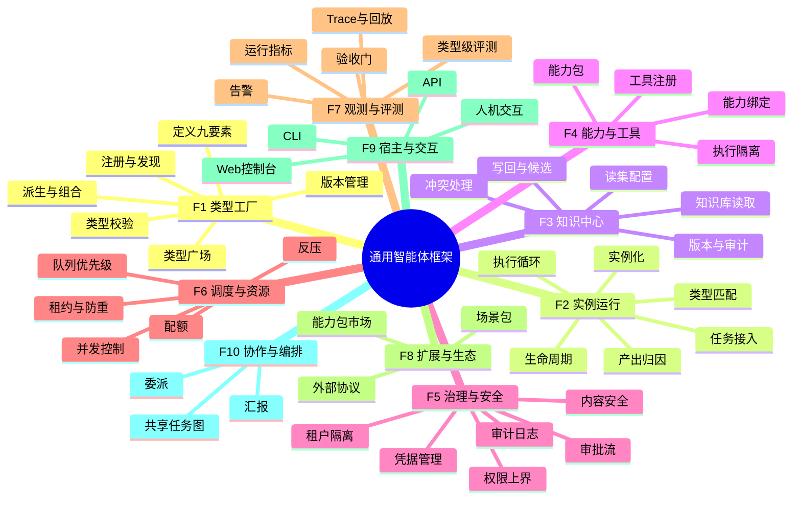

# 通用智能体框架 · 产品功能树与设计方案 v1

> **定位**：从**产品功能视角**回答"这个智能体框架向使用者提供哪些能力"。不含实现、不含技术选型。
> **输入**：[31-核心设计原则](31-核心设计原则-智能体类型-v1.md)（九要素）与 [32-通用 Agent 框架](32-通用Agent框架-v0.md)（九组件）。本文把它们翻译成"用户能看见、能操作、能验收的功能"。
> **与前序文档**：[29-系统设计方案](29-系统设计方案-v1.md) 是"记忆中心"总体方案，其能力已并入本文的 F3 知识中心；[27-功能树](27-功能树-v0.md) 是早期产品向草稿，已作废。
> **第一步交付**：功能树 + 功能域详解 + 优先级 + 用户旅程。第二步（模拟验证）见 [35-类型库-模拟验证](35-类型库-模拟验证-v0.md)。

---

## 0. 摘要（先结论）

**一句话**：把"每次任务都重新拼提示词 + 挑工具 + 抄上下文"变成——**定义一次智能体类型，之后按需实例化无数次**。

**框架的十条功能主线**：

1. **类型工厂**：定义、注册、派生、版本化 agent 类型（"造 agent 的模具"）
2. **实例运行**：把任务变成实例、跑起来、管生命周期（"用模具压出 agent"）
3. **知识中心**：类型声明读什么、写回什么，知识有版本、可审计（"agent 的记忆"）
4. **能力与工具**：工具注册、能力包、执行隔离（"agent 的手"）
5. **治理与安全**：权限上界、审批、租户、审计（"agent 的缰绳"）
6. **调度与资源**：并发、配额、租约、反压（"agent 的体力"）
7. **观测与评测**：指标、trace、类型级评测、验收门（"agent 的成绩单"）
8. **扩展与生态**：能力包、场景包、外部系统接入（"框架的生长"）
9. **宿主与交互**：CLI / Web / API / 人机交互（"人和 agent 的界面"）
10. **协作与编排**：多 agent 委派与协作（预留，另一会话主题）

**MVP 最小闭环（P0）**：F1（类型定义/注册/匹配）+ F2（实例化/执行/归因）+ F3（读集/写域/快照）+ F4（工具注册/越界拒绝）+ F5（权限上界/审批/审计）+ F6（并发/租约）+ F7（指标/验收门）+ F9（一种宿主）。

---

## 1. 产品定位

### 1.1 它是什么

一个**智能体工厂与运行平台**：团队用"类型"描述 agent（它是谁、干什么、能碰什么），平台负责把任务实例化成 agent、跑完、管住、留痕。

### 1.2 它不是什么（划清边界）

| 不是 | 为什么 | 是什么 |
|---|---|---|
| 提示词模板库 | 提示词只是"行为"的一部分 | 类型 = 九要素的完整定义 |
| 工作流编排器 | 编排是"任务之间怎么连"，框架管"任务内 agent 怎么活" | 协作留给 F10 与另一会话 |
| RPA / 脚本平台 | 脚本是确定性的；agent 是决策性的 | 行为规则 + 边界 + 验收 |
| 单一聊天产品 | 聊天是宿主形态之一 | F9 的一种 |
| 模型供应商 | 模型可替换 | 能力/工具/知识层与模型解耦 |

### 1.3 使用者与角色

| 角色 | 关心什么 | 主要用哪些功能域 |
|---|---|---|
| **类型设计者**（专家/架构师） | 类型定义是否清楚、可复用 | F1 类型工厂 |
| **任务发起者**（业务方） | 任务能不能被正确理解、结果能不能验收 | F2 实例运行、F9 宿主 |
| **治理者**（安全/合规/负责人） | 有没有越权、能不能审计、成本可控吗 | F5 治理、F6 调度、F7 观测 |
| **平台运维** | 跑得稳不稳、资源够不够、故障能不能定位 | F6、F7、F9 |
| **扩展开发者** | 能不能加工具/接系统/做场景包 | F4、F8 |

### 1.4 核心价值主张

1. **复用**：定义一次类型，实例化无数次；类型可评、可版本、可派生。
2. **治理**：每个实例的权限、写域、行为都有上界，越界可判、可审批、可审计。
3. **可观测**：任何产出可归因到"类型版本 + 实例 + 证据"，缺证据不算完成。

---

## 2. 功能树总览

### 2.1 思维导图



### 2.2 功能树（缩进版，便于检索与勾选）

```
通用智能体框架
├─ F1 类型工厂
│  ├─ F1.1 类型定义（九要素模板、校验）
│  ├─ F1.2 类型注册与发现（枚举/搜索/详情）
│  ├─ F1.3 类型派生与组合
│  ├─ F1.4 版本管理（历史/差异/回滚）
│  ├─ F1.5 类型校验（检查清单/反模式检测）
│  └─ F1.6 类型广场（模板/示例库）
├─ F2 实例运行
│  ├─ F2.1 任务接入（消息/事件/工作项）
│  ├─ F2.2 类型匹配与路由
│  ├─ F2.3 实例化（快照/租约/预算）
│  ├─ F2.4 执行循环（多步/工具调用/停止条件）
│  ├─ F2.5 生命周期管理（回收/重启/长驻）
│  └─ F2.6 产出归因（类型版本+实例+证据）
├─ F3 知识中心
│  ├─ F3.1 知识库读取（检索/按范围）
│  ├─ F3.2 读集配置（类型声明读什么）
│  ├─ F3.3 写回与候选（私有草稿/候选/合并）
│  ├─ F3.4 版本与审计（谁改了什么）
│  └─ F3.5 冲突处理（显式分歧/人工裁决）
├─ F4 能力与工具
│  ├─ F4.1 工具注册（声明/描述/参数）
│  ├─ F4.2 能力包（按职责打包）
│  ├─ F4.3 执行隔离（超时/取消/重放）
│  └─ F4.4 能力绑定（类型-工具-写域）
├─ F5 治理与安全
│  ├─ F5.1 权限上界（实例权限⊆类型上界）
│  ├─ F5.2 审批流（高风险动作经人）
│  ├─ F5.3 租户隔离（数据与运行隔离）
│  ├─ F5.4 凭据管理（不落明文）
│  ├─ F5.5 审计日志（越权/审批/调用）
│  └─ F5.6 内容安全（不可信输入/外溢）
├─ F6 调度与资源
│  ├─ F6.1 并发控制（全局/类型/租户上限）
│  ├─ F6.2 配额（token/时间/费用）
│  ├─ F6.3 租约与防重（同任务不双跑）
│  ├─ F6.4 队列与优先级（公平/优先）
│  └─ F6.5 反压（过载降速不崩溃）
├─ F7 观测与评测
│  ├─ F7.1 运行指标（数量/耗时/成本/失败率）
│  ├─ F7.2 Trace 与回放（每步可查/可重放）
│  ├─ F7.3 类型级评测（按类型横向比较）
│  ├─ F7.4 验收门（缺证据不算完成）
│  └─ F7.5 告警（异常/越权/成本超限）
├─ F8 扩展与生态
│  ├─ F8.1 能力包市场（安装/组合）
│  ├─ F8.2 场景包（一套策略+类型清单）
│  └─ F8.3 外部协议（与其他系统互联）
├─ F9 宿主与交互
│  ├─ F9.1 CLI（脚本/批处理）
│  ├─ F9.2 Web 控制台（看板/操作）
│  ├─ F9.3 API（外部系统接入）
│  └─ F9.4 人机交互（审批/确认/汇报）
└─ F10 协作与编排（预留）
   ├─ F10.1 委派（向子 agent 派任务）
   ├─ F10.2 汇报（向父 agent 交结果）
   └─ F10.3 共享任务图（多 agent 协同）
```

### 2.3 阅读方式

- **按角色读**：§1.3 表 → 对应功能域；
- **按优先级读**：§5 的 P0/P1/P2；
- **按实现顺序读**：§4 功能→组件映射。

---

## 3. 功能域详解

> 每个功能域统一格式：**一句话 / 使用者 / 功能表 / 关系 / 不做**。功能表中的"验收判据"是**可判定的一句话**，用于评审与 MVP 验收。

### F1 类型工厂（造 agent 的模具）

**一句话**：让设计者用九要素定义一个 agent 类型，注册后能被任务匹配与实例化。

**使用者**：类型设计者（主）、平台运维。

| 功能 | 子功能 | 优先级 | 验收判据 |
|---|---|---|---|
| F1.1 类型定义 | 九要素表单/模板、必填校验、设计说明 | P0 | 缺任一必填要素无法注册 |
| F1.2 注册与发现 | 注册表、枚举、搜索、类型详情 | P0 | 能回答"当前有哪些类型" |
| F1.3 派生与组合 | 类型派生（能力可扩展）、组合（has-a） | P1 | 派生关系可查、边界不放宽 |
| F1.4 版本管理 | 版本历史、差异对比、回滚、实例绑版本 | P0 | 改类型=新版本，旧版本仍可实例化 |
| F1.5 类型校验 | 15 条检查清单、反模式检测、独立评审记录 | P1 | 校验不过不能进"可用"状态 |
| F1.6 类型广场 | 官方/团队模板、示例类型 | P2 | 从模板一键创建 |

**关系**：F1 的输出是 F2 的输入；F1.3 的派生关系由 F1 自己维护（用户已拍板"子类型能扩展能力和数据集，由类型本身决定"）。

**不做**：不负责执行、不存知识本体、不判定具体权限（只声明上界）。

### F2 实例运行（用模具压出 agent）

**一句话**：把外部任务变成实例，按类型跑起来，管生命周期，产出可归因。

**使用者**：任务发起者、平台运维。

| 功能 | 子功能 | 优先级 | 验收判据 |
|---|---|---|---|
| F2.1 任务接入 | 消息/事件/工作项、幂等键、去重 | P0 | 同一请求重复提交不重复执行 |
| F2.2 类型匹配 | 显式指定 + 语义兜底路由 | P1 | 能回答"为什么这个任务给了这个类型" |
| F2.3 实例化 | 绑输入、钉知识快照、发租约、定预算 | P0 | 实例化不复制类型/知识，秒级完成 |
| F2.4 执行循环 | 多步、工具调用、停止条件、失败重试 | P0 | 每步可查、可中断、可恢复 |
| F2.5 生命周期 | 一次性/短驻/长驻三策略、回收 | P0 | 三种策略都可选且行为不同 |
| F2.6 产出归因 | 类型版本+实例+证据链 | P0 | 任一产出能追到"谁、按什么定义、干了什么" |

**关系**：依赖 F1（类型）、F3（知识快照）、F4（工具）、F5（权限）、F6（租约）。

**不做**：不定义类型、不实现调度策略（调用 F6）、不存公共知识（写回走 F3）。

### F3 知识中心（agent 的记忆）

**一句话**：类型声明读集/写域，实例只读快照、只写私有，公共知识经候选写回并留版本。

**使用者**：类型设计者（声明）、任务发起者（受益）、治理者（审计）。

| 功能 | 子功能 | 优先级 | 验收判据 |
|---|---|---|---|
| F3.1 知识库读取 | 按范围检索、按相关度/时间过滤 | P0 | 实例只能读到读集内的内容 |
| F3.2 读集配置 | 类型→读集声明、项目/领域/全局范围 | P0 | 越界读取被拒绝并可解释 |
| F3.3 写回与候选 | 私有草稿、候选提交、审批合并 | P0 | 实例不能直写公共知识 |
| F3.4 版本与审计 | 知识版本、变更历史、回滚 | P1 | 能回答"这条知识谁改的、什么时候" |
| F3.5 冲突处理 | 矛盾标记、显式分歧、人工裁决 | P1 | 冲突不会被静默合并 |

**关系**：29 的"记忆中心"实现可落在这里；F2 的实例化从这里取快照。

**不做**：不存 agent 定义（F1）、不做执行（F2）。

### F4 能力与工具（agent 的手）

**一句话**：工具注册、能力包、执行隔离；能力与类型、写域绑定。

**使用者**：扩展开发者（注册）、类型设计者（绑定）、治理者（审计）。

| 功能 | 子功能 | 优先级 | 验收判据 |
|---|---|---|---|
| F4.1 工具注册 | 声明名/描述/参数/副作用 | P0 | 未注册工具不可调用 |
| F4.2 能力包 | 按职责打包工具 | P1 | 能力包可被类型引用 |
| F4.3 执行隔离 | 超时/取消/重放/收据 | P0 | 写操作有收据、可重放 |
| F4.4 能力绑定 | 类型↔工具↔写域 | P0 | 越界调用被拒 |

**关系**：F5 判定权限、F3 管数据范围、F1 声明能力。

**不做**：不判定权限（F5）、不定义类型（F1）。

### F5 治理与安全（agent 的缰绳）

**一句话**：权限上界、审批、租户隔离、凭据、审计、内容安全——横切所有域。

**使用者**：治理者（主）、平台运维。

| 功能 | 子功能 | 优先级 | 验收判据 |
|---|---|---|---|
| F5.1 权限上界 | 类型上界→实例权限（只收窄） | P0 | 实例权限超类型上界被拒 |
| F5.2 审批流 | 高风险动作挂起待人批准 | P0 | 无审批者时 fail-closed |
| F5.3 租户隔离 | 数据+运行隔离 | P1 | 跨租户不可见/不可调 |
| F5.4 凭据管理 | 凭据池、不落明文、按需注入 | P1 | 凭据不出现在产出/日志 |
| F5.5 审计日志 | 越权/审批/工具调用全记录 | P0 | 任一越权可回放取证 |
| F5.6 内容安全 | 不可信输入、外溢控制 | P1 | 不可信内容不能直接触发高影响动作 |

**关系**：横切 F1–F9；F1 声明边界，F5 判定执行。

**不做**：不做业务逻辑。

### F6 调度与资源（agent 的体力）

**一句话**：并发、配额、租约、队列、反压——让 agent"跑得多但不失控"。

**使用者**：平台运维（主）、治理者（成本）。

| 功能 | 子功能 | 优先级 | 验收判据 |
|---|---|---|---|
| F6.1 并发控制 | 全局/类型/租户并发上限 | P0 | 超限排队而不是压垮 |
| F6.2 配额 | token/时间/费用预算 | P1 | 超预算停止并可解释 |
| F6.3 租约与防重 | 同任务同刻单活跃租约 | P0 | 同一工作项不会双跑 |
| F6.4 队列与优先级 | 公平/优先/插队规则 | P1 | 优先级可验证 |
| F6.5 反压 | 过载降速、熔断 | P1 | 过载时可用性不崩 |

**关系**：F2 调用 F6；F7 观测 F6。

**不做**：不做执行（F2）、不做类型定义。

### F7 观测与评测（agent 的成绩单）

**一句话**：指标、trace、类型级评测、验收门、告警。

**使用者**：治理者、平台运维、类型设计者。

| 功能 | 子功能 | 优先级 | 验收判据 |
|---|---|---|---|
| F7.1 运行指标 | 数量/耗时/成本/失败率/越权数 | P0 | 看板能回答"今天跑了多少、花多少" |
| F7.2 Trace 与回放 | 每步输入输出、可重放 | P1 | 任一失败可定位到步骤 |
| F7.3 类型级评测 | 按类型比较成功率/成本/质量 | P1 | 能回答"哪个类型更划算" |
| F7.4 验收门 | 完成需证据，缺证据不通过 | P0 | 无证据的产出不被签收 |
| F7.5 告警 | 异常/越权/成本超限 | P1 | 异常有通知 |

**关系**：观测 F2/F3/F4/F5/F6；F1 的设计依据来自 F7。

**不做**：不干预执行（门禁除外）。

### F8 扩展与生态（框架的生长）

**一句话**：能力包、场景包、外部协议——让框架能长、能接。

**使用者**：扩展开发者（主）。

| 功能 | 子功能 | 优先级 | 验收判据 |
|---|---|---|---|
| F8.1 能力包市场 | 安装/组合/版本 | P2 | 装上即用、可组合 |
| F8.2 场景包 | 策略选择+类型清单打包 | P2 | 导入场景=得到一套配置 |
| F8.3 外部协议 | 与其他 agent 系统互联 | P2 | 互通不改变骨架语义 |

**关系**：F8 扩展 F1（类型模板）、F4（工具包）；不改骨架。

**不做**：不引入新的核心语义（类型/实例/共享层不变）。

### F9 宿主与交互（人和 agent 的界面）

**一句话**：CLI / Web / API / 人机交互——把功能暴露给人或系统。

**使用者**：全部角色。

| 功能 | 子功能 | 优先级 | 验收判据 |
|---|---|---|---|
| F9.1 CLI | 建类型/发任务/查状态/审批 | P0 | 无 Web 也能完成闭环 |
| F9.2 Web 控制台 | 看板/类型管理/实例追踪 | P1 | 非技术用户能看懂 |
| F9.3 API | 外部系统对接 | P1 | 可被程序调用 |
| F9.4 人机交互 | 审批/澄清/汇报 | P0 | 高风险动作必须经人 |

**关系**：宿主不反向依赖内核；换宿主不改内核。

**不做**：不做业务逻辑、不直接读写知识/类型（走接口）。

### F10 协作与编排（预留）

**一句话**：多 agent 的委派、汇报、共享任务图——另一会话的主题，本框架只留接口位。

**使用者**：后续。

| 功能 | 子功能 | 优先级 | 验收判据 |
|---|---|---|---|
| F10.1 委派 | 向子 agent 派任务 | P2（预留） | 委派关系可追溯 |
| F10.2 汇报 | 子 agent 向父交结果 | P2（预留） | 结果可合并 |
| F10.3 共享任务图 | 多 agent 协同 | P2（预留） | 任务图一致 |

**不做**：本框架不定义协作协议（留给专门设计）。

---

## 4. 功能地图（功能域 → 组件 → 九要素）

| 功能域 | 对应组件（32） | 承载的九要素 | MVP 必须有 |
|---|---|---|---|
| F1 类型工厂 | C1 类型系统 | 身份/职责/能力/知识/行为/边界/接口/生命周期/协作 | 是 |
| F2 实例运行 | C2 实例运行时 | 行为/生命周期/接口 | 是 |
| F3 知识中心 | C3 共享知识层 | 知识（读集/写域） | 是 |
| F4 能力与工具 | C4 工具与能力层 | 能力 | 是 |
| F5 治理与安全 | C5 边界与安全层 | 边界/身份（权限） | 是 |
| F6 调度与资源 | C6 调度与资源层 | 生命周期（资源） | 是 |
| F7 观测与评测 | C7 观测与评测层 | 接口（验收证据） | 是 |
| F8 扩展与生态 | C8 扩展与集成层 | — | 否 |
| F9 宿主与交互 | C9 宿主与接口层 | 接口/身份 | 是（一种宿主） |
| F10 协作与编排 | C8 预留 | 协作 | 否 |

**自检**：十域覆盖九要素、九组件；每个组件至少有一个功能域承载；每个要素至少有一个功能域落实。

---

## 5. 优先级与 MVP

### 5.1 P0 最小闭环（先跑通"定义→实例化→跑完→可审计"）

- F1.1 类型定义、F1.2 注册发现、F1.4 版本
- F2.1 任务接入、F2.3 实例化、F2.4 执行循环、F2.5 生命周期、F2.6 归因
- F3.1 知识读取、F3.2 读集、F3.3 写回候选
- F4.1 工具注册、F4.3 执行隔离、F4.4 能力绑定
- F5.1 权限上界、F5.2 审批、F5.5 审计
- F6.1 并发、F6.3 租约
- F7.1 指标、F7.4 验收门
- F9.1 CLI、F9.4 人机交互

**闭环验收**：用 F1 定义一个类型 → F2 用两条真实任务实例化 → F4 调工具 → F5 拦一次越权 → F3 读快照写候选 → F7 查指标与证据。全程可回放。

### 5.2 P1（治理与体验）

F1.3 派生、F1.5 校验、F2.2 匹配、F3.4 版本审计、F3.5 冲突、F4.2 能力包、F5.3 租户、F5.4 凭据、F5.6 内容安全、F6.2 配额、F6.4 队列、F6.5 反压、F7.2 trace、F7.3 类型级评测、F7.5 告警、F9.2 Web、F9.3 API。

### 5.3 P2（生态与扩展）

F1.6 类型广场、F8.1 市场、F8.2 场景包、F8.3 外部协议、F10 协作（预留）。

---

## 6. 用户旅程（功能串起来的样子）

### 6.1 设计者：建一个"客服 agent"类型

F1.1 填九要素（职责：处理售后咨询；边界：不能承诺退款≥500 元；知识：读售后政策，写回咨询结论）→ F1.5 校验（边界是否可判？能力是否最小？）→ F1.2 注册 → F1.4 版本 v1 → 用 F1.6 模板留档。

### 6.2 业务方：把 100 条消息变成 100 个实例

F2.1 接入 100 条消息（带幂等键）→ F2.2 匹配"客服 agent"→ F2.3 每条实例化（钉知识快照、发租约、定预算）→ F2.4 执行（读政策→分类→回复）→ F5.2 命中"退款≥500"的挂起审批 → F2.6 归因 → F7.1 看板：处理量/耗时/审批数。

### 6.3 治理者：审计一次越权

F7.5 告警"某实例尝试调用未授权工具"→ F5.5 审计日志（谁、哪个类型版本、尝试了什么）→ F5.1 判定（越权，拒绝）→ F7.2 回放→ 结论：类型上界写宽了 → F1.4 新版本收紧 → 旧实例按旧版本归档。

---

## 7. 与 31/32 的关系与待确认

**与 31**：本文每个功能都指向 31 的要素——F1 是九要素的"落地入口"，F2 承载行为/生命周期，F3 承载知识，F4 承载能力，F5 承载边界。

**与 32**：§4 的功能→组件映射确保"组件都有功能承载"；反过来，若某功能找不到组件，说明 32 缺组件（目前没有）。

**待确认**：

1. **功能粒度**：十域是否偏多？F8 与 F10 都是 P2，是否合并为"生态与协作"？
2. **F2.2 类型匹配**：显式指定为主、语义兜底为辅——语义兜底要不要 MVP 就上？（我倾向后置）
3. **F3 写回候选**：MVP 是"只写私有草稿 + 手动提升"，还是直接上候选制？
4. **F9 宿主**：MVP 是否只做 CLI（最快闭环），Web 后置？

**下一步**：第二步模拟验证——用八步创建法批量创建真实类型（见 35），检验功能树是否"够用、不缺、不冗"；同时用 P0 闭环走一遍，验证功能之间没有断点。
